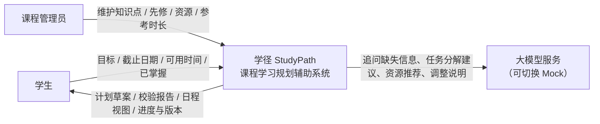
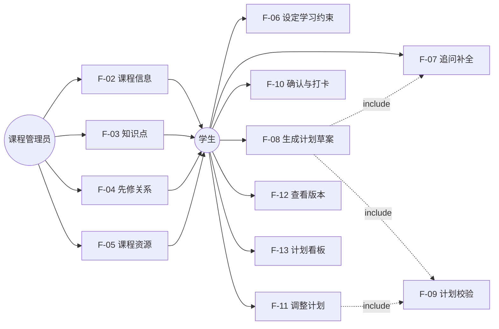

# 学径 StudyPath —— 课程学习规划辅助系统

## 软件需求说明书

| 项目 | 内容 |
|---|---|
| 组　　号 | 第 6 组 |
| 班　　级 | 软件工程 2 班 |
| 组　　长 | 王昱涵 |
| 小组成员 | 李鸿佑、李俊达、项奕乔 |
| 指导教师 | 张德珍 |
| 日　　期 | 2026 年 10 月 26 日 |
| 文档版本 | v0.9（征求意见稿） |

---

## 1 引言

### 1.1 编写目的

本文档定义「学径 StudyPath——课程学习规划辅助系统」的功能需求、性能需求、输入输出要求与运行环境要求，作为概要设计、详细设计、编码实现与测试验收的共同依据。

预期读者：

| 读者 | 关注章节 |
|---|---|
| 项目组成员 | 全文，重点是第 3 章需求规定 |
| 指导教师（评审） | 1.2、2.1、3.1、附录 B 需求追踪矩阵 |
| 测试与验收人员 | 3.1 各功能的验收要点、3.3、3.5 |
| 后续维护人员 | 2.3 假定与约束、3.4、4 运行环境规定 |

### 1.2 背景

**a. 待开发的软件系统名称**

学径 StudyPath —— 课程学习规划辅助系统（以下简称"本系统"）。

**b. 任务提出者、开发者与用户**

| 项 | 说明 |
|---|---|
| 任务提出者 | 《软件工程综合实训》课程组 |
| 开发者 | 软件工程 2 班 第 6 组（王昱涵、李鸿佑、李俊达、项奕乔） |
| 直接用户 | 修读单门课程的高校学生 |
| 间接用户 | 维护课程内容的课程管理员（本项目中由课程任课教师或助教担任） |
| 运行环境 | 本地部署的 Web 应用（浏览器访问），单机 SQLite 存储 |

**c. 与其他系统的关系**

本系统为**独立系统**，不依赖学校教务系统、学习管理系统或第三方账号体系，全部业务数据自包含。对外仅有一个可选依赖：大语言模型服务（通过统一的 Provider 接口调用，可切换为本地 Mock 实现，切换后系统功能完整可用，仅语言生成质量下降）。

表 1.1 项目背景规划

| 项目 | 内容 |
|---|---|
| 项目名称 | 学径 StudyPath |
| 项目类型 | 课程实践项目（自选题目） |
| 开发周期 | 2026-10-26 至 2026-11-20，共 4 周 / 120 学时 |
| 团队规模 | 4 人 |
| 目标课程 | Python 程序设计（示例课程，由课程管理员维护） |
| 主要交付物 | 可运行系统 + 18 类开发文档 + 演示 PPT |

**问题背景**：在单门课程的学习中，学生常见的问题不是"没有资源"，而是**资源与时间对不上**——不知道从哪个知识点开始、不知道每个知识点要花多久、不知道在截止日期前是否学得完。教师的课程大纲给出的是知识点清单与章节顺序，学生需要自己把它翻译成"哪天学什么、每天学多久"的可执行安排，这一步几乎全靠个人经验，且一旦落后就很难自我纠正。

本系统把这一步显式化：由课程管理员维护结构化的课程内容（知识点、先修关系、资源、参考时长），由学生给出目标与时间约束，由系统**用程序算出**一份可执行、可校验、可调整、可追溯的学习计划。

### 1.3 定义

**专门术语**

| 术语 | 定义 |
|---|---|
| 知识点（Concept） | 课程内容的最小学习单元，具备难度、参考学习时长、学习目标与常见错误等属性 |
| 先修关系（Prerequisite） | 知识点之间的有向依赖：学习 B 之前必须先完成 A，记为 A → B。本系统仅支持 AND 语义 |
| 参考学习时长 | 课程管理员为一个知识点设定的、中等水平学生完成学习所需的分钟数，是计划时长的基准值 |
| 学习约束（Constraints） | 学生给出的规划输入：目标知识点、截止日期、可用时间（周模板 + 排除日期）、已掌握知识点 |
| 计划任务（Plan Task） | 计划的最小执行单元，一个知识点拆为「学习」「练习」两类任务，任务具备预计时长、计划时段、状态 |
| 时间容量 | 在给定区间内，学生可用时间总和；容量校验即比较"任务总需求时长"与"可用总时长" |
| 时段重叠 | 同一学生在同一时间被安排了两个及以上任务 |
| 先修违反 | 计划中某任务的开始时间早于其先修任务的结束时间 |
| 截止不可达 | 按排程结果，最后一个任务的结束时间晚于截止日期 |
| 计划版本（Plan Version） | 每次计划确认或调整生效时生成的不可变快照，记录变更原因与差异 |
| 智能体（Agent） | 承担单一职责的大模型调用单元，本系统含约束收集、计划编排、资源调度、调整建议四类 |
| 确定性引擎 | 不含大模型、结果可复现的计算模块，本系统含排程引擎与校验引擎 |

**缩写**

| 缩写 | 全称 | 说明 |
|---|---|---|
| LLM | Large Language Model | 大语言模型 |
| WBS | Work Breakdown Structure | 工作分解结构 |
| MVP | Minimum Viable Product | 最小可行产品 |
| JWT | JSON Web Token | 登录凭证格式 |
| SSE | Server-Sent Events | 服务端推送（用于追问的流式输出） |
| IPO | Input-Process-Output | 输入-处理-输出表 |

### 1.4 参考资料

1. GB/T 8567—1988《计算机软件产品开发文件编制指南》
2. IEEE/ANSI 830—1993《软件需求规格说明指南》
3. 《软件工程综合实训》课程组：《软件工程综合实训安排》，2026-10-26
4. 《软件工程综合实训》课程组：《开发进度管理表》，2026-10-26
5. 本项目《需求确认单》，2026-10-26（见 `docs/09_过程记录/`）
6. 《学径 StudyPath 项目开发计划书》（D01）
7. 张海藩、牟永敏：《软件工程导论》（第 6 版），清华大学出版社

---

## 2 任务概述

### 2.1 目标

**系统定位**：面向**单门课程**的学习规划辅助工具。它不替代课程教学，也不生产教学内容，而是解决"把课程大纲变成个人可执行日程"这一环节。

**核心价值主张**：让每一份学习计划都**可解释、可校验、可调整、可追溯**。

- 可解释：每个任务为什么在这个时间、为什么推荐这份资源，都有依据；
- 可校验：容量、重叠、先修、截止四项约束由程序判定，不依赖模型判断；
- 可调整：延后或目标变化时，系统给出差异化的新方案而非推倒重来；
- 可追溯：每次调整都留有版本与原因，学生能看到"我的计划是怎么变过来的"。

**系统上下文**



**系统边界**

| 在系统内 | 在系统外（不做） |
|---|---|
| 课程内容的结构化管理 | 课程视频托管与转码 |
| 学习计划的生成、校验、调整、版本 | 教学内容的自动生成 |
| 任务级进度记录 | 考试成绩管理与学分认定 |
| 计划相关的智能体对话 | 与教务系统对接、跨课程统计 |

### 2.2 用户的特点

表 2.1 用户特征

| 角色 | 教育水平 | 技术专长 | 使用频度 | 关键诉求 |
|---|---|---|---|---|
| 学生 | 本科在读，具备基本计算机操作能力 | 会使用浏览器与常见 Web 应用，不了解系统内部机制 | 计划制定期每天 1–2 次；执行期每天 1 次（打卡） | 少填表、计划要"排得下"、落后时知道怎么办 |
| 课程管理员 | 教师或助教，熟悉课程内容 | 能使用后台表格录入，不写代码 | 学期初集中录入（1–2 次），学期中偶发修订 | 录入效率、先修关系不能出错、改动要能生效 |

**由此产生的设计约束**：

1. 学生端**不能是长表单**——目标与时间约束优先通过对话收集，表单作为兜底；
2. 管理员端**必须是表格化批量操作**，且先修关系保存时即时校验成环；
3. 所有"系统建议"必须给学生**是否采纳**的选择权，不允许悄悄改计划。

### 2.3 假定和约束

| 编号 | 类型 | 内容 |
|---|---|---|
| AS-01 | 假定 | 学生愿意如实填写可用时间；系统不校验其真实性 |
| AS-02 | 假定 | 课程管理员维护的知识点与先修关系是领域正确的，系统只校验结构（成环、孤立点），不校验学科正确性 |
| AS-03 | 假定 | 学生的学习以"知识点"为最小单位，不存在必须跨知识点才能完成的任务 |
| CS-01 | 约束 | 开发周期 4 周 / 120 学时，团队 4 人，须与课程进度表同步 |
| CS-02 | 约束 | 单机部署，SQLite 存储，不做分布式与高并发设计 |
| CS-03 | 约束 | 只面向 1 门课程（Python 程序设计），数据模型保留多课程字段但不实现切换 |
| CS-04 | 约束 | 不做移动端适配，以 1366×768 及以上桌面浏览器为基准 |
| CS-05 | 约束 | 大模型为非必需依赖，离线 Mock 模式下系统主流程必须完整可用 |
| CS-06 | 约束 | 排程与校验不得调用大模型，以保证结果确定、可复现、可单测 |
| CS-07 | 约束 | 遵循 GB/T 8567 文档规范与本课程文档模板 |

---

## 3 需求规定

### 3.1 对功能的规定

#### 3.1.1 功能总览

系统共 13 项功能，分为「课程内容」「学习规划」「执行跟踪」三组。

表 3.1 功能清单

| 编号 | 功能名称 | 主要角色 | 对应选题要求 | 优先级 |
|---|---|---|---|---|
| F-01 | 登录与角色识别 | 学生 / 管理员 | — | P0 |
| F-02 | 课程基本信息维护 | 管理员 | ① | P0 |
| F-03 | 知识点维护（含参考学习时长） | 管理员 | ① | P0 |
| F-04 | 先修关系维护（含成环校验） | 管理员 | ① | P0 |
| F-05 | 课程资源维护与关联 | 管理员 | ① | P0 |
| F-06 | 学习约束设定 | 学生 | ② | P0 |
| F-07 | 智能体追问与约束补全 | 学生 | ③ | P0 |
| F-08 | 任务分解与计划草案生成 | 学生 | ③ | P0 |
| F-09 | 计划校验（容量 / 重叠 / 先修 / 截止） | 系统 | ④ | P0 |
| F-10 | 计划确认与进度记录 | 学生 | ⑤ | P0 |
| F-11 | 计划调整（延期 / 目标变更） | 学生 | ⑥ | P0 |
| F-12 | 计划版本与差异追溯 | 学生 | ⑦ | P0 |
| F-13 | 计划看板与日历视图 | 学生 | 支撑 | P1 |



---

#### 3.1.2 F-01 登录与角色识别

**描述**：学生与管理员使用账号密码登录，系统据角色决定可见功能。

| 项 | 内容 |
|---|---|
| 输入 | 用户名、密码 |
| 处理 | ① 校验用户名存在；② 校验密码（bcrypt 比对）；③ 生成 JWT（含 `user_id`、`role`，有效期 24h）；④ 记录登录时间 |
| 输出 | `{ access_token, token_type, username, role }` |

**业务规则**

- BR-01-1：用户名唯一，长度 3–32，仅允许字母、数字、下划线、中文；
- BR-01-2：密码长度 ≥ 8，须含字母与数字；
- BR-01-3：学生访问管理员接口返回 403；管理员可访问全部接口；
- BR-01-4：连续 5 次密码错误锁定 5 分钟。

**验收要点**

1. 用错误密码登录 5 次后，第 6 次即使密码正确也返回"账号已锁定"；
2. 用学生令牌调用 `POST /api/admin/concepts` 返回 403；
3. 未登录访问 `/api/plans` 返回 401。

---

#### 3.1.3 F-02 课程基本信息维护

**描述**：管理员维护课程名称、简介、学期、课程封面文字等基本信息（单课程场景下为"编辑"而非"新建"）。

| 项 | 内容 |
|---|---|
| 输入 | 课程名称、课程简介、学期、总学时、状态（启用/停用） |
| 处理 | 校验必填项 → 保存 → 清除课程信息缓存 |
| 输出 | 更新后的课程对象 |

**验收要点**：修改课程简介后，学生端课程首页在刷新后显示新简介。

---

#### 3.1.4 F-03 知识点维护

**描述**：管理员对课程知识点做增删改查，并设置参考学习时长。

| 项 | 内容 |
|---|---|
| 输入 | 名称、章节、难度（1–5）、参考学习时长（分钟）、学习目标（0–5 条）、常见错误（0–5 条）、排序号、状态 |
| 处理 | ① 字段校验（时长 5–600 分钟、难度 1–5）；② 同课程内名称唯一性校验；③ 保存；④ 若知识点被已确认计划引用，删除时改为"停用" |
| 输出 | 知识点列表 / 单条详情 |

**业务规则**

- BR-03-1：被未归档计划引用的知识点不可物理删除，只能停用；
- BR-03-2：停用知识点在新建计划时不可选，在历史计划中仍正常显示；
- BR-03-3：参考学习时长默认 30 分钟，取值 5–600。

**验收要点**

1. 输入时长 0 或 700 时保存失败并提示范围；
2. 新建同名知识点提示"该课程下已存在同名知识点"；
3. 删除被引用知识点时，系统改为停用并提示影响范围（N 份计划）。

---

#### 3.1.5 F-04 先修关系维护

**描述**：管理员为知识点建立先修关系（A → B 表示学 B 前须完成 A）。

| 项 | 内容 |
|---|---|
| 输入 | 先修知识点、后继知识点、依赖强度（0.1–1.0，默认 0.8） |
| 处理 | ① 自依赖校验（A ≠ B）；② **成环检测**（DFS）；③ 重复边校验；④ 保存 |
| 输出 | 先修关系列表 + 校验结果 |

**业务规则**

- BR-04-1：图必须为有向无环图，检测到环时拒绝保存并指出环路（如 A → B → C → A）；
- BR-04-2：同一对 (A, B) 只允许一条边；
- BR-04-3：允许孤立知识点（无先修也无后继），但列表中标黄提示。

**验收要点**

1. 已存在 A→B、B→C，再添加 C→A 时保存被拒绝，提示环路 `A → B → C → A`；
2. 添加自依赖 A→A 被拒绝；
3. 孤立知识点在列表中可见且有提示标记。

---

#### 3.1.6 F-05 课程资源维护与关联

**描述**：管理员录入学习资源并挂接到一个或多个知识点。

| 项 | 内容 |
|---|---|
| 输入 | 标题、类型（文档/视频/练习/链接）、URL 或正文摘要、预计阅读时长、关联知识点（多选）、状态 |
| 处理 | ① URL 格式校验；② 关联关系写入；③ 资源可被计划任务推荐 |
| 输出 | 资源列表 / 按知识点的资源清单 |

**业务规则**

- BR-05-1：一个资源可关联多个知识点，一个知识点可有多份资源；
- BR-05-2：资源不计入任务时长，仅作为任务内的推荐材料展示（避免"阅读资源"与"学习任务"重复计时）；
- BR-05-3：资源无关联知识点时保存失败（避免成为孤儿数据）。

**验收要点**

1. 保存未选知识点的资源时提示"请至少关联一个知识点"；
2. 在计划任务详情里能看到该知识点关联的全部资源；
3. 资源被删除后，历史计划中该任务显示"资源已移除"而非报错。

---

#### 3.1.7 F-06 学习约束设定

**描述**：学生填写规划所需的三类输入（目标、时间、基础）。

| 项 | 内容 |
|---|---|
| 输入 | ① 主目标知识点（必填）+ 附加知识点（可多选）；② 截止日期；③ 可用时间周模板（周一至周日 × 0–3 段起止时间）+ 排除日期；④ 已掌握知识点（多选） |
| 处理 | ① 校验目标知识点存在且未掌握；② 校验截止日期 ≥ 明天；③ 校验周模板总时长 > 0；④ 校验排除日期不与截止冲突；⑤ 保存为约束对象 |
| 输出 | 约束对象 `PlanningConstraints` + 可用总时长估算 |

**业务规则**

- BR-06-1：截止日期不得早于次日，且不超过 180 天；
- BR-06-2：单日可用时段不得超过 8 小时，时段之间不得重叠；
- BR-06-3：已掌握知识点不计入计划；若主目标已被标记为已掌握，提示"该知识点已标记为掌握，是否更换目标？"；
- BR-06-4：约束保存后可修改，修改会触发 F-11 的调整评估。

**验收要点**

1. 截止日期填昨天，保存失败并提示；
2. 周模板全部留空时保存失败；
3. 已掌握勾选"变量与赋值"，生成计划中不出现该知识点；
4. 系统在保存后立即显示"从 10-27 到 11-10 共 15 天，可用 22.5 小时"。

---

#### 3.1.8 F-07 智能体追问与约束补全

**描述**：当学生缺少关键信息（目标、截止、可用时间）时，由**约束收集智能体**通过对话追问，而不是抛给对方一张空白表单。

| 项 | 内容 |
|---|---|
| 输入 | 学生自然语言输入、当前已收集的约束、缺失字段清单 |
| 处理 | ① 从对话中抽取字段（显式抽取 + 相对日期归一化，如"下周五"→具体日期）；② 与已收集约束合并；③ 判断还缺哪些必填项；④ 生成下一个问题（一次只问 1–2 个）；⑤ 信息齐备后输出完整约束并请求确认 |
| 输出 | `{ reply, extracted: {...}, missing: [...], constraints, ready: bool }` |

**业务规则**

- BR-07-1：**一次最多追问 2 个字段**，避免"问卷化"；
- BR-07-2：抽取结果必须回显给学生确认（"我理解为：截止 11 月 10 日，每周一三五晚 19:00–21:00，对吗？"）；
- BR-07-3：无法抽取时给出候选值（如"本月末 / 下月中 / 自定义"），而不是重复提问；
- BR-07-4：大模型超时或不可用时，降级为结构化表单，学生填完效果等价；
- BR-07-5：抽取结果写入约束前必须通过 F-06 的全部校验。

**验收要点**

1. 只说"我想两周内学会函数"，系统追问"每天能投入多久"，并把"两周"归一化为具体日期；
2. 大模型服务断开时，界面自动切到表单模式且可继续完成规划；
3. 追问轮次超过 5 轮仍未齐备时，提示"也可以直接在表单里填写"。

---

#### 3.1.9 F-08 任务分解与计划草案生成

**描述**：把"从已掌握到目标"的知识点集合，分解为带时长的任务，并排到具体时间上，生成计划草案。

| 项 | 内容 |
|---|---|
| 输入 | 约束对象、课程知识点集合、先修关系、学生已掌握集合 |
| 处理 | ① **确定知识点集合**：对目标知识点做先修闭包，减去已掌握集合；② **拓扑排序**确定任务顺序；③ **任务分解**：每知识点拆「学习」「练习」两任务，时长 = 参考时长 × 难度/掌握度修正系数 × 学习:练习比例；④ **排程**（排程引擎）：按可用时段顺序装箱，预留 10% 缓冲；⑤ 生成计划草案（状态=草稿） |
| 输出 | `PlanDraft{ tasks[], summary{ total_minutes, span_days, utilization } }` |

**业务规则**

- BR-08-1：知识点集合必须包含目标知识点本身；
- BR-08-2：已掌握集合中的知识点及其"仅被它独占"的后继不再生成任务；
- BR-08-3：单个任务时长上限 120 分钟，超过则拆分为多个连续时间片；
- BR-08-4：同一知识点内的「学习」任务必须早于「练习」任务；
- BR-08-5：排程只使用未来时间（> 当前时间），不使用过去时段；
- BR-08-6：草案生成不落库为正式计划，须经 F-10 确认。

**验收要点**

1. 目标为"文件操作"、已掌握"变量与赋值"时，草案包含两者之间的全部先修知识点；
2. 任务顺序满足先修关系（可用 F-09 校验验证）；
3. 生成 30 个知识点的计划耗时 ≤ 1 秒。

---

#### 3.1.10 F-09 计划校验

**描述**：由**校验引擎**（纯程序）对计划做四项确定性检查，输出可解释的校验报告。

| 项 | 内容 |
|---|---|
| 输入 | 计划（任务列表 + 时段）、约束对象、先修关系 |
| 处理 | ① 容量校验：Σ任务时长 vs Σ可用时长（含缓冲）；② 重叠校验：任意两任务时段相交；③ 先修校验：任务的开始时间不得早于其所有先修任务的结束时间；④ 截止校验：最后任务结束时间 vs 截止日期 |
| 输出 | `ValidationReport{ passed, issues[]{ code, severity, message, suggestions[], affected_tasks[] }, metrics }` |

**问题码**

| 码 | 问题 | 严重级 | 建议动作 |
|---|---|---|---|
| `CAP_EXCEEDED` | 任务总时长超出可用时长 | ERROR | 缩短任务时长 / 顺延截止 / 删减附加知识点 |
| `TIME_OVERLAP` | 两个任务时段重叠 | ERROR | 自动错开 / 手动调整 |
| `PREREQ_VIOLATED` | 任务早于其先修任务 | ERROR | 后移该任务 / 重排 |
| `DEADLINE_UNREACHABLE` | 排程结束晚于截止日期 | ERROR | 延长每日时长 / 顺延截止 / 降低目标 |
| `CAP_TIGHT` | 可用时长利用率 > 90% | WARN | 建议预留缓冲 |
| `ISOLATED_CONCEPT` | 目标知识点无先修也无后继 | INFO | 提示可跳过前置检查 |

**业务规则**

- BR-09-1：校验必须在 **200 ms** 内返回（50 个任务规模）；
- BR-09-2：校验不通过**不阻止**计划生成，但界面须高亮冲突任务并展示建议；
- BR-09-3：每个 ERROR 级问题至少给出 2 条建议动作；
- BR-09-4：校验结果随计划一并存储，供版本对比与答辩复现。

**验收要点**

1. 构造"5 个知识点 / 每天 30 分钟 / 3 天后截止"的场景，必须返回 `CAP_EXCEEDED` 与 `DEADLINE_UNREACHABLE`；
2. 人为把「练习」任务移到「学习」任务之前，必须返回 `PREREQ_VIOLATED` 并指出两个任务；
3. 同一时段放两个任务，必须返回 `TIME_OVERLAP`；
4. 校验函数为纯函数，相同输入两次调用结果完全一致（可单测断言）。

---

#### 3.1.11 F-10 计划确认与进度记录

**描述**：学生确认草案后计划生效；执行期逐任务记录完成情况。

| 项 | 内容 |
|---|---|
| 输入 | 确认操作；任务打卡（任务 ID、是否完成、实际用时、备注） |
| 处理 | ① 确认时生成版本 v1 并置状态"执行中"；② 打卡更新任务状态与实际用时；③ 汇总计算计划完成率 |
| 输出 | 计划状态、完成率、剩余任务 |

**业务规则**

- BR-10-1：确认前可反复重新生成，不产生版本；
- BR-10-2：已完成任务不可修改计划时段，如确需修改须走 F-11；
- BR-10-3：实际用时允许为空，为空时按预计时长计入统计并在报表中标"估算"；
- BR-10-4：全部任务完成或超过截止日期后，计划状态转为"已完成"。

**验收要点**

1. 确认草案后版本号从无到 v1，状态为"执行中"；
2. 打卡两个任务后完成率显示为"2/N"；
3. 尝试修改已完成任务的时段，被拒绝并提示走调整流程。

---

#### 3.1.12 F-11 计划调整

**描述**：当出现延后、目标变化或可用时间变化时，重新排程并给出差异化的新计划。

| 项 | 内容 |
|---|---|
| 输入 | 触发原因（手动 / 延期 / 目标变更 / 时间变更）、新的约束或新目标 |
| 处理 | ① 收集未完成任务；② 重新执行 F-08 排程（保留已完成任务作为既成事实）；③ 与旧计划做差异计算；④ **调整建议智能体**生成"为什么这样调"的自然语言说明；⑤ 学生确认后生成新版本 |
| 输出 | `PlanDiff{ added[], removed[], moved[], resized[], summary }` + 调整说明 + 新版本 |

**业务规则**

- BR-11-1：已完成任务不得移动或删除，只参与先修判断；
- BR-11-2：系统自动检测延期的阈值为"计划结束时间已过当前时间 ≥ 2 天"；
- BR-11-3：调整必须经学生确认才生效，未确认则保留原计划；
- BR-11-4：每条调整须记录 `change_reason`（枚举：delay / goal_change / availability_change / manual）；
- BR-11-5：目标变更时，已完成的旧目标相关任务保留在版本历史中，不并入新计划。

**验收要点**

1. 把系统时间推后 3 天并标记 2 个任务未完成，系统提示"检测到计划延期，是否调整"；
2. 调整后差异列表准确列出被移动的任务与新的时段；
3. 未确认时刷新页面，计划仍为旧版本。

---

#### 3.1.13 F-12 计划版本与差异追溯

**描述**：查看计划的历史版本及各版本之间的差异与调整原因。

| 项 | 内容 |
|---|---|
| 输入 | 计划 ID、版本号（可选） |
| 处理 | 读取版本快照 → 与前一版本做差异 → 输出时间线 |
| 输出 | `versions[]{ version, created_at, change_reason, diff_summary, operator }` |

**业务规则**

- BR-12-1：版本只增不改，不可编辑、不可删除；
- BR-12-2：每个版本保存完整快照（任务列表 + 校验结果），不保存增量；
- BR-12-3：版本对比支持"当前 vs 任意历史版本"。

**验收要点**

1. 经过 2 次调整后，版本列表显示 v1、v2、v3 及各自原因；
2. 选择 v1 与 v3 对比，能列出新增、删除、时间变化的任务；
3. 旧计划被新版本替换后状态为"已归档"，不可再打卡。

---

#### 3.1.14 F-13 计划看板与日历视图

**描述**：以日历 / 时间轴形式呈现计划，任务按状态着色，冲突任务标红。

| 项 | 内容 |
|---|---|
| 输入 | 计划数据、校验报告、当前日期 |
| 处理 | 按日期分组渲染；状态着色（未开始/已完成/已逾期/冲突）；点击任务展开资源与详情 |
| 输出 | 可视化看板 |

**业务规则**

- BR-13-1：逾期未完成任务以红色边框标识；
- BR-13-2：冲突任务同时显示校验问题码的简短说明；
- BR-13-3：看板默认展示"今天 ± 7 天"，可切换全周期视图。

**验收要点**

1. 未开始 / 已完成 / 逾期 / 冲突四种状态在同一屏可区分；
2. 点击任务卡片能看到该知识点的资源清单与预计/实际用时。

---

### 3.2 对性能的规定

#### 3.2.1 精度

| 数据项 | 精度要求 |
|---|---|
| 时长 | 以分钟为整数单位，最小 15 分钟；展示时超过 60 分钟换算为"X 小时 Y 分钟" |
| 日期 | 精确到天，格式 `YYYY-MM-DD`；时间段精确到分钟 `HH:mm` |
| 完成率 | 百分比保留 1 位小数 |
| 利用率（容量） | 百分比保留 1 位小数，计算基准为任务总时长 ÷ 可用总时长 |
| 掌握度（如启用） | 0–1 之间小数，保留 4 位 |

#### 3.2.2 时间特性要求

表 3.2 响应时间指标（本地部署，单用户）

| 操作 | 指标 | 说明 |
|---|---|---|
| 页面首屏渲染 | ≤ 2 s | 不含大模型调用 |
| 计划生成（F-08） | ≤ 1 s | 50 个任务规模，纯程序计算 |
| 计划校验（F-09） | ≤ 200 ms | 同上 |
| 约束保存（F-06） | ≤ 300 ms | 含校验 |
| 智能体追问单轮（F-07） | ≤ 10 s | 超出则降级为表单 |
| 调整建议生成（F-11） | ≤ 10 s | 仅生成说明文案，排程独立计算 |
| 打卡写入（F-10） | ≤ 200 ms | — |
| 版本对比（F-12） | ≤ 500 ms | 3 个版本以内 |

#### 3.2.3 灵活性

| 变化类型 | 系统的适应能力 |
|---|---|
| 课程更换 | 知识库由管理员录入，换课程只需重建内容，代码无需改动；数据模型已含 `course_id` |
| 任务粒度调整 | 「学习:练习」比例、单任务时长上限、缓冲比例均为配置项 |
| 排程策略调整 | 排程引擎以策略对象注入，可替换为"按难度优先""按截止倒排"而不改调用方 |
| 校验规则增减 | 校验器采用规则注册机制，新增规则不影响既有规则 |
| 大模型更换 | Provider 接口统一，支持 DeepSeek / 星火 / Mock 切换，业务层无感知 |
| 精度变化 | 若需精确到半小时，仅调整时间片常量与前端展示 |

### 3.3 输入输出要求

#### 3.3.1 主要输入

表 3.3 学习约束输入字段

| 字段 | 类型 | 必填 | 取值范围 / 格式 | 校验规则 |
|---|---|---|---|---|
| `target_concept_id` | 整数 | 是 | 课程内启用知识点 | 不可为已掌握 |
| `extra_concept_ids` | 整数数组 | 否 | 0–10 个 | 同上，去重 |
| `deadline` | 日期 | 是 | `YYYY-MM-DD`，≥ 次日，≤ +180 天 | 与排除日期不冲突 |
| `availability` | 数组 | 是 | `{weekday: 1–7, start: "HH:mm", end: "HH:mm"}`，单日 ≤ 3 段 | 段内 start < end；同日段间不重叠；单日合计 ≤ 8h |
| `excluded_dates` | 日期数组 | 否 | 0–30 个 | 须落在 [今天, deadline] 内 |
| `mastered_concept_ids` | 整数数组 | 否 | 0–全部知识点 | — |

#### 3.3.2 主要输出

计划草案 JSON 结构（节选）：

```json
{
  "plan_id": 1024,
  "status": "draft",
  "constraints": {
    "deadline": "2026-11-10",
    "total_available_minutes": 1350
  },
  "summary": {
    "task_count": 18,
    "total_minutes": 1120,
    "utilization": 0.83,
    "span_days": 15
  },
  "tasks": [
    {
      "task_id": 9001,
      "concept": "函数定义与调用",
      "type": "study",
      "estimated_minutes": 45,
      "scheduled_date": "2026-10-28",
      "start_time": "19:00",
      "end_time": "19:45",
      "prerequisite_task_ids": [8990],
      "resources": [{"title": "函数基础讲义", "type": "document", "url": "..."}]
    }
  ],
  "validation": {
    "passed": false,
    "issues": [
      {
        "code": "DEADLINE_UNREACHABLE",
        "severity": "ERROR",
        "message": "按当前排程，最后一个任务结束于 11-12，晚于截止日期 11-10，超出 2 天。",
        "suggestions": ["把每日可用时长从 60 分钟增加到 90 分钟", "把截止日期顺延至 11-12", "移除附加知识点「装饰器」"],
        "affected_tasks": [9001, 9002]
      }
    ]
  }
}
```

#### 3.3.3 输出格式约定

| 项 | 约定 |
|---|---|
| 字符编码 | UTF-8 |
| 接口格式 | REST + JSON；流式对话使用 SSE（`text/event-stream`） |
| 时间格式 | 日期 `YYYY-MM-DD`，时间 `HH:mm`，时间戳 ISO 8601 带时区 |
| 金额 / 时长 | 时长统一为分钟整数，前端负责换算显示 |
| 错误响应 | `{ "code": "E1001", "message": "人话描述", "field": "deadline", "detail": "..." }` |

表 3.4 主要错误码

| 码 | 含义 | 触发场景 |
|---|---|---|
| `E1001` | 参数校验失败 | 字段越界、格式错误 |
| `E1002` | 资源不存在 | 知识点 / 计划 ID 无效 |
| `E1003` | 状态不允许 | 对已归档计划打卡 |
| `E2001` | 先修成环 | 保存先修关系 |
| `E2002` | 目标已掌握 | 目标知识点在已掌握集合内 |
| `E3001` | 大模型不可用 | Provider 调用失败（系统应降级而非抛出） |
| `E4001` | 未认证 | 无 token 或 token 过期 |
| `E4003` | 越权 | 学生调用管理员接口 |

### 3.4 数据管理能力要求

表 3.5 数据量估算（单课程、单学期）

| 数据对象 | 记录数（估算） | 单条大小 | 增长趋势 |
|---|---|---|---|
| 用户 | 50 | < 1 KB | 线性，学期重置 |
| 课程 | 1 | < 2 KB | 固定 |
| 知识点 | 30 | ~1 KB | 学期初集中增长 |
| 先修关系 | 40 | < 0.2 KB | 随知识点增长 |
| 课程资源 | 60 | ~1 KB | 学期初集中增长 |
| 学习计划 | 200 | ~2 KB | 每学生每课程 1–3 份 |
| 计划任务 | 3 000 | ~0.5 KB | 随计划线性增长 |
| 计划版本 | 400 | ~8 KB（快照） | 每次调整 +1 |
| 学习约束 | 200 | ~1 KB | 与计划同比 |

- 存储规模：单学期数据库 < 20 MB，SQLite 单文件足够；
- 保留策略：计划与版本永久保留（用于追溯），学习事件保留 1 个学期，日志保留 30 天；
- 备份策略：每日自动备份数据库文件，保留最近 7 份。

### 3.5 故障处理要求

表 3.6 故障与处理

| 故障 | 影响 | 处理要求 |
|---|---|---|
| 大模型超时 / 不可用 | 追问与调整说明不可用 | 5 秒内切换为表单/模板文案；不阻塞计划生成与校验；界面提示"AI 暂不可用，已切换为手动模式" |
| 大模型返回格式错误 | 抽取结果无法解析 | 重试 1 次；仍失败则丢弃本次抽取，保留已填内容，不清空学生输入 |
| 排程无解（容量严重不足） | 无法给出可行计划 | 仍输出"最接近可行"的排程 + 明确问题码，并建议"顺延截止 / 减少目标 / 增加时长" |
| 先修图成环（历史数据） | 拓扑排序失败 | 排程前做环检测，若发现环则提示"课程先修关系存在环，请联系管理员"，列出环路 |
| 数据库被占用（并发写） | 打卡失败 | 开启 WAL 模式 + 3 秒忙等待；失败返回 `E1005` 并提示重试 |
| 浏览器刷新丢失未保存输入 | 学生重填 | 表单与对话草稿自动存入 `localStorage`，页面重载后恢复 |
| 服务异常退出 | 会话中断 | 计划与约束均落库，重新登录后从"执行中"恢复 |

### 3.6 其他专门要求

| 编号 | 要求 | 说明 |
|---|---|---|
| OR-01 | 安全性 | 密码 bcrypt 存储（cost ≥ 10）；JWT 签名密钥通过环境变量注入，禁止硬编码；所有写接口做角色与资源归属校验 |
| OR-02 | 隐私 | 仅采集学习相关数据（目标、时间、进度），不采集设备指纹、位置；不向第三方传输学生数据（大模型调用仅传递知识点与时长等非个人化内容） |
| OR-03 | 可维护性 | 阈值（缓冲比例、延期判定天数、时间片）全部配置化；关键函数具备单元测试；接口变更须同步《详细设计》 |
| OR-04 | 可演示性 | 必须支持离线演示：一键切换 Mock 模式，全流程可走通；演示数据可一键重建 |
| OR-05 | 可追溯性 | 任何计划变更都记录操作人、时间、原因；任何生成结果都可复现（排程与校验的输入随版本存储） |
| OR-06 | 兼容性 | 支持 Chrome / Edge 最新两个大版本，1366×768 及以上分辨率正常显示 |
| OR-07 | 文档一致性 | 文档描述的功能必须可演示；未实现项列入"后续工作"，不得写入功能章节 |

---

## 4 运行环境规定

### 4.1 设备

表 4.1 硬件要求

| 环境 | 配置 | 说明 |
|---|---|---|
| 开发机 | 4 核 / 8 GB 内存 / 10 GB 可用磁盘 | 同时运行前后端 |
| 演示机 | 2 核 / 4 GB 内存 / 5 GB 可用磁盘 | 单机运行后端 + 浏览器 |
| 客户端 | 任意可运行 Chrome / Edge 的 PC | 1366×768 及以上 |

### 4.2 支持软件

| 软件 | 版本 | 用途 |
|---|---|---|
| Python | 3.11+ | 后端运行 |
| FastAPI + Uvicorn | 最新稳定版 | Web 框架与 ASGI 服务器 |
| SQLite | 3.35+ | 数据存储（支持 WAL） |
| Node.js | 18+ | 前端构建 |
| React + Vite + TypeScript | React 18 / Vite 5 | 前端框架与构建工具 |
| Tailwind CSS | 3.x | 样式方案 |
| 浏览器 | Chrome / Edge 最新版 | 客户端 |
| Docker（可选） | 24+ | 一键部署演示 |

### 4.3 接口

| 接口 | 说明 |
|---|---|
| 前后端接口 | REST + JSON，统一前缀 `/api`，鉴权使用 `Authorization: Bearer <JWT>`；对话类使用 SSE |
| 大模型接口 | Provider 抽象层：`LLMProvider.chat(messages, **opts) -> str`；实现类包括 `DeepSeekProvider`、`MockProvider`；通过环境变量 `LLM_PROVIDER` 切换 |
| 数据接口 | 仅本地 SQLite 文件，无外部数据库依赖 |
| 其他 | 无必需外部服务；不调用第三方统计、埋点、字体 CDN（字体需本地化以保证离线可用） |

### 4.4 控制

| 项 | 说明 |
|---|---|
| 启动 | `uvicorn app.main:app --port 8000`；前端 `npm run dev`（开发）/ `npm run build` + 静态托管（演示） |
| 健康检查 | `GET /health` 返回 `{status: "ok"}`；`GET /health/detail` 返回数据库与依赖状态 |
| 配置 | 环境变量 / `.env`：`LLM_PROVIDER`、`DATABASE_URL`、`SECRET_KEY`、`CORS_ORIGINS`、排程参数 |
| 日志 | 输出到 `logs/`，按天切分；记录请求、异常、智能体调用耗时与降级原因 |
| 关闭 | 收到 SIGTERM 后完成在途请求，关闭数据库连接池 |

---

## 附录 A 数据字典（概念级）

| 实体 | 关键属性 | 说明 |
|---|---|---|
| User | id、username、password_hash、role、created_at | role ∈ {student, admin} |
| Course | id、name、description、semester、status | 单课程场景下仅 1 条 |
| Concept | id、course_id、name、chapter、difficulty、reference_minutes、objectives、pitfalls、sort_order、status | 参考时长 5–600 分钟 |
| Prerequisite | id、course_id、from_concept_id、to_concept_id、strength | 有向无环 |
| Resource | id、course_id、title、type、url_or_summary、read_minutes、status | type ∈ {document, video, exercise, link} |
| ConceptResource | concept_id、resource_id | 多对多关联 |
| StudyPlan | id、student_id、course_id、status、current_version、created_at | status ∈ {draft, pending_confirm, active, completed, archived} |
| PlanTask | id、plan_id、concept_id、type、estimated_minutes、actual_minutes、scheduled_date、start_time、end_time、status、prerequisite_task_ids | type ∈ {study, practice} |
| PlanValidation | id、plan_id、version、passed、issues_json、metrics_json | 与版本一一对应 |
| PlanVersion | id、plan_id、version、change_reason、diff_json、snapshot_json、operator_id、created_at | 只增不改 |
| Constraint | id、plan_id、deadline、availability_json、excluded_dates_json、mastered_concept_ids | 与计划一对一 |

---

## 附录 B 需求追踪矩阵

将选题要求逐条映射到本文档章节、对应功能与验收方式，确保无遗漏、可核查。

| 选题要求 | 本文档章节 | 对应功能 | 验收方式 |
|---|---|---|---|
| ① 限定一门课程，维护知识点、资源、先修关系及参考学习时长 | 3.1.3–3.1.6、2.3 CS-03 | F-02、F-03、F-04、F-05 | 管理员完成 30 个知识点、40 条先修、60 条资源录入并可见于学生端 |
| ② 学生填写学习目标、截止日期、可用时间及已掌握内容，可调整任务预计时长 | 3.1.7、3.3.1 | F-06 | 表单与对话两种方式均可形成完整约束；任务的 `estimated_minutes` 可被覆盖并留痕 |
| ③ 智能体追问缺失信息，检索资源，分解任务并生成计划 | 3.1.8、3.1.9 | F-07、F-08 | 只给一句话目标即可被追问补齐；生成的任务携带资源推荐 |
| ④ 程序检查时间容量、任务重叠及先修条件 | 3.1.10、3.2.2 | F-09 | 四类问题码均可被构造出来；校验函数单测通过 |
| ⑤ 学生确认计划并记录进度 | 3.1.11 | F-10 | 确认生成 v1；打卡后完成率更新 |
| ⑥ 智能体根据延期或目标变化提出调整，经确认后更新 | 3.1.12 | F-11 | 模拟延期 3 天，系统给出差异方案；未确认不生效 |
| ⑦ 保存计划版本及调整原因 | 3.1.13 | F-12 | 3 个版本可在时间线查看并两两对比 |

---

## 附录 C 待确认事项与后续工作

**待确认**

| 编号 | 事项 | 影响 |
|---|---|---|
| Q1 | 是否保留「掌握度评估」（BKT 类模型）用于复习任务推荐 | 影响 F-08 的时长修正系数；当前按学生自评实现 |

> 组员姓名与分工已在 2026-10-26 确认：组长王昱涵，组员李鸿佑、李俊达、项奕乔，分工见《项目开发计划书》表 2.1。

**明确列入后续工作（本期不做）**

1. 计划版本回滚；
2. 自动测评判定"已掌握"；
3. 多课程切换与选课流程；
4. 资源文件上传与视频转码；
5. 移动端适配；
6. 学习提醒推送（邮件 / 微信）；
7. 与教务系统对接。

---

### 变更记录

| 日期 | 版本 | 变更内容 | 作者 |
|---|---|---|---|
| 2026-10-26 | v0.9 | 首次成稿，覆盖 13 项功能与四项校验 | 项目组 |
