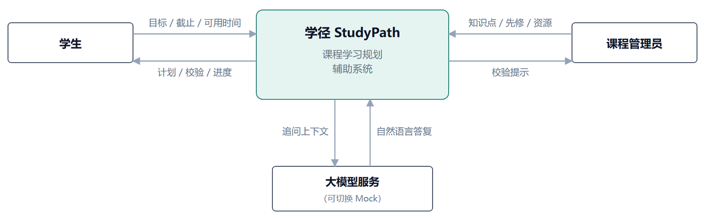
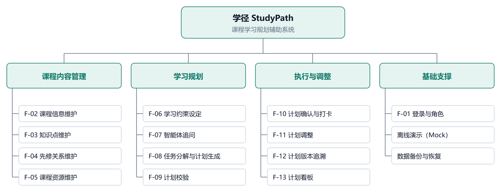
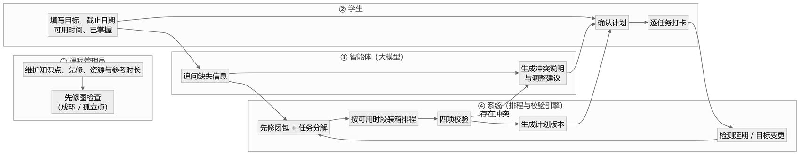
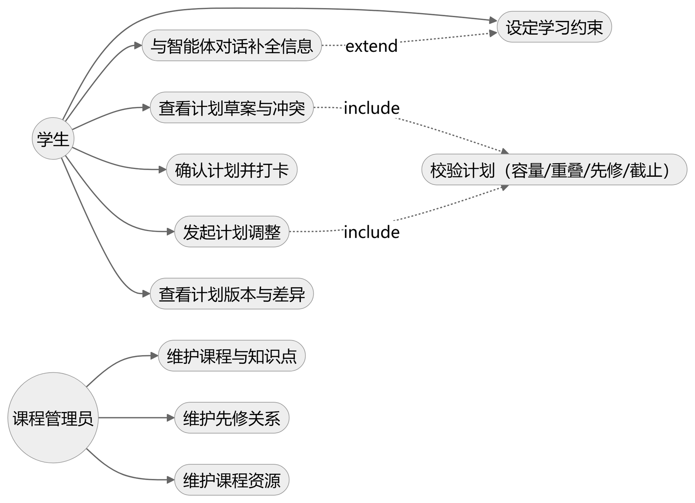
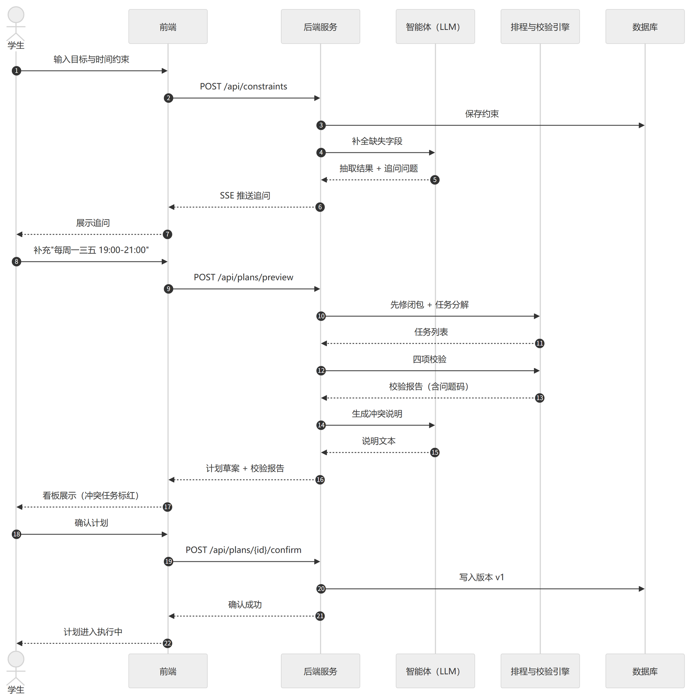
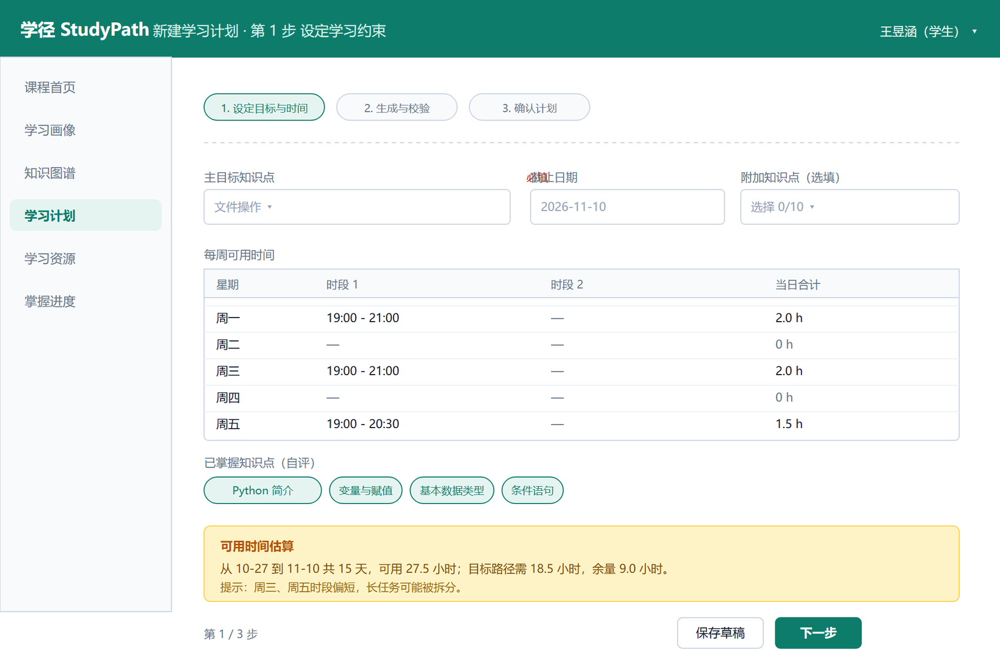
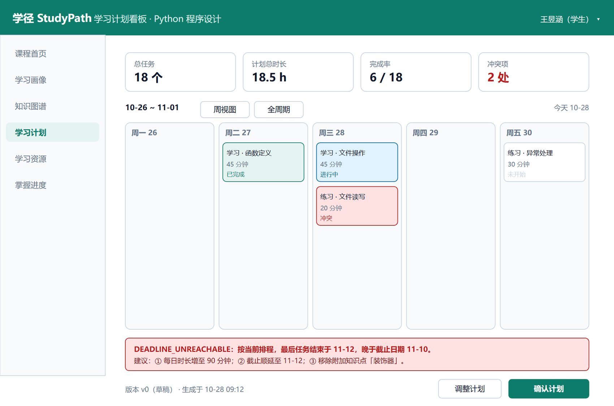
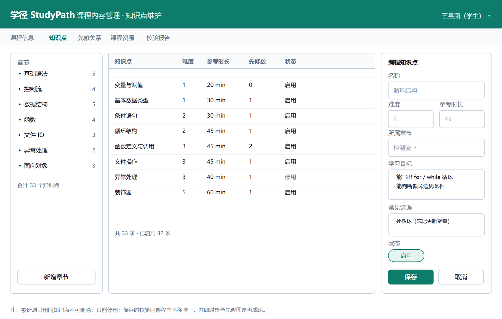
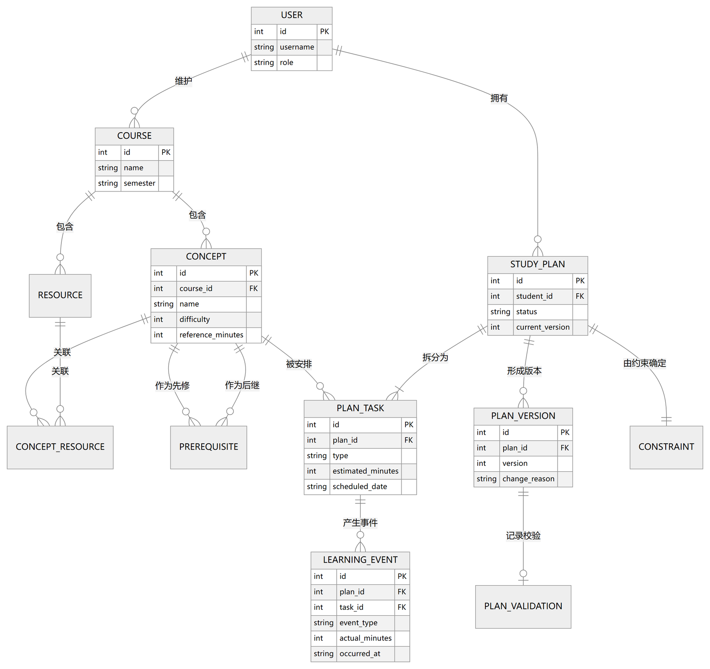
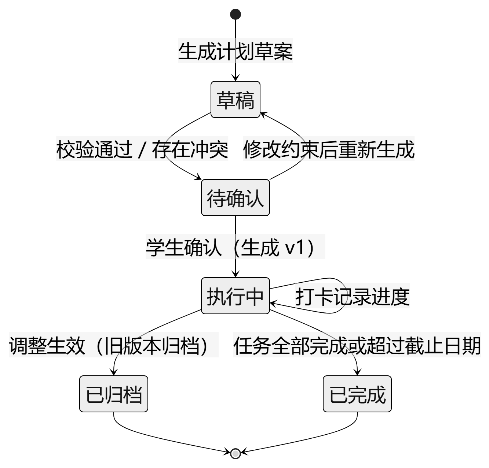

# 课程学习规划辅助系统

## 软件需求说明书

学径 StudyPath

| 项目 | 内容 |
|---|---|
| 课程名称 | 软件工程综合实训 |
| 文档编号 | D02 |
| 文档版本 | v2.0 |
| 文档状态 | 组内评审通过（2026-10-28），待指导教师评审 |
| 项目组 | 软件工程 2 班 第 6 组 |
| 组长 | 王昱涵 |
| 小组成员 | 李鸿佑、李俊达、项奕乔 |
| 指导教师 | 张德珍 |
| 编制日期 | 2026 年 10 月 28 日 |

本文规定学径 StudyPath 的建设范围、用户操作、业务规则、数据要求、质量要求及验收依据。系统面向单门课程，将课程知识结构和学生时间约束转换为可执行的学习计划，支持计划校验、进度记录、经学生确认的调整和版本追溯。本文用于需求评审，并作为后续设计、实现和测试的共同依据；评审通过后建立需求基线。

## 1 引言

### 1.1 编写目的

本说明书明确课程学习规划辅助系统应提供的服务和应满足的约束，使项目组、指导教师及测试人员对“系统做什么、在什么条件下工作、怎样判定合格”形成一致认识。本文描述待实现的需求及其验收条件，不代表相应功能已完成或已通过测试。

项目组据此编写数据要求说明书 D03、概要设计说明书 D04、数据库设计说明书 D05、详细设计说明书 D06，以及测试计划 D09 和测试分析报告 D10。用户手册和操作手册应与批准后的功能范围一致。算法代码、数据库物理表结构和具体接口路径由设计文档细化。

### 1.2 项目背景

项目名称为“学径 StudyPath 课程学习规划辅助系统”，属于《软件工程综合实训》课程实践项目，由软件工程 2 班第 6 组开发。项目开发计划列明的周期为 2026 年 10 月 26 日至 11 月 20 日，共 4 周、120 学时；本期以 Python 程序设计作为示例课程，团队为 4 人。

学生在学习一门课程时，往往已有教材、视频和练习，却难以确定知识点的学习顺序、所需时间及每天的安排。单纯按章节列出清单，不能判断计划是否超出可用时间，也不能在延期后给出一致、可解释的调整。课程管理者则需要维护知识点、先修关系和资源，保证规划依据可用。

本系统以管理员维护的课程内容和学生确认的约束为输入，由程序完成任务排序、时间安排和约束校验；智能体辅助收集信息、解释计划、检索已有资源和说明调整原因。系统为独立的本地 Web 应用，不依赖教务系统、第三方账号或在线学习平台。大语言模型是可选服务，本地 Mock 模式须能完成核心闭环。

### 1.3 预期读者

表 1.1 预期读者与阅读重点

| 读者 | 主要用途 | 重点章节 |
|---|---|---|
| 指导教师与评审人员 | 确认范围、规则和验收口径 | 第 2 章、3.1、附录 A 至 C |
| 设计与开发人员 | 建立数据、模块、接口和界面设计 | 第 3 章、第 4 章 |
| 测试人员 | 形成测试数据、用例及通过标准 | 3.1、3.2、3.5、附录 A 与 B |
| 使用与维护人员 | 理解操作边界、异常与运行条件 | 2.2、3.5、第 4 章 |

### 1.4 术语与缩略语

表 1.2 术语与缩略语

| 术语 | 定义 |
|---|---|
| 知识点 Concept | 课程学习单元，具有名称、章节、难度、参考时长、目标和状态等属性 |
| 先修关系 | A → B 表示学习 B 前须完成 A；多个先修条件按 AND 语义处理，先修图应为有向无环图 |
| 先修闭包 | 从目标沿先修关系向前追溯得到的全部必需知识点，包含目标本身 |
| 已掌握集合 | 学生自评并确认无需安排任务的知识点集合，不表示系统进行了能力测评 |
| 学习约束 | 目标、截止日期、每周可用时段、排除日期及已掌握集合等输入 |
| 任务与时间片 | 任务为某知识点的学习或练习活动；时间片为任务执行的一个连续区间 |
| 原始容量与可排容量 | 原始容量为有效可用分钟之和；可排容量为扣减缓冲后的可安排分钟数 |
| 草案与生效版本 | 草案可修改且不改变执行计划；生效版本为学生确认后的不可变规划快照 |
| 学习事件 | 对完成状态、实际用时及备注的执行记录，独立于规划版本保存 |
| 智能体 Agent | 承担约束收集、编排辅助、资源推荐或调整说明的组件，可采用模型或本地规则实现 |
| 确定性引擎 | 用程序计算排程和校验，相同规范化输入及配置产生相同业务结果 |
| LLM | Large Language Model，大语言模型 |
| Mock | 不调用外部模型，以本地规则和模板支撑完整业务流程的替代实现 |
| MVP | Minimum Viable Product，最小可行产品 |
| JWT 与 SSE | 分别为登录凭证格式和服务端事件推送方式，属于候选实现约定 |

### 1.5 参考资料与编写依据

表 1.3 参考资料与编写依据

| 编号 | 资料 | 用途 |
|---|---|---|
| R01 | 《第 6 组 王昱涵 课程学习规划辅助系统 项目开发计划书》，2026 年 10 月 26 日 | 项目范围、人员、周期、技术边界及验收闭环 |
| R02 | 《D02 软件需求说明书》v0.9，2026 年 10 月 26 日 | 13 项功能、输入输出及初步业务规则 |
| R03 | GB/T 8567—2006《计算机软件文档编制规范》 | 文档编制参考，采用引言、任务概述、需求规定、运行环境的主结构 |
| R04 | ISO/IEC/IEEE 29148:2018 Systems and software engineering Life cycle processes Requirements engineering | 需求表达、可验证性及可追踪性的参考 |

R03 官方信息页：https://openstd.samr.gov.cn/bzgk/std/newGbInfo?hcno=84C42B6277D2714B7176B10C6E6B1A44 。R04 官方信息页：https://www.iso.org/standard/72089.html 。查询日期为 2026 年 10 月 28 日。本文按项目规模裁剪组织内容，不作为标准符合性认证声明。

### 1.6 需求标识与优先级

功能需求沿用 F-01 至 F-13；业务规则用 BR 标识，性能要求用 PF 标识，数据要求用 DR 标识，安全及其他质量要求用 QR 标识，接口要求用 IF 标识，验收用例用 AT 标识。编号在修订中保持稳定，删除项保留记录，不重复占用。

P0 为本期必须交付的能力；P1 为计划交付、必要时可经评审后延期的增强能力。削减 P1 须同步修改需求、计划和验收范围。除明确列为后续工作外，本文“应”“须”“不得”均为相应需求的验收约束；参数默认值在评审批准前为拟定基线。

## 2 任务概述

### 2.1 建设目标与产品范围

系统应将单门课程中的目标知识点转换为按日期和时段排列的学习与练习任务，说明知识点的来源、前后顺序及所用资源，由程序给出容量、重叠、先修和截止四类校验结果。学习落后或修改目标、可用时间时，系统应生成调整草案，经本人确认生效，保留前后版本与原因。

表 2.1 本期产品范围与不包含内容

| 范围 | 本期内容 |
|---|---|
| 课程内容 | 单课程基本信息、知识点、参考时长、先修关系、资源及关联 |
| 个性化规划 | 目标与时间约束、已掌握内容、追问、任务分解、预计时长调整、程序排程 |
| 计划执行 | 校验报告、计划确认、任务打卡、完成率和逾期提示 |
| 计划演化 | 延期及目标变化后的调整预览、确认、完整快照和差异查询 |
| 展示和演示 | 任务列表及详情、看板或日历；本地 Mock 完整演示 |

本期不包含多课程选课和切换、自动能力测评、成绩或学分认定、视频托管与转码、资源文件上传、移动端专项适配、消息推送、教务系统对接、版本回滚和分布式部署。资源以链接或摘要提供；外链离线时可以不可访问，但不得影响计划生成、校验与执行。

### 2.2 用户特点与权限

学生具备基本浏览器操作能力，主要使用目标设置、计划查看、打卡和调整功能。管理员由教师或助教角色承担，熟悉示例课程结构，主要在课程初始化及修订时使用后台。

表 2.2 角色权限矩阵

| 操作 | 学生 | 课程管理员 |
|---|---|---|
| 浏览启用课程、知识点和资源 | 允许 | 允许 |
| 修改课程内容及先修关系 | 禁止 | 允许 |
| 新建、确认、调整学习计划 | 仅本人 | 不代替学生确认 |
| 查看学习约束、进度与历史版本 | 仅本人 | 本期不提供浏览学生私有计划的权限 |
| 打卡与修改执行记录 | 仅本人当前计划 | 禁止代打卡 |
| 初始化演示数据与系统配置 | 禁止 | 通过部署维护流程执行 |

权限须在服务端校验，隐藏按钮不能替代访问控制。管理员身份不自动获得学生私有数据访问权。账号由部署阶段预置或演示脚本初始化，本期不要求开放注册、短信验证、找回密码和完整用户管理后台。

### 2.3 业务流程与系统上下文

管理员先维护课程、知识点、先修和资源。学生通过对话或表单提供目标、截止、可用时间及已掌握内容。系统回显并校验约束，求先修闭包并分解任务，由确定性程序生成草案和校验报告。学生查看依据、修改预计时长并重新生成；满足确认条件后建立 v1。执行期间记录学习事件；发生延期或约束变化时生成调整草案，展示差异与原因，经确认建立 v2 及后续版本。

主流程为：课程内容准备 → 学生设定约束 → 追问或表单补全 → 约束确认 → 任务分解与排程 → 校验 → 学生确认 → 进度记录 → 调整预览 → 再次确认 → 版本追溯。

系统边界、外部实体与数据往来如图 2-1 所示。系统位于中心，向外只与三类实体交互：学生、课程管理员、大模型服务；其中大模型服务是可选依赖，切换为本地 Mock 后 P0 流程完整可用。

图 2-1 系统上下文图

外部模型只接收辅助任务必需的最少内容。知识点合法性、解析后的字段校验、资源 ID 校验、最终排程及业务约束均由本系统判定。模型输出不得直接修改生效计划、进度或绕过确认。

### 2.4 假定与约束

表 2.3 假定与约束

| 编号 | 类型 | 内容 |
|---|---|---|
| AS-01 | 假定 | 学生如实申报时间和已掌握知识点，系统不保证考试成绩或学习结果 |
| AS-02 | 假定 | 管理员保证课程内容的学科正确性，系统校验字段和图结构 |
| AS-03 | 假定 | 课程可分解为知识点，每个知识点可安排学习和练习活动 |
| CS-01 | 项目约束 | 团队 4 人、4 周、120 学时，优先保证 P0 及最小闭环 |
| CS-02 | 部署约束 | 单机本地 Web 应用、SQLite，不以高并发和分布式为目标 |
| CS-03 | 课程约束 | 仅启用 Python 程序设计示例课程，保留课程标识用于数据归属 |
| CS-04 | 时间约束 | 统一采用 Asia/Shanghai 时区、整数分钟，无跨时区排程 |
| CS-05 | 模型约束 | 模型可替换、可关闭，Mock 模式下 P0 全流程可用 |
| CS-06 | 计算约束 | 排程与校验不以模型输出作为最终判定，不要求数学最优解 |
| CS-07 | 交互约束 | 以桌面浏览器及不低于 1366×768 分辨率验收 |

## 3 需求规定

### 3.1 功能需求

#### 3.1.1 功能清单

表 3.1 功能清单

| 编号 | 名称 | 主要使用者 | 优先级 | 对应选题 |
|---|---|---|---|---|
| F-01 | 登录与角色识别 | 学生、管理员 | P0 | 支撑 |
| F-02 | 课程基本信息维护 | 管理员 | P0 | ① |
| F-03 | 知识点与参考时长维护 | 管理员 | P0 | ① |
| F-04 | 先修关系维护与成环检查 | 管理员 | P0 | ① |
| F-05 | 课程资源维护与关联 | 管理员 | P0 | ① |
| F-06 | 学习约束设定与校验 | 学生 | P0 | ② |
| F-07 | 智能体追问与约束补全 | 学生 | P0 | ③ |
| F-08 | 任务分解与计划草案生成 | 学生、系统 | P0 | ③ |
| F-09 | 计划校验与问题解释 | 系统 | P0 | ④ |
| F-10 | 计划确认与进度记录 | 学生 | P0 | ⑤ |
| F-11 | 计划调整与确认 | 学生、系统 | P0 | ⑥ |
| F-12 | 版本保存与差异追溯 | 学生 | P0 | ⑦ |
| F-13 | 计划看板与日历视图 | 学生 | P1 | 支撑 |

系统由 4 个功能域、13 项功能构成，分解关系如图 3-1 所示；各功能在四类角色之间的协作流程如图 3-2 所示；参与者与用例的关系如图 3-3 所示。图 3-1 的叶子节点与上表功能编号一一对应，无孤立功能，也无未列入清单的隐藏功能。

图 3-1 系统功能结构图

图 3-2 中两条回路分别对应 F-07（追问补全）与 F-11（延期重排）。课程管理员提供内容，学生提出约束并最终确认，智能体只承担“问”与“说”，排程与校验由确定性引擎完成。

图 3-2 核心业务流程图（角色分区）

说明：用例图只表达“谁能做什么”，不表达先后顺序；控制流以图 3-2 与图 3-9 为准。

图 3-3 用例图

#### 3.1.2 F-01 登录与角色识别

目的与前置条件：已初始化账号的用户使用用户名、密码登录；系统根据服务端保存的角色提供功能。输入为用户名和密码，输出为认证结果、显示信息、角色与会话有效期，不输出密码或密码散列。

正常流程：校验格式与账号状态，验证密码，建立会话并记录登录时间；学生进入个人计划入口，管理员进入课程维护入口。退出应清除客户端认证信息；会话到期后拒绝写操作，重新认证后允许继续。

业务规则 BR-01：用户名唯一，长度 3 至 32 个字符；密码至少 8 个字符且含字母与数字。连续 5 次密码验证失败后锁定 5 分钟，期间正确密码也不得登录；期满允许再验证。用户名与密码错误统一显示“账号或密码错误”。会话默认 24 小时，服务端不信任客户端传入的角色或用户归属。

异常与验收：无认证访问保护资源返回 401；角色越权返回 403；非本人私有对象请求应拒绝且不返回内容。学生写课程数据、访问另一学生计划和锁定期内登录均须失败，锁定期满正确密码可登录。对应 AT-01 至 AT-03。

#### 3.1.3 F-02 课程基本信息维护

目的与前置条件：管理员登录后维护唯一启用课程的名称、简介、学期、总学时和启用状态。名称、学期必填，总学时为正整数；不提供学生选课或课程切换。

正常流程：读取课程、修改字段、校验后原子保存，返回更新信息与修改时间；学生刷新课程页可见新内容。非法输入或写入失败时，原数据保持不变。

业务规则 BR-02：停用课程前展示影响说明；停用后禁止新建计划和生成调整草案，既有计划仍可查看、打卡及查询历史。恢复启用后允许重新规划。更新简介不得修改旧版本快照。

验收条件：修改简介后学生端显示新内容；总学时 0 保存失败；停用后新建受阻、历史可用。对应 AT-04。

#### 3.1.4 F-03 知识点与参考时长维护

目的与前置条件：管理员维护知识点名称、章节、难度、参考时长、学习目标、常见错误、排序号和状态。输出为保存结果、列表与详情。

正常流程：新增或编辑，检查字段及同课程名称唯一性，保存后向学生提供启用内容。列表支持章节及状态筛选，提供表格化编辑；成组提交须逐条标明成功或失败，不得静默丢弃失败记录。

业务规则 BR-03：名称去除首尾空白后同课程唯一；难度为 1 至 5 整数，参考时长为 5 至 600 整数分钟，默认 30 分钟，指完成该点学习与练习的总预计时间，避免重复计时。学习目标和常见错误各 0 至 5 条。被任何已确认版本引用的知识点不能物理删除，应转停用并显示引用计划数；未被引用且无依赖、无资源关联的知识点可经确认删除。

停用知识点不可作为新目标。新规划的先修闭包包含停用点时，应报告课程内容不完整，不能跳过必需先修。既有计划按内容快照显示，不随管理员改名或改时长而变化。

验收条件：时长 0、601 和重复名称均拒绝；被引用知识点只能停用；旧任务继续显示原名称、时长。对应 AT-05、AT-06。

#### 3.1.5 F-04 先修关系维护与成环检查

目的与前置条件：管理员在同课程知识点之间建立有向关系。输入为先修 A、后继 B；输出为关系清单、保存结果及必要的环路说明。

正常流程：检查两端存在、同课程、A 不等于 B，检查重复边；在提交后的完整图上检查成环，全部通过后保存。批量提交按整个批次校验并原子保存，不能只检查单条边而漏掉批次内部环。

业务规则 BR-04：有序对只允许一条关系。出现 A → B → C → A 时指出环路并拒绝整个修改，原图不变。全部边均为必须满足的 AND 条件，本期不以依赖强度放松先修。孤立点允许存在，仅提示信息。修改关系影响后续草案，不改写历史版本。

验收条件：自依赖、重复、跨课程关系被拒绝；已有 A → B、B → C 时增加 C → A 失败；批量形成环也失败；孤立点可正常规划。对应 AT-07、AT-08。

#### 3.1.6 F-05 课程资源维护与关联

目的与前置条件：管理员录入标题、类型、链接或摘要、阅读时长、关联知识点和状态。类型包括文档、视频、练习和链接；至少关联一个知识点。

正常流程：检查内容与关联，校验 URL 格式，保存资源及多对多关系。学生在知识点或任务详情中可查看启用资源。推荐从已有库中选择，展示关联知识点和推荐理由。

业务规则 BR-05：URL 仅接受 HTTP 或 HTTPS；摘要按文本显示，不执行脚本。链接资源必须有 URL，摘要资源须有非空摘要。阅读时长为参考，已包含于知识点任务时长中，不再次累加。模型不能生成不存在的资源 ID 或声称已验证链接。缺少资源时允许生成任务，但提示“暂无关联资源”。

停用或移除的资源不得进入新草案推荐。旧版本保留原标题和关联，打开时若资源不可用则提示，不能造成任务页失败。本期不保证外部网站可用性，不提供文件托管。

验收条件：无关联、非法协议保存失败；一资源可关联多知识点；Mock 可按规则选资源；移除资源后历史任务仍能打开。对应 AT-09、AT-10。

#### 3.1.7 F-06 学习约束设定与校验

目的与前置条件：学生已登录、课程启用且内容可规划。输入为主目标、0 至 10 个附加目标、截止日期、每周时间模板、排除日期及已掌握集合。输出规范化约束、原始容量、缓冲与可排容量。

正常流程：选择目标并填写时间，系统检查有效性、去重，展开规划区间内的实际可用时段，显示摘要后由学生确认。表单与对话最终使用同一校验规则。

业务规则 BR-06：截止不得早于次日、不得晚于当前日期后 180 天；截止边界为该日期之后次日 00:00，不要求截止日必须有时段。每日模板 0 至 3 段，开始早于结束，不跨日、不重叠，每日合计不超过 8 小时；相邻段可合并。排除日期为当前日期至截止日期间的 0 至 30 个日期，允许包含截止日，当日容量为零。

目标和掌握集合须来自本课程，去重后至少有一个未掌握目标。主目标已掌握时提示更换或撤销该标记。仅使用基准时刻之后的可用部分；扣除过去时间和排除日期后原始容量为零，应拒绝规划请求并说明原因。生效计划修改约束进入 F-11，不得覆盖现行版本。

验收条件：昨天截止、每日 9 小时、重叠、空模板和全被排除均拒绝；截止日排除但此前仍有时间时允许；已掌握点不生成任务。对应 AT-11 至 AT-13。

#### 3.1.8 F-07 智能体追问与约束补全

目的与前置条件：学生进入规划向导。输入自然语言、已确认字段和缺失项，输出追问、候选解释、抽取字段、缺失清单及待确认摘要。

正常流程：识别目标并映射课程知识点；以界面显示的当前日期解释相对日期；对含糊或缺失字段一次最多追问两项；齐备后回显目标、绝对截止、周模板、排除日期、掌握集合，由学生确认再转 F-08。

业务规则 BR-07：“两周后”“下周五”须转换为具体日期回显；“晚上有空”等不能直接形成时段。多个候选目标由学生选择。抽取不得覆盖已确认值，除非学生明确要求更改；全部字段通过 F-06。确认约束不等于确认正式计划。

单次辅助请求总等待上限 10 秒，包含重试；超时或不可用时转表单并保留已填内容。格式错误在剩余预算内最多重试一次；仍失败放弃本轮抽取。追问超过 5 轮仍未齐备，提供表单入口。Mock 通过字段检查与模板问题完成业务，不要求理解任意自然语言。

验收条件：仅说“两周内学会函数”时回显日期并追问时间；含糊时间须澄清；模型断开后表单继续且内容不丢失。对应 AT-14、AT-15。

#### 3.1.9 F-08 任务分解与计划草案生成

目的与前置条件：约束已确认、课程结构合法。输入约束、内容快照、掌握集合、基准时刻及配置；输出任务、时间片、资源、依据、指标与校验报告。

正常流程：求全部目标的先修闭包，去重后减去已掌握集合，保留仍为其他目标必需的内容。每点生成学习与练习，确定先修顺序；匹配已有资源并按未来时段排程，输出草案。无需全局最优，但安排应可解释、可复现。

业务规则 BR-08A：参考时长已表达难度，不默认叠加未定义的掌握度或难度倍率。本期学习练习默认 7∶3；学习分钟数向上取整，练习为剩余，两者均大于零、之和等于参考时长。学生可把单任务预计时长覆盖为 1 至 1440 整数分钟，保存原值、覆盖值和修改时间，并重排重校；生效后修改走 F-11。

业务规则 BR-08B：连续时间片最长 120 分钟，任务可按有效时段拆片，尾片允许短于 15 分钟；片长之和严格等于预计时长。同一知识点的全部学习片排完才排练习；后继学习须在所有先修点的练习片结束后开始。已掌握的先修不排任务，视为满足；其他必需先修不能省略。

业务规则 BR-08C：每个当日有效可用时段的末尾预留 10% 缓冲，分钟数向上取整；剩余部分用于排程，默认不能挪用缓冲掩盖不足。变更比例须重新生成，记录配置。相同可选顺序按章节排序号、知识点 ID 稳定选择。草案可反复生成，不得改变现行计划。

无法全部安排时保留完整任务清单，将剩余标为“未排入”，说明原因及建议，不得省略或伪造日期。先修成环或必需点停用时终止生成、报告课程数据错误。

验收条件：A → B → C，目标 C、已掌握 A，生成 B、C 而不生成 A；公共先修不重复；覆盖时长后重算容量；拆片合计准确。对应 AT-16 至 AT-18。

从“约束已确认”到“草案返回前端”的调用顺序如图 3-4 所示。图中可见两条边界：智能体只承担补全字段与生成说明两类任务，其结果不进入排程与校验的判定链；排程与校验引擎为纯计算模块，输入相同则输出相同，可脱离大模型单独测试。

图 3-4 计划生成与校验时序图

#### 3.1.10 F-09 计划校验与问题解释

目的与前置条件：接收任务和时间片、约束、先修、基准时刻及配置，由独立程序输出校验结果。模型只解释结果，不能改问题码、严重度或通过标志。

业务规则 BR-09：原始容量为 C，逐段扣缓冲后可排容量为 C′，待排任务总预计时间为 T。T 大于 C′即容量不足。利用率显示 T/C；C 为零显示不适用且报告无可用时间。完成率与容量利用率不得混用。

时间片采用左闭右开区间 [开始, 结束)，边界相邻不算重叠。容量、过去时间和可用时段检查仅针对待执行任务，已完成任务作为冻结历史事实不再占用未来容量。待执行片段须在有效可排时段内，结束晚于开始，开始不早于基准时刻。先修校验同时检查知识点依赖及学习先于练习，先修最后一片结束不得晚于后继第一片开始。截止校验检查是否全部可在截止边界前完成；存在无法排入任务也判定截止不可达，不能只检查已排部分的最后时间。

表 3.2 校验问题码与判定要求

| 问题码 | 级别 | 判定与显示要求 |
|---|---|---|
| CAP_EXCEEDED | ERROR | T 大于 C′，显示需求、原始容量、缓冲、可排容量与缺口 |
| TIME_OVERLAP | ERROR | 时间片相交，指出两任务及交集 |
| PREREQ_VIOLATED | ERROR | 先修缺失、顺序违反或练习早于学习 |
| DEADLINE_UNREACHABLE | ERROR | 任务无法排入截止前，或片段结束越过截止边界 |
| SLOT_INVALID | ERROR | 越出可排时段、排除日期、非正时长或过去时间 |
| CAP_TIGHT | WARN | 0.8 小于 T/C 且 T 不大于 C′，提示余量情况 |
| RESOURCE_MISSING | WARN | 无可用资源，允许知情确认 |
| ISOLATED_CONCEPT | INFO | 无先修和后继，不阻止生成与确认 |

报告包含 passed、issues、metrics，问题含码、级别、中文说明、受影响任务和建议。每个 ERROR 至少给两类动作，如增加时间、顺延截止、减少附加目标或修复结构；不得删除必需先修规避约束。

失败可展示和保存草案，但任何 ERROR 均阻止确认；WARN 允许确认且须展示。任务、约束、时长或课程输入变化使旧报告失效，确认时服务端重新校验。同一学生同课程最多一份生效计划，替换须显式提示、原子生效。

验收条件：四类核心冲突输出正确问题码及任务定位；相邻时段不误报；相同业务输入结果一致，耗时、请求标识等非业务元数据不参与一致性比较。对应 AT-19 至 AT-22。

#### 3.1.11 F-10 计划确认与进度记录

目的与前置条件：学生拥有无 ERROR 草案。输入草案标识、修订号和确认动作，或当前任务打卡；输出生效版本、状态、完成率和用时统计。

正常流程：检查归属、草案有效性，重新校验，一个事务内保存 v1、完整快照和当前指针。学生逐任务标记完成（两步：先点“完成”，再确认提交，避免误触），可填非负整数实际分钟数、最多 500 字备注；系统记录独立学习事件并更新执行状态。

业务规则 BR-10：重复确认不建立重复版本，重复打卡不重复统计。实际用时未填保持空，采用预计值估算时标明“估算”。完成率为当前目标内已完成逻辑任务数除以总逻辑任务数，保留一位小数；多片任务只算一次。全部任务完成才算计划完成；超过截止但未完成仍执行中，并显示逾期，不得自动算完成。

已完成任务原计划时段与预计时长在调整中冻结；实际用时和备注可更正并记录事件。本期不支持撤销完成状态，避免破坏后续先修。未完成任务改安排走 F-11。历史版本只读不能打卡，当前事件不得回写历史规划快照。学生可主动结束并归档当前计划，操作前须提示仍未完成的任务；归档不等于完成，重新学习须建立新计划。

验收条件：首次仅建 v1，有 ERROR 拒绝；重复打卡不增长两次；截止过后仅完成 2/10 时显示 20.0% 与逾期，不显示完成。对应 AT-23、AT-24。

#### 3.1.12 F-11 计划调整与确认

目的与前置条件：学生拥有生效计划，因延期、目标、时间或预计时长变化调整。输入原版本、新约束或覆盖值、类型和说明；输出调整草案、报告、差异和解释。

正常流程：读取现行版本及事件，冻结已完成任务，重算未完成目标及先修，从本次基准时刻起排程；展示新增、移除、移动和时长变化。确认时复核版本与完成记录未变、重校后原子建下一版；取消或未确认不改变原计划。

业务规则 BR-11：进入计划页或主动刷新时检测延期，未完成任务最后结束距当前不少于 48 小时即提示调整；不强制后台定时服务。原因类型为 delay、goal_change、availability_change、duration_change、manual，并保存非空中文说明。

逻辑任务 ID 保持稳定，不能全量重新编号代替差异计算。已完成但不属新目标的任务保留为历史事实，不计入新目标完成率分母，不删除执行记录；仍为新目标先修的完成事实可复用。只可移除未完成且不再被保留目标依赖的任务。预览后如现行版本或打卡改变，应返回冲突并重算，不能覆盖另一窗口更新。

验收条件：两个任务逾期 48 小时后显示入口；只移动未完成任务；未确认刷新仍旧版；双窗口过期确认被拒绝。对应 AT-25、AT-26。

#### 3.1.13 F-12 版本保存与差异追溯

目的与前置条件：学生查询本人计划，输入计划和两个版本号，输出时间线、快照、原因与差异。

业务规则 BR-12：首次 v1，确认调整后递增。版本只增不改，不提供编辑、删除及回滚。每版保存约束、目标范围、课程和先修快照、任务及资源引用、覆盖时长、配置、基准时刻、校验结果、操作人、确认时间、原因和引擎版本，支持复现。

规划快照与执行事件分开：历史快照显示当时安排，事件显示实际完成情况，各有时间标识。现行课程变化不得影响旧版展示和重放。新版本生效后旧版为历史只读，整份计划继续使用新版本，不等于整份计划归档。

差异规则：ID 仅在新版为新增、仅在旧版为移除；预计分钟变为时长变化；分钟不变而片段变化为移动；两者同时变化须同时列出字段差异。退出新目标的已完成内容标为保留历史事实，不误报删除。任意两版可比较，显示旧值和新值，不只给数量。

验收条件：两次调整后显示 v1、v2、v3；v1 与 v3 对比准确；修改现行参考时长不影响 v1，按旧输入重放结果相同。对应 AT-27。

#### 3.1.14 F-13 计划看板与日历视图

目的与前置条件：学生有本人草案或计划。输入计划、进度、报告和当前日期，按日或周显示安排与详情。

业务规则 BR-13：默认今天起连续 7 天，可切全周期列表或日历。卡片显示知识点、类型、时长和时间；未开始、完成、逾期、冲突同时用文字或图标表达，颜色作辅助。详情显示资源、先修及预计和实际用时。未排入任务须独立列示，不能因无日期而消失。

看板显示当前版本；历史页明显只读且无打卡按钮。更新后刷新统计，无计划、无资源、加载失败分别提示。P1 日历如延期，P0 列表、详情、确认、打卡、调整及版本仍完整可用。

验收条件：四类状态可区分、详情可用、未排入可见、历史不能打卡。对应 AT-28。

### 3.2 性能与质量要求

#### 3.2.1 精度与计算规则

表 3.3 精度与计算规则

| 编号 | 对象 | 需求 |
|---|---|---|
| PF-01 | 时长 | 整数分钟，最小 1 分钟；不要求时段和预计时长为 15 的倍数 |
| PF-02 | 时间 | 日期 YYYY-MM-DD，界面时间 HH:mm，时间戳包含时区；统一按 Asia/Shanghai 解释 |
| PF-03 | 比例 | 用原值计算后显示一位小数；分母为零显示不适用，不出现除零错误 |
| PF-04 | 拆片 | 各片时长之和严格等于任务预计时长；缓冲单独展示，不计为学习用时 |

确定性比较须固定课程快照、排序、约束、基准时刻、配置及引擎版本，不得以运行时当前时间作为隐藏输入，不得因数据库返回顺序不同改变排程。

#### 3.2.2 响应时间与规模

下列数值为验收目标，不是已测结果。基准为第 4 章演示机配置、本地访问、服务预热后单用户操作，数据含 30 个知识点、40 条先修、60 份资源。基准计划为 50 个逻辑任务、最多 100 片；另对全部 30 个知识点形成的 60 任务执行正确性测试。

表 3.4 响应时间与规模指标

| 编号 | 操作 | 目标 | 测量边界 |
|---|---|---|---|
| PF-05 | 页面首屏 | 不超过 2 秒 | 静态文件本地部署，从导航到可操作内容显示 |
| PF-06 | 程序生成计划 | 不超过 1 秒 | 规范化输入进入引擎到草案及校验完成，不含模型解释 |
| PF-07 | 计划校验 | 不超过 200 毫秒 | 校验函数起止，不含网络和模型 |
| PF-08 | 约束保存 | 不超过 300 毫秒 | 服务端收到有效请求到写入并构造响应 |
| PF-09 | 打卡写入 | 不超过 200 毫秒 | 无锁冲突时，鉴权后到写入响应 |
| PF-10 | 版本对比 | 不超过 500 毫秒 | 同计划不超过 3 版，每版 50 任务 |
| PF-11 | 模型辅助或降级 | 不超过 10 秒 | 请求到响应或可用替代结果，包含重试 |

固定输入和环境，每项预热 3 次、测 20 次，升序第 19 个样本为 P95，与目标比较；记录版本、硬件、样本和失败次数。PF-11 的超时上限须逐次满足，不用平均值掩盖无响应。以上不扩展为公网、冷启动或高并发承诺。

#### 3.2.3 可用性与可靠性

QR-01：输入错误定位字段并解释范围；保存失败保留输入。操作显示处理中、成功或失败状态，防止重复提交。任务标识、版本号和用户归属前后端一致。

QR-02：内容维护、计划确认、版本更新和打卡满足事务完整性，异常全部回滚。不得出现新版本已建而当前指针未更新等中间状态。重启恢复全部已提交数据；未提交输入不能显示为已保存。

QR-03：核心业务不从公网加载必需字体、脚本或样式。关闭外网启用 Mock 后，P0 主流程可用；外部资源及在线生成效果除外。界面标明在线模型或本地规则模式。

#### 3.2.4 可维护性与灵活性

QR-04：学习练习比例、片长上限、缓冲比例、延期阈值、超时集中配置并校验。影响排程的配置纳入版本快照；修改默认值不改变旧版本。容量、时间片和先修等关键规则有自动化测试；接口变更同步 D06 和用例。

QR-05：模型使用统一适配接口，至少支持一种实际服务适配及一种 Mock，遵守相同输出校验。资源选择与说明有规则降级。未来更换课程内容可通过管理员维护完成，本期不提供多课程并行和切换。

### 3.3 输入输出与接口要求

#### 3.3.1 主要输入

表 3.5 主要输入字段与约束

| 字段 | 类型 | 必填性 | 约束 |
|---|---|---|---|
| target_concept_id | 标识 | 是 | 启用且未掌握的主目标 |
| extra_concept_ids | 标识列表 | 否 | 0 至 10 个，去重，不重复计主目标 |
| deadline | 日期 | 是 | 次日至当前日期后 180 天 |
| availability | 时段列表 | 是 | weekday 为 1 至 7，start/end 为 HH:mm；每日最多 3 段、合计不超 8 小时 |
| excluded_dates | 日期列表 | 否 | 当前日期至截止之间，最多 30 个并去重 |
| mastered_concept_ids | 标识列表 | 否 | 本课程知识点，不与目标矛盾 |
| duration_overrides | 任务分钟映射 | 否 | 已生成任务覆盖为 1 至 1440 整数分钟，保存原值 |
| actual_minutes 和 note | 整数及文本 | 打卡可选 | 分钟非负或空，备注最多 500 字 |
| base_version 和 draft_revision | 整数 | 确认时必填 | 与服务端最新状态一致 |

名称拟定 1 至 100 字，资源标题 1 至 200 字，简介、摘要及说明单字段不超过 2000 字，URL 不超过 2048 字符。前后端采用同一限制，超限明确拒绝而非截断。最终字段字典由 D03 维护。

#### 3.3.2 主要输出

表 3.6 主要输出内容

| 对象 | 必需内容 |
|---|---|
| 约束摘要 | 目标名称、绝对截止、周模板、排除日期、掌握集合、基准时刻 |
| 草案 | 标识与修订号、逻辑任务及片段、未排入任务、资源、生成依据、输入快照标识 |
| 指标 | 任务数、预计总分钟、原始容量、缓冲、可排容量、缺口、利用率和日期跨度 |
| 校验 | passed、问题码、级别、任务定位、中文说明和建议 |
| 确认结果 | 计划标识、版本号、状态与确认时间；失败无半成品版本 |
| 进度 | 完成数、当前目标任务数、完成率、用时及估算标识、逾期状态 |
| 版本差异 | 比较版本、原因、确认人和时间、旧值、新值及变化类别 |

统一采用 UTF-8，界面显示中文名称和单位，接口可用稳定英文名。通过标志由校验服务计算，不采纳客户端 passed 值；导出功能非本期必需。

#### 3.3.3 用户界面接口

表 3.7 页面与主要反馈

| 页面 | 主要内容与反馈 |
|---|---|
| 登录 | 账号、隐藏密码、登录、错误与锁定提示 |
| 课程管理 | 基本信息、知识点表格、先修编辑、资源关联、字段错误及引用影响 |
| 规划向导 | 对话与表单、目标、周模板、摘要确认、模型模式 |
| 草案 | 任务、预计时长编辑、时间安排、未排入清单、校验、重新生成、确认 |
| 当前计划 | 版本号、今日与全周期任务、完成率、逾期、打卡和调整 |
| 调整预览 | 旧值新值、原因、报告、确认及取消 |
| 历史版本 | 时间线、任意两版比较、快照、差异、只读标识 |

核心流程不要求用户理解 JWT、Provider、拓扑排序或数据库。日期和时间输入提供格式提示；删除、停用、替换操作应说明具体对象和影响范围，不只显示“确定吗”。

以下 3 张原型覆盖主流程的三个入口页，用于确认布局与信息密度，不代表最终视觉稿。

图 3-5 为 F-06 与 F-07 的落地页面。左侧为结构化表单（兜底），顶部为步骤指示；页面底部实时给出“可用时间与目标路径所需时间”的估算，使学生**在提交前就知道排不排得下**，而不是等校验报冲突。

图 3-5 界面原型：学习约束设定向导

图 3-6 为学生进入系统后的主视图，对应 F-13 的 P0 列表形态。顶部卡片对应任务总数、计划总时长、完成率与冲突数；按日展示任务卡片，状态用文字与底色共同区分；底部固定校验结果栏，展示问题码与建议动作。

图 3-6 界面原型：学习计划看板

图 3-7 为课程管理员主界面（F-02 至 F-05）。左栏章节树用于定位，中间表格支持表格化批量浏览与状态切换，右侧为单条编辑面板；被引用的知识点只能停用，不能删除。

图 3-7 界面原型：知识点维护（管理端）

#### 3.3.4 软件接口与错误约定

IF-01：前后端使用 HTTP 与 JSON，接口在统一受控前缀下提供；认证可用 Bearer JWT，有效期依 F-01。对话可用 SSE 或普通请求，均须满足超时与保留输入要求。具体 URL、消息和状态码由 D06 确定。

IF-02：模型接收最少化课程语境，返回文本或结构化建议；系统校验字段、日期、知识点及资源 ID。不可解析不得破坏已有数据。不发送用户名、账号标识、令牌、真实身份、打卡备注或精确个人日程；个人日期与时段优先在本地解析，模型辅助只使用不含身份的必要课程语境。

IF-03：数据接口为本地 SQLite，无学校平台或外部数据库依赖，不把数据库暴露为静态下载资源。外链由用户主动打开；资源和模型文本中的指令不构成变更计划或权限的授权。

表 3.8 错误码与反馈要求

| 错误码 | 含义 | 反馈要求 |
|---|---|---|
| E1001 | 字段错误 | 定位字段及范围，保留输入 |
| E1002 | 不存在或不可访问 | 不泄露他人对象内容 |
| E1003 | 状态不允许 | 说明当前状态及可执行操作 |
| E1005 | 写入失败或忙 | 回滚，允许安全重试 |
| E2001 | 先修成环或结构非法 | 显示环路或缺失点 |
| E2002 | 目标与已掌握冲突 | 引导更改目标或自评 |
| E2003 | 校验不通过 | 返回报告，拒绝确认 |
| E2004 | 草案或版本过期 | 返回冲突，要求重算 |
| E3001 | 模型不可用 | 降级，不中断 P0 |
| E4001 和 E4003 | 未认证和无权限 | 对应 401、403，不执行写入 |

响应至少含 code、message，字段错误加 field，复杂冲突加 detail。不得向普通用户返回内部堆栈、口令、密钥、SQL 或文件绝对路径。

### 3.4 数据管理能力要求

#### 3.4.1 数据对象与规模

下表为单课程单学期的容量规划目标，不是实测值，不要求物理表数量等于概念对象数量。快照可按设计合并存储，但应满足历史独立性。

表 3.9 数据对象与验收规模

| 对象 | 主要内容 | 验收数据规模 |
|---|---|---|
| 用户 | 唯一账号、密码散列、角色与状态 | 50 个 |
| 课程 | 名称、学期、说明与状态 | 1 门启用 |
| 知识点 | 章节、难度、时长、目标与状态 | 30 个 |
| 先修 | 同课程有向边 | 40 条，另含非法测试集 |
| 资源及关联 | 标题、类型、内容及多对多关联 | 60 份 |
| 计划与约束 | 归属、目标、截止、周模板等 | 200 份，含草案和历史 |
| 任务与片段 | 稳定 ID、时长、安排及依赖 | 累计 3000 个逻辑任务 |
| 校验与版本 | 完整输入、报告、快照、原因及差异 | 累计 400 版 |
| 学习事件 | 完成、更正、用时及发生时间 | 与任务量匹配 |

DR-01：按此规模构建数据验证读写和查询。资源只存链接或摘要，不存视频；数据库容量目标不超 100 MB，不含备份和日志。超出时在 D03 说明原因并评估，不可删快照凑容量。

核心实体及其关系如图 3-8 所示。图中保留与规划直接相关的核心实体（用户、课程、知识点、先修关系、资源、计划、任务、版本、约束），属性为概念级；完整字段定义由 D03 数据要求说明书维护。其中三条约束直接决定计划是否可追溯：

1. 计划与版本是 1 : N，每次确认或调整生效写一个新版本，旧版本只读；
2. 任务必须挂在计划下并指向一个知识点，不允许出现孤儿任务；
3. 约束与计划是 1 : 1，修改约束不覆盖原值，而是作为新版本的输入被一并快照。

图 3-8 数据概念模型（E-R 图）

#### 3.4.2 完整性与一致性

DR-02：主要对象有稳定唯一标识；账号、同课程知识点名称、有序先修边、同计划版本号有唯一约束；关联可追溯、无悬空引用。资源缺失可提示，必需先修缺失阻止新计划生效。

DR-03：同学生同课程最多一份生效计划；确认及调整的版本写入、当前指针切换、原版本状态在同事务完成。学习事件验证现行版本和任务归属，不能因重排丢失。重复请求幂等，版本冲突明确拒绝。

DR-04：历史快照不可变，课程当前内容、执行状态和历史分别保存。旧版展示不读取现行时长替代旧值；重放使用保存的基准时刻与配置，不使用今天时间。

#### 3.4.3 保留与备份恢复

DR-05：正常使用期间保留全部生效版本和学习事件，日志保留 30 天。学期结束清理或归档须独立维护、事先备份，不提供用户直接删版本功能；数据库、备份与日志目录仅维护人员可访问。

DR-06：服务运行时至少每 24 小时生成一致性备份，启动发现过期时补做，保留最近 7 份。采用 SQLite 一致性备份或受控停写复制，不能在 WAL 模式只复制主文件忽略事务。提供手动备份及恢复说明，恢复前停写并保留故障副本。

在备份正常执行的前提下，恢复点目标不超过 24 小时，最近成功备份之后的数据可能需重录。验收规模下，从开始恢复到核心业务可用不超过 30 分钟，核对账号、当前版本、历史和事件一致性；停机期间不承诺定时备份。

### 3.5 故障处理要求

表 3.10 故障场景与处理要求

| 场景 | 系统处理 | 数据和反馈 |
|---|---|---|
| 模型超时、无网络或额度不足 | 10 秒内转表单或模板 | 保留已确认字段，说明本地模式，计算及版本可用 |
| 输出非法或未知 ID | 校验丢弃，预算内最多重试一次 | 不写正式数据，不用虚构资源补位 |
| 容量不足或无法排完 | 展示完整草案、未排入、问题及建议 | 阻止确认，可改输入重算 |
| 先修图损坏或必需点停用 | 终止生成并说明结构问题 | 旧生效计划保留，提示管理员修复 |
| 数据库忙、磁盘写失败 | 有限等待与回滚，忙等上限 3 秒 | 返回 E1005，不显示假成功，可安全重试 |
| 刷新或重启 | 恢复服务端已保存草案和生效数据 | 不承诺从未保存输入；私有草稿不跨账号 |
| 两窗口同时修改 | 拒绝过期请求 E2004 | 不覆盖新版本、不丢打卡 |
| 外链失效 | 保留任务标题及提示 | 不影响进度及版本 |
| 备份或日志失败 | 维护告警并记录原因 | 不假称成功，可见最近成功备份时间 |

故障发生时未经确认不得替换生效计划。已提交的版本或打卡不能因前端没收到响应而重复产生。

### 3.6 其他专门要求

#### 3.6.1 安全与隐私

QR-06：密码不明文存储或写日志，采用加盐单向散列；沿用候选方案时用 bcrypt、工作因子至少 10。签名密钥与 API Key 通过环境配置，不写代码、示例或浏览器。接口执行认证、角色、归属检查，数据库参数化访问。

QR-07：用户输入、模型输出、资源摘要均为不可信数据，文本转义展示，防脚本执行。生成文本不是服务端操作指令，不能触发未授权写入；学生只访问本人数据，管理员权限遵循 2.2。

QR-08：仅采集账号和规划必需信息，不收集定位、设备指纹等；个人日程解析、约束计算和执行记录在本地处理。演示使用虚构身份，测试数据和报告不包含真实学号及未脱敏对话。

QR-09：日志记录操作类型、脱敏用户标识、对象、时间、结果、耗时及故障编号，不含口令、令牌、密钥或完整私有对话。客户端草稿缓存按账号隔离，退出清除私有缓存；凭证不随草稿复制导出。公网不在本期部署范围内，扩大边界须另行评估。

#### 3.6.2 可追溯性与交付

QR-10：生成记录输入、时刻和配置；确认调整记录人、时间、原因和结果；更正打卡形成事件。需求、设计、实现、测试按附录 B 关联，实现路径及实际结论由开发后补录，不以计划结果冒充实测。

QR-11：交付包含程序、锁定依赖、配置示例、示例课程和账号初始化方法；启动检查配置并提示错误。演示重置需明确覆盖范围并显式执行，普通启动不能删现有数据。

QR-12：在验收约定的 Chrome、Edge 桌面版测试并记录具体版本和分辨率；关键状态、错误、确认有文字说明，不仅用颜色；中文、长标题、时间片显示完整可理解。

### 3.7 状态与一致性规则

表 3.11 状态与转换规则

| 对象 | 状态或标记 | 转换条件 |
|---|---|---|
| 草案 | 输入未齐、已生成、可确认 | 字段齐备可生成；无 ERROR 可确认；失败仍是草案 |
| 计划 | 执行中、已完成、已归档 | 确认进入执行中；当前目标全完成才完成；主动结束或新计划替换可归档 |
| 版本 | 当前、历史只读 | 新版确认成为当前，原版成为历史，属于同一计划 |
| 任务 | 未完成、已完成 | 经两步确认的有效打卡完成，错误可更正用时与备注；本期不撤销完成状态 |
| 逾期 | 派生标记 | 过任务结束或计划截止且未完成，不改变完成状态 |
| 冲突 | 派生标记 | 来自最新校验，不等于执行状态 |

BR-STATE：执行状态不回写历史快照；新版本生效与旧版只读原子完成；归档计划不能打卡。已完成计划追加目标，须生成并确认新调整后重新执行；归档后继续学习采用新计划，不改历史。

计划、版本、任务、逾期与冲突标记的状态与转换关系如图 3-9 所示。图中“逾期”与“冲突”是派生标记，不改变执行状态；只有当前目标内全部必做任务完成，计划才转入已完成。

图 3-9 学习计划状态机图

## 4 运行环境规定

### 4.1 设备与部署

表 4.1 设备与部署要求

| 环境 | 条件 | 用途 |
|---|---|---|
| 开发机 | 建议 4 核、8 GB 内存、10 GB 可用磁盘 | 开发工具、前后端及测试 |
| 演示机 | 不低于 2 核、4 GB 内存、5 GB 可用磁盘 | 本地后端、静态前端和浏览器，作为性能基准 |
| 客户端 | 桌面浏览器，至少 1366×768 | 课程查看及计划执行 |
| 网络 | 本地访问无需外网，真实模型与外链需网络 | 断网验证降级 |

后端和数据库同机，默认本地回环访问，数据目录可写。局域网演示须限定来源及端口，不扩大为公网。运行系统版本在交付时固定，本期至少完成一种环境的安装、启动及恢复验证。

### 4.2 支持软件

表 4.2 支持软件与约束

| 软件 | 项目约定 | 约束 |
|---|---|---|
| 后端 | Python 3.11，FastAPI、Uvicorn | 精确依赖版本以锁定文件为准 |
| 数据库 | SQLite 3.x | 支持事务、外键及一致性备份 |
| 前端 | React 18、TypeScript，构建工具由设计确定 | 演示使用本地静态资源 |
| 构建环境 | 与工具链兼容的 Node.js | D12 固定版本，不要求演示现场装依赖 |
| 浏览器 | Chrome、Edge 桌面版 | 记录实际版本，不只写最新版 |
| 测试 | pytest 与接口测试工具 | 记录环境和结果 |
| 模型 | 可选真实适配、必需 Mock | 无 API Key 可直接 Mock 启动 |

技术约定来自开发计划，属于实现约束，不强制模型厂商、样式库或容器工具。不得无记录升级关键依赖导致环境不可复现。

### 4.3 外部接口与依赖

必需依赖仅为本地运行环境、数据库和浏览器。模型适配器具备超时、异常归一化及 Mock 切换；资源外链不是计算依赖。健康检查区分主服务、数据库、模型模式与备份状态；模型故障不应使核心服务被误判完全不可用。

开发可前后端分开启动，交付演示提供统一入口，检查初始化并托管前端，输出访问地址。实际命令、端口和目录写入 D12，不把尚未验证的命令当作已运行事实。

### 4.4 控制与维护

启动读取数据目录、认证密钥、模型模式和参数，检查配置、数据库可写及数据版本。真实模型密钥缺失时显式采用 Mock，不无限重试；认证安全配置缺失应停止并提示维护人员。

关闭时停止接收新写入，完成在途事务提交或回滚后关闭连接。日志按日轮转；维护查看脱敏故障记录。备份、恢复、初始化和重置均有说明，不允许未认证调用。

排程配置变化只影响新草案，现行版本沿用已保存值；重启不自动重排或创建版本。模拟延期用受控测试时钟，不要求修改设备日期。

## 附录 A 验收场景与通过条件

### A.1 最小业务闭环

P0 底线为：管理员录入知识点和先修并可见；学生确认目标及时间；系统生成且能报告容量不足、截止不可达；学生确认可行计划并打卡；调整后可看前后差异与原因。五项均须在 Mock 模式演示，真实模型作为补充。

### A.2 验收用例清单

表 A.1 验收用例清单

| 编号 | 场景与输入 | 预期结果 |
|---|---|---|
| AT-01 | 正常登录，退出后访问保护页面 | 按角色进入，退出后无凭证返回 401 |
| AT-02 | 输错 5 次后立即正确登录 | 锁定 5 分钟，期满可登录 |
| AT-03 | 学生写课程或访问别人计划 | 拒绝，不泄露私有内容 |
| AT-04 | 修改简介、总学时 0、停用课程 | 合法可见，非法不存，停用禁新规划、历史可用 |
| AT-05 | 重名，时长 0、601 | 字段错误，无非法记录 |
| AT-06 | 删被 v1 引用点，再改现行时长 | 只能停用，v1 内容不变 |
| AT-07 | 已有 A → B → C，再加 C → A | 拒绝并显示环路，原图不变 |
| AT-08 | 批量形成环，自依赖、重复、孤立点 | 非法拒绝；孤立点可规划 |
| AT-09 | 无知识点关联、脚本协议资源 | 拒绝，合法多对多可存 |
| AT-10 | 停用已推荐资源再打开历史 | 新版不推荐，旧任务仍可打开 |
| AT-11 | 昨天截止、空模板、重叠或每日 9 小时 | 拒绝并保留输入 |
| AT-12 | 排除截止日但此前有时间；再排除全部 | 前者允许，后者无容量被拒绝 |
| AT-13 | 主目标在掌握集合内 | 提示更改，不确认矛盾约束 |
| AT-14 | 只说两周内学会函数 | 回显日期及目标，追问时间 |
| AT-15 | 模型断网、超时、未知资源 ID | 10 秒内降级，数据保留，未知 ID 不入库 |
| AT-16 | A → B → C，目标 C，掌握 A | 仅排 B、C，满足先修 |
| AT-17 | 参考 5 分钟，覆盖某任务为 135 | 分配合计准确，135 按上限拆片并合计 135 |
| AT-18 | 同输入、时刻、配置生成两次 | 集合、顺序、片段及业务校验一致 |
| AT-19 | 5 个孤立点各 60 分钟，明天起 3 天每天 30 分钟 | T=300，C=90，缓冲9，可排81，缺口219，报告容量及截止失败 |
| AT-20 | 19:00 至 19:30 与 19:20 至 19:50，再改后者从 19:30 起 | 前者重叠，后者不误报 |
| AT-21 | 练习早于学习或后继早于先修结束 | 报先修违反并定位 |
| AT-22 | 输入越过截止、排除日或可排时间的片段 | 截止或时段错误，禁止确认 |
| AT-23 | 错误草案确认；可行草案双击确认 | 前者拒绝，后者仅一份 v1 |
| AT-24 | 10 任务完成 2 并重复打卡，时钟过截止 | 20.0%，不重复，逾期非完成 |
| AT-25 | 两任务逾期 48 小时，保留一个已完成任务后调整 | 提示入口，冻结完成事实，未确认不生效 |
| AT-26 | 双窗口同版，一方先确认或打卡 | 另一方过期请求拒绝，无更新丢失 |
| AT-27 | 建 v1/v2/v3，比 v1/v3，再改现行内容 | 差异及原因完整，旧快照不变可重放 |
| AT-28 | 四状态与未排入任务、历史版本 | 文字可辨，详情可用，历史只读，无任务遗漏 |
| AT-29 | 关闭外网、Mock、单次模型无响应 | 降级及时，五项闭环可用 |
| AT-30 | 模拟忙锁、写失败及异常退出 | 回滚或提交明确，重试不重复 |
| AT-31 | 备份恢复，核对账号、版本、事件 | 在目标时间内恢复，引用一致 |
| AT-32 | 按 3.2.2 规模与方法测性能 | P95 达标，超时上限逐次满足，有样本记录 |
| AT-33 | 查日志、缓存、接口及模型请求 | 无密钥泄露，无他人数据或精确日程外发 |

### A.3 通过与交付判定

P0 及关联数据、权限、异常和离线场景须通过，不得存在越权、数据丢失、错误生效或核心流程中断的未解决缺陷。P1 延期应有评审后的范围变更及替代列表。性能用实测判断，不凭主观体验。

验收材料包含发布包、锁定依赖、配置说明、示例课程与虚构账号、测试记录、缺陷及修复记录、需求追踪矩阵和演示脚本。测试结论及实现路径由开发测试阶段补录，本文不预填全部通过。

## 附录 B 需求追踪矩阵

### B.1 选题要求追踪

选题表共 7 项要求，逐条映射到本章节、功能、图示与验收用例，作为范围完整性的自检依据。

表 B.1 选题要求追踪

| 选题要求 | 对应功能 | 章节 | 图示 | 验收用例 |
|---|---|---|---|---|
| ① 限定一门课程，维护知识点、资源、先修关系及参考学习时长 | F-02 至 F-05 | 3.1.3 至 3.1.6、3.4.1 | 图 3-1、图 3-7、图 3-8 | AT-04 至 AT-10 |
| ② 学生填写目标、截止日期、可用时间及已掌握内容，可调整任务预计时长 | F-06、BR-08A | 3.1.7、3.3.1 | 图 3-2、图 3-5 | AT-11 至 AT-14、AT-17 |
| ③ 智能体追问缺失信息，检索资源，分解任务并生成计划 | F-07、F-08 | 3.1.8、3.1.9 | 图 3-2、图 3-4 | AT-14 至 AT-18 |
| ④ 程序检查时间容量、任务重叠及先修条件 | F-09、BR-09 | 3.1.10 | 图 3-2、图 3-4、图 3-6 | AT-19 至 AT-22 |
| ⑤ 学生确认计划并记录进度 | F-10、BR-10 | 3.1.11 | 图 3-6、图 3-9 | AT-23、AT-24 |
| ⑥ 智能体根据延期或目标变化提出调整，经确认后更新 | F-11、BR-11 | 3.1.12 | 图 3-2、图 3-9 | AT-25、AT-26 |
| ⑦ 保存计划版本及调整原因 | F-12、BR-12 | 3.1.13 | 图 3-9、图 3-8 | AT-27 |

### B.2 主题归纳与设计承接

主题归纳自开发计划和 v0.9，用于覆盖检查，不将未附的选题表或访谈视为已核验材料。设计承接为后续文档方向，代码路径在实现后补充。

表 B.2 需求追踪矩阵

| 来源主题 | 需求标识 | 设计承接 | 验收依据 |
|---|---|---|---|
| 登录权限 | F-01、QR-06 至 QR-09 | D04 认证；D06 归属校验 | AT-01 至 AT-03、AT-33 |
| 课程与时长 | F-02、F-03、CS-03 | D03 字典；D05 内容数据 | AT-04 至 AT-06 |
| 先修合法 | F-04、BR-04 | D06 图校验 | AT-07、AT-08 |
| 资源检索 | F-05、IF-02 | D04 资源服务；D05 关联 | AT-09、AT-10、AT-15 |
| 目标时间基础 | F-06、BR-06 | D03 约束；D06 时间展开 | AT-11 至 AT-13 |
| 追问确认 | F-07、PF-11 | D04 智能体；D06 交互 | AT-14、AT-15、AT-29 |
| 分解与覆盖 | F-08、BR-08A 至 BR-08C | D06 闭包拆片排程 | AT-16 至 AT-18 |
| 四类核心校验 | F-09、PF-01 至 PF-04 | D06 报告规则 | AT-19 至 AT-22 |
| 确认与进度 | F-10、BR-STATE、DR-03 | D05 事件；D06 事务状态 | AT-23、AT-24、AT-30 |
| 调整建议 | F-11、BR-11 | D06 并发与确认 | AT-25、AT-26 |
| 版本原因 | F-12、DR-04、QR-10 | D05 快照；D06 差异 | AT-27 |
| 看板日历 | F-13、QR-12 | D04 页面；D11 操作 | AT-28 |
| 性能可靠性 | PF-05 至 PF-11、QR-01 至 QR-05 | D06 性能；D09 测量 | AT-29、AT-30、AT-32 |
| 规模备份 | DR-01 至 DR-06 | D03 规模；D05 完整性；D12 恢复 | AT-31、AT-32 |
| 本地及隐私 | CS-02、CS-05、IF-01 至 IF-03、QR-06 至 QR-12 | D04 边界；D12 部署；D15 维护 | AT-03、AT-29、AT-33 |

## 附录 C 图表清单

### C.1 图清单

表 C.1 图清单

| 图号 | 图题 | 所在章节 | 源文件 |
|---|---|---|---|
| 图 2-1 | 系统上下文图 | 2.3 | `figures/src/fig-2-1-context.svg` |
| 图 3-1 | 系统功能结构图 | 3.1.1 | `figures/src/fig-3-1-function-tree.svg` |
| 图 3-2 | 核心业务流程图（角色分区） | 3.1.1 | `figures/src/fig-3-2-swimlane.mmd` |
| 图 3-3 | 用例图 | 3.1.1 | `figures/src/fig-3-3-usecase.mmd` |
| 图 3-4 | 计划生成与校验时序图 | 3.1.9 | `figures/src/fig-3-4-sequence.mmd` |
| 图 3-5 | 界面原型：学习约束设定向导 | 3.3.3 | `figures/src/fig-3-5-wizard.svg` |
| 图 3-6 | 界面原型：学习计划看板 | 3.3.3 | `figures/src/fig-3-6-board.svg` |
| 图 3-7 | 界面原型：知识点维护（管理端） | 3.3.3 | `figures/src/fig-3-7-admin.svg` |
| 图 3-8 | 数据概念模型（E-R 图） | 3.4.1 | `figures/src/fig-3-8-er.mmd` |
| 图 3-9 | 学习计划状态机图 | 3.7 | `figures/src/fig-3-9-plan-state.mmd` |

### C.2 表清单

表 C.2 表清单

| 表号 | 表题 | 所在章节 |
|---|---|---|
| 表 1.1 | 预期读者与阅读重点 | 1.3 预期读者 |
| 表 1.2 | 术语与缩略语 | 1.4 术语与缩略语 |
| 表 1.3 | 参考资料与编写依据 | 1.5 参考资料与编写依据 |
| 表 2.1 | 本期产品范围与不包含内容 | 2.1 建设目标与产品范围 |
| 表 2.2 | 角色权限矩阵 | 2.2 用户特点与权限 |
| 表 2.3 | 假定与约束 | 2.4 假定与约束 |
| 表 3.1 | 功能清单 | 3.1.1 功能清单 |
| 表 3.2 | 校验问题码与判定要求 | 3.1.10 F-09 计划校验与问题解释 |
| 表 3.3 | 精度与计算规则 | 3.2.1 精度与计算规则 |
| 表 3.4 | 响应时间与规模指标 | 3.2.2 响应时间与规模 |
| 表 3.5 | 主要输入字段与约束 | 3.3.1 主要输入 |
| 表 3.6 | 主要输出内容 | 3.3.2 主要输出 |
| 表 3.7 | 页面与主要反馈 | 3.3.3 用户界面接口 |
| 表 3.8 | 错误码与反馈要求 | 3.3.4 软件接口与错误约定 |
| 表 3.9 | 数据对象与验收规模 | 3.4.1 数据对象与规模 |
| 表 3.10 | 故障场景与处理要求 | 3.5 故障处理要求 |
| 表 3.11 | 状态与转换规则 | 3.7 状态与一致性规则 |
| 表 4.1 | 设备与部署要求 | 4.1 设备与部署 |
| 表 4.2 | 支持软件与约束 | 4.2 支持软件 |
| 表 A.1 | 验收用例清单 | A.2 验收用例清单 |
| 表 B.1 | 选题要求追踪 | B.1 选题要求追踪 |
| 表 B.2 | 需求追踪矩阵 | B.2 主题归纳与设计承接 |
| 表 D.1 | 评审确认事项 | D.1 评审确认事项 |
| 表 D.2 | 评审记录 | D.2 变更控制与评审记录 |
| 表 D.3 | 变更记录 | D.3 变更记录 |

### C.3 图表维护约定

1. 图题在图**下方**、表题在表**上方**，编号按章连续，跨章引用写全（如“图 3-2”）。
2. 正文引用与图表编号必须一致；改图只改 `figures/src/` 下的源文件，由 `scripts/build_figures.py` 重新生成 PNG，不手工截图。
3. 图默认按 1700 px 宽输出，插入 A4 文档后相当于 250 dpi 以上；线条与文字在黑白打印下可辨，状态不以颜色作为唯一区分手段。
4. 新增图或表须同时更新本附录与正文引用，否则视为文档缺陷。

## 附录 D 评审事项与需求变更

### D.1 评审确认事项

表 D.1 评审确认事项

| 编号 | 待评审口径 | 本版拟定值 | 确认责任 |
|---|---|---|---|
| C-01 | 时长与拆片 | 参考 5 至 600，比例 7∶3，覆盖 1 至 1440，片上限 120 分钟 | 项目组及指导教师 |
| C-02 | 缓冲与延期 | 逐段 10%，逾期不少于 48 小时提示 | 项目组及指导教师 |
| C-03 | 性能与规模 | 按 3.2.2、3.4.1 验收 | 测试负责人与项目组 |
| C-04 | P1 看板 | 计划本期实现，延期须保留 P0 列表并变更范围 | 项目组及指导教师 |
| C-05 | 部署及模型 | 一种经验证系统环境、一种实际适配和 Mock，精确版本交设计确定 | 开发负责人与项目组 |

参数评审调整应同步规则、数据字典、设计、用例和配置示例。自动测评及掌握度模型列后续研究，本期仅用自评集合，不引入未定义的时长修正系数。

### D.2 变更控制与评审记录

建立基线后，变更记录编号、涉及需求、原因、提出人和优先级；评估工作量、周期、数据、接口和测试影响后评审。批准后更新版本及关联文档，未批准不进入生效基线。

表 D.2 评审记录

| 记录项 | 内容 |
|---|---|
| 评审日期 | 2026-10-28 |
| 参评人员 | 项目组全体：王昱涵（组长）、李鸿佑、李俊达、项奕乔 |
| 评审结论 | 组内评审通过：13 项功能、四类校验与验收口径无重大异议；按整改项完成修订后，以 v2.0 作为需求基线 |
| 整改项及责任人 | ① 补齐 10 张图与选题①至⑦追踪（含图号、表号、图表清单）；② 修正课程名为《软件工程综合实训》；③ 打卡改为两步确认；④ 明确附录编号与 AT 用例编号以本版为准。责任人：李鸿佑 |
| 复核日期与基线版本 | 2026-10-28，复核通过，基线版本 v2.0 |

### D.3 变更记录

表 D.3 变更记录

| 日期 | 版本 | 主要变更 | 状态 |
|---|---|---|---|
| 2026-10-26 | v0.9 | 13 项功能及四类校验初稿 | 已有参考稿 |
| 2026-10-28 | v1.0 | 统一课程名及规范依据，补充时长覆盖、拆片、状态、确认门槛、并发、快照、隐私和验收追踪，统一超时缓冲 | 待评审 |
| 2026-10-28 | v2.0 | 补齐 10 张图（上下文、功能结构、业务流程、用例、时序、3 张界面原型、E-R、状态机）；表统一编号并新增附录 C 图表清单；附录 B 增补选题①至⑦追踪；课程名改为《软件工程综合实训》；打卡改为两步确认；附录 C 重排为附录 D | 待评审 |
