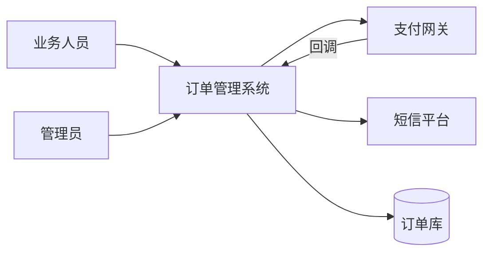
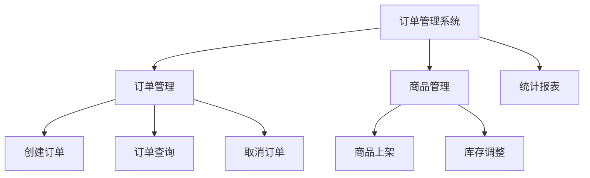
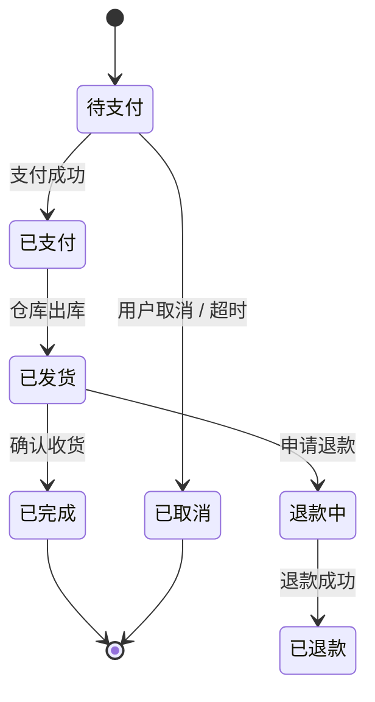
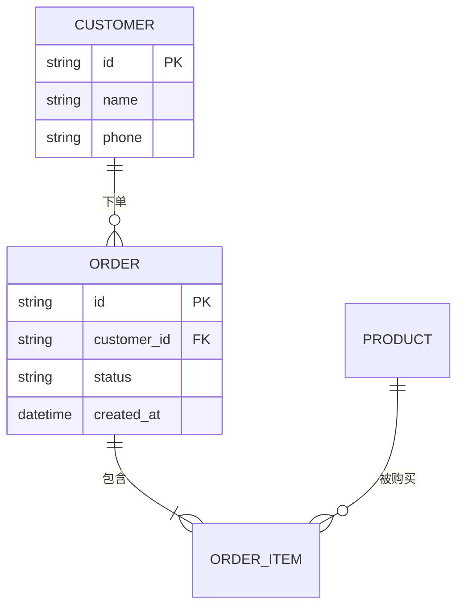

# 软件需求分析说明书 · 图表清单与规范

> 用途：写《软件需求规格说明书 / 需求分析报告》时，判断该配哪些图、放哪一章、怎么编号、怎么验收。
> 适用：课程设计、项目立项、招标/投标、验收文档、内部需求评审。

---

## 一、总体原则

1. **图是为消除歧义服务的，不是为凑页数**。一张图讲不清一个主题，就说明该拆成两张，而不是继续往上堆。
2. **一图一主题**。单张流程图超过 15 个节点、单张 ER 图超过 20 个实体，评审时基本没人看得下去。
3. **图必须被正文引用**。正文写「如图 3-2 所示」，读者才知道该看哪张；只贴图不引用，等于没画。
4. **交付源文件**。除了 PNG/SVG，附上 `.drawio` / `.vsdx` / `.puml` / `.mmd`，否则改一个字都要重画。
5. **黑白可读**。打印或投影成灰度时，分支不能只靠颜色区分，要配形状、线型或文字标注。
6. **图有边界，表有字段**。凡是有「谁/什么时候/多大」这类定量信息，用表格比用图清楚（如权限矩阵、数据字典、性能指标）。

---

## 二、图表清单（按用途分四类）

### 2.1 范围与结构 —— 回答「系统做什么、边界在哪」

| 图 | 回答什么问题 | 必要性 | 建议章节 |
|---|---|---|---|
| 系统上下文图（Context Diagram） | 系统边界、外部实体、与外部系统的数据往来 | ★ 必备 | 引言 / 系统概述 |
| 功能结构图（功能分解树） | 系统由哪些功能模块构成、层级关系 | ★ 必备 | 功能需求 |
| 系统总体架构图（分层 / 微服务 / C4-L1） | 技术分层、模块职责与依赖方向 | 推荐 | 总体设计 或 需求概述 |
| 用例图（Use Case Diagram） | 参与者（谁）与用例（能做什么）的关系 | 面向对象方法必备 | 功能需求 |
| 角色/干系人关系图 | 有哪几类用户、组织层级如何 | 视情况 | 用户分析 |

### 2.2 行为与流程 —— 回答「业务怎么走、状态怎么变」

| 图 | 回答什么问题 | 必要性 | 建议章节 |
|---|---|---|---|
| 业务流程图（跨角色泳道图） | 核心业务在部门/角色之间如何流转 | ★ 必备（1~3 张核心流程） | 业务需求 |
| 活动图 / 流程图 | 单个用例内部的判断、分支、并行 | 视复杂度 | 功能需求 |
| 状态机图 | 有生命周期的对象（订单、审批单、工单）如何变状态 | 有状态流转时必备 | 功能需求 |
| 时序图（Sequence Diagram） | 系统之间/服务之间的调用顺序与接口约定 | 多系统集成时必备 | 接口需求 |

### 2.3 数据 —— 回答「有哪些数据、怎么流动、存在哪」

| 图 | 回答什么问题 | 必要性 | 建议章节 |
|---|---|---|---|
| ER 图（概念模型 / 逻辑模型） | 实体、属性、关系、基数 | ★ 必备 | 数据需求 |
| 数据流图 DFD（顶层图 + 0 层 + 1 层） | 数据从哪来、经什么加工、落到哪个存储 | 结构化方法必备 | 数据需求 |
| 数据字典（表） | 每个数据项的类型、长度、取值范围、来源 | 与 DFD/ER 配套 | 数据需求 |
| 数据分布图 | 多系统/多库时，主数据与副本在哪 | 大型系统或数据中台 | 数据需求 |

### 2.4 界面与运行环境 —— 回答「长什么样、装在哪」

| 图 | 回答什么问题 | 必要性 | 建议章节 |
|---|---|---|---|
| 界面原型 / 线框图 | 关键页面布局与元素 | ★ 必备（3~8 张关键页） | 界面需求 |
| 页面跳转图 / 站点地图 | 页面之间如何导航 | 推荐 | 界面需求 |
| 部署图 / 网络拓扑图 | 装几台机器、怎么连、走什么网络区域 | 有部署约束时必备 | 运行环境 |
| 硬件接口 / 电气连接图 | 传感器、执行器、PLC 怎么接 | 嵌入式项目必备 | 接口需求 |
| 权限矩阵（表） | 角色 × 功能的可见/可操作 | 推荐 | 功能需求 |

---

## 三、最小套装：按系统类型选

### A. 管理信息系统 / B 端后台（OA、订单、CRM、后台管理）

1. 系统上下文图
2. 功能结构图
3. 核心业务泳道流程图（1~2 张）
4. 用例图
5. ER 图
6. 关键界面原型（3~5 张）

> 这 6 张能覆盖 90% 的评审关注点。DFD 可省略，除非文档模板明确要求结构化方法。

### B. 嵌入式 / 工控 / 物联网

1. 系统上下文图（含传感器、执行器、云端）
2. 功能结构图
3. 状态机图（设备状态：待机/运行/故障/维护）
4. 时序图（下位机 ↔ 上位机 ↔ 云）
5. 硬件接口 / 网络拓扑图
6. 操作界面原型（如果是带屏设备）

### C. 平台 / 集成 / 数据类系统

1. 系统上下文图
2. 部署图 / 网络拓扑图
3. 时序图（接口交互，按对接方各一张）
4. 数据流图（跨系统数据流转）
5. ER 图或数据分布图
6. 功能结构图

---

## 四、按方法论的区别

| 方法 | 典型图组合 | 备注 |
|---|---|---|
| 结构化分析（教材、政务、军工常见） | 功能结构图 + DFD（顶层/0 层/1 层）+ 数据字典 + ER 图 | 强调「加工—数据流—存储」；DFD 与 ER 需互相自洽 |
| 面向对象 / UML | 用例图 + 活动图 + 状态机图 + 时序图 + 类图 | 类图属设计阶段，需求书里可只到概念类图 |
| 敏捷 / 迭代 | 上下文图 + 用户故事地图 + 界面原型 + 流程图（少量） | 图少而精，需求以用户故事加验收标准表达 |

> 说明：`GB/T 8567-2006`、`ISO/IEC/IEEE 29148` 这类标准规定的是**文档章节结构**，不强制具体图种。因此「必须画哪些图」主要取决于行业惯例、招标文件条款和评审习惯。

---

## 五、图与文档怎么咬合

### 5.1 编号与图题

- 编号：`图 <章号>-<序号>`，如「图 3-2 订单创建流程」。跨章引用时写全。
- 图题位置：**图的标题在图下方**，表题在表上方（国标习惯）。
- 图例：同一文档内符号含义统一，第一张图给出图例，后续复用。
- 清单：文首或文末附「图表目录」，便于评审翻查。

### 5.2 需求追溯矩阵（强烈建议）

每张图都对应若干条需求，用一张表把「需求编号 ↔ 图号」双向绑定：

| 需求编号 | 需求名称 | 对应图 | 验证方式 |
|---|---|---|---|
| FR-01 | 用户下单 | 图 3-2、图 5-1 | 功能测试 |
| FR-02 | 订单状态流转 | 图 3-5（状态机） | 状态覆盖测试 |
| DR-01 | 订单主数据模型 | 图 4-1（ER） | 数据评审 |

### 5.3 交付格式

| 内容 | 格式 |
|---|---|
| 插入文档的图 | PNG（300dpi）或 SVG（矢量优先） |
| 可编辑源文件 | `.drawio` / `.vsdx` / `.puml` / `.mmd` |
| 复杂拓扑 | 建议同时给一张简化版，正文用简化版，附录放全量 |

---

## 六、评审前检查清单

- [ ] 每张图都有编号与图题，且正文有「如图 x-y 所示」的引用
- [ ] 系统上下文图的外部实体，都能在接口需求里找到对应条目
- [ ] 功能结构图的叶子节点，都能对应到一条功能需求
- [ ] 泳道图的每个角色，都在用户/角色分析里定义过
- [ ] 状态机图的状态与事件，能覆盖所有业务规则中的状态迁移
- [ ] ER 图的每个实体，都能在数据字典里找到字段定义
- [ ] 时序图的每条消息，都有明确的接口名或协议
- [ ] 界面原型覆盖了所有「主流程入口」页面
- [ ] 图内文字在 A4 黑白打印下可辨认
- [ ] 附了源文件，且文件名与图号一致（如 `fig-3-2-order-flow.drawio`）

---

## 七、常见扣分点

1. **用例图当流程图用** —— 用例图不表达顺序，控制流交给活动图/时序图。
2. **DFD 与 ER 打架** —— DFD 里出现的「存储」在 ER 图里找不到实体，是最常见的自相矛盾。
3. **功能结构图不是树** —— 画成网状或带调用箭头，那是架构图，不是功能分解。
4. **状态机漏掉异常态** —— 只有「正常流转」，没有「取消/超时/失败回滚」。
5. **原型是截图而非设计** —— 拿已实现系统的截图充数，评审会认为需求阶段没做设计。
6. **图太多但都不说话** —— 20 张图没有一张被正文引用。

---

## 附录 A：图种中英文对照

| 中文 | 英文 | 常用工具 |
|---|---|---|
| 系统上下文图 | System Context Diagram | draw.io、Visio、C4-PlantUML |
| 功能结构图 | Functional Decomposition Diagram | draw.io、XMind |
| 用例图 | Use Case Diagram | StarUML、PlantUML |
| 业务流程图（泳道） | Swimlane Business Process Diagram | draw.io、Visio |
| 活动图 | Activity Diagram | PlantUML、StarUML |
| 状态机图 | State Machine Diagram | PlantUML、draw.io |
| 时序图 | Sequence Diagram | PlantUML、Mermaid |
| ER 图 | Entity-Relationship Diagram | draw.io、PowerDesigner |
| 数据流图 | Data Flow Diagram | Visio、draw.io |
| 部署图 | Deployment Diagram | draw.io、PlantUML |
| 网络拓扑图 | Network Topology Diagram | Visio、draw.io |

---

## 附录 B：可直接复制的 Mermaid 片段

### B.1 系统上下文图

### B.2 功能结构图

### B.3 状态机图（订单）

### B.4 ER 图

---

## 附录 C：课程设计场景的简化版

多数软件工程课程设计只要求下列 5 张，且更看重「图与文字是否自洽」而非图种齐全：

1. 系统功能结构图
2. 业务流程图（1~2 张）
3. 用例图
4. E-R 图
5. 界面原型（首页 + 2~3 个核心功能页）

若老师明确要求「结构化方法」，把第 3 项换成 **数据流图（顶层 + 0 层）** 并补一份数据字典。
