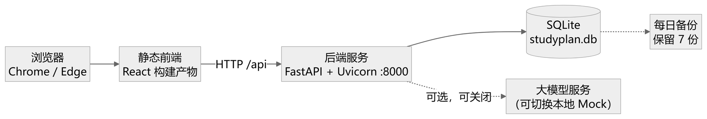
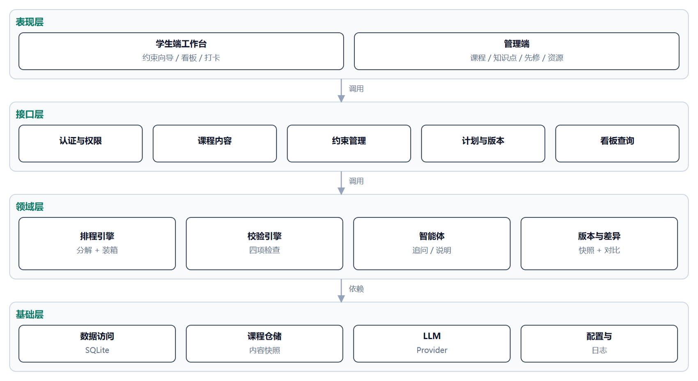
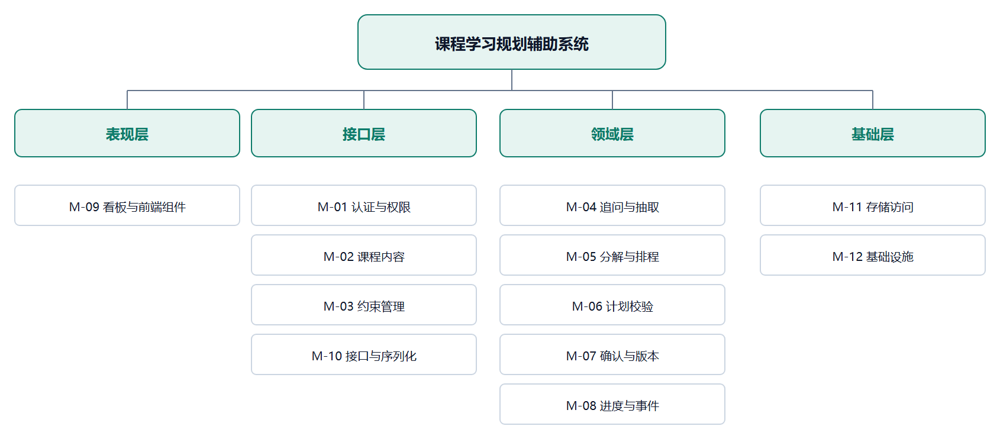

# 课程学习规划辅助系统 · 概要设计说明书

学径 StudyPath

| 项目 | 内容 |
|---|---|
| 课程名称 | 软件工程综合实训 |
| 文档编号 | D04 |
| 文档版本 | v0.1 |
| 文档状态 | 初稿，待评审 |
| 项目组 | 软件工程 2 班 第 6 组 |
| 组长 | 王昱涵 |
| 小组成员 | 李鸿佑、李俊达、项奕乔 |
| 指导教师 | 张德珍 |
| 编制日期 | 2026 年 11 月 1 日 |

本文确定系统的总体结构、模块划分、接口与运行设计，作为详细设计与编码实现的依据。本文不重复需求内容，功能与规则以《软件需求说明书》D02 v2.3 为准。

## 1 引言

### 1.1 编写目的

本说明书把 D02 确定的需求转换为可实现的结构：划分层次与模块、明确模块职责与调用关系、规定接口边界与运行方式、给出出错处理与维护安排。预期读者为设计与开发人员、测试人员、指导教师。

阅读约定：凡本文与 D02 冲突之处，以 D02 为准并回改本文；凡本文未展开的规则细节，见 D02 对应章节。

### 1.2 背景

| 项 | 说明 |
|---|---|
| 系统名称 | 学径 StudyPath —— 课程学习规划辅助系统 |
| 任务提出者 | 《软件工程综合实训》课程组 |
| 开发者 | 软件工程 2 班 第 6 组（4 人） |
| 用户 | 学生（主用户）、课程管理员 |
| 运行形态 | 单机部署的 B/S 应用，浏览器访问，SQLite 存储 |
| 上游文档 | D02 软件需求说明书 v2.3（需求基线） |
| 下游文档 | D05 数据库设计说明书、D06 详细设计说明书 |

### 1.3 定义

| 术语 | 含义 |
|---|---|
| 层（Layer） | 按职责纵向切分的代码集合：表现层、接口层、领域层、基础层 |
| 模块（Module） | 本文的设计单元，编号 M-01～M-12，一个模块可跨多个文件但职责单一 |
| 确定性引擎 | 不调用大模型、输入相同即输出相同的计算模块（排程引擎、校验引擎） |
| 智能体（Agent） | 调用大模型完成语言任务的模块，输出必须经程序校验才能入库 |
| 适配器（Provider） | 对第三方能力的统一封装，本期为大模型（真实服务 / 本地 Mock） |
| 快照（Snapshot） | 计划确认时固化的输入与输出，创建后不可修改 |
| 幂等（Idempotent） | 同一请求重复执行不产生重复结果（重复确认、重复打卡） |
| 降级（Degrade） | 依赖不可用时切换到等效的低配路径（模型→表单/模板） |

### 1.4 参考资料

| 编号 | 资料 | 版本/日期 |
|---|---|---|
| R01 | 《D02 软件需求说明书》 | v2.3，2026-10-28 |
| R02 | 《D01 项目开发计划书》 | v0.9，2026-10-26 |
| R03 | GB/T 8567—2006《计算机软件文档编制规范》 | 2006 |
| R04 | ISO/IEC/IEEE 29148:2018 需求工程 | 2018 |
| R05 | 《D05 数据库设计说明书》 | v0.1，2026-11-01 |

## 2 总体设计

### 2.1 需求规定

| 类别 | 摘要 | 详见 |
|---|---|---|
| 功能 | 13 项功能 F-01～F-13：课程内容维护 4 项、学习规划 5 项、执行与调整 4 项 | D02 §3.1 |
| 校验 | 容量、重叠、先修、截止四项，固定顺序执行，ERROR 阻止确认 | D02 §3.1.10、§3.8.2 |
| 性能 | 计划生成 ≤1 s、校验 ≤200 ms、页面首屏 ≤2 s、模型辅助 ≤10 s | D02 §3.2.2 |
| 规模 | 30 知识点、40 条先修、60 份资源、50 个逻辑任务 | D02 §3.2.2、§3.4.1 |
| 约束 | 单课程、单机、离线可演示、排程与校验不依赖模型 | D02 §2.4 |

### 2.2 运行环境

系统为单机 B/S 应用：浏览器加载静态前端，前端通过 HTTP 调用本机后端，后端读写同一台机器上的 SQLite 文件；大模型是可选外部依赖，关闭后自动使用本地 Mock。

图 2-1 部署与运行环境图

表 2.1 部署要素

| 要素 | 内容 | 说明 |
|---|---|---|
| 客户端 | Chrome / Edge 桌面版，≥1366×768 | 不要求移动端适配 |
| 前端 | React 构建后的静态文件 | 由后端托管或本地静态服务器提供 |
| 后端 | Python 3.11 + FastAPI + Uvicorn，默认 8000 端口 | 单进程、单 worker |
| 数据库 | SQLite 3.x 单文件 `studyplan.db` | 开启 WAL；详见 D05 |
| 模型 | 可选：真实适配器 / 本地 Mock | 由配置项切换，故障自动降级 |
| 网络 | 本地回环即可运行；真实模型与外链需外网 | 演示可在断网环境完成 P0 |

### 2.3 基本设计概念和处理流程

系统遵循四条设计原则，它们直接决定了模块划分与接口边界。

**原则一：分层隔离，单向依赖。** 表现层只依赖接口层，接口层只依赖领域层，领域层只依赖基础层；反向依赖通过参数与返回值传递，不使用全局状态。这样任何一层的替换不影响其他层，也便于分头开发。

**原则二：程序算、模型说。** 任务分解、排程、四项校验、差异计算一律由确定性引擎完成，结果可复现、可单测；大模型只承担三类语言任务——把学生的自然语言转成结构化字段、把结构化结果转成学生能懂的解释、在既定候选内挑选资源。模型输出必须通过字段与 ID 校验才会进入计划，且不得修改校验结论或绕过确认。

**原则三：单一事实源与快照不可变。** 课程内容是唯一事实源，计划生成时连同基准时刻、配置一起快照；确认后版本只读，执行记录（打卡）作为独立事件追加，不回写快照。这样“历史为什么这么排”永远可复现。

**原则四：失败可解释、可降级。** 任何失败都返回带问题码的结构化结果与建议动作；外部依赖失败时切换到等效低配路径，而不是让主流程中断。

图 2-2 系统总体架构图

**一次计划生成的处理流程**（对应 D02 图 3-4 的时序）：

1. 接口层接收约束请求 → M-03 校验字段并展开可用时段、计算原始容量 C、缓冲 B、可排容量 C′；
2. 若字段不全，M-04 追问并把自然语言抽成字段，回显确认后再回到步骤 1；
3. M-05 求先修闭包、去重减已掌握、拆学习与练习任务、按有效时段装箱拆片；
4. M-06 按固定顺序执行四项校验，产出问题码、受影响任务与建议；
5. M-04 把校验结果转成解释文本（不修改结论）；
6. 学生确认 → M-07 复核版本与进度、事务写入版本与当前指针 → M-08 开始记录执行事件。

### 2.4 结构

系统按四层划分 12 个模块，模块编号 M-01～M-12，每个模块职责单一且可独立测试。

图 2-3 模块结构图

表 2.2 模块清单

| 编号 | 模块 | 所属层 | 职责 | 主要输入 → 输出 |
|---|---|---|---|---|
| M-01 | 认证与权限 | 接口层 | 登录、会话、角色与归属校验 | 用户名密码 → 令牌与角色；请求上下文 → 放行/拒绝 |
| M-02 | 课程内容管理 | 接口层 | 课程、知识点、先修、资源的维护与成环检查 | 内容字段 → 保存结果；先修批次 → 环路或成功 |
| M-03 | 约束管理 | 接口层 | 约束录入、字段校验、可用时段展开、容量计算 | 约束请求 → 规范化约束 + C/B/C′ |
| M-04 | 追问与抽取 | 领域层 | 目标映射、日期归一、追问、解释文本生成 | 自然语言 → 字段候选 + 追问/说明 |
| M-05 | 分解与排程 | 领域层 | 先修闭包、任务分解、拆片、按可用时段装箱 | 约束 + 课程快照 → 任务与时间片 |
| M-06 | 计划校验 | 领域层 | 四项检查、问题码、建议动作 | 草案 + 约束 → 校验报告 |
| M-07 | 确认与版本 | 领域层 | 确认门槛、事务写入、差异计算、版本快照 | 草案标识 → 生效版本；新旧版本 → 差异 |
| M-08 | 进度与事件 | 领域层 | 打卡、更正、完成率、逾期标记 | 打卡请求 → 学习事件 + 统计 |
| M-09 | 看板与前端组件 | 表现层 | 页面、任务卡片、状态展示、交互反馈 | 查询结果 → 界面 |
| M-10 | 接口与序列化 | 接口层 | 路由注册、请求校验、错误码映射 | HTTP 请求 → 调用领域模块 → 响应 |
| M-11 | 存储访问 | 基础层 | 数据访问、事务、迁移、备份 | 领域对象 → 表记录；查询条件 → 记录集 |
| M-12 | 基础设施 | 基础层 | 配置、日志、模型适配器、健康检查 | 配置项 → 运行时上下文 |

> 说明：M-01、M-02、M-03、M-10 属于接口层，但承担了领域校验（如成环检测、容量展开），因为它们的产出是后续模块的直接输入，放在接口层可避免重复计算。

### 2.5 功能需求与程序的关系

表 2.3 功能需求与模块的对应关系（√ 表示该模块参与实现）

| 功能 | M-01 | M-02 | M-03 | M-04 | M-05 | M-06 | M-07 | M-08 | M-09 | M-10 | M-11 | M-12 |
|---|---|---|---|---|---|---|---|---|---|---|---|---|
| F-01 登录与角色 | √ |  |  |  |  |  |  |  |  | √ | √ | √ |
| F-02 课程信息维护 |  | √ |  |  |  |  |  |  |  | √ | √ |  |
| F-03 知识点维护 |  | √ |  |  |  |  |  |  |  | √ | √ |  |
| F-04 先修关系维护 |  | √ |  |  |  |  |  |  |  | √ | √ |  |
| F-05 课程资源维护 |  | √ |  |  |  |  |  |  |  | √ | √ |  |
| F-06 学习约束设定 |  |  | √ |  |  |  |  |  |  | √ | √ |  |
| F-07 智能体追问 |  |  | √ | √ |  |  |  |  |  | √ |  | √ |
| F-08 分解与计划生成 |  | √ | √ |  | √ |  |  |  |  | √ | √ | √ |
| F-09 计划校验 |  |  |  |  |  | √ |  |  |  | √ |  |  |
| F-10 确认与打卡 | √ |  |  |  |  |  | √ | √ |  | √ | √ |  |
| F-11 计划调整 |  |  | √ | √ | √ | √ | √ |  |  | √ | √ | √ |
| F-12 版本与差异 |  |  |  |  |  |  | √ |  |  | √ | √ |  |
| F-13 看板与日历 |  |  |  |  |  |  |  |  | √ | √ | √ |  |

### 2.6 人工处理过程

系统不假设全自动，以下环节保留人工操作：

表 2.4 人工处理过程

| 环节 | 人工内容 | 触发方式 | 系统支持 |
|---|---|---|---|
| 课程内容首次录入 | 管理员录入课程、知识点、先修、资源；确认学科正确性 | 学期初一次性 | 表格化编辑、成环检查、引用影响提示 |
| 课程内容修订 | 管理员调整时长或停用知识点 | 学期中偶发 | 影响范围提示、历史快照保护 |
| 演示数据初始化 | 维护人员执行初始化脚本 | 演示前 | 脚本可重复执行、覆盖范围显式声明 |
| 备份与恢复 | 维护人员确认备份、执行恢复 | 每日自动 + 按需手动 | 启动补做、恢复核对清单 |

### 2.7 尚未解决的问题

表 2.5 未决问题

| 编号 | 问题 | 影响 | 计划 |
|---|---|---|---|
| Q-01 | 任务拆片后时间片数量上限（当前按 100 片估） | 极端约束下排程耗时可能超出 1 s | D06 给复杂度分析，必要时限制附加目标数量 |
| Q-02 | 同一学生多窗口并发确认的冲突概率 | 影响 E2004 的触发频率与提示文案 | 已用版本号乐观锁兜底，D06 补并发时序 |
| Q-03 | 模型抽取与规则解析的边界（日期归一化是否全部本地） | 影响 IF-02 的隐私承诺能否成立 | D06 明确“本地优先、模型只处理脱敏文本” |

## 3 接口设计

### 3.1 用户接口

用户接口由浏览器呈现，共 7 个页面，布局与元素见 D02 图 3-5～图 3-7。

表 3.1 页面与主要交互

| 页面 | 主要元素 | 关键反馈 |
|---|---|---|
| 登录 | 账号、密码、登录按钮 | 账号或密码错误统一提示；锁定倒计时 |
| 规划向导 | 目标选择、截止日期、周模板、排除日期、已掌握多选 | 实时显示 C/B/C′ 与目标路径所需时长 |
| 草案 | 任务列表、预计时长编辑、未排入清单、校验报告、重新生成、确认 | ERROR 高亮并禁用确认；修改后自动重排 |
| 当前计划 | 今日任务、全周期列表、完成率、逾期标记、打卡入口 | 两步确认；重复打卡不重复计数 |
| 调整预览 | 差异列表（新增/移除/移动/时长变化）、原因、确认/取消 | 版本或进度已变时提示重新计算 |
| 历史版本 | 时间线、两版对比、只读标识 | 历史只读，无打卡按钮 |
| 课程管理 | 章节树、知识点表格、先修编辑、资源关联 | 字段错误定位、引用影响提示、成环指出环路 |

用户接口约定：不使用仅靠颜色传达状态（状态同时有文字）；破坏性操作需二次确认并说明影响范围；日期时间输入提供格式提示。

### 3.2 外部接口

表 3.2 外部接口

| 接口 | 对方 | 形式 | 约定 |
|---|---|---|---|
| 浏览器 ↔ 前端 | 客户端 | HTTP 静态资源 | 前端资源本地加载，不从公网取字体与脚本 |
| 前端 ↔ 后端 | 进程间 | HTTP + JSON，前缀 `/api` | 统一认证头、统一错误结构（见 D02 §3.3.4） |
| 后端 ↔ 数据库 | SQLite 文件 | 文件读写 + SQL | 单写多读，开启 WAL 与忙等待 |
| 后端 ↔ 大模型 | 外部服务 | HTTPS，Provider 适配 | 超时 10 s（含重试）；失败降级为表单/模板 |
| 后端 ↔ 备份文件 | 本地磁盘 | 文件复制 | 每日至少一次，保留 7 份，一致性备份 |
| 测试时钟 | 测试进程 | 配置注入 | 用于构造“延期”“逾期”场景，不修改设备时间 |

### 3.3 内部接口

模块之间只通过函数调用与数据结构交互，不允许跨层直接访问数据库。

表 3.3 主要内部接口

| 调用方 | 被调方 | 接口（语义） | 输入 → 输出 |
|---|---|---|---|
| M-10 | M-01 | 校验请求上下文 | 请求头 + 对象归属 → 通过 / 401 / 403 |
| M-10 | M-03 | 保存并规范化约束 | 约束请求 → 约束对象 + C/B/C′ |
| M-10 | M-05 | 生成草案 | 约束 + 内容快照 + 基准时刻 → 任务与时间片 |
| M-10 | M-06 | 校验草案 | 草案 + 约束 → 校验报告 |
| M-10 | M-07 | 确认草案 | 草案标识 + 修订号 → 版本号 / E2004 |
| M-10 | M-08 | 打卡 | 任务标识 + 完成标记 + 用时 → 学习事件 + 统计 |
| M-03 | M-02 | 读取课程内容快照 | 课程标识 → 知识点与先修 |
| M-05 | M-03 | 读取可用时段与容量 | 约束对象 → 时间片序列 |
| M-05 | M-02 | 读取知识点与参考时长 | 知识点集合 → 属性 |
| M-06 | M-05 | 读取任务与时间片 | 草案标识 → 任务列表 |
| M-07 | M-06 | 复核校验结论 | 草案 + 约束 → 是否仍通过 |
| M-07 | M-11 | 事务写入版本与指针 | 版本对象 → 提交结果 |
| M-04 | M-12 | 调用模型 | 提示词 + 上下文 → 文本或结构化候选 |
| M-08 | M-11 | 追加学习事件 | 事件对象 → 事件标识 |

## 4 运行设计

### 4.1 运行模块组合

表 4.1 三个主要运行场景

| 场景 | 触发 | 参与的模块（按调用顺序） | 结束条件 |
|---|---|---|---|
| 生成学习计划 | 学生提交约束 | M-01 → M-03 →（M-04 追问）→ M-05 → M-06 →（M-04 解释）→ M-09 展示 | 返回草案与校验报告 |
| 打卡记录进度 | 学生确认任务完成 | M-01 → M-08 → M-11 → M-09 | 返回完成率与逾期标记 |
| 计划调整 | 学生发起或系统检测到延期 | M-01 → M-07 读取现行版本 → M-05 重排 → M-06 校验 → M-07 差异 →（M-04 说明）→ M-09 | 返回调整草案，确认后写新版本 |

### 4.2 运行控制

| 控制项 | 方式 | 说明 |
|---|---|---|
| 启动 | 一条命令启动后端，托管前端静态文件 | 启动时检查配置、数据库可写、数据版本 |
| 停止 | 接收终止信号，结束在途事务后关闭连接 | 未提交事务回滚 |
| 模型切换 | 配置项 `LLM_PROVIDER = mock / 真实适配器 / auto` | 切换在重启生效；运行期失败自动降级 |
| 备份 | 启动时补做逾期备份，运行期每日一次 | 失败只告警，不影响主流程 |
| 健康检查 | `/health` 与 `/health/detail` | 区分主服务、数据库、模型模式、备份状态 |
| 演示重置 | 维护人员显式执行 | 明确覆盖范围，普通启动不删数据 |

### 4.3 运行时间

表 4.2 运行时间预算（对齐 D02 表 3.3）

| 环节 | 预算 | 主要耗时来源 |
|---|---|---|
| 页面首屏 | ≤ 2 s | 静态资源加载与首次渲染 |
| 约束保存与容量展开 | ≤ 300 ms | 字段校验 + 时段展开 |
| 任务分解与排程 | ≤ 1 s | 闭包、拓扑排序、装箱拆片 |
| 四项校验 | ≤ 200 ms | 四项线性检查与问题汇总 |
| 确认写入 | ≤ 300 ms | 事务写版本、快照与指针 |
| 打卡写入 | ≤ 200 ms | 单表插入与统计更新 |
| 版本对比 | ≤ 500 ms | 两版快照差异计算 |
| 模型辅助 | ≤ 10 s | 网络往返 + 重试；超时即降级 |

## 5 系统数据结构设计

### 5.1 逻辑结构设计要点

系统共 12 个逻辑数据对象：用户、课程、知识点、先修关系、资源、知识点资源关联、学习计划、学习约束、计划任务、计划版本、校验记录、学习事件。标识符、属性与值域已由 D02 §3.4.4 的数据字典定义，本文不重复。

结构要点三条：

1. 计划是聚合根：任务、约束、版本必须挂在计划下，不允许孤儿记录；
2. 版本是快照：确认时把目标、约束、任务、配置、校验结果一并写入，只增不改；
3. 事件是流水：打卡与更正以事件追加，引用稳定的任务标识，不回写快照。

详见 D05 §3.2 的逻辑结构与 §3.3 的物理结构。

### 5.2 物理结构设计要点

采用 SQLite 单文件：开启 WAL 与外键约束，主键为整数自增或业务标识，所有外键建索引，`(plan_id, version)`、`(course_id, name)` 等建唯一约束。容量目标 < 100 MB。详见 D05 §3.3。

### 5.3 数据结构与程序的关系

表 5.1 数据对象与模块的访问关系（√ 表示该模块读或写该数据）

| 数据对象 | M-02 | M-03 | M-05 | M-06 | M-07 | M-08 | M-11 |
|---|---|---|---|---|---|---|---|
| 用户 / 课程 | √ |  |  |  |  |  | √ |
| 知识点 / 先修 | √ |  | √ |  |  |  | √ |
| 资源 / 关联 | √ |  | √ |  |  |  | √ |
| 学习约束 |  | √ | √ | √ | √ |  | √ |
| 计划任务 |  |  | √ | √ | √ | √ | √ |
| 计划版本 / 校验记录 |  |  |  |  | √ |  | √ |
| 学习事件 |  |  |  |  |  | √ | √ |

## 6 系统出错处理设计

### 6.1 出错信息

对外错误码沿用 D02 表 3.21（E1001 字段错误、E1002 不存在或不可访问、E1003 状态不允许、E1005 写入失败或忙、E2001 先修成环、E2002 目标冲突、E2003 校验不通过、E2004 版本过期、E3001 模型不可用、E4001/E4003 未认证与无权限）。

表 6.1 模块级异常与处置

| 模块 | 异常 | 对外表现 | 处置 |
|---|---|---|---|
| M-02 | 批量提交形成环 | E2001 + 环路与行号 | 整批回滚，保留输入 |
| M-03 | 可用容量为零 | E1003 + 原因 | 拒绝规划，引导改约束 |
| M-04 | 模型超时或输出不可解析 | 不报错，降级 | 10 s 预算内转表单/模板，保留已填字段 |
| M-05 | 先修图损坏或必需点停用 | E2001 | 终止生成，提示联系管理员 |
| M-05 | 无法全部排入 | 不报错 | 返回草案 + 未排入清单 + 缺口 |
| M-06 | 存在 ERROR | E2003 | 草案可看、禁止确认 |
| M-07 | 版本或进度已变 | E2004 | 拒绝写入，要求重新计算 |
| M-08 | 重复打卡 | 不报错 | 幂等，不重复计数 |
| M-11 | 数据库忙或写失败 | E1005 | 忙等上限 3 s，回滚并提示重试 |

### 6.2 补救措施

表 6.2 补救措施

| 措施类型 | 具体做法 | 适用场景 |
|---|---|---|
| 降级 | 模型不可用 → 表单与模板；模型给出不存在的资源 ID → 丢弃该候选，按规则回退 | 模型超时、输出非法 |
| 重试 | 仅对幂等操作重试，重试计入同一时间预算；写操作失败提示人工重试 | 网络抖动、忙锁 |
| 回滚 | 确认与调整在一个事务内完成，任一失败整体回滚 | 写版本、切指针、更新状态 |
| 恢复 | 每日备份 + 启动补做；恢复前停写并保留故障副本；核对账号、版本、事件一致性 | 数据损坏、误操作 |
| 数据核对 | 提供“计划—版本—事件”一致性检查脚本 | 演示前、恢复后 |

### 6.3 系统维护设计

| 安排 | 内容 |
|---|---|
| 日志 | 按日切分，记录请求、耗时、异常、模型调用与降级原因；不含口令、令牌与完整对话 |
| 链路追踪 | 一次请求内的模块调用序列与耗时，用于定位超时环节 |
| 配置集中 | 缓冲比例、片长上限、延期阈值、超时预算、模型模式均集中配置并校验范围 |
| 健康检查 | 主服务、数据库、模型模式、备份状态四项分开报告 |
| 迁移 | 建表与升级脚本按版本号顺序执行，启动时校验数据版本 |
| 演示复位 | 独立脚本，显式声明覆盖范围，普通启动不触发 |

## 附录 A 与需求文档的对应关系

| 需求条目 | 本文对应位置 |
|---|---|
| F-01～F-13 | 表 2.2 模块清单、表 2.3 功能与模块矩阵 |
| 四项校验与问题码 | M-06、表 6.1；判定顺序见 D02 §3.8.2 |
| 性能指标 PF-05～PF-11 | 表 4.2 运行时间预算 |
| 数据对象与规模 | §5.1、§5.2，详见 D05 |
| 错误码 | §6.1，详见 D02 表 3.21 |
| 权限边界 | §3.3 内部接口 + D02 表 3.2 权限矩阵 |

### 变更记录

| 日期 | 版本 | 主要变更 | 状态 |
|---|---|---|---|
| 2026-11-01 | v0.1 | 首次成稿：4 层 12 模块、两张矩阵、接口与运行设计、出错处理 | 待评审 |
