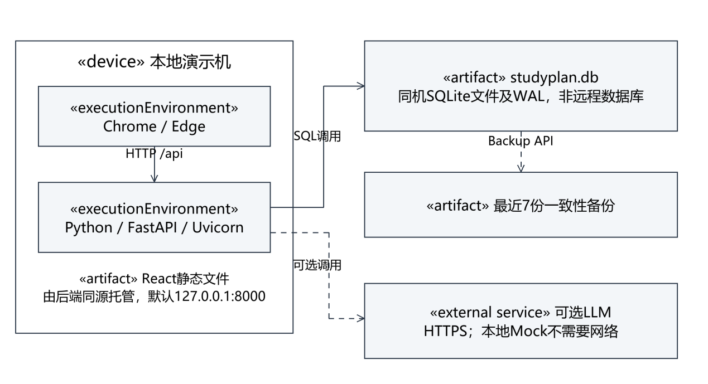
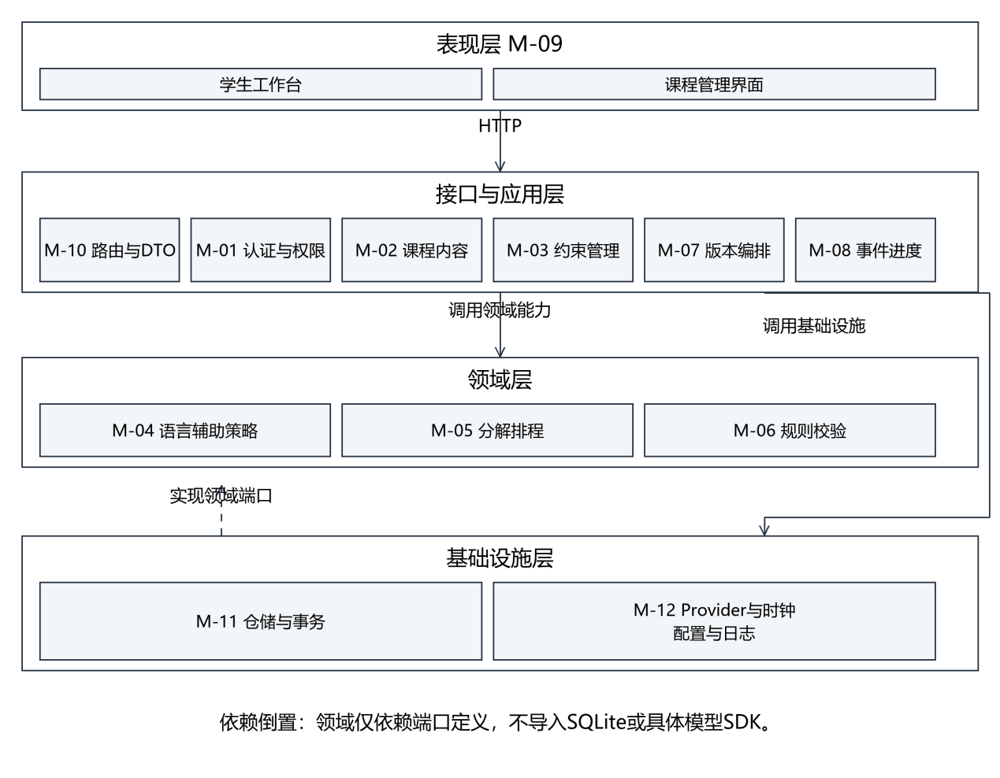
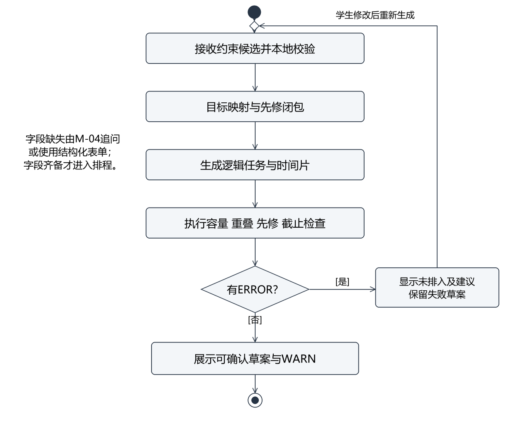
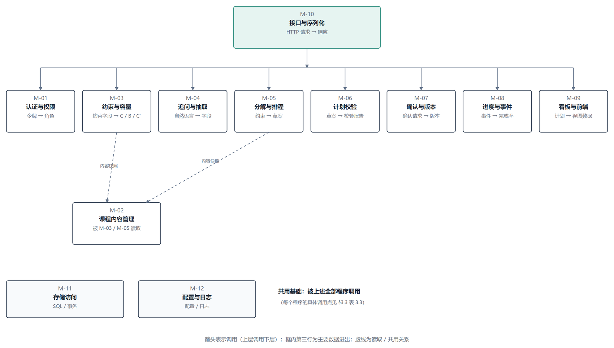
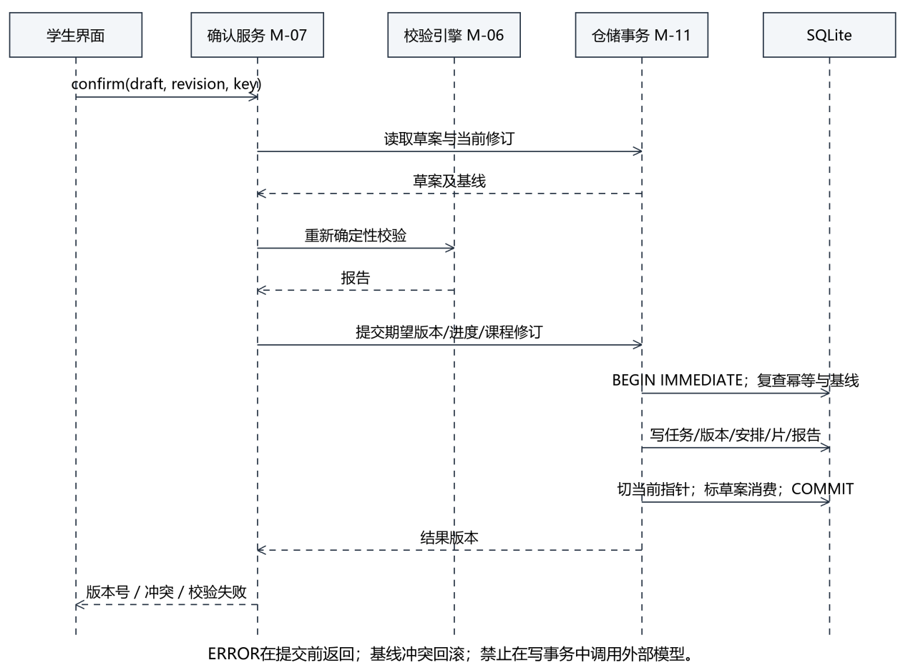
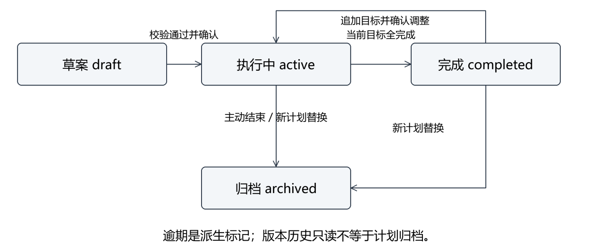
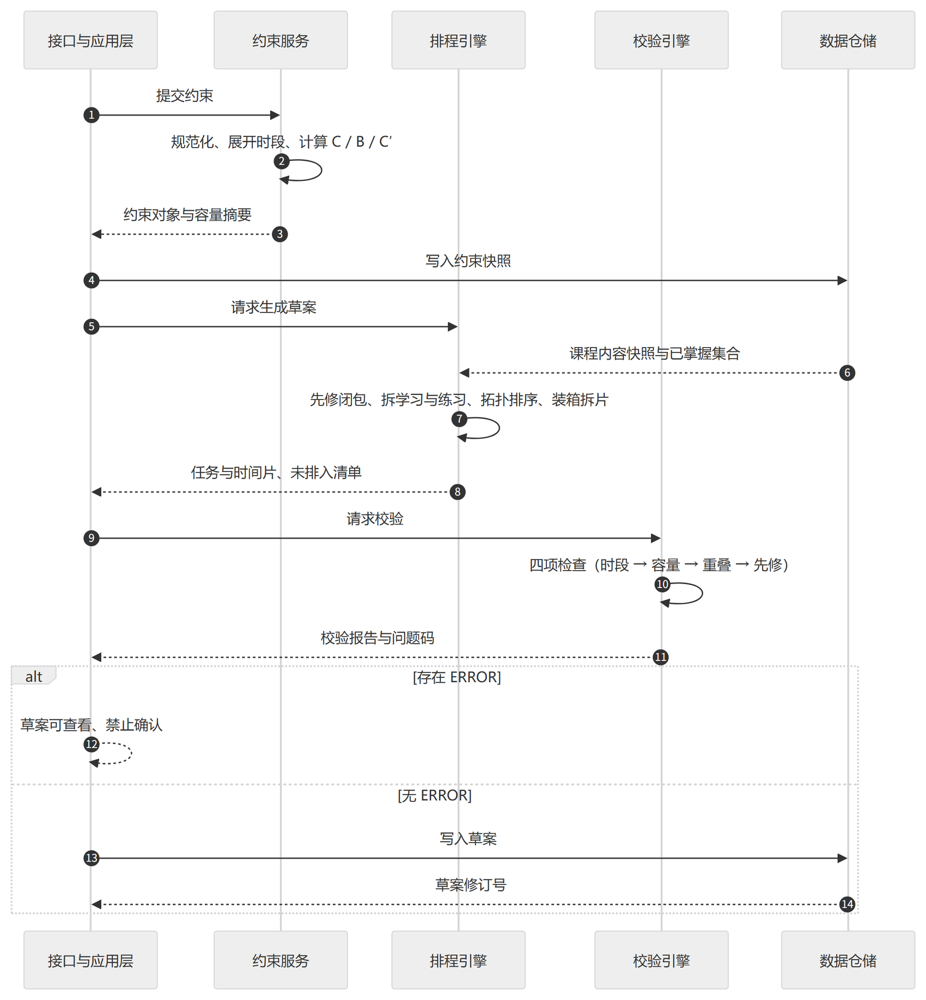

# 课程学习规划辅助系统 · 概要设计说明书

学径 StudyPath

| 项目 | 内容 |
|---|---|
| 课程名称 | 软件工程综合实训 |
| 文档编号 | D04 |
| 文档版本 | v1.1 |
| 文档状态 | 设计评审稿，待评审 |
| 项目组 | 软件工程 2 班 第 6 组 |
| 组长 | 王昱涵 |
| 小组成员 | 李鸿佑、李俊达、项奕乔 |
| 指导教师 | 张德珍 |
| 编制日期 | 2026 年 11 月 2 日 |

本文按教师模板组织，供设计评审及后续开发使用。参数、接口与数据结构为拟定设计，评审通过后纳入设计基线。

## 1 引言

### 1.1 编写目的

本说明书把 D02 确定的需求转换为可实现的结构：划分层次与模块、明确模块职责与调用关系、规定接口边界与运行方式、给出出错处理与维护安排。预期读者为设计与开发人员、测试人员、指导教师。

阅读约定：凡本文与 D02 冲突之处，以 D02 为准并回改本文；凡本文未展开的规则细节，见 D02 对应章节。

### 1.2 背景

表 1.1 系统背景

| 项 | 说明 |
|---|---|
| 系统名称 | 学径 StudyPath —— 课程学习规划辅助系统 |
| 任务提出者 | 《软件工程综合实训》课程组 |
| 开发者 | 软件工程 2 班 第 6 组（4 人） |
| 用户 | 学生（主用户）、课程管理员 |
| 运行形态 | 单机部署的 B/S 应用，浏览器访问，SQLite 存储 |
| 上游文档 | D02 软件需求说明书 v2.3（2026-10-28，需求基线） |
| 下游文档 | D05 数据库设计说明书、D06 详细设计说明书 |

### 1.3 定义

表 1.2 术语补充定义

| 术语 | 含义 |
|---|---|
| 层（Layer） | 按职责纵向切分的代码集合：表现层、接口与应用层、领域层、基础设施层 |
| 模块（Module） | 本文的设计单元，编号 M-01～M-12，一个模块可跨多个文件但职责单一 |
| 确定性引擎 | 不调用大模型、输入相同即输出相同的计算模块（排程引擎、校验引擎） |
| 智能体（Agent） | 调用大模型完成语言任务的模块，输出必须经程序校验才能入库 |
| 适配器（Provider） | 对第三方能力的统一封装，本期为大模型（真实服务 / 本地 Mock） |
| 快照（Snapshot） | 计划确认时固化的输入与输出，创建后不可修改 |
| 幂等（Idempotent） | 同一请求重复执行不产生重复结果（重复确认、重复打卡） |
| 降级（Degrade） | 依赖不可用时切换到等效的低配路径（模型→表单/模板） |

### 1.4 参考资料

本版依据《D02 软件需求说明书》v2.3（2026-10-28，需求基线）、《D05 数据库设计说明书》v1.0（2026-11-02）及《D01 项目开发计划书》编制。设计评审通过后纳入设计基线；D02 若有变更，本文同步修改。

老师提供的《3.概要设计说明书格式》是本说明书的章节依据，保留六章及全部二级标题，将模板中的“尚未问决的问题”校正为“尚未解决的问题”。数据库细节以同版D05为准。建模采用面向对象分析与分层应用设计，数据库用实体关系模型，不把模块分解图标作UML类图。

参考技术资料：OMG UML 2.5.1（https://www.omg.org/spec/UML/2.5.1/About-UML）；SQLite外键（https://www.sqlite.org/foreignkeys.html）、部分索引（https://www.sqlite.org/partialindex.html）及备份接口（https://www.sqlite.org/backup.html）。访问日期2026-11-02。GB/T 8567—2006为文档编制参考，具体章目按老师模板执行。

## 2 总体设计

### 2.1 需求规定

表 2.1 需求摘要

| 类别 | 摘要 | 详见 |
|---|---|---|
| 功能 | 13 项功能 F-01～F-13：课程内容维护 4 项、学习规划 5 项、执行与调整 4 项 | D02 §3.1 |
| 校验 | 容量、重叠、先修、截止四项，固定顺序执行，ERROR 阻止确认 | D02 §3.1.10、§3.8.2 |
| 性能 | 计划生成 ≤1 s、校验 ≤200 ms、页面首屏 ≤2 s、模型辅助 ≤10 s | D02 §3.2.2 |
| 规模 | 30 知识点、40 条先修、60 份资源、50 个逻辑任务 | D02 §3.2.2、§3.4.1 |
| 约束 | 单课程、单机、离线可演示、排程与校验不依赖模型 | D02 §2.4 |

### 2.2 运行环境

系统为单机 B/S 应用：浏览器加载静态前端，前端通过 HTTP 调用本机后端，后端读写同一台机器上的 SQLite 文件；大模型是可选外部依赖，关闭后自动使用本地 Mock。

表 2.2 部署要素

| 要素 | 内容 | 说明 |
|---|---|---|
| 客户端 | Chrome / Edge 桌面版，≥1366×768 | 不要求移动端适配 |
| 前端 | React 构建后的静态文件 | 由后端托管或本地静态服务器提供 |
| 后端 | Python 3.11 + FastAPI + Uvicorn，默认 8000 端口 | 单进程、单 worker |
| 数据库 | SQLite 3.x 单文件 studyplan.db | 开启 WAL；详见 D05 |
| 模型 | 可选：真实适配器 / 本地 Mock | 由配置项切换，故障自动降级 |
| 网络 | 本地回环即可运行；真实模型与外链需外网 | 演示可在断网环境完成 P0 |

图 2-1 部署节点与制品示意图

图2-1 部署节点与制品示意图

图2-1区分浏览器执行环境、同机后端与数据库文件。静态制品由后端同源托管，HTTP请求从浏览器直接到后端；SQLite不是独立网络服务。备份使用一致性API而非任意文件复制。

### 2.3 基本设计概念和处理流程

系统遵循四条设计原则，它们直接决定了模块划分与接口边界。

原则一：分层隔离，单向依赖。 表现层经HTTP访问接口；接口与应用层协调用例、权限与事务；领域层实现纯计算及端口定义；基础设施层实现仓储、Provider和时钟端口。领域模块不得直接导入SQLite驱动或模型SDK。分层降低耦合，但替换实现仍须通过契约与回归验证。

原则二：程序算、模型说。 任务分解、排程、四项校验、差异计算一律由确定性引擎完成，结果可复现、可单测；大模型只承担三类语言任务——把学生的自然语言转成结构化字段、把结构化结果转成学生能懂的解释、在既定候选内挑选资源。模型输出必须通过字段与 ID 校验才会进入计划，且不得修改校验结论或绕过确认。

原则三：单一事实源与快照不可变。 当前课程内容是新规划的输入源，已生效版本快照是历史规划的事实源，计划生成时连同基准时刻、配置一起快照；确认后版本只读，执行记录（打卡）作为独立事件追加，不回写快照。这样“历史为什么这么排”永远可复现。

原则四：失败可解释、可降级。 任何失败都返回带问题码的结构化结果与建议动作；外部依赖失败时切换到等效低配路径，而不是让主流程中断。

一次计划生成的处理流程（对应 D02 图 3-4 的时序）：

1. 接口与应用层接收约束请求 → M-03 校验字段并展开可用时段、计算原始容量 C、缓冲 B、可排容量 C′；

2. 若字段不全，M-04 追问并把自然语言抽成字段，回显确认后再回到步骤 1；

3. M-05 求先修闭包、去重减已掌握、拆学习与练习任务、按有效时段装箱拆片；

4. M-06 按固定顺序执行四项校验，产出问题码、受影响任务与建议；

5. M-04 把校验结果转成解释文本（不修改结论）；

6. 学生确认 → M-07 复核版本与进度、事务写入版本与当前指针 → M-08 开始记录执行事件。

图2-2为分层组件示意图：虚线开放箭头表示实现领域端口的依赖方向，实线箭头为业务调用。组件内部以名称标识职责，详细类与方法在D06展开。

图 2-2 系统分层组件与依赖方向

图 2-3 计划生成活动图

活动图以实心圆表示开始，圆角矩形表示活动，菱形表示有守卫条件的分支，靶心表示结束。失败草案可保存但不生效；用户修改后重新生成，不自动删除必需先修。

### 2.4 结构

图 2-4 是**模块结构图**：方框为模块，自上而下的箭头表示**调用**（上层调用下层），框内第三行标注该模块的主要**数据进出**。M-10 作为唯一入口位于顶层，向下调用 8 个功能模块；M-02 是被读取的内容提供方，虚线箭头表示“读取快照”；M-11、M-12 是被全部程序共用的基础模块。逐条调用的输入输出与异常约定见 §3.3 表 3.3。

系统保留M-01至M-12编号，按四层重新明确边界：表现层；接口与应用层；领域层；基础设施层。M-02、M-03等应用服务负责协调，成环、容量和归属等规则由领域或策略组件执行。

图 2-4 系统模块结构图

表 2.3 模块清单

| 编号 | 模块 | 所属层 | 职责 | 主要输入→输出 |
|---|---|---|---|---|
| M-01 | 认证与权限 | 接口与应用层 | 登录、会话、角色与归属校验 | 用户名密码 → 令牌与角色；请求上下文 → 放行/拒绝 |
| M-02 | 课程内容管理 | 接口与应用层 | 课程、知识点、先修、资源的维护与成环检查 | 内容字段 → 保存结果；先修批次 → 环路或成功 |
| M-03 | 约束管理 | 接口与应用层 | 约束录入、字段校验、可用时段展开、容量计算 | 约束请求 → 规范化约束 + C/B/C′ |
| M-04 | 追问与抽取 | 领域层 | 目标映射、日期归一、追问、解释文本生成 | 自然语言 → 字段候选 + 追问/说明 |
| M-05 | 分解与排程 | 领域层 | 先修闭包、任务分解、拆片、按可用时段装箱 | 约束 + 课程快照 → 任务与时间片 |
| M-06 | 计划校验 | 领域层 | 四项检查、问题码、建议动作 | 草案 + 约束 → 校验报告 |
| M-07 | 确认与版本 | 接口与应用层 | 确认门槛、事务写入、差异计算、版本快照 | 草案标识 → 生效版本；新旧版本 → 差异 |
| M-08 | 进度与事件 | 接口与应用层 | 打卡、更正、完成率、逾期标记 | 打卡请求 → 学习事件 + 统计 |
| M-09 | 看板与前端组件 | 表现层 | 页面、任务卡片、状态展示、交互反馈 | 查询结果 → 界面 |
| M-10 | 接口与序列化 | 接口与应用层 | 路由注册、请求校验、错误码映射 | HTTP 请求 → 调用领域模块 → 响应 |
| M-11 | 存储访问 | 基础设施层 | 数据访问、事务、迁移、备份 | 领域对象 → 表记录；查询条件 → 记录集 |
| M-12 | 基础设施 | 基础设施层 | 配置、日志、模型适配器、健康检查 | 配置项 → 运行时上下文 |

### 2.5 功能需求与程序的关系

表 2.4 功能需求与模块分配矩阵

下表是功能分配矩阵，●为主责，○为协作。M-09前端、M-10路由、M-11仓储作为公共支撑列出，不表示路由直接执行SQL。所有私有操作先经过M-01归属校验。

| 功能 | M-02课程 | M-03约束 | M-04语言 | M-05排程 | M-06校验 | M-07版本 | M-08进度 |
|---|---|---|---|---|---|---|---|
| F-01 登录 | — | — | — | — | — | — | — |
| F-02～05 内容维护 | ● | — | ○ | — | ○ | — | — |
| F-06 约束 | ○ | ● | ○ | — | — | — | — |
| F-07 追问 | — | ○ | ● | — | — | — | — |
| F-08 生成 | ○ | ○ | ○ | ● | ○ | — | — |
| F-09 校验 | — | ○ | — | ○ | ● | — | — |
| F-10 确认打卡 | — | — | — | — | ○ | ● | ● |
| F-11 调整 | ○ | ○ | ○ | ● | ○ | ● | ○ |
| F-12 版本 | — | — | — | — | — | ● | — |
| F-13 看板 | — | — | — | — | — | ○ | ● |

表 2.5 公共支撑模块分配

| 功能范围 | 公共支撑模块 |
|---|---|
| F-01 | M-01主责；M-09/M-10/M-11/M-12协作 |
| F-02～F-13 | M-01认证与归属；M-09展示；M-10路由；需要持久化时经M-11 |
| 模型相关功能 | M-12实现真实Provider与Mock；模型不得执行写入 |

### 2.6 人工处理过程

系统不假设全自动，以下环节保留人工操作：

表 2.6 人工处理过程

| 环节 | 人工内容 | 触发方式 | 系统支持 |
|---|---|---|---|
| 课程内容首次录入 | 管理员录入课程、知识点、先修、资源；确认学科正确性 | 学期初一次性 | 表格化编辑、成环检查、引用影响提示 |
| 课程内容修订 | 管理员调整时长或停用知识点 | 学期中偶发 | 影响范围提示、历史快照保护 |
| 演示数据初始化 | 维护人员执行初始化脚本 | 演示前 | 脚本可重复执行、覆盖范围显式声明 |
| 备份与恢复 | 维护人员确认备份、执行恢复 | 每日自动 + 按需手动 | 启动补做、恢复核对清单 |

### 2.7 尚未解决的问题

表 2.7 未决问题

| 编号 | 问题 | 影响 | 计划 |
|---|---|---|---|
| Q-01 | 任务拆片后时间片数量上限（当前按 100 片估） | 极端约束下排程耗时可能超出 1 s | D06 给复杂度分析，必要时限制附加目标数量 |
| Q-02 | 同一学生多窗口并发确认的冲突概率 | 影响 E2004 的触发频率与提示文案 | 已用版本号乐观锁兜底，D06 补并发时序 |
| Q-03 | 模型抽取与规则解析的边界（日期归一化是否全部本地） | 影响 IF-02 的隐私承诺能否成立 | D06 明确“本地优先、模型只处理脱敏文本” |

## 3 接口设计

### 3.1 用户接口

用户接口由浏览器呈现，按下表七类页面实现；页面需求与F-01至F-13对应，不依赖未提供的原型编号。

表 3.1 页面与主要交互

| 页面 | 主要元素 | 关键反馈 |
|---|---|---|
| 登录 | 账号、密码、登录按钮 | 账号或密码错误统一提示；锁定倒计时 |
| 规划向导 | 目标选择、截止日期、周模板、排除日期、已掌握多选 | 实时显示 C/B/C′ 与目标路径所需时长 |
| 草案 | 任务列表、预计时长编辑、未排入清单、校验报告、重新生成、确认 | ERROR 高亮并禁用确认；修改后自动重排 |
| 当前计划 | 今日任务、全周期列表、完成率、逾期标记、打卡入口 | 两步确认；重复打卡不重复计数 |
| 调整预览 | 差异列表（新增/移除/移动/时长变化）、原因、确认/取消 | 版本或进度已变时提示重新计算 |
| 历史版本 | 时间线、两版对比、只读标识 | 历史只读，无打卡按钮 |
| 课程管理 | 章节树、知识点表格、先修编辑、资源关联 | 字段错误定位、引用影响提示、成环指出环路 |

用户接口约定：不使用仅靠颜色传达状态（状态同时有文字）；破坏性操作需二次确认并说明影响范围；日期时间输入提供格式提示。

### 3.2 外部接口

表 3.2 外部接口

| 接口 | 对方 | 形式 | 约定 |
|---|---|---|---|
| 浏览器 ↔ 前端 | 客户端 | HTTP 静态资源 | 前端资源本地加载，不从公网取字体与脚本 |
| 前端 ↔ 后端 | 进程间 | HTTP + JSON，前缀 /api | 统一认证头、统一错误结构（见 D02 §3.3.4） |
| 后端 ↔ 数据库 | SQLite 文件 | 文件读写 + SQL | 单写多读，开启 WAL 与忙等待 |
| 后端 ↔ 大模型 | 外部服务 | HTTPS，Provider 适配 | 超时 10 s（含重试）；失败降级为表单/模板 |
| 后端 ↔ 备份文件 | 本地磁盘 | 一致性备份API | 每日至少一次，保留 7 份，一致性备份 |
| 测试时钟 | 测试进程 | 配置注入 | 用于构造“延期”“逾期”场景，不修改设备时间 |

拟定HTTP契约如下，详细DTO在D06与OpenAPI同步，路径为设计约定，不表示接口已经上线。所有私有操作先检查学生身份与对象归属。

表 3.3 核心 HTTP 接口契约

| 方法与路径 | 用途 | 关键契约 |
|---|---|---|
| POST /api/auth/login | 登录 | 账号密码换取令牌、角色及有效期 |
| GET /api/course | 当前课程 | 已登录只读启用内容 |
| PUT /api/admin/course | 修改课程 | admin；内容修订号递增 |
| POST /api/admin/concepts | 新增知识点 | admin；名称、时长校验 |
| PATCH /api/admin/concepts/{id} | 修改或停用知识点 | admin；引用保护，不改历史 |
| PUT /api/admin/prerequisites | 批量更新先修 | admin；整批无环及同课程检查 |
| POST /api/admin/resources | 维护资源与关联 | admin；资源与关联同事务 |
| POST /api/plans/drafts | 生成草案 | 返回draft_​id、revision、任务、片段、报告 |
| POST /api/dialogue/constraints | 追问补全 | 最多追问两项，10秒内响应或降级 |
| POST /api/drafts/{id}/confirm | 确认草案 | revision、confirm_​key；结果版本或冲突 |
| POST /api/plans/{id}/adjustments | 调整预览 | 基线版本、进度修订和调整原因 |
| POST /api/plans/{id}/events | 打卡与更正 | request_​key、task_​id、version_​id、用时备注 |
| GET /api/plans/{id}/versions | 版本清单 | 本人只读历史 |
| GET /api/plans/{id}/diff | 两版比较 | from、to；字段旧值与新值 |
| GET /api/plans/{id}/tasks | 任务与进度 | 返回版本号及progress_​revision |

HTTP 400为字段错误，401未认证，403角色不符，404对象不存在或不向当前用户暴露，409基线或幂等冲突，503数据库暂不可写。错误对象统一为code、message、field、detail、request_id。E2003携带完整校验报告；模型失败可返回成功响应及mode=mock、degraded_reason=E3001，不阻断主流程。

### 3.3 内部接口

模块之间通过DTO、纯函数和端口交互。应用服务通过UnitOfWork协调仓储；领域引擎只接收内存数据。禁止路由或领域计算直接拼接SQL。

表 3.4 主要内部接口

| 调用方 | 被调方 | 接口（语义） | 输入→输出 |
|---|---|---|---|
| M-10 | M-01 | 校验请求上下文 | 请求头 + 对象归属 → 通过 / 401 / 403 |
| M-10 | M-03 | 保存并规范化约束 | 约束请求 → 约束对象 + C/B/C′ |
| M-10 | M-05 | 生成草案 | 约束 + 内容快照 + 基准时刻 → 任务与时间片 |
| M-10 | M-06 | 校验草案 | 草案 + 约束 → 校验报告 |
| M-10 | M-07 | 确认草案 | 草案标识 + 修订号 → 版本号 / E2004 |
| M-10 | M-08 | 打卡 | 任务标识 + 完成标记 + 用时 → 学习事件 + 统计 |
| M-03 | M-02 | 读取课程内容快照 | 课程标识 → 知识点与先修 |
| M-05 | M-03 | 读取可用时段与容量 | 约束对象 → 时间片序列 |
| M-05 | M-02 | 读取知识点与参考时长 | 知识点集合 → 属性 |
| M-07/M-10 | M-06 | validate | 显式草案对象、约束、图与基准时刻 → 报告；校验器不回调排程器 |
| M-07 | M-06 | 复核校验结论 | 草案 + 约束 → 是否仍通过 |
| M-07 | M-11 | 事务写入版本与指针 | 版本对象 → 提交结果 |
| M-04 | M-12 | 调用模型 | 提示词 + 上下文 → 文本或结构化候选 |
| M-08 | M-11 | 追加学习事件 | 事件对象 → 事件标识 |

## 4 运行设计

### 4.1 运行模块组合

表 4.1 三个主要运行场景

| 场景 | 触发 | 参与的模块（按调用顺序） | 结束条件 |
|---|---|---|---|
| 生成学习计划 | 学生提交约束 | M-01 → M-03 →（M-04 追问）→ M-05 → M-06 →（M-04 解释）→ M-09 展示 | 返回草案与校验报告 |
| 打卡记录进度 | 学生确认任务完成 | M-01 → M-08 → M-11 → M-09 | 返回完成率与逾期标记 |
| 计划调整 | 学生发起或系统检测到延期 | M-01 → M-07 读取现行版本 → M-05 重排 → M-06 校验 → M-07 差异 →（M-04 说明）→ M-09 | 返回调整草案，确认后写新版本 |

图 4-1 草案确认交互时序图

图4-1 草案确认交互时序图

图4-1中竖向虚线为生命线，实线消息为调用，虚线消息为返回。提交前重校；BEGIN IMMEDIATE后再次比对草案修订、版本号、progress_revision与课程修订，任一不同即返回E2004并回滚。请求幂等键已消费时返回原result_version_id；不得新增第二版本。版本、version_task、task_slice、校验报告及当前指针在同一事务提交，模型调用不进入写事务。

调整草案保存base_version、base_progress_revision和course_revision。新目标外的已完成任务仍以in_scope=0、frozen=1保留，不计新目标分母。任何学习事件都使progress_revision递增，防止另一窗口基于旧进度确认。

图 4-2 学习计划状态转换图

图4-2 学习计划状态转换图

### 4.1.1 生成侧的模块交互

表 4.1 只列出"哪些模块参与"，不说明调用顺序。图 4-3 补上生成侧的时序：约束服务先算出容量，排程引擎再读课程快照并产出任务，校验引擎按固定顺序检查，只有无 ERROR 时才写入草案。这条链与 §3.3 的表 3.4（主要内部接口）一一对应。

图 4-3 计划生成与校验的模块交互时序图

### 4.2 运行控制

表 4.2 运行控制

| 控制项 | 方式 | 说明 |
|---|---|---|
| 启动 | 一条命令启动后端，托管前端静态文件 | 启动时检查配置、数据库可写、数据版本 |
| 停止 | 接收终止信号，结束在途事务后关闭连接 | 未提交事务回滚 |
| 模型切换 | 配置项 LLM_​PROVIDER = mock / 真实适配器 / auto | 切换在重启生效；运行期失败自动降级 |
| 备份 | 启动时补做逾期备份，运行期每日一次 | 失败只告警，不影响主流程 |
| 健康检查 | /health 与 /health/detail | 区分主服务、数据库、模型模式、备份状态 |
| 演示重置 | 维护人员显式执行 | 明确覆盖范围，普通启动不删数据 |

### 4.3 运行时间

表 4.3 运行时间预算（对齐 D02 表 3.3）

| 环节 | 预算 | 主要耗时来源 |
|---|---|---|
| 页面首屏 | ≤ 2 s | 静态资源加载与首次渲染 |
| 约束保存与容量展开 | ≤ 300 ms | 字段校验 + 时段展开 |
| 任务分解与排程 | ≤ 1 s | 闭包、拓扑排序、装箱拆片 |
| 四项校验 | ≤ 200 ms | 基于排序的区间扫描与依赖边检查；约O(S log S + E) |
| 确认写入 | ≤ 300 ms | 事务写版本、快照与指针 |
| 打卡写入 | ≤ 200 ms | 事件追加、进度修订号更新及统计查询 |
| 版本对比 | ≤ 500 ms | 两版快照差异计算 |
| 模型辅助 | ≤ 10 s | 网络往返 + 重试；超时即降级 |

## 5 系统数据结构设计

### 5.1 逻辑结构设计要点

本版采用16张表：12张沿用的业务表、3张新增支撑表（plan_draft、version_task、task_slice）及schema_meta。表、字段、约束及图均由D05同一结构定义生成。完整字段共121项，不再引用不存在于已提供D02中的“12表81项字典”。

plan_task只存稳定任务身份，跨版安排进入version_task，连续时间片进入task_slice；plan_version固化输入、配置、基准时刻和快照；learning_event只追加，不修改历史规划。失败草案及校验保存在plan_draft.payload_json，正式plan_validation仅存已生效版本的通过报告。

### 5.2 物理结构设计要点

采用SQLite文件，连接开启foreign_keys、WAL、busy_timeout=3000、synchronous=FULL。FULL为本版持久性优先的设计选择，仍需目标机器性能验证。数据库没有独立用户或GRANT，数据隔离由文件权限与应用鉴权共同保证。

复合外键保证同课程及同计划归属；当前版本采用延迟外键保证存在；部分唯一索引保证每学生每课程仅一份active或completed现行计划。完成计划在新计划确认时先归档，避免两份现行计划。冻结版本及事件有不可变触发器。

### 5.3 数据结构与程序的关系

表 5.1 数据对象与模块的访问矩阵

R表示经仓储读取，W表示经仓储写入，—为不直接访问。M-11实际执行SQL，M-10仅解析与序列化，不直接读写表；下表为应用服务访问矩阵。

| 数据 | M-01 | M-02 | M-03 | M-07 | M-08 | M-11 |
|---|---|---|---|---|---|---|
| 用户 | RW | R | — | R | R | RW |
| 课程及内容 | — | RW | R | R | — | RW |
| 当前约束/草案 | — | — | RW | RW | — | RW |
| 任务/版本/安排/片/报告 | — | — | — | RW | R | RW |
| 事件/进度修订 | — | — | — | R | RW | RW |
| schema_​meta | — | — | — | — | — | RW |

## 6 系统出错处理设计

### 6.1 出错信息

对外错误码沿用 D02 表 3.21（E1001 字段错误、E1002 不存在或不可访问、E1003 状态不允许、E1005 写入失败或忙、E2001 先修成环、E2002 目标冲突、E2003 校验不通过、E2004 版本过期、E3001 模型不可用、E4001/E4003 未认证与无权限）。

表 6.1 模块级异常与处置

| 模块 | 异常 | 对外表现 | 处置 |
|---|---|---|---|
| M-02 | 批量提交形成环 | E2001 + 环路与行号 | 整批回滚，保留输入 |
| M-03 | 可用容量为零 | E1003 + 原因 | 拒绝规划，引导改约束 |
| M-04 | 模型超时或输出不可解析 | 不报错，降级 | 10 s 预算内转表单/模板，保留已填字段 |
| M-05 | 先修图损坏或必需点停用 | E2001 | 终止生成，提示联系管理员 |
| M-05 | 无法全部排入 | 不报错 | 返回草案 + 未排入清单 + 缺口 |
| M-06 | 存在 ERROR | E2003 | 草案可看、禁止确认 |
| M-07 | 版本或进度已变 | E2004 | 拒绝写入，要求重新计算 |
| M-08 | 重复打卡 | 不报错 | 幂等，不重复计数 |
| M-11 | 数据库忙或写失败 | E1005 | 忙等上限 3 s，回滚并提示重试 |

### 6.2 补救措施

表 6.2 补救措施

| 措施类型 （模板术语） | 具体做法 | 适用场景 |
|---|---|---|
| 降效技术 | 模型不可用 → 表单与模板；给出不存在的资源 ID → 丢弃该候选并按规则回退 | 模型超时、输出非法 |
| 重试 | 仅对幂等操作重试，重试计入同一时间预算；写操作失败提示人工重试 | 网络抖动、忙锁 |
| 回滚（事务恢复） | 确认与调整在一个事务内完成，任一失败整体回滚 | 写版本、切指针、更新状态 |
| 恢复及再启动技术 | 每日备份 + 启动补做；恢复前停写并保留故障副本；核对账号、版本、事件一致性 | 数据损坏、误操作 |
| 后备技术 | 每日备份保留最近 7 份，启动时补做逾期备份 | 定期保护、演示前 |
| 数据核对 | 提供“计划—版本—事件”一致性检查脚本 | 演示前、恢复后 |

### 6.3 系统维护设计

表 6.3 系统维护设计

| 安排 | 内容 |
|---|---|
| 日志 | 按日切分，记录请求、耗时、异常、模型调用与降级原因；不含口令、令牌与完整对话 |
| 链路追踪 | 一次请求内的模块调用序列与耗时，用于定位超时环节 |
| 配置集中 | 缓冲比例、片长上限、延期阈值、超时预算、模型模式均集中配置并校验范围 |
| 健康检查 | 主服务、数据库、模型模式、备份状态四项分开报告 |
| 迁移 | 建表与升级脚本按版本号顺序执行，启动时校验数据版本 |
| 演示复位 | 独立脚本，显式声明覆盖范围，普通启动不触发 |

## 附录 A 与需求文档的对应关系

表 A.1 需求条目与设计位置的对应

| 需求条目 | 本文对应位置 |
|---|---|
| F-01～F-13 | 表 2.3 模块清单、表 2.4 功能与模块对应关系 |
| 四项校验与问题码 | M-06、表6.1；先字段与时段合法性，再容量、重叠、先修、截止 |
| 性能指标 PF-05～PF-11 | 表 4.2 运行时间预算 |
| 数据对象与规模 | §5.1、§5.2，详见 D05 |
| 错误码 | §6.1，详见 D02 表 3.21 |
| 权限边界 | §3.3 内部接口 + D02 表 2.2 权限矩阵 |

## 附录 B 设计核验与评审记录

核验重点：Mock断网生成与调整、相邻区间不误报、拆片时长守恒、ERROR阻止确认、双窗口竞争仅一方成功、重复打卡仅一条完成事件、已完成任务不被移动、历史输入可重放。算法和API实际性能、真实Provider适配及部署命令在D06与D12完成后实测，本版不声明系统已实现。

图2-1部署节点与制品；图2-2分层组件；图2-4模块分解；图2-3生成活动；图4-1确认时序；图4-2计划状态。图中使用UML语义或明确注明的结构示意记法，不用普通流程图冒充数据流图。

评审日期、参评人、结论、整改责任人与复核日期由项目组评审时填写。D02最终基线版本与真实模型服务商仍须确认。

## 附录 C 图表清单

表 C.1 图清单

| 图号 | 图题 | 所在章节 | 来源 |
|---|---|---|---|
| 图 2-1 | 部署节点与制品示意图 | 2.2 | 组员 v1.0 |
| 图 2-2 | 系统分层组件与依赖方向 | 2.3 | 组员 v1.0 |
| 图 2-3 | 计划生成活动图 | 2.3 | 组员 v1.0 |
| 图 2-4 | 系统模块结构图（控制关系） | 2.4 | 本次重绘 |
| 图 4-1 | 草案确认交互时序图 | 4.1 | 组员 v1.0 |
| 图 4-2 | 学习计划状态转换图 | 4.1 | 组员 v1.0 |
| 图 4-3 | 计划生成与校验的模块交互时序图 | 4.1.1 | 我方补充 |

### 变更记录

2026-11-01 v0.1：队员初稿。2026-11-02 v1.1：合并组员 v1.0 稿与我方补充稿；修正课程名、D02 引用与表号；补齐表 2.4/2.5。
2026-11-02 v1.0：按教师模板完善；修正分层、版本拆片及并发事务；与D05统一16表设计；重绘六幅图；状态为待评审。
