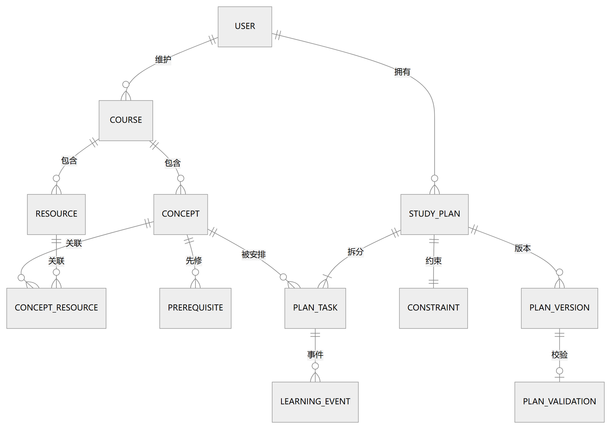

# 课程学习规划辅助系统 · 数据库设计说明书

学径 StudyPath

| 项目 | 内容 |
|---|---|
| 课程名称 | 软件工程综合实训 |
| 文档编号 | D05 |
| 文档版本 | v0.1 |
| 文档状态 | 初稿，待评审 |
| 项目组 | 软件工程 2 班 第 6 组 |
| 组长 | 王昱涵 |
| 小组成员 | 李鸿佑、李俊达、项奕乔 |
| 指导教师 | 张德珍 |
| 编制日期 | 2026 年 11 月 1 日 |

本文定义系统持久化层的数据库设计：库的标识与使用约定、概念与逻辑结构、物理存储与索引、安全保密与字典落地。字段级定义以《软件需求说明书》D02 v2.3 §3.4.4 的数据字典为准，本文不重复字段清单。

## 1 引言

### 1.1 编写目的

说明本数据库的用途、使用方式、结构组成与物理安排，供开发、测试、维护与验收使用。预期读者：后端开发人员、测试人员、后续维护人员、指导教师。

本文与 D02 的分工：**D02 定义“存什么”（数据项、类型、值域、必填），本文定义“怎么存”（表、键、索引、约束、文件与参数）**。

### 1.2 背景

| 项 | 说明 |
|---|---|
| 数据库名称 | `studyplan.db`（SQLite 3 单文件） |
| 所属系统 | 学径 StudyPath —— 课程学习规划辅助系统 |
| 任务提出者 / 开发者 | 《软件工程综合实训》课程组 / 软件工程 2 班第 6 组 |
| 用户 | 学生、课程管理员；维护人员负责备份与恢复 |
| 安装位置 | 与后端服务同机的数据目录，可写 |
| 上游文档 | D02 软件需求说明书 v2.3（§3.4.4 数据字典、§3.4.1～3.4.3） |
| 相关文档 | D04 概要设计说明书（§5 系统数据结构设计） |

### 1.3 定义

| 术语 | 含义 |
|---|---|
| 逻辑结构 | 表、主键、外键与表间关系的全局视图（设计人员视角） |
| 物理结构 | 文件、页面、索引、参数的落地安排（系统人员视角） |
| 快照（Snapshot） | 计划确认时固化的 JSON，创建后不得修改 |
| 部分索引（Partial Index） | 带 WHERE 条件的索引，用于表达“仅一条生效”这类约束 |
| 数据版本 | 建表与升级脚本的版本号，启动时校验，防止旧库跑新代码 |

### 1.4 参考资料

| 编号 | 资料 | 版本/日期 |
|---|---|---|
| R01 | 《D02 软件需求说明书》§3.4 数据管理能力要求 | v2.3，2026-10-28 |
| R02 | 《D04 概要设计说明书》§5 系统数据结构设计 | v0.1，2026-11-01 |
| R03 | SQLite 官方文档：WAL、部分索引、外键约束 | 3.x |
| R04 | GB/T 8567—2006《计算机软件文档编制规范》 | 2006 |

## 2 外部设计

### 2.1 标识符和状态

表 2.1 数据库标识

| 项 | 内容 |
|---|---|
| 逻辑名 | `studyplan` |
| 物理名 | `studyplan.db`（单文件） |
| 存储位置 | 后端工作目录下的 `data/`，可用环境变量覆盖 |
| 版本标识 | 数据版本号记录在 `schema_meta` 表，随建表/升级脚本递增 |
| 状态 | 开发期可自由重建；演示期使用固定快照；不含“实验/测试”这类临时状态 |
| 有效范围 | 与系统版本绑定，跨版本升级须执行迁移脚本（见 §2.4） |

### 2.2 使用它的程序

表 2.2 访问数据库的程序

| 程序 | 版本 | 访问方式 | 说明 |
|---|---|---|---|
| 后端服务（FastAPI） | v1.0 | 读写 | 唯一在线访问者，所有业务读写经此 |
| 初始化脚本 `init_db` | v1.0 | 建表、写种子数据 | 幂等，可重复执行 |
| 备份脚本 `backup_db` | v1.0 | 只读（一致性备份） | 每日执行，保留 7 份 |
| 演示复位脚本 `reset_demo` | v1.0 | 清空并重建 | 显式调用，普通启动不触发 |
| 一致性检查脚本 `check_consistency` | v1.0 | 只读 | 核对计划—版本—事件 |

### 2.3 约定

表 2.3 命名与编码约定

| 类别 | 约定 | 示例 |
|---|---|---|
| 表名 | 小写单数，下划线分隔 | `study_plan`、`plan_task` |
| 字段名 | 小写下划线；主键 `id`；外键 `<实体>_id` | `plan_id`、`concept_id` |
| 时间字段 | 以 `_at` 结尾，ISO 8601 带时区 | `created_at`、`occurred_at` |
| 日期字段 | 以 `_date` 结尾，`YYYY-MM-DD` | `deadline`、`scheduled_date` |
| 时长字段 | 以 `_minutes` 结尾，整数分钟 | `estimated_minutes` |
| 状态字段 | `status`，取值小写英文枚举 | `active`、`archived` |
| 布尔字段 | `is_` 前缀或过去分词 | `passed`、`is_enabled` |
| 快照字段 | 以 `_snapshot` 结尾，存 JSON 文本 | `snapshot` |
| 字符集 | UTF-8 | 全文统一 |

### 2.4 专门指导

**建库顺序**：`schema_meta` → 账号与课程 → 知识点与先修 → 资源与关联 → 计划与约束 → 任务与版本 → 校验记录与学习事件。必须先建被引用表，再建引用表。

**数据装载**：课程内容由管理员录入或由种子脚本导入；先修关系导入后必须执行一次成环检查；演示账号与演示计划由脚本生成，姓名与学号均为虚构。

**升级方式**：每个版本一个迁移脚本，按版本号顺序执行，执行记录写入 `schema_meta`；升级前自动备份，升级失败回滚到备份。

**禁止事项**：不得直接修改已确认版本的快照字段；不得物理删除被版本引用的知识点（只能停用）；不得在业务代码中绕过事务直接批量写。

### 2.5 支持软件

表 2.4 支持软件与运行参数

| 项 | 取值 | 说明 |
|---|---|---|
| 数据库 | SQLite 3.35 及以上 | 需支持部分索引与外键 |
| 日志模式 | `journal_mode = WAL` | 读写并发更稳，崩溃恢复更好 |
| 同步级别 | `synchronous = NORMAL` | WAL 下的常用折中 |
| 外键 | `foreign_keys = ON` | 每个连接开启 |
| 忙等待 | `busy_timeout = 3000` | 冲突时等待 3 秒后返回 E1005 |
| 页大小 | 默认 4096 字节 | 不调整 |
| 访问方式 | 参数化 SQL | 禁止字符串拼接 |
| 备份工具 | 官方备份 API 或停写复制 | WAL 模式下不得只复制主文件 |

## 3 结构设计

### 3.1 概念结构设计

概念模型沿用 D02 图 3-8（数据概念模型 E-R 图），实体与关系的标识符、属性与值域见 D02 §3.4.4 数据字典。

概念到逻辑的转换规则：

| 概念元素 | 转换为 | 说明 |
|---|---|---|
| 实体 | 一张表 | 实体主标识 → 主键 |
| 1:N 关系 | 在 N 方加外键 | 如计划与任务 |
| M:N 关系 | 独立的关联表 | 知识点与资源 |
| 1:1 关系 | 用唯一外键或独立表 | 计划与约束用独立表 |
| 多值属性 | 独立表或 JSON 列 | 学习目标、常见错误用 JSON 列；可用时段用 JSON 列 |
| 派生标记 | 不落库，查询时计算 | 逾期、冲突由版本与当前时间算出 |

表 3.1 实体与表的映射

| 概念实体 | 物理表 | 说明 |
|---|---|---|
| 用户 | `app_user` | 学生与管理员同一张表，用角色区分 |
| 课程 | `course` | 本期仅一条启用记录 |
| 知识点 | `concept` | 参考时长、难度、章节 |
| 先修关系 | `prerequisite` | 有向边，应用层保证无环 |
| 资源 | `resource` | 链接或摘要 |
| 知识点资源关联 | `concept_resource` | 多对多 |
| 学习计划 | `study_plan` | 聚合根 |
| 学习约束 | `plan_constraint` | 与计划一对一 |
| 计划任务 | `plan_task` | 逻辑任务 + 时间片 |
| 计划版本 | `plan_version` | 快照，只增不改 |
| 校验记录 | `plan_validation` | 与版本一一对应 |
| 学习事件 | `learning_event` | 打卡与更正流水 |

### 3.2 逻辑结构设计



图 3-1 数据库逻辑结构图

表 3.2 表清单

| 表名 | 中文名 | 主键 | 外键 | 关键字段 | 估算记录数 |
|---|---|---|---|---|---|
| `app_user` | 用户 | `id` | — | `username`、`password_hash`、`role`、`status` | 50 |
| `course` | 课程 | `id` | — | `name`、`semester`、`status` | 1 |
| `concept` | 知识点 | `id` | `course_id` | `name`、`chapter`、`difficulty`、`reference_minutes`、`status` | 30 |
| `prerequisite` | 先修关系 | `id` | `from_concept_id`、`to_concept_id`、`course_id` | 唯一有序对 | 40 |
| `resource` | 资源 | `id` | `course_id` | `title`、`type`、`url`、`summary`、`status` | 60 |
| `concept_resource` | 知识点资源关联 | (`concept_id`,`resource_id`) | 两列外键 | — | 150 |
| `study_plan` | 学习计划 | `id` | `student_id`、`course_id` | `status`、`current_version` | 200 |
| `plan_constraint` | 学习约束 | `id` | `plan_id` | `deadline`、`availability`、`mastered_ids`、`base_time` | 200 |
| `plan_task` | 计划任务 | `id` | `plan_id`、`concept_id` | `type`、`estimated_minutes`、`scheduled_date`、`status` | 3000 |
| `plan_version` | 计划版本 | `id` | `plan_id`、`operator_id` | `version`、`change_reason`、`snapshot` | 400 |
| `plan_validation` | 校验记录 | `id` | `version_id` | `passed`、`issues`、`metrics` | 400 |
| `learning_event` | 学习事件 | `id` | `plan_id`、`task_id`、`operator_id` | `event_type`、`actual_minutes`、`occurred_at` | 与任务量匹配 |

**结构要点**

1. **聚合根**：`plan_task`、`plan_constraint`、`plan_version` 必须挂在 `study_plan` 下，外键设为 `ON DELETE RESTRICT`，禁止孤儿记录。
2. **快照只读**：`plan_version.snapshot` 存 JSON（目标、约束、任务、配置、校验结果），应用层禁止 UPDATE。
3. **事件独立**：`learning_event` 只追加，更正以新事件表达（`event_type = correction`），不改旧事件、不回写快照。
4. **派生标记不落库**：逾期、冲突、完成率由查询时计算，避免存储与规则不一致。

### 3.3 物理结构设计

表 3.3 索引清单

| 索引名 | 表 | 字段 | 类型 | 用途 |
|---|---|---|---|---|
| `ux_user_username` | `app_user` | `username` | 唯一 | 登录查询 |
| `ux_concept_course_name` | `concept` | `course_id`, `name` | 唯一 | 同课程名称唯一 |
| `ix_concept_course` | `concept` | `course_id` | 普通 | 按课程取知识点 |
| `ux_prereq_pair` | `prerequisite` | `from_concept_id`, `to_concept_id` | 唯一 | 去重 |
| `ix_prereq_to` | `prerequisite` | `to_concept_id` | 普通 | 反向取前置 |
| `ux_plan_active` | `study_plan` | `student_id`, `course_id` | 唯一（部分索引，`status = 'active'`） | 同学生同课程仅一份生效计划 |
| `ix_plan_student` | `study_plan` | `student_id` | 普通 | 学生计划列表 |
| `ux_task_plan_seq` | `plan_task` | `plan_id`, `seq` | 唯一 | 计划内任务序号稳定 |
| `ix_task_plan_date` | `plan_task` | `plan_id`, `scheduled_date` | 普通 | 看板按日查询 |
| `ux_version_plan_no` | `plan_version` | `plan_id`, `version` | 唯一 | 版本号不重复 |
| `ux_validation_version` | `plan_validation` | `version_id` | 唯一 | 版本与校验一一对应 |
| `ix_event_task_time` | `learning_event` | `task_id`, `occurred_at` | 普通 | 单任务事件回溯 |
| `ix_event_plan_time` | `learning_event` | `plan_id`, `occurred_at` | 普通 | 计划进度统计 |

表 3.4 约束清单

| 类型 | 位置 | 内容 |
|---|---|---|
| CHECK | `concept` | `difficulty BETWEEN 1 AND 5`；`reference_minutes BETWEEN 5 AND 600` |
| CHECK | `plan_task` | `estimated_minutes BETWEEN 1 AND 1440`；`status IN ('undone','done')` |
| CHECK | `study_plan` | `status IN ('draft','pending','active','done','archived')` |
| CHECK | `resource` | `type IN ('document','video','exercise','link')`；`url` 为 NULL 或 `http(s)://` 开头 |
| CHECK | `learning_event` | `actual_minutes IS NULL OR actual_minutes >= 0` |
| 外键 | 各子表 | `ON DELETE RESTRICT ON UPDATE CASCADE` |
| 业务约束 | 应用层 | 先修图无环（提交时检测）；知识点被引用时只能停用；版本快照不可修改 |

表 3.5 容量估算

| 项 | 估算 | 说明 |
|---|---|---|
| 单学期数据量 | 约 15–20 MB | 含任务、版本快照与事件 |
| 快照占比 | 约 60% | 版本快照是主要占用 |
| 索引开销 | 约 10% | 索引数 13 个 |
| 容量上限 | 100 MB | 超出需评估，不得删快照凑容量 |
| 增长趋势 | 线性 | 每学期递增，可归档旧学期数据 |

## 4 运用设计

### 4.1 数据字典设计

数据字典正文位于 D02 §3.4.4（12 张表、81 个数据项），本节说明字典在数据库中的落地方式，避免同一事实两处维护。

| 落地项 | 做法 |
|---|---|
| 字段含义 | 依赖 §2.3 的命名约定 + D02 字典；不重复在代码里写注释性字符串 |
| 字典版本 | 与数据版本号一致，记录在 `schema_meta` |
| 变更流程 | 先改 D02 §3.4.4，再改 D05 §3.2/§3.3，最后执行迁移脚本；三处同版本号 |
| 校验落地 | 字典中的“取值范围”落为 CHECK 或应用层校验；“必填”落为 NOT NULL |
| 生成物 | 迁移脚本 + 实体定义由字典生成，避免手写漂移 |

### 4.2 安全保密设计

表 4.1 角色与数据对象权限

| 数据对象 | 学生 | 课程管理员 | 维护人员 |
|---|---|---|---|
| 课程、知识点、先修、资源 | 只读（仅启用项） | 读写 | 只读 |
| 学习计划、约束、任务、版本、事件 | 仅本人 | 不可访问 | 只读（排障） |
| 账号 | 仅本人基本信息 | 可维护账号状态 | 可维护 |
| 备份文件、日志 | 不可访问 | 不可访问 | 读写 |

表 4.2 安全措施

| 措施 | 内容 |
|---|---|
| 口令保护 | 仅存 `password_hash`（bcrypt，工作因子 ≥ 10），不存明文、不写日志 |
| 最小权限 | 应用使用单一数据库账号；通过应用层角色与归属校验实现数据隔离 |
| 参数化访问 | 全部 SQL 使用参数绑定，禁止拼接 |
| 备份保护 | 备份文件与数据库同目录权限，仅维护人员可读；备份前不停写需用一致性备份 API |
| 日志脱敏 | 不记录口令、令牌、密钥与完整对话；用户标识做脱敏 |
| 演示数据 | 姓名、学号、计划全部虚构，不含真实个人信息 |
| 数据导出 | 本期不提供导出功能；如需导出，须先经评审 |

## 附录 A 建表脚本要点

```sql
PRAGMA journal_mode = WAL;
PRAGMA foreign_keys = ON;
PRAGMA busy_timeout = 3000;

CREATE TABLE IF NOT EXISTS schema_meta (
  key   TEXT PRIMARY KEY,
  value TEXT NOT NULL
);

CREATE TABLE IF NOT EXISTS app_user (
  id            INTEGER PRIMARY KEY AUTOINCREMENT,
  username      TEXT    NOT NULL,
  password_hash TEXT    NOT NULL,
  role          TEXT    NOT NULL CHECK (role IN ('student','admin')),
  status        TEXT    NOT NULL DEFAULT 'enabled',
  created_at    TEXT    NOT NULL
);
CREATE UNIQUE INDEX IF NOT EXISTS ux_user_username ON app_user(username);

CREATE TABLE IF NOT EXISTS concept (
  id                INTEGER PRIMARY KEY AUTOINCREMENT,
  course_id         INTEGER NOT NULL REFERENCES course(id) ON DELETE RESTRICT,
  name              TEXT    NOT NULL,
  chapter           TEXT    NOT NULL,
  difficulty        INTEGER NOT NULL CHECK (difficulty BETWEEN 1 AND 5),
  reference_minutes INTEGER NOT NULL CHECK (reference_minutes BETWEEN 5 AND 600),
  objectives        TEXT,
  pitfalls          TEXT,
  sort_order        INTEGER NOT NULL DEFAULT 1,
  status            TEXT    NOT NULL DEFAULT 'enabled'
);
CREATE UNIQUE INDEX IF NOT EXISTS ux_concept_course_name ON concept(course_id, name);

CREATE UNIQUE INDEX IF NOT EXISTS ux_plan_active
  ON study_plan(student_id, course_id) WHERE status = 'active';
```

> 其余表按 §3.2、§3.3 的定义生成；建表脚本纳入版本管理，与迁移脚本一一对应。

## 附录 B 与上游文档的对应关系

| D02 条目 | 本文位置 |
|---|---|
| §3.4.1 数据对象与规模 | §3.2 表清单、表 3.5 容量估算 |
| §3.4.2 完整性与一致性 | §3.3 表 3.3 索引、表 3.4 约束 |
| §3.4.3 保留与备份恢复 | §2.4 专门指导、§4.2 安全措施 |
| §3.4.4 数据字典（12 表 / 81 项） | 全文基准；§4.1 说明落地方式 |
| 图 3-8 概念模型 | §3.1 概念结构（引用） |

### 变更记录

| 日期 | 版本 | 主要变更 | 状态 |
|---|---|---|---|
| 2026-11-01 | v0.1 | 首次成稿：12 张表、13 个索引、约束与容量估算、安全保密与字典落地 | 待评审 |
