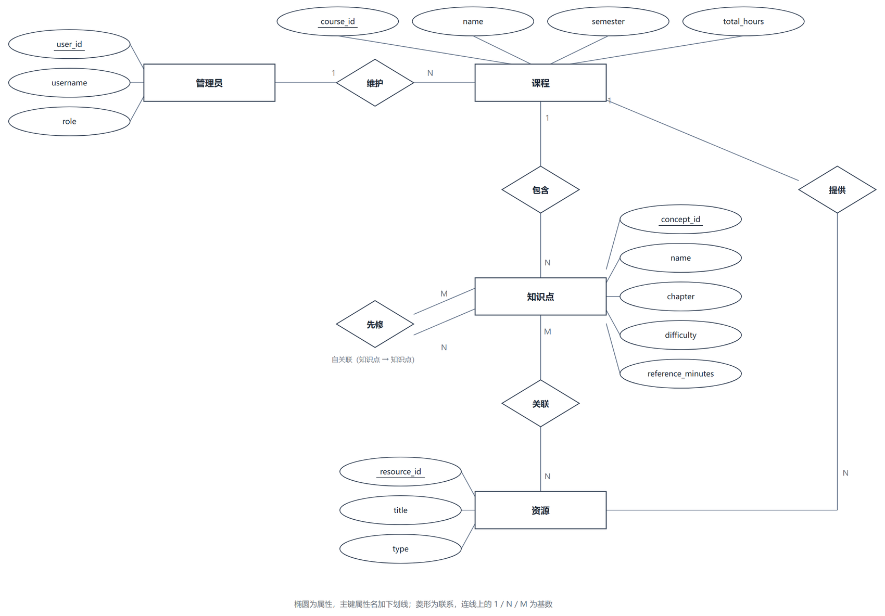
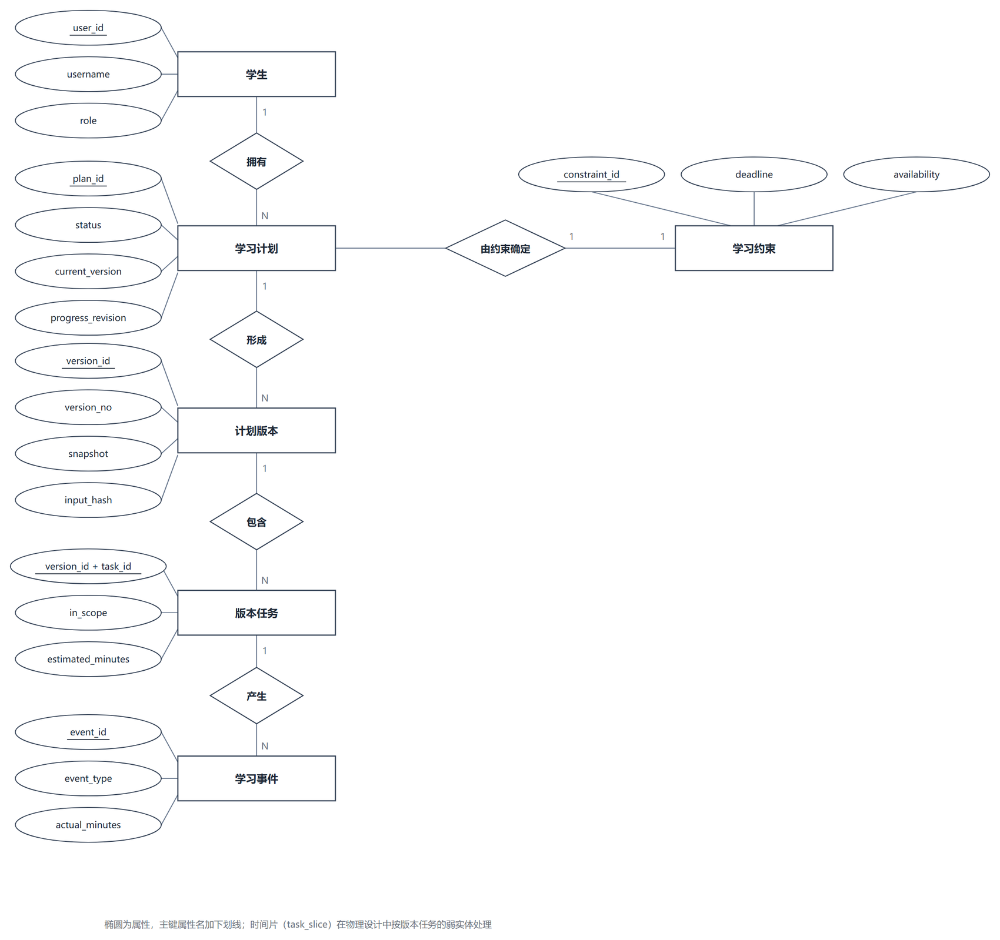
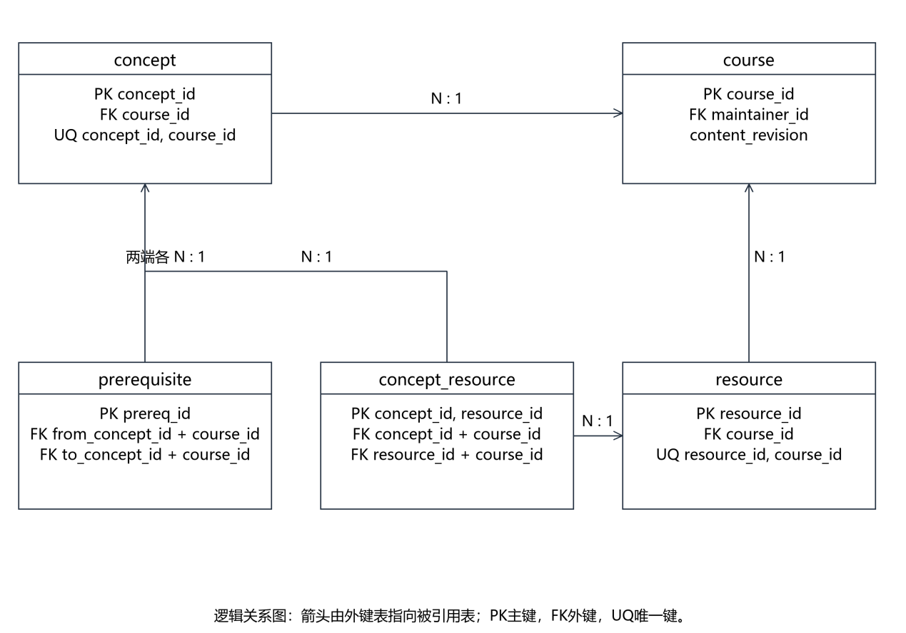
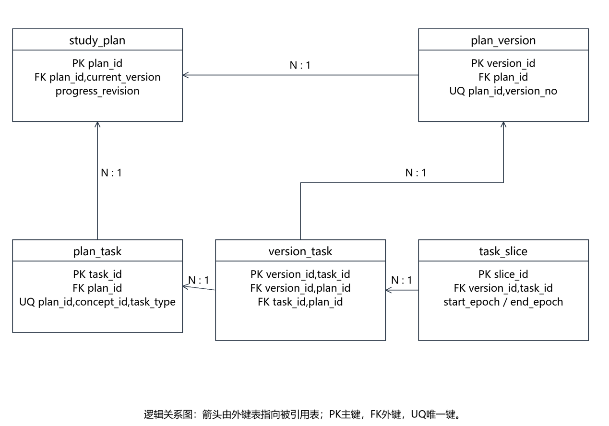
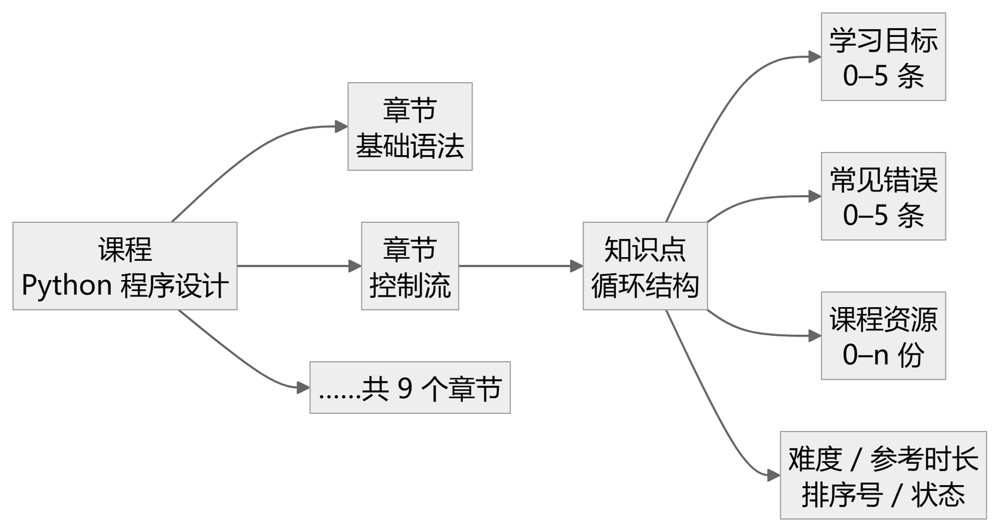
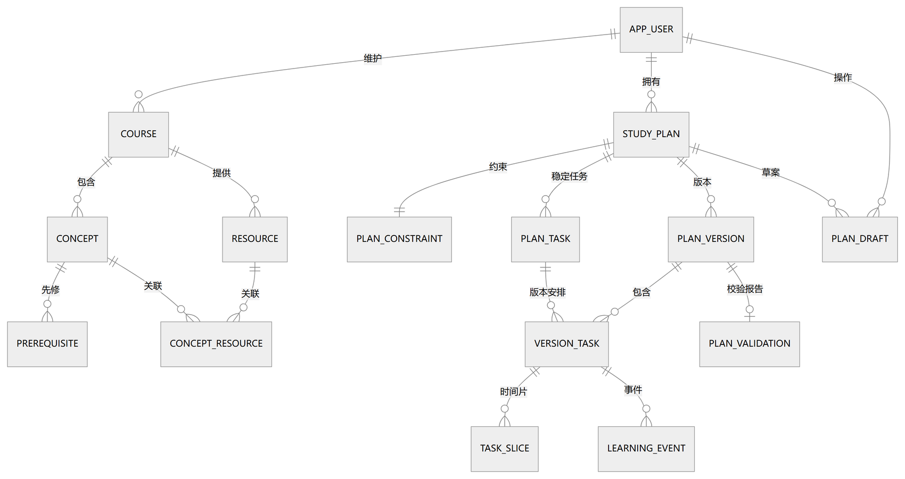
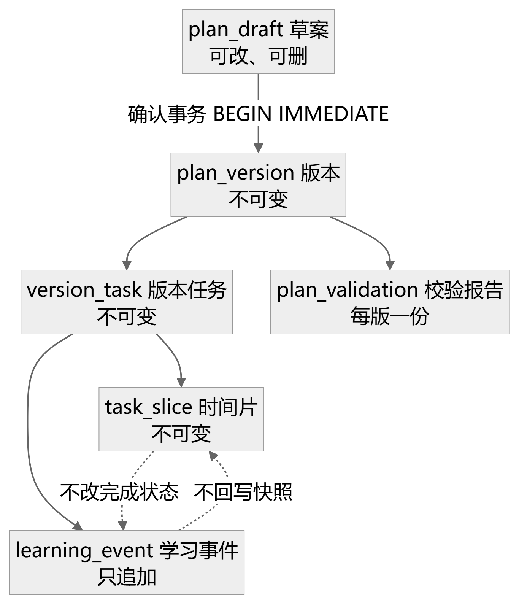

# 课程学习规划辅助系统 · 数据库设计说明书

学径 StudyPath

| 项目 | 内容 |
|---|---|
| 课程名称 | 软件工程综合实训 |
| 文档编号 | D05 |
| 文档版本 | v1.1 |
| 文档状态 | 设计评审稿，待评审 |
| 项目组 | 软件工程 2 班 第 6 组 |
| 组长 | 王昱涵 |
| 小组成员 | 李鸿佑、李俊达、项奕乔 |
| 指导教师 | 张德珍 |
| 编制日期 | 2026 年 11 月 2 日 |

本文按教师模板组织，供设计评审及后续开发使用。参数、接口与数据结构为拟定设计，评审通过后纳入设计基线。

## 1 引言

### 1.1 编写目的

为后端开发、测试和维护提供统一持久化契约，明确数据的含义、主外键、约束、访问及恢复方式，避免字典、ER图与代码各自使用不同字段。本说明书按教师《4.数据库设计说明书格式》保留四章全部二级标题，另增备份恢复和验证附录。关系模型承接面向对象业务概念，不要求一类对应一表。

### 1.2 背景

数据库逻辑名studyplan，文件名studyplan.db，服务于学径StudyPath课程学习规划辅助系统。任务提出者为《软件工程综合实训》课程组，开发者为软件工程2班第6组；学生维护本人学习计划，课程管理员维护单门Python课程内容，维护人员负责部署与备份。部署于与后端相同设备的受控数据目录，不提供浏览器或模型直接数据库连接。

### 1.3 定义

PK是主键，FK是外键，UQ是唯一约束。业务版本version_no与数据库schema_version分别管理，不能混用。稳定任务只表示某计划某知识点的学习或练习身份；版本任务表示该身份在一个版本中的安排。快照是不可变规划事实，事件是实际执行事实；草案是尚未生效的候选数据。事务表示一组要么全部提交、要么全部回滚的变更。

### 1.4 参考资料

输入资料为《D02 软件需求说明书》v2.3（2026-10-28，需求基线）、《D04 概要设计说明书》v1.1（2026-11-02）、教师数据库模板与项目开发计划。最终需求版本以 D02 v2.3 为准。

技术资料：SQLite外键 https://www.sqlite.org/foreignkeys.html ；部分索引 https://www.sqlite.org/partialindex.html ；一致性备份 https://www.sqlite.org/backup.html 。访问日期2026-11-02。数据库实现细节以这些能力及配套脚本验证为依据。

## 2 外部设计

### 2.1 标识符和状态

数据库文件为data/studyplan.db，路径可由配置指定；schema_meta中schema_version初值1.0.0。当前为开发测试用设计，示例数据使用虚构身份。正式演示前锁定应用与模式版本，记录备份和环境，不承诺尚未执行的发布。数据库有效期与对应发布版本一致，升级必须先备份并迁移，不得以删除重建替代用户数据升级。

### 2.2 使用它的程序

表 2.1 访问数据库的程序

| 程序 | 设计职责 | 访问方式 |
|---|---|---|
| FastAPI后端 | 唯一在线业务入口；候选应用版本1.0 | 参数化SQL，经M-11与UnitOfWork |
| 初始化程序 | 执行随附schema.sql并导入课程及虚构账号 | 建库与受控装载 |
| 备份恢复程序 | 一致性备份及停写恢复 | sqlite3.Connection.backup |
| 迁移和一致性检查 | 校验schema_​version、外键、快照、事件 | 维护时执行；不开放公共HTTP接口 |

程序名称为设计契约，除随附schema.sql与verify_schema.py外，不暗示全部运维脚本已实现。前端只访问HTTP接口，不持有数据库文件路径或连接。

### 2.3 约定

表字段使用小写snake_case，主键采用实体名_id；所有FK指向真实列名，如course.course_id，不用不存在的course.id。时长为整数分钟，时间片保存UTC Unix秒且须整分钟，界面转Asia/Shanghai。日期deadline按本地YYYY-MM-DD处理，截止日之后次日00:00为排程上界。审计时间统一UTC ISO文本，固定Z结尾，避免混合时区字符串排序。

TEXT不自动限制长度，需CHECK或应用校验；JSON为TEXT并校验json_valid，数组项数、语义和引用合法性仍由应用验证。普通关系及多对多关联规范化；只在封闭配置与不可变快照中使用JSON，减少更新异常。标识不得重排或复用；INTEGER PRIMARY KEY足以提供行标识，不默认使用AUTOINCREMENT。

### 2.4 专门指导

新库执行schema.sql，随后以同一连接开启foreign_keys、busy_timeout及synchronous。WAL为持久日志模式，其他连接参数应逐连接设置。启动验证SQLite至少3.35且JSON函数可用；随附验证所用版本见验证报告，目标运行时仍须检查。

初始化按用户、课程、知识点、资源及关系、计划数据顺序装载。先修批量提交在同一事务内检查自环、重复和整个批次有向环；课程及引用项必须同课程。资源至少一知识点关联由服务事务保证，不用仅一条行级CHECK假称保证跨表最小基数。

每次课程写事务递增content_revision；草案生成保存该值。确认开始前不持写锁调用模型；提交时BEGIN IMMEDIATE，重查草案、current_version、progress_revision、content_revision；再写新版本及全部子项，最后切current_version和消费草案。任一失败整体ROLLBACK。版本及事件不可原地更正；删除知识点前检查逻辑任务及已确认引用，已引用则停用。

已有库升级不应直接运行IF NOT EXISTS并当作迁移成功；比较模式版本，逐个执行经过验证的迁移，记录结果，失败回滚或恢复备份。演示重置是独立显式操作，普通启动不清数据。

### 2.5 支持软件

表 2.2 支持软件与运行参数

| 项 | 设计取值 | 说明 |
|---|---|---|
| SQLite | 至少3.35并验证JSON函数 | 关系型嵌入式数据库，不是网络DBMS |
| Python | 项目约定3.11，标准sqlite3驱动 | 记录目标运行时实际SQLite版本 |
| foreign_​keys | ON，每连接 | 复合键与归属一致性 |
| journal_​mode | WAL | 允许读写并行，仍只有一写者 |
| synchronous | FULL，每连接 | 本版优先已确认数据持久性，性能需实测 |
| busy_​timeout | 3000毫秒，每连接 | 冲突超时返回E1005 |
| cache_​size | -2048，每连接 | 约2MiB缓存预算，并非数据库全部常驻 |
| page_​size | 新库默认4096字节 | WAL文件另计空间 |

## 3 结构设计

### 3.1 概念结构设计

两张概念 ER 图采用**严格 Chen 记法**：矩形为实体，**椭圆为属性**，**主键属性名加下划线**，菱形为联系，连线旁的 1 / N / M 为基数。图中只画与规划直接相关的属性，完整字段（类型、长度、约束、默认值）见 §4.1 数据字典——两处口径一致，以数据字典为准。

课程内容视图包含管理员、课程、知识点、资源及先修联系。管理员可维护零至多课程，每课程本版归属一名维护管理员；业务层限制该账号角色为admin。课程可暂时没有知识点或资源，知识点可没有先修；资源启用保存后至少一条知识点关联。知识点与资源为多对多，先修是知识点自身的有向多对多联系，关系的两端必须用不同角色区分。

图 3-1 课程内容概念ER图

图3-1 课程内容概念ER图

图3-1中“前置知识点”是知识点实体的角色视图，不是新增实体或物理表。标注1/N/M说明最大基数；可选最小基数和启用约束以本节文字为准，避免图中将所有关系误画为必有。

学习规划视图中学生拥有零至多计划；草案计划可无版本，已确认计划至少一版；每个版本有多个版本任务安排，同一逻辑任务跨版复用。版本安排可有零至多时间片，未排入草案不生成正式安排。逻辑任务可产生零至多事件，已完成后只能追加更正或备注，不能撤销完成。

图 3-2 学习规划概念ER图

图3-2 学习规划概念ER图

概念图突出业务联系，不展开所有实现支撑。草案、模式元数据和正式校验报告在逻辑设计中补充。稳定任务、版本任务和时间片分别解决身份、版本安排、分段执行问题，不能合并为单组start_time/end_time。

### 3.2 逻辑结构设计

16表包括15张业务及支撑表与1张元数据表。当前可变模型用于展示，版本快照及版本安排不可变。快照有意冗余完整课程和规划输入，服务历史复现，不以其替代可查询的FK关系。

表 3.1 关系模式清单（16 张表）

| 关系模式 | 中文名 | 主键 | 外键要点 |
|---|---|---|---|
| schema_​meta | 模式元数据 | key |  |
| app_​user | 用户 | user_​id |  |
| course | 课程 | course_​id | FOREIGN KEY(maintainer_​id) REFERENCES app_​user(user_​id) ON DELETE RESTRICT |
| concept | 知识点 | concept_​id | FOREIGN KEY(course_​id) REFERENCES course(course_​id) ON DELETE RESTRICT |
| prerequisite | 先修关系 | prereq_​id | FOREIGN KEY(from_​concept_​id,course_​id) REFERENCES concept(concept_​id,course_​id) ON DELETE RESTRICT; FOREIGN KEY(to_​concept_​id,course_​id) REFERENCES concept(concept_​id,course_​id) ON DELETE RESTRICT |
| resource | 资源 | resource_​id | FOREIGN KEY(course_​id) REFERENCES course(course_​id) ON DELETE RESTRICT |
| concept_​resource | 知识点资源关联 | PRIMARY KEY(concept_​id,resource_​id) | FOREIGN KEY(concept_​id,course_​id) REFERENCES concept(concept_​id,course_​id) ON DELETE RESTRICT; FOREIGN KEY(resource_​id,course_​id) REFERENCES resource(resource_​id,course_​id) ON DELETE RESTRICT |
| study_​plan | 学习计划 | plan_​id | FOREIGN KEY(student_​id) REFERENCES app_​user(user_​id) ON DELETE RESTRICT; FOREIGN KEY(course_​id) REFERENCES course(course_​id) ON DELETE RESTRICT; FOREIGN KEY(plan_​id,current_​version) REFERENCES plan_​version(plan_​id,version_​no) DEFERRABLE INITIALLY DEFERRED |
| plan_​constraint | 当前学习约束 | constraint_​id | FOREIGN KEY(plan_​id,course_​id) REFERENCES study_​plan(plan_​id,course_​id) ON DELETE RESTRICT; FOREIGN KEY(target_​concept_​id,course_​id) REFERENCES concept(concept_​id,course_​id) ON DELETE RESTRICT |
| plan_​task | 稳定逻辑任务 | task_​id | FOREIGN KEY(plan_​id,course_​id) REFERENCES study_​plan(plan_​id,course_​id) ON DELETE RESTRICT; FOREIGN KEY(concept_​id,course_​id) REFERENCES concept(concept_​id,course_​id) ON DELETE RESTRICT |
| plan_​version | 不可变计划版本 | version_​id | FOREIGN KEY(plan_​id) REFERENCES study_​plan(plan_​id) ON DELETE RESTRICT; FOREIGN KEY(operator_​id) REFERENCES app_​user(user_​id) ON DELETE RESTRICT |
| version_​task | 版本任务安排 | PRIMARY KEY(version_​id,task_​id) | FOREIGN KEY(version_​id,plan_​id) REFERENCES plan_​version(version_​id,plan_​id) ON DELETE RESTRICT; FOREIGN KEY(task_​id,plan_​id) REFERENCES plan_​task(task_​id,plan_​id) ON DELETE RESTRICT |
| task_​slice | 版本任务时间片 | slice_​id | FOREIGN KEY(version_​id,task_​id) REFERENCES version_​task(version_​id,task_​id) ON DELETE RESTRICT |
| plan_​validation | 版本校验报告 | validation_​id | FOREIGN KEY(version_​id) REFERENCES plan_​version(version_​id) ON DELETE RESTRICT |
| learning_​event | 只追加学习事件 | event_​id | FOREIGN KEY(version_​id,task_​id,plan_​id) REFERENCES version_​task(version_​id,task_​id,plan_​id) ON DELETE RESTRICT; FOREIGN KEY(operator_​id) REFERENCES app_​user(user_​id) ON DELETE RESTRICT; FOREIGN KEY(corrects_​event_​id) REFERENCES learning_​event(event_​id) ON DELETE RESTRICT |
| plan_​draft | 持久化草案 | draft_​id | FOREIGN KEY(plan_​id) REFERENCES study_​plan(plan_​id) ON DELETE RESTRICT; FOREIGN KEY(plan_​id,base_​version) REFERENCES plan_​version(plan_​id,version_​no) ON DELETE RESTRICT; FOREIGN KEY(result_​version_​id,plan_​id) REFERENCES plan_​version(version_​id,plan_​id) ON DELETE RESTRICT |

表 3.2 与 D02 数据字典的对应关系

| D02 数据字典（12 张） | 本文实现（16 张） | 说明 |
|---|---|---|
| 用户 USER | `app_user` | 增加锁定计数与最近登录时间 |
| 课程 COURSE | `course` | 增加维护人、内容修订号 |
| 知识点 CONCEPT | `concept` | 学习目标与常见错误改为 JSON 列 |
| 先修关系 PREREQUISITE | `prerequisite` | 增加课程冗余列以支持复合外键 |
| 资源 RESOURCE | `resource` | 增加课程冗余列 |
| 知识点资源关联 CONCEPT_RESOURCE | `concept_resource` | 同上 |
| 学习计划 STUDY_PLAN | `study_plan` | 增加进度修订号 |
| 学习约束 CONSTRAINT | `plan_constraint` | 增加课程冗余列，字段名对齐 |
| 计划任务 PLAN_TASK | `plan_task` | 只保留稳定身份 |
| ↳ | `version_task`（新增） | 承接预计时长、覆盖值与排入状态 |
| ↳ | `task_slice`（新增） | 承接时间片，支持一任务多片 |
| 计划版本 PLAN_VERSION | `plan_version` | 增加输入摘要与引擎版本 |
| 校验记录 PLAN_VALIDATION | `plan_validation` | 仅保留生效版本的报告 |
| 学习事件 LEARNING_EVENT | `learning_event` | 增加请求幂等键与更正指向 |
| — | `plan_draft`（新增） | 草案持久化、确认幂等 |
| — | `schema_meta`（原单列） | 模式版本等元数据 |

> 结论：12 张表未减少任何业务字段；`plan_task` 拆为三张表是为了同时支持“同任务跨版复用”与“一任务多片”，新增 `plan_draft` 与 `schema_meta` 是支撑表。因此 D02 §3.4.4 的 81 个数据项在本文中均有落点，本文另扩展到 121 个字段。

图 3-3 课程内容逻辑关系图

图3-3 课程内容逻辑关系图

图 3-4 任务与版本逻辑关系图

图3-4 任务与版本逻辑关系图

图3-3、3-4为关系模式分图，箭头从外键端指向候选键端。其余关系如下：plan_constraint以UNIQUE(plan_id)实现一对一；plan_validation以UNIQUE(version_id)实现一对一；learning_event通过(version_id,task_id,plan_id)引用version_task，避免事件跨计划；plan_draft引用计划及可空的基线版本和确认结果版本；schema_meta独立。study_plan的当前指针用(plan_id,current_version)复合外键关联本计划版本，延迟到提交时检查。

### 3.2.1 课程内容的数据层次

图 3-1 与图 3-2 表达实体之间的关系，图 3-5 补充另一视角：课程内容本身的层次归属——课程下有章节，章节下有知识点，知识点再挂学习目标、常见错误、资源与难度时长。两图互补，前者答“谁关联谁”，后者答“谁属于谁”。

图 3-5 课程内容数据层次（层次方框图）

### 3.2.2 全库关系与数据生命周期

图 3-3 与图 3-4 是分图，便于看清局部；图 3-6 把 16 张表的关系总览成一张，用于回答"全库长什么样、外键往哪指"。图 3-7 则从写入顺序说明数据的可变性：草案可改可删，一旦确认事务提交，版本、版本任务、时间片与校验报告全部转为不可变，学习事件只追加且不回写快照。

图 3-6 数据表关系全景图（16 张表）

图 3-7 数据生命周期与可变性边界

### 3.3 物理结构设计

所有表使用SQLite B树行存储，外存位于本地受控数据目录；数据库、-wal、-shm与备份分别预留空间。表行通过整数主键或复合主键访问，查询以用户归属、课程、版本、任务与时间范围索引过滤。避免每次看板查询扫描全部快照；读取version_task和task_slice，执行状态按事件归并。

以下为显式索引，表级PK/UQ产生的SQLite自动索引另计，不把二者混算。部分唯一索引同时覆盖active与completed，已完成计划仍是当前计划，替换时先归档旧计划再确认新计划。

表 3.3 显式索引清单

| 索引 | 表 | 列或表达式 | 条件 |
|---|---|---|---|
| ux_​single_​course | course | (1) | UNIQUE WHERE status='enabled' |
| ux_​current_​plan | study_​plan | student_​id,course_​id | UNIQUE WHERE status IN ('active','completed') |
| ix_​concept_​course | concept | course_​id,status,sort_​order |  |
| ix_​prerequisite_​to | prerequisite | to_​concept_​id,course_​id |  |
| ix_​resource_​course | resource | course_​id,status |  |
| ix_​cr_​resource | concept_​resource | resource_​id,course_​id |  |
| ix_​plan_​owner | study_​plan | student_​id,updated_​at |  |
| ix_​task_​concept | plan_​task | concept_​id,course_​id |  |
| ix_​vtask_​task | version_​task | task_​id,plan_​id |  |
| ix_​slice_​time | task_​slice | version_​id,start_​epoch |  |
| ix_​event_​task | learning_​event | task_​id,event_​id |  |
| ix_​event_​plan | learning_​event | plan_​id,event_​id |  |
| ux_​done_​once | learning_​event | task_​id | UNIQUE WHERE event_​type='done' |
| ix_​draft_​plan | plan_​draft | plan_​id,status |  |

行级CHECK检查枚举、正整数、长度、JSON与时间片合法性；复合外键保证课程和计划归属；不可变触发器阻止版本、版本任务、时间片、报告及事件的UPDATE/DELETE。子项INSERT在当前指针已到该版本后被sealed触发器拒绝，防止确认之后补写历史安排。维护迁移如需改变此保护必须停服、备份并形成受控迁移，不对业务用户开放。

跨行规则由应用事务执行：DAG无环、资源至少一个关联、所有目标及掌握集合合法、片段和等于任务时长、片段不重叠、全先修满足、ERROR阻止确认、操作者是计划本人、corrects_event_id属于同一任务且是最新done/correction。SQLite CHECK不支持以任意跨表查询替代这些服务规则。

容量设计：50用户、1启用课程、30知识点、40先修、60资源、约150关联、200计划、3000稳定任务、400版本、约20000版本任务和40000时间片。若平均完整快照40KiB，400版约15.6MiB；版本任务及片段按平均行大小预算约10MiB，事件与索引另预留。目标数据库小于100MiB，备份7份及WAL建议预留至少1GiB可用空间。容量为估算，压测后用page_count乘page_size实测，不宣称15—20MB固定占比或缓存全驻留。

## 4 运用设计

### 4.1 数据字典设计

下列字典与配套schema.sql由同一16表121字段模型生成。字段名及物理约束逐项完整列出；跨字段、跨行规则见3.3。可空列表示NULL有明确语义，不能用0替代未填实际分钟。TEXT无固定字节长度，字符长度按CHECK或本节业务范围控制。

#### 4.1.1 模式元数据 schema_meta

表 4.1 模式元数据 schema_meta

| 字段 | 类型 | 物理约束 | 含义与范围 |
|---|---|---|---|
| key | TEXT | PRIMARY KEY NOT NULL | 元数据键 |
| value | TEXT | NOT NULL | 模式版本或迁移标识 |

#### 4.1.2 用户 app_user

表 4.2 用户 app_user

| 字段 | 类型 | 物理约束 | 含义与范围 |
|---|---|---|---|
| user_​id | INTEGER | PRIMARY KEY | 稳定整数标识，不因重排变化 |
| username | TEXT | NOT NULL UNIQUE CHECK(length(username) BETWEEN 3 AND 32) | 去首尾空白后账号，3—32字符 |
| password_​hash | TEXT | NOT NULL | 加盐密码散列；本期 bcrypt，工作因子至少10 |
| role | TEXT | NOT NULL CHECK(role IN ('student','admin')) | 角色 |
| status | TEXT | NOT NULL DEFAULT 'enabled' CHECK(status IN ('enabled','disabled')) | 启用或禁用，不把临时锁定当账号状态 |
| failed_​attempts | INTEGER | NOT NULL DEFAULT 0 CHECK(failed_​attempts>=0) | 连续失败数 |
| locked_​until | TEXT |  | 临时锁定截止，NULL表示无锁定 |
| last_​login_​at | TEXT |  | 最近成功登录时间，可空 |
| created_​at | TEXT | NOT NULL | UTC ISO 8601，固定格式 YYYY-MM-DDTHH:mm:ssZ；界面转换为北京时间 |

#### 4.1.3 课程 course

表 4.3 课程 course

| 字段 | 类型 | 物理约束 | 含义与范围 |
|---|---|---|---|
| course_​id | INTEGER | PRIMARY KEY | 稳定整数标识，不因重排变化 |
| maintainer_​id | INTEGER | NOT NULL | 维护管理员 |
| name | TEXT | NOT NULL CHECK(length(name) BETWEEN 1 AND 100) | 1—100字符 |
| description | TEXT | NOT NULL DEFAULT '' CHECK(length(description)<=2000) | 简介，最多2000字符 |
| semester | TEXT | NOT NULL | 如2026秋 |
| total_​hours | INTEGER | NOT NULL CHECK(total_​hours>0) | 正整数课时 |
| status | TEXT | NOT NULL CHECK(status IN ('enabled','disabled')) | 启用/停用 |
| content_​revision | INTEGER | NOT NULL DEFAULT 0 CHECK(content_​revision>=0) | 内容修订号，每次内容事务后递增 |

表级约束：FOREIGN KEY(maintainer_id) REFERENCES app_user(user_id) ON DELETE RESTRICT。

#### 4.1.4 知识点 concept

表 4.4 知识点 concept

| 字段 | 类型 | 物理约束 | 含义与范围 |
|---|---|---|---|
| concept_​id | INTEGER | PRIMARY KEY | 稳定整数标识，不因重排变化 |
| course_​id | INTEGER | NOT NULL | 所属课程 |
| name | TEXT | NOT NULL CHECK(length(name) BETWEEN 1 AND 100) | 去空白后同课程唯一，1—100字符 |
| chapter | TEXT | NOT NULL | 章节名 |
| difficulty | INTEGER | NOT NULL CHECK(difficulty BETWEEN 1 AND 5) | 整数1—5 |
| reference_​minutes | INTEGER | NOT NULL CHECK(reference_​minutes BETWEEN 5 AND 600) | 知识点学习与练习总分钟 |
| objectives_​json | TEXT | NOT NULL DEFAULT '[]' CHECK(json_​valid(objectives_​json) AND json_​type(objectives_​json)='array') | 0—5条学习目标 |
| pitfalls_​json | TEXT | NOT NULL DEFAULT '[]' CHECK(json_​valid(pitfalls_​json) AND json_​type(pitfalls_​json)='array') | 0—5条常见错误 |
| sort_​order | INTEGER | NOT NULL DEFAULT 1 CHECK(sort_​order>=1) | 稳定排序值 |
| status | TEXT | NOT NULL CHECK(status IN ('enabled','disabled')) | 启用/停用 |

表级约束：FOREIGN KEY(course_id) REFERENCES course(course_id) ON DELETE RESTRICT；UNIQUE(course_id,name)；UNIQUE(concept_id,course_id)。

#### 4.1.5 先修关系 prerequisite

表 4.5 先修关系 prerequisite

| 字段 | 类型 | 物理约束 | 含义与范围 |
|---|---|---|---|
| prereq_​id | INTEGER | PRIMARY KEY | 稳定整数标识，不因重排变化 |
| course_​id | INTEGER | NOT NULL | 课程归属 |
| from_​concept_​id | INTEGER | NOT NULL | 先修端 |
| to_​concept_​id | INTEGER | NOT NULL | 后继端 |

表级约束：FOREIGN KEY(from_concept_id,course_id) REFERENCES concept(concept_id,course_id) ON DELETE RESTRICT；FOREIGN KEY(to_concept_id,course_id) REFERENCES concept(concept_id,course_id) ON DELETE RESTRICT；CHECK(from_concept_id<>to_concept_id)；UNIQUE(from_concept_id,to_concept_id)。

#### 4.1.6 资源 resource

表 4.6 资源 resource

| 字段 | 类型 | 物理约束 | 含义与范围 |
|---|---|---|---|
| resource_​id | INTEGER | PRIMARY KEY | 稳定整数标识，不因重排变化 |
| course_​id | INTEGER | NOT NULL | 课程归属 |
| title | TEXT | NOT NULL CHECK(length(title) BETWEEN 1 AND 200) | 标题1—200字符 |
| type | TEXT | NOT NULL CHECK(type IN ('document','video','exercise','link')) | 材料类型 |
| url | TEXT | CHECK(url IS NULL OR (length(url)<=2048 AND (url LIKE 'http://%' OR url LIKE 'https://%'))) | 可空，仅http/https且最多2048字符 |
| summary | TEXT | CHECK(summary IS NULL OR length(summary)<=2000) | 可空，最多2000字符 |
| read_​minutes | INTEGER | NOT NULL DEFAULT 0 CHECK(read_​minutes BETWEEN 0 AND 240) | 参考阅读分钟，不额外计时 |
| status | TEXT | NOT NULL CHECK(status IN ('enabled','disabled')) | 启用/停用 |

表级约束：FOREIGN KEY(course_id) REFERENCES course(course_id) ON DELETE RESTRICT；UNIQUE(resource_id,course_id)；CHECK(coalesce(length(trim(url)),0)>0 OR coalesce(length(trim(summary)),0)>0)；CHECK(type<>'link' OR url IS NOT NULL)。

#### 4.1.7 知识点资源关联 concept_resource

表 4.7 知识点资源关联 concept_resource

| 字段 | 类型 | 物理约束 | 含义与范围 |
|---|---|---|---|
| concept_​id | INTEGER | NOT NULL | 知识点端 |
| resource_​id | INTEGER | NOT NULL | 资源端 |
| course_​id | INTEGER | NOT NULL | 冗余课程标识用于复合外键防跨课程 |

表级约束：PRIMARY KEY(concept_id,resource_id)；FOREIGN KEY(concept_id,course_id) REFERENCES concept(concept_id,course_id) ON DELETE RESTRICT；FOREIGN KEY(resource_id,course_id) REFERENCES resource(resource_id,course_id) ON DELETE RESTRICT。

#### 4.1.8 学习计划 study_plan

表 4.8 学习计划 study_plan

| 字段 | 类型 | 物理约束 | 含义与范围 |
|---|---|---|---|
| plan_​id | INTEGER | PRIMARY KEY | 稳定整数标识，不因重排变化 |
| student_​id | INTEGER | NOT NULL | 所属学生 |
| course_​id | INTEGER | NOT NULL | 所属课程 |
| status | TEXT | NOT NULL DEFAULT 'draft' CHECK(status IN ('draft','active','completed','archived')) | 计划生命周期 |
| current_​version | INTEGER | CHECK(current_​version IS NULL OR current_​version>=1) | 草案时NULL，生效后为正版本号 |
| progress_​revision | INTEGER | NOT NULL DEFAULT 0 CHECK(progress_​revision>=0) | 每次执行事件追加后递增 |
| created_​at | TEXT | NOT NULL | UTC ISO 8601，固定格式 YYYY-MM-DDTHH:mm:ssZ；界面转换为北京时间 |
| updated_​at | TEXT | NOT NULL | UTC ISO 8601，固定格式 YYYY-MM-DDTHH:mm:ssZ；界面转换为北京时间 |

表级约束：FOREIGN KEY(student_id) REFERENCES app_user(user_id) ON DELETE RESTRICT；FOREIGN KEY(course_id) REFERENCES course(course_id) ON DELETE RESTRICT；UNIQUE(plan_id,course_id)；FOREIGN KEY(plan_id,current_version) REFERENCES plan_version(plan_id,version_no) DEFERRABLE INITIALLY DEFERRED；CHECK(status='draft' OR current_version IS NOT NULL)。

#### 4.1.9 当前学习约束 plan_constraint

表 4.9 学习约束 plan_constraint

| 字段 | 类型 | 物理约束 | 含义与范围 |
|---|---|---|---|
| constraint_​id | INTEGER | PRIMARY KEY | 稳定整数标识，不因重排变化 |
| plan_​id | INTEGER | NOT NULL UNIQUE | 计划，一对一 |
| course_​id | INTEGER | NOT NULL | 同计划课程 |
| target_​concept_​id | INTEGER | NOT NULL | 当前主目标 |
| extra_​concept_​ids_​json | TEXT | NOT NULL DEFAULT '[]' CHECK(json_​valid(extra_​concept_​ids_​json)) | 0—10个去重目标 |
| deadline | TEXT | NOT NULL | 本地业务日期YYYY-MM-DD |
| availability_​json | TEXT | NOT NULL CHECK(json_​valid(availability_​json)) | 周一至周日每天0—3段，应用校验 |
| excluded_​dates_​json | TEXT | NOT NULL DEFAULT '[]' CHECK(json_​valid(excluded_​dates_​json)) | 0—30个日期 |
| mastered_​concept_​ids_​json | TEXT | NOT NULL DEFAULT '[]' CHECK(json_​valid(mastered_​concept_​ids_​json)) | 自评集合 |
| base_​time | TEXT | NOT NULL | UTC ISO 8601，固定格式 YYYY-MM-DDTHH:mm:ssZ；界面转换为北京时间 |

表级约束：FOREIGN KEY(plan_id,course_id) REFERENCES study_plan(plan_id,course_id) ON DELETE RESTRICT；FOREIGN KEY(target_concept_id,course_id) REFERENCES concept(concept_id,course_id) ON DELETE RESTRICT。

#### 4.1.10 稳定逻辑任务 plan_task

表 4.10 稳定逻辑任务 plan_task

| 字段 | 类型 | 物理约束 | 含义与范围 |
|---|---|---|---|
| task_​id | INTEGER | PRIMARY KEY | 稳定整数标识，不因重排变化 |
| plan_​id | INTEGER | NOT NULL | 所属计划 |
| course_​id | INTEGER | NOT NULL | 课程 |
| concept_​id | INTEGER | NOT NULL | 知识点 |
| task_​type | TEXT | NOT NULL CHECK(task_​type IN ('study','practice')) | 学习或练习 |
| created_​at | TEXT | NOT NULL | UTC ISO 8601，固定格式 YYYY-MM-DDTHH:mm:ssZ；界面转换为北京时间 |

表级约束：FOREIGN KEY(plan_id,course_id) REFERENCES study_plan(plan_id,course_id) ON DELETE RESTRICT；FOREIGN KEY(concept_id,course_id) REFERENCES concept(concept_id,course_id) ON DELETE RESTRICT；UNIQUE(plan_id,concept_id,task_type)；UNIQUE(task_id,plan_id)。

#### 4.1.11 不可变计划版本 plan_version

表 4.11 计划版本 plan_version

| 字段 | 类型 | 物理约束 | 含义与范围 |
|---|---|---|---|
| version_​id | INTEGER | PRIMARY KEY | 稳定整数标识，不因重排变化 |
| plan_​id | INTEGER | NOT NULL | 所属计划 |
| version_​no | INTEGER | NOT NULL CHECK(version_​no>=1) | 从1递增 |
| change_​reason | TEXT | NOT NULL CHECK(change_​reason IN ('initial','delay','goal_​change','availability_​change','duration_​change','manual')) | 首次为initial，其后为调整类型 |
| change_​note | TEXT | NOT NULL CHECK(length(trim(change_​note)) BETWEEN 1 AND 500) | 非空说明，最多500字 |
| snapshot_​json | TEXT | NOT NULL CHECK(json_​valid(snapshot_​json)) | 完整规范化输入及业务输出 |
| input_​hash | TEXT | NOT NULL CHECK(length(input_​hash)=64) | 规范化输入SHA256，64字符 |
| engine_​version | TEXT | NOT NULL | 排程及校验规则版本 |
| operator_​id | INTEGER | NOT NULL | 确认学生 |
| created_​at | TEXT | NOT NULL | UTC ISO 8601，固定格式 YYYY-MM-DDTHH:mm:ssZ；界面转换为北京时间 |

表级约束：FOREIGN KEY(plan_id) REFERENCES study_plan(plan_id) ON DELETE RESTRICT；FOREIGN KEY(operator_id) REFERENCES app_user(user_id) ON DELETE RESTRICT；UNIQUE(plan_id,version_no)；UNIQUE(version_id,plan_id)。

#### 4.1.12 版本任务安排 version_task

表 4.12 版本任务安排 version_task

| 字段 | 类型 | 物理约束 | 含义与范围 |
|---|---|---|---|
| version_​id | INTEGER | NOT NULL | 版本 |
| task_​id | INTEGER | NOT NULL | 稳定任务 |
| plan_​id | INTEGER | NOT NULL | 同计划防错配 |
| in_​scope | INTEGER | NOT NULL CHECK(in_​scope IN (0,1)) | 1计入当前目标分母，0仅保留完成历史 |
| frozen | INTEGER | NOT NULL CHECK(frozen IN (0,1)) | 已完成任务冻结标记 |
| original_​minutes | INTEGER | NOT NULL CHECK(original_​minutes BETWEEN 1 AND 1440) | 默认分配分钟 |
| estimated_​minutes | INTEGER | NOT NULL CHECK(estimated_​minutes BETWEEN 1 AND 1440) | 本版最终预计分钟 |
| override_​minutes | INTEGER | CHECK(override_​minutes IS NULL OR override_​minutes BETWEEN 1 AND 1440) | 手工覆盖值，可空 |
| override_​note | TEXT |  | 覆盖说明，可空 |
| schedule_​state | TEXT | NOT NULL CHECK(schedule_​state IN ('scheduled','unscheduled','historical')) | 排入、未排入或历史 |

表级约束：PRIMARY KEY(version_id,task_id)；UNIQUE(version_id,task_id,plan_id)；FOREIGN KEY(version_id,plan_id) REFERENCES plan_version(version_id,plan_id) ON DELETE RESTRICT；FOREIGN KEY(task_id,plan_id) REFERENCES plan_task(task_id,plan_id) ON DELETE RESTRICT；CHECK(override_minutes IS NULL OR estimated_minutes=override_minutes)。

#### 4.1.13 版本任务时间片 task_slice

表 4.13 版本任务时间片 task_slice

| 字段 | 类型 | 物理约束 | 含义与范围 |
|---|---|---|---|
| slice_​id | INTEGER | PRIMARY KEY | 稳定整数标识，不因重排变化 |
| version_​id | INTEGER | NOT NULL | 所属版本 |
| task_​id | INTEGER | NOT NULL | 所属逻辑任务 |
| slice_​no | INTEGER | NOT NULL CHECK(slice_​no>=1) | 同版任务内从1编号 |
| start_​epoch | INTEGER | NOT NULL CHECK(start_​epoch%60=0) | UTC整分钟起点的Unix秒数 |
| end_​epoch | INTEGER | NOT NULL CHECK(end_​epoch%60=0) | UTC整分钟终点的Unix秒数 |

表级约束：FOREIGN KEY(version_id,task_id) REFERENCES version_task(version_id,task_id) ON DELETE RESTRICT；UNIQUE(version_id,task_id,slice_no)；CHECK(end_epoch>start_epoch AND end_epoch-start_epoch<=7200)。

#### 4.1.14 版本校验报告 plan_validation

表 4.14 版本校验报告 plan_validation

| 字段 | 类型 | 物理约束 | 含义与范围 |
|---|---|---|---|
| validation_​id | INTEGER | PRIMARY KEY | 稳定整数标识，不因重排变化 |
| version_​id | INTEGER | NOT NULL UNIQUE | 每版唯一报告 |
| passed | INTEGER | NOT NULL CHECK(passed=1) | 0/1，生效版本必须为1 |
| issues_​json | TEXT | NOT NULL CHECK(json_​valid(issues_​json)) | WARN/INFO列表，ERROR不生效 |
| metrics_​json | TEXT | NOT NULL CHECK(json_​valid(metrics_​json)) | T/C/B/Cprime/缺口等 |

表级约束：FOREIGN KEY(version_id) REFERENCES plan_version(version_id) ON DELETE RESTRICT。

#### 4.1.15 只追加学习事件 learning_event

表 4.15 学习事件 learning_event

| 字段 | 类型 | 物理约束 | 含义与范围 |
|---|---|---|---|
| event_​id | INTEGER | PRIMARY KEY | 稳定整数标识，不因重排变化 |
| plan_​id | INTEGER | NOT NULL | 计划 |
| task_​id | INTEGER | NOT NULL | 稳定任务 |
| version_​id | INTEGER | NOT NULL | 事件发生时的当前版本 |
| event_​type | TEXT | NOT NULL CHECK(event_​type IN ('done','correction','note')) | 完成、用时更正或备注 |
| actual_​minutes | INTEGER | CHECK(actual_​minutes IS NULL OR actual_​minutes>=0) | 非负或NULL；NULL表示未填 |
| note | TEXT | CHECK(note IS NULL OR length(note)<=500) | 最多500字 |
| operator_​id | INTEGER | NOT NULL | 本人学生 |
| request_​key | TEXT | NOT NULL UNIQUE | 客户端幂等键，全局唯一 |
| corrects_​event_​id | INTEGER |  | 更正所依据的前一完成或更正事件，可空 |
| occurred_​at | TEXT | NOT NULL | UTC ISO 8601，固定格式 YYYY-MM-DDTHH:mm:ssZ；界面转换为北京时间 |

表级约束：FOREIGN KEY(version_id,task_id,plan_id) REFERENCES version_task(version_id,task_id,plan_id) ON DELETE RESTRICT；FOREIGN KEY(operator_id) REFERENCES app_user(user_id) ON DELETE RESTRICT；FOREIGN KEY(corrects_event_id) REFERENCES learning_event(event_id) ON DELETE RESTRICT；CHECK((event_type='correction' AND corrects_event_id IS NOT NULL) OR (event_type<>'correction' AND corrects_event_id IS NULL))。

#### 4.1.16 持久化草案 plan_draft

表 4.16 持久化草案 plan_draft

| 字段 | 类型 | 物理约束 | 含义与范围 |
|---|---|---|---|
| draft_​id | INTEGER | PRIMARY KEY | 稳定整数标识，不因重排变化 |
| plan_​id | INTEGER | NOT NULL | 所属计划 |
| revision | INTEGER | NOT NULL CHECK(revision>=1) | 草案修订号 |
| base_​version | INTEGER |  | 初次为NULL，调整为当前版本号 |
| base_​progress_​revision | INTEGER | NOT NULL CHECK(base_​progress_​revision>=0) | 预览时执行修订号 |
| course_​revision | INTEGER | NOT NULL | 预览时课程修订号 |
| payload_​json | TEXT | NOT NULL CHECK(json_​valid(payload_​json)) | 输入、任务、时间片及可失败报告；不改生效数据 |
| status | TEXT | NOT NULL CHECK(status IN ('editing','ready','invalid','consumed','cancelled')) | 草案状态 |
| confirm_​key | TEXT | UNIQUE | 确认幂等键，可空 |
| result_​version_​id | INTEGER |  | 已消费时指向确认结果，可空 |
| updated_​at | TEXT | NOT NULL | UTC ISO 8601，固定格式 YYYY-MM-DDTHH:mm:ssZ；界面转换为北京时间 |

表级约束：FOREIGN KEY(plan_id) REFERENCES study_plan(plan_id) ON DELETE RESTRICT；FOREIGN KEY(plan_id,base_version) REFERENCES plan_version(plan_id,version_no) ON DELETE RESTRICT；FOREIGN KEY(result_version_id,plan_id) REFERENCES plan_version(version_id,plan_id) ON DELETE RESTRICT；CHECK((status='consumed' AND result_version_id IS NOT NULL AND confirm_key IS NOT NULL) OR (status<>'consumed' AND result_version_id IS NULL))。

快照JSON至少包含schema_version、engine_version、course_snapshot、constraints、base_time、config、tasks、slices、validation和completion_facts。input_hash对规范化输入计算：键排序、数组按约定稳定排序、UTF-8编码；运行耗时、请求ID不进入哈希。资源标题、知识点名称、时长及先修均随快照固化，不能展示旧版时读取现行值替代。

草案payload_json允许passed=false及未排入任务；只有确认成功才写plan_version及plan_validation。version_task.estimated_minutes等于有覆盖时的override_minutes，否则按默认分配；in_scope=0的已完成任务仍保留，统计分母只含in_scope=1。effective_actual_minutes取该任务最新done/correction事件的值，note事件不改变用时；NULL采用预计值估算时界面明确标注。

### 4.2 安全保密设计

表 4.17 角色与数据对象权限

| 对象 | 学生 | 课程管理员 | 维护人员 |
|---|---|---|---|
| 启用课程内容 | 只读 | 按角色维护 | 受控维护 |
| 计划、约束、版本、事件 | 仅本人 | 不开放学生私有计划 | 仅授权故障排查，不作普通业务角色 |
| 账号 | 仅本人必要信息 | 本期不开放账号后台 | 受控初始化及停用 |
| 数据库、日志和备份 | 无文件访问 | 无直接文件访问 | 操作系统目录权限控制 |

SQLite没有独立数据库账号、GRANT或内置行级权限，本系统通过应用角色与owner过滤、参数化SQL及操作系统文件权限实施隔离。数据库存放在静态资源根目录之外；备份与日志不可通过URL下载。密码仅存带盐散列，锁定计数与解锁时间持久化；密钥放环境配置。只记录脱敏操作审计，不记录口令、令牌、完整对话和精确私人日程；外部模型不得连接数据库。

### 4.3 备份与恢复

服务运行期间每24小时至少一次一致性备份，启动发现超期补做；使用sqlite3.Connection.backup到临时备份，检查integrity_check及foreign_key_check成功后原子命名为有效备份，保留最近7份。失败文件不计成功，报告最近成功时间。WAL模式不得只复制主库。备份不包含环境密钥，恢复部署应另行提供安全配置。

恢复先停止业务和所有数据库连接，保留故障主库及WAL/SHM现场，再从选定完整备份恢复；不得把旧WAL遗留在恢复主库旁继续重放。核验完整性、模式版本、账号、各计划当前指针、版本数量和学习事件后重启。重启不自动重排。恢复点目标24小时（服务与备份正常运行前提），恢复耗时目标30分钟（验收规模），需实测。

## 附录 A 事务与一致性契约

确认事务顺序：BEGIN IMMEDIATE；按confirm_key查询已消费草案并返回既有结果；复核草案revision、current_version、progress_revision、content_revision；读取冻结完成事实；创建缺失的稳定任务；写新版本、版本安排和片段、报告；更新当前约束；切current_version及计划状态；标草案consumed、结果版本和确认键；COMMIT。所有写入失败ROLLBACK，外部模型不占写事务。

打卡事务顺序：读取并校验本人当前版本、任务范围和事件幂等键；重复键返回既有结果；首次done受ux_done_once保护；更正校验同任务前驱事件且状态已完成；追加事件并递增progress_revision，必要时将计划置completed；COMMIT。不同窗口更正同时到达由写锁串行化，后提交方重新检查前驱事件。

片段满足总分钟和、先修及可用区间后才可提交；当前指针切换必须最后执行，使sealed触发器在确认后保护全部历史子项。阶段性创建的版本不能在事务外暴露。

## 附录 B 配套脚本与验证

scripts/schema.sql包含完整16表、14个显式索引和13个保护触发器；verify_schema.py验证新库初始化、重复执行、完整性与外键、同课程约束、当前版本归属、当前计划唯一性、版本冻结、拆片、幂等和事件归属。验证结果见随附“核验与变更说明.md”。脚本是设计附件，不能代替HTTP权限或排程算法测试。

使用方式：在空数据库连接执行schema.sql；逐连接设置PRAGMA；执行verify_schema.py可在内存建立并核验，不覆盖用户数据库。将来升级使用独立迁移，不以初始化脚本伪装升级。事务性模式版本只有迁移成功后写入。

## 附录 C 上游对应与评审记录

表 C.1 上游需求与数据库落点对应

| 需求 | 数据库落点 | 核验 |
|---|---|---|
| 课程知识资源先修 | course/concept/prerequisite/resource/concept_​resource | 同课程FK、DAG应用校验、启用唯一 |
| 约束与预计时长调整 | plan_​constraint/plan_​draft/version_​task | JSON语义、覆盖时长与原值 |
| 生成与程序校验 | task_​slice/plan_​validation/草案payload | 分钟守恒、区间及先修测试 |
| 确认进度与调整 | study_​plan/learning_​event/plan_​draft | 版本与进度修订、幂等 |
| 版本及原因追溯 | plan_​version/version_​task/task_​slice | 不可变、基准时刻与完整输入 |

评审日期、参评人、结论、整改责任和复核记录待评审时填写。本版增加3张支撑表以落实既有需求，未新增多课程选课、推送或能力测评范围。

## 附录 D 图表清单

表 D.1 图清单

| 图号 | 图题 | 所在章节 | 来源 |
|---|---|---|---|
| 图 3-1 | 课程内容概念 ER 图 | 3.1 | 本次重绘（Chen 记法） |
| 图 3-2 | 学习规划概念 ER 图 | 3.1 | 本次重绘（Chen 记法） |
| 图 3-3 | 课程内容逻辑关系图 | 3.2 | 组员 v1.0 |
| 图 3-4 | 任务与版本逻辑关系图 | 3.2 | 组员 v1.0 |
| 图 3-5 | 课程内容数据层次（层次方框图） | 3.2.1 | 我方补充 |
| 图 3-6 | 数据表关系全景图（16 张表） | 3.2.2 | 我方补充 |
| 图 3-7 | 数据生命周期与可变性边界 | 3.2.2 | 我方补充 |

表 D.2 表清单

| 章 | 表号范围 | 内容 |
|---|---|---|
| 2 外部设计 | 表 2.1～2.2 | 访问程序、支持软件与参数 |
| 3 结构设计 | 表 3.1～3.3 | 关系模式清单、与 D02 的对应、显式索引 |
| 4 运用设计 | 表 4.1～4.17 | 16 张表的数据字典、角色权限 |
| 附录 C | 表 C.1 | 上游需求与数据库落点对应 |

### 变更记录

2026-11-01 v0.1：队员初稿。2026-11-02 v1.1：合并组员 v1.0 稿；补 表 3.2 与 D02 数据字典的对应、图 3-5 数据层次、全部 22 张表的表题与图表清单；修正课程名与数据库逻辑名。
2026-11-02 v1.0：按教师模板完善，统一命名，补登录锁定、草案、版本任务及时间片；16表121字段与脚本同源；修复跨课程FK、现行唯一、不可变及备份安排；重绘四幅数据库图，状态待评审。
