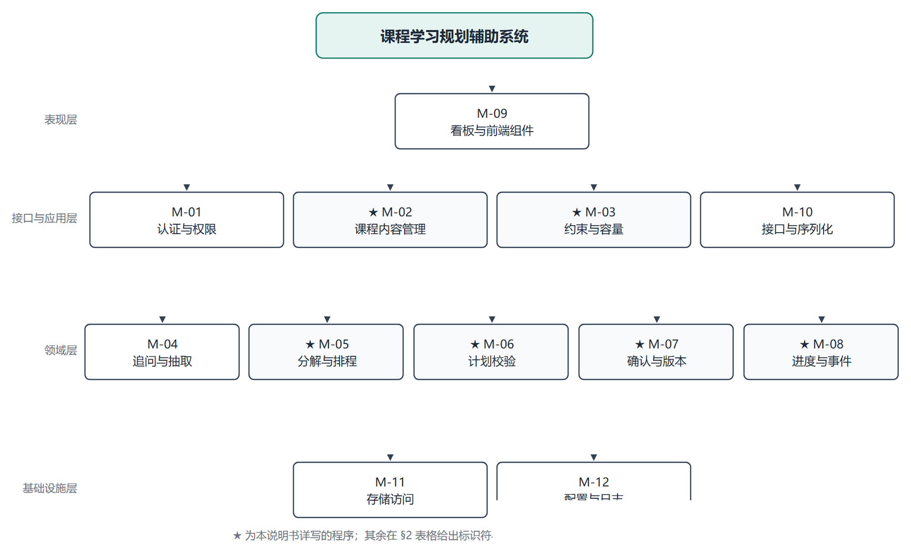
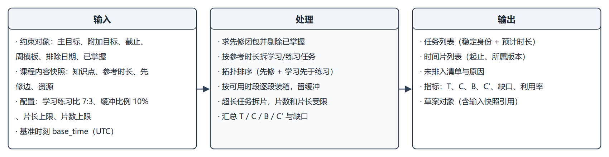
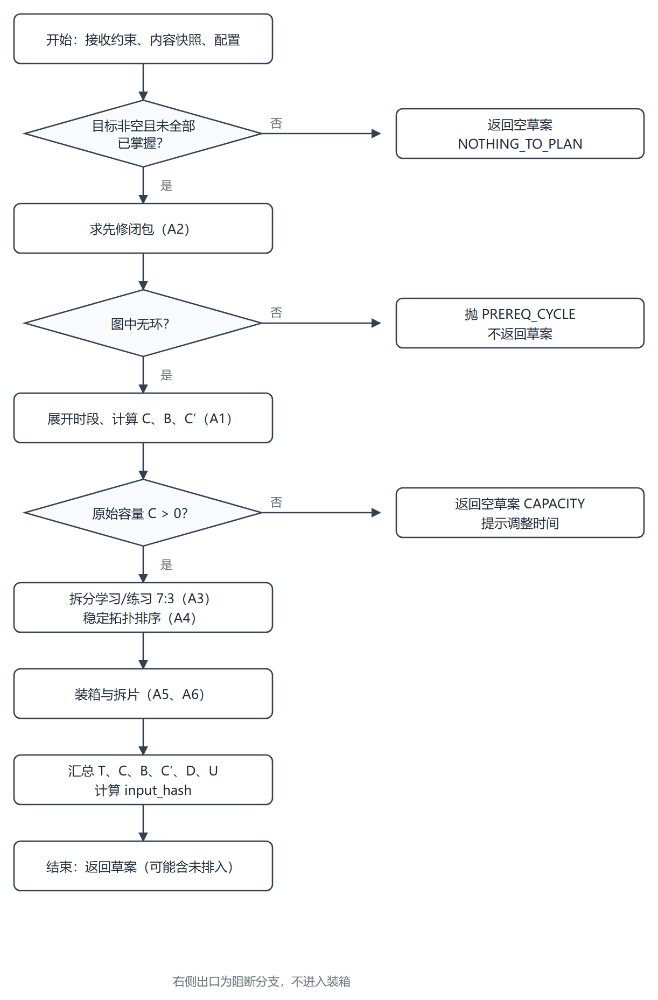

# 课程学习规划辅助系统 · 详细设计说明书

学径 StudyPath

| 项目 | 内容 |
|---|---|
| 课程名称 | 软件工程综合实训 |
| 文档编号 | D06 |
| 文档版本 | v0.1（样章：§1、§2 与 M-05） |
| 文档状态 | 编写中 |
| 项目组 | 软件工程 2 班 第 6 组 |
| 组长 | 王昱涵 |
| 小组成员 | 李鸿佑、李俊达、项奕乔 |
| 指导教师 | 张德珍 |
| 编制日期 | 2026 年 11 月 3 日 |

本文把概要设计与数据库设计落到可直接编码的粒度：每个程序的输入输出、算法公式与伪码、流程逻辑、接口签名、限制条件与单体测试。所有伪码用 Python 风格书写，与实现语言一致。

## 1 引言

### 1.1 编写目的

说明本文的定位：

- 上游：D02 定义"做什么"（需求与验收），D04 定义"分几块"（分层与模块），D05 定义"数据怎么存"（表与约束）。
- 本文定义"每块怎么写"：程序级的功能、算法、流程、接口、测试。
- 代码审查与单元测试以本文为准；本文与 D02 冲突以 D02 为准，与 D04 冲突以本文为准并回改 D04。

预期读者：编码人员、测试人员、评审教师。

### 1.2 背景

| 项 | 说明 |
|---|---|
| 系统名称 | 学径 StudyPath —— 课程学习规划辅助系统 |
| 任务提出者 | 《软件工程综合实训》课程组 |
| 开发者 | 软件工程 2 班 第 6 组（4 人） |
| 用户 | 学生（主用户）、课程管理员 |
| 运行形态 | 单机 B/S 应用，Python 3.11 + FastAPI + SQLite |
| 上游文档 | D02 v2.4、D04 v1.1、D05 v1.1 |

### 1.3 定义

| 术语 | 含义 |
|---|---|
| 程序 | 本文的设计单元，沿用 D04 的模块编号 M-01～M-12 |
| 确定性引擎 | 不调用大模型、输入相同则输出相同的计算程序（M-05、M-06） |
| 逻辑任务 | 一个知识点的一项学习或练习，跨版本保持稳定身份 |
| 时间片 | 某个逻辑任务在某一版本中的一段连续安排 |
| 可排容量 C′ | 原始容量 C 扣除缓冲 B 之后的可用分钟数 |
| 片（slice） | 单个任务被切分后的最小安排单位 |
| 纯函数 | 不读写外部状态、只依赖入参并返回结果的函数 |

### 1.4 参考资料

| 编号 | 资料 | 版本/日期 |
|---|---|---|
| R01 | 《D02 软件需求说明书》 | v2.4，2026-11-02 |
| R02 | 《D04 概要设计说明书》 | v1.1，2026-11-02 |
| R03 | 《D05 数据库设计说明书》 | v1.1，2026-11-02 |
| R04 | GB/T 8567—2006《计算机软件文档编制规范》 | 2006 |
| R05 | Python 3.11 语言参考、FastAPI 文档 | — |

## 2 程序系统的结构

系统共 12 个程序，分四层。其中 6 个（带 ★）在本说明书中逐条详写；其余 6 个控制逻辑简单，在表 2.1 给出标识符与职责，正文以"与某程序同构 + 差异说明"处理——依据是本模板允许"内容与上层模块相同时只需简单说明"。



图 6-1 程序系统层次结构图

表 2.1 程序清单

| 标识符 | 程序名 | 所属层 | 主要职责 | 详写 | 对应需求 |
|---|---|---|---|---|---|
| M-01 | 认证与权限 | 接口与应用层 | 登录、会话、角色与归属校验 | 简述 | F-01 |
| M-02 | 课程内容管理 | 接口与应用层 | 课程、知识点、先修、资源维护与成环检查 | ★ | F-02～F-05 |
| M-03 | 约束与容量 | 接口与应用层 | 约束校验、时段展开、容量计算 | ★ | F-06 |
| M-04 | 追问与抽取 | 领域层 | 自然语言转字段、追问、解释文本 | 简述 | F-07 |
| M-05 | 分解与排程 | 领域层 | 闭包、拆分、排序、装箱、拆片 | ★ | F-08 |
| M-06 | 计划校验 | 领域层 | 四项检查、问题码、建议 | ★ | F-09 |
| M-07 | 确认与版本 | 领域层 | 确认事务、版本写入、差异计算 | ★ | F-10、F-12 |
| M-08 | 进度与事件 | 领域层 | 打卡、更正、完成率、逾期标记 | ★ | F-10 |
| M-09 | 看板与前端组件 | 表现层 | 页面、任务卡片、状态展示 | 简述 | F-13 |
| M-10 | 接口与序列化 | 接口与应用层 | 路由、请求校验、错误码映射 | 简述 | 全部 |
| M-11 | 存储访问 | 基础设施层 | 数据访问、事务、迁移、备份 | 简述 | 全部 |
| M-12 | 配置与日志 | 基础设施层 | 配置加载、日志、模型适配器 | 简述 | 全部 |

表 2.2 详写与简述的划分依据

| 判据 | 详写的程序 | 简述的程序 |
|---|---|---|
| 含可验证算法或公式 | M-02（成环检测）、M-03、M-05、M-06、M-07（差异）、M-08（幂等与统计） | — |
| 以调用编排为主 | — | M-01、M-04、M-09、M-10 |
| 以基础设施封装为主 | — | M-11、M-12 |

表 2.3 全局配置常量（本文定稿，实现为可配置项）

| 常量名 | 取值 | 单位 | 说明与出处 |
|---|---|---|---|
| `STUDY_RATIO` | 0.70 | — | 学习时长占比，练习取剩余 30%（BR-08） |
| `BUFFER_RATIO` | 0.10 | — | 缓冲占原始容量比例，向上取整到分钟（BR-08） |
| `MAX_SLICE_SECONDS` | 7200 | 秒 | 单片上限 2 小时（D05 表 3.4） |
| `MAX_SLICES_PER_TASK` | 100 | 片 | 单任务最多片数；超出则该任务判为不可排（原 Q-01，本文定稿） |
| `CAP_TIGHT_THRESHOLD` | 0.80 | — | T/C 超过此值给 `CAP_TIGHT` 警告（D02 §3.8.2） |
| `DELAY_THRESHOLD_HOURS` | 48 | 小时 | 逾期超过此时长触发调整草案（BR-11） |
| `MODEL_TIMEOUT_SECONDS` | 10 | 秒 | 模型单轮预算，超时转表单（IF-02） |
| `MIN_TASK_MINUTES` | 1 | 分钟 | 任务最短时长，低于则合并到相邻任务 |

**图示约定**（全篇适用）：

| 图型 | 用在哪 | 不用在哪 |
|---|---|---|
| IPO 图 | 每个程序一张（x.2） | — |
| 流程图 | 每个程序一张（x.7），单列 + 右侧阻断出口 | 不用判定表图、判定树、N-S 盒图、PAD 图、Jackson 图、PDL |

**判定类内容不画图，写成表格。** 例如 M-06 的“五项检查顺序与阻断关系”、M-07 的“确认门槛”，用一张三列表（条件 / 结果 / 问题码）就能说清，比判定表图更省版面、也更容易与需求文档的规则表对齐。

理由：图型要服务于“读得懂”，不是服务于“图种齐全”。本系统各程序的判定都是**有序 + 短路**（前一项 ERROR 就停），不是条件正交组合；判定表擅长的是“2^N 种组合全覆盖”，而这里 32 种组合里绝大多数因顺序约束根本不可达，画出来只是把流程图的信息换个符号重排一遍。

## 3 M-05 分解与排程设计说明

### 3.1 程序描述

M-05 是系统的核心计算程序：把"学生的约束 + 课程内容快照"转换成"任务与时间片"，并给出容量指标。它决定了计划是否可行，也是校验程序 M-06 的直接输入。

程序特点：

- **纯函数**：不读写数据库、不调用模型、不读系统时钟；基准时刻由入参 `base_time` 传入。相同入参必须得到逐字节相同的结果，这是"历史可复现"的前提。
- **无状态、可重入**：不持有跨调用状态，可被并发调用（当前实现为单进程串行，但接口不依赖调用顺序）。
- **非常驻**：按需调用，单次执行结束后即可回收。
- **确定性**：拓扑排序与装箱都定义了稳定的次序规则（见 §3.6），避免因字典/集合遍历顺序不同而产生不同结果。

### 3.2 功能



图 6-2 M-05 分解与排程的 IPO 图

功能要点：

1. **先修闭包**：从目标知识点反向收集全部前置，形成必须完成的节点集合；
2. **剔除已掌握**：学生自评已掌握的知识点不生成任务，但其先修关系仍参与闭包；
3. **拆学习与练习**：按参考时长 7:3 拆分，练习用于巩固；
4. **稳定排序**：按先修关系与章节顺序排序，保证同一份输入每次排出的顺序一致；
5. **装箱**：把任务时长填入展开后的可用时段，逐段预留缓冲；
6. **拆片**：单个任务的连续时长超过单片上限时切分，片数受限；
7. **汇总指标**：输出 T、C、B、C′、缺口 D 与利用率 U。

不在本程序职责内的：合法性检查（归 M-06）、持久化（归 M-07/M-11）、解释文本（归 M-04）。

### 3.3 性能

| 操作 | 规模 | 目标耗时 | 说明 |
|---|---|---|---|
| 时段展开 | 180 天 × 每日 3 段 | ≤ 20 ms | 与排除日期求差 |
| 先修闭包 | 30 知识点、40 条边 | ≤ 10 ms | 邻接表 + 迭代 DFS |
| 任务拆分 | 30 知识点 → 60 任务 | ≤ 5 ms | 线性 |
| 拓扑排序 | 60 节点 | ≤ 10 ms | Kahn，堆排序保证稳定 |
| 装箱与拆片 | 60 任务、约 400 片 | ≤ 150 ms | 单次线性扫描时段 |
| 整体（含指标） | 上述规模 | **≤ 1 s** | 对齐 D02 表 3.17 |

精度要求：所有时长以**整分钟**为单位，拆分产生的浮点误差用"学习取整、练习取差"吸收，保证 `学习 + 练习 = 参考时长` 恒成立。

### 3.4 输入项

表 3.1 M-05 的输入项

| 名称 | 类型 | 有效范围 | 来源 | 必填 |
|---|---|---|---|---|
| `constraint` | `Constraint` | 主目标 1 个、附加目标 0～10 个、截止为未来日期 | M-03 校验后传入 | 是 |
| `content_snapshot` | `ContentSnapshot` | 30 知识点、40 条先修、60 份资源 | M-02 只读快照 | 是 |
| `mastered_ids` | `set[ConceptId]` | 本课程知识点子集 | 约束对象 | 否（空集） |
| `config` | `EngineConfig` | 见 §2 表 2.3 | M-12 配置 | 是 |
| `base_time` | `datetime`（UTC） | 不得早于当前时间 24 小时以上（演示可放宽） | 调用方传入 | 是 |

### 3.5 输出项

表 3.2 M-05 的输出项

| 名称 | 类型 | 内容 | 说明 |
|---|---|---|---|
| `tasks` | `list[Task]` | 稳定身份、知识点、类型、预计分钟、顺序号 | 顺序号即拓扑序，跨版本稳定 |
| `slices` | `list[Slice]` | 任务 ID、片号、起止 epoch（整分钟） | 全部落在可用时段内 |
| `unscheduled` | `list[Unscheduled]` | 任务 ID 与原因码 | 原因：容量不足 / 片数超限 |
| `metrics` | `Metrics` | T、C、B、C′、D、U | 供 M-06 与看板使用 |
| `draft` | `Draft` | 上述内容的聚合 + 输入摘要 `input_hash` | 不落库，由 M-07 持久化 |

### 3.6 算法

#### 3.6.1 时段展开（A1）

把周模板在 `[base_time, deadline)` 区间展开为有序、互不重叠的时段列表。

设规划区间起始日 $d_0 = \lfloor base\_time \rfloor$（本地日期），截止边界 $D = deadline + 1$ 日 00:00。对每日 $d \in [d_0, D)$，若 $d \notin excluded$，取其星期对应的模板段 $(s_i, e_i)$，裁剪后加入结果：

$$
\text{seg}(d, i) = \left[\max(s_i, base\_time),\ \min(e_i, D)\right),\quad \text{仅当 } \max < \min
$$

原始容量：

$$
C = \sum_{k} \left| \text{seg}_k \right| \quad (\text{分钟，向下取整})
$$

缓冲与可排容量：

$$
B = \left\lceil \text{BUFFER\_RATIO} \times C \right\rceil,\qquad C' = C - B
$$

```python
def expand_availability(constraint, config, base_time) -> list[Interval]:
    d0 = local_date(base_time)
    D = local_date(constraint.deadline) + timedelta(days=1)
    out = []
    for d in dates(d0, D):
        if d in constraint.excluded_dates:
            continue
        for s, e in constraint.availability[d.weekday()]:
            lo, hi = max(s, base_time), min(e, datetime.combine(D, time.min))
            if lo < hi:
                out.append(Interval(lo, hi))
    return sorted(out, key=lambda x: x.start)
```

#### 3.6.2 先修闭包（A2）

从目标集合 $G$ 出发，沿先修边反向遍历，得到必须完成的结点集 $R$：

$$
R = G \cup \{ u \mid \exists v \in R,\ (u, v) \in E_{\text{prereq}} \}
$$

实现用显式栈的迭代 DFS（避免递归深度问题）。遍历中若再次遇到"正在访问"的节点，说明输入图成环——这在 M-02 提交时已拦截，此处作为**不变式断言**处理：直接抛 `PREREQ_CYCLE`，不静默纠正。

```python
def prereq_closure(goals, edges, mastered) -> list[ConceptId]:
    reverse = defaultdict(list)
    for u, v in edges:            # u 先修 v
        reverse[v].append(u)
    seen, order, stack = set(), [], list(goals)
    while stack:
        node = stack.pop()
        if node in seen:
            continue
        seen.add(node)
        order.append(node)
        stack.extend(sorted(reverse[node], key=lambda c: c.sort_key))
    return order      # 已按"先修在前"排序的近似序，正式次序由 A4 决定
```

#### 3.6.3 时长拆分（A3）

对知识点 $c$ 的参考时长 $T_c$：

$$
L_c = \left\lfloor \text{STUDY\_RATIO} \times T_c \right\rfloor,\qquad P_c = T_c - L_c
$$

练习取差值而非再次取整，保证 $L_c + P_c = T_c$ 恒成立。若 $c \in mastered$ 或 $c$ 已停用，则两者都不生成；若 $P_c < \text{MIN\_TASK\_MINUTES}$，把 $P_c$ 并入 $L_c$，只生成学习任务。

```python
def split_tasks(concepts, mastered, config) -> list[Task]:
    tasks = []
    for c in concepts:
        if c.id in mastered or not c.enabled:
            continue
        total = c.reference_minutes
        study = int(total * config.study_ratio)
        practice = total - study
        if practice < config.min_task_minutes:
            study, practice = total, 0
        tasks.append(Task(c.id, "study", study))
        if practice:
            tasks.append(Task(c.id, "practice", practice))
    return tasks
```

#### 3.6.4 稳定拓扑排序（A4）

在结点集 $R$ 上按先修边做 Kahn 排序；同一入度的候选按三元组 $(\text{chapter}, \text{sort\_order}, \text{concept\_id})$ 升序取最小，保证**确定性**。同一知识点内，学习任务排在练习任务之前。

$$
\text{key}(c) = (\text{chapter}(c),\ \text{sort\_order}(c),\ \text{concept\_id}(c))
$$

```python
def topo_order(nodes, edges) -> list[ConceptId]:
    indeg = {n: 0 for n in nodes}
    adj = defaultdict(list)
    for u, v in edges:
        if u in indeg and v in indeg:
            adj[u].append(v)
            indeg[v] += 1
    heap = [(c.key, c.id) for c in nodes if indeg[c.id] == 0]
    heapq.heapify(heap)
    order = []
    while heap:
        _, cid = heapq.heappop(heap)
        order.append(cid)
        for nxt in adj[cid]:
            indeg[nxt] -= 1
            if indeg[nxt] == 0:
                heapq.heappush(heap, (key_of(nxt), nxt))
    assert len(order) == len(nodes), "先修图成环"
    return order
```

#### 3.6.5 装箱（A5）

按 A4 的次序逐任务填充时段，允许一个任务跨多个时段（切分为片）。

总量与缺口：

$$
T = \sum_{c} (L_c + P_c),\qquad D = \max(0,\ T - C'),\qquad U = \frac{T}{C}
$$

```python
def pack(tasks, intervals, config) -> tuple[list[Slice], list[Unscheduled]]:
    pool = [list(i) for i in intervals]      # 可消费的剩余时段
    cur = 0                                  # 当前时段索引
    slices, unscheduled = [], []
    for t in tasks:
        need = t.minutes
        pieces = []
        while need > 0:
            if cur >= len(pool):
                unscheduled.append(Unscheduled(t.id, "CAPACITY"))
                pieces = []
                break
            lo, hi = pool[cur]
            avail = int((hi - lo).total_seconds() // 60)
            if avail <= 0:
                cur += 1
                continue
            take = min(need, avail, config.max_slice_seconds // 60)
            start = lo
            pieces.append((start, start + timedelta(minutes=take)))
            pool[cur][0] = start + timedelta(minutes=take)
            need -= take
        if pieces:
            if len(pieces) > config.max_slices_per_task:
                unscheduled.append(Unscheduled(t.id, "TOO_MANY_SLICES"))
            else:
                slices.extend(make_slices(t.id, pieces))
    return slices, unscheduled
```

**装箱判定**（与 A6 共同决定"排入 / 未排入"）：

| 条件 | 结果 | 原因码 |
|---|---|---|
| 剩余时段总分钟 ≥ 任务分钟 且 片数 ≤ 100 | 排入 | — |
| 时段用尽仍不足 | 未排入 | `CAPACITY` |
| 需要的片数 > 100 | 未排入 | `TOO_MANY_SLICES` |
| 单段剩余 < `MIN_TASK_MINUTES` | 跳过该段 | — |

#### 3.6.6 拆片（A6）

单片时长上限取自配置（7200 秒 = 120 分钟）。切分规则：在同一时段内尽量取满 `min(剩余需求, 段剩余, 单片上限)`，跨段继续。片号在同一任务内从 1 递增，`slice_no` 稳定，便于差异比较。

本程序**不做二次缓冲**：缓冲已在 $C'$ 中按整段预留，若再在片内扣减会造成双重预留，与实际可用时间不符。

#### 3.6.7 复杂度

时段数 $m \le 540$，任务数 $n \le 60$，片数 $s \le 400$。

- A1：$O(m)$；
- A2：$O(V + E)$，$V \le 30,\ E \le 40$；
- A4：$O((V + E)\log V)$；
- A5：$O(s)$（每个任务顺序消费时段指针，不回退）。

整体为线性量级，实测目标见 §3.3。

### 3.7 流程逻辑



图 6-3 M-05 主流程图

流程要点：

1. 先判空：目标集为空或全部已掌握 → 直接返回空草案并给 `NOTHING_TO_PLAN`；
2. 先修闭包失败（成环）→ 抛出 `PREREQ_CYCLE`，不进入装箱；
3. 容量为 0（$C = 0$）→ 不排程，返回 `CAPACITY`，由上层提示改约束；
4. 装箱结束后若 `unscheduled` 非空 → 仍返回草案（可查看），但 `metrics.deficit > 0`；
5. 组装指标 → 生成 `input_hash` → 返回。

表 3.3 主流程判定表

| 条件 | 规则 1 | 规则 2 | 规则 3 | 规则 4 |
|---|---|---|---|---|
| 目标集非空 | N | Y | Y | Y |
| 先修图无环 | — | N | Y | Y |
| 原始容量 C > 0 | — | — | N | Y |
| 结果 | 空草案 `NOTHING_TO_PLAN` | 异常 `PREREQ_CYCLE` | 空草案 `CAPACITY` | 正常草案 |

### 3.8 接口

表 3.4 M-05 的调用关系

| 方向 | 对象 | 方式 | 说明 |
|---|---|---|---|
| 上层调用方 | M-10 接口与序列化 | 函数调用 | 生成草案入口 |
| 同层调用方 | M-07 确认与版本 | 函数调用 | 调整时重排 |
| 被调用 | M-02 课程内容管理 | 只读快照 | 通过 `ContentSnapshot` 传入，不直接查库 |
| 被调用 | M-03 约束与容量 | 只读 | 使用其展开的时段与 C/B/C′ |
| 下游 | M-06 计划校验 | 返回值 | 草案作为校验输入 |

函数签名：

```python
def generate_plan(
    constraint: Constraint,
    content: ContentSnapshot,
    config: EngineConfig,
    base_time: datetime,
) -> Draft:
    """生成计划草案。纯函数：相同入参必须得到相同 output_hash。"""
```

涉及的持久化结构（仅引用，本程序不写库）：`plan_task`、`version_task`、`task_slice`（见 D05 §4.1）。

### 3.9 存储分配

| 对象 | 规模上限 | 单条估算 | 合计 |
|---|---|---|---|
| 任务对象 | 60 | ~200 B | ~12 KB |
| 时间片 | 400 | ~120 B | ~48 KB |
| 时段列表 | 540 | ~80 B | ~43 KB |
| 快照引用 | 30 知识点 | 复用入参 | 不额外分配 |

峰值内存 < 1 MB，无需特殊分配策略；不持有跨调用缓存，避免与"纯函数"约束冲突。

### 3.10 注释设计

| 位置 | 内容要求 | 示例 |
|---|---|---|
| 模块首部 | 职责、约束（纯函数）、入参含义、可能抛出的异常 | `"""生成计划草案。纯函数：不读写外部状态。\n Raises: PREREQ_CYCLE, CAPACITY。"""` |
| 分支点 | 说明为什么这样判（而不是重复代码） | `# 缓冲已在 C′ 中整段预留，片内不再二次扣减，避免双重预留` |
| 变量 | 单位与量纲必须写在名字或注释里 | `need_minutes`, `slice_no` |
| 公式 | 与本文公式号对应 | `# 见 §3.6.5 式 (3-3)：D = max(0, T - C′)` |

### 3.11 限制条件

1. 单进程串行调用，不做并发控制；若将来并发，需保证 `content` 快照不可变。
2. 入参对象视为只读，本程序不得原地修改（必要时先深拷贝时段列表）。
3. 不读取系统时钟，所有时间来自 `base_time`，否则结果不可复现。
4. 不支持跨课程排程：`content` 只含一门课程。
5. 片数超过 100 的任务直接判不可排，不做"跨多日无限切分"的兜底。
6. 浮点只用于比例计算，落库前一律转为整分钟。

### 3.12 测试计划

环境：`pytest` + 内存 SQLite；M-02/M-03 用固定夹具（30 知识点、40 条先修），不 mock 算法本身；模型适配器替换为假实现（本程序不调用）。

表 3.5 M-05 单体测试用例

| 用例号 | 覆盖点 | 输入 | 预期结果 |
|---|---|---|---|
| T-05-01 | 正常流 | 1 目标（90 分钟）、7 天 × 2 小时/天 | 生成 2 任务（63/27），全部排入，`D=0` |
| T-05-02 | 7:3 取整 | 参考时长 85 分钟 | 学习 59、练习 26；两者之和 = 85 |
| T-05-03 | 极小练习 | 参考时长 10 分钟（7:0.3→练习 3） | 若配置 `MIN_TASK_MINUTES=5`，只生成学习任务 10 分钟 |
| T-05-04 | 已掌握剔除 | 目标已掌握 | 返回空草案 + `NOTHING_TO_PLAN` |
| T-05-05 | 先修闭包 | 目标 C，先修 B，B 先修 A | 生成 A、B、C 三组任务，A 的任务在前 |
| T-05-06 | 成环断言 | 构造 A→B→A | 抛 `PREREQ_CYCLE`，不返回草案 |
| T-05-07 | 容量为零 | 全部时段被排除日期覆盖 | 返回空草案 + `CAPACITY` |
| T-05-08 | 容量紧张 | T/C = 0.85 | `D=0`，`U≈0.85`，由 M-06 给 `CAP_TIGHT` |
| T-05-09 | 容量不足 | T 超过 C′ | `unscheduled` 含 `CAPACITY`，`D>0` |
| T-05-10 | 拆片 | 单任务 300 分钟、每日段 120 分钟 | 生成 3 片，每片 ≤ 120 分钟，片号 1..3 |
| T-05-11 | 片数超限 | 构造需 120 片的任务 | `unscheduled` 含 `TOO_MANY_SLICES` |
| T-05-12 | 确定性 | 同一输入连续调用两次 | 两次输出的 `output_hash` 完全相同 |

桩模块：`ContentSnapshot` 用 JSON 夹具加载；`Constraint` 直接构造；无需数据库桩（本程序不访问库）。

### 3.13 尚未解决的问题

| 编号 | 问题 | 当前处理 | 计划 |
|---|---|---|---|
| Q-01 | 拆片上限取多少 | 本章定稿为 100 片，超出判不可排 | 若实测发现正常场景超限，调 `MAX_SLICES_PER_TASK` 并重跑 T-05-11 |
| Q-04 | 跨天拆片是否允许"同日多片" | 允许，只要落在不同时段 | 若看板拥挤，改为每日最多 2 片（仅影响 A5 的取片顺序） |
