# 课程学习规划辅助系统 · 详细设计说明书

学径 StudyPath

| 项目 | 内容 |
|---|---|
| 课程名称 | 软件工程综合实训 |
| 文档编号 | D06 |
| 文档版本 | v1.0（全稿，待评审） |
| 文档状态 | 设计评审稿，待评审 |
| 项目组 | 软件工程 2 班 第 6 组 |
| 组长 | 王昱涵 |
| 小组成员 | 李鸿佑、李俊达、项奕乔 |
| 指导教师 | 张德珍 |
| 编制日期 | 2026 年 11 月 4 日 |

本文把概要设计与数据库设计落到可直接编码的粒度：每个程序的输入输出、算法公式与伪码、流程逻辑、接口签名、限制条件与单体测试。所有伪码用 Python 风格书写，与实现语言一致。

## 1 引言

### 1.1 编写目的

说明本文的定位：

- 上游：D02 定义"做什么"（需求与验收），D04 定义"分几块"（分层与模块），D05 定义"数据怎么存"（表与约束）。
- 本文定义"每块怎么写"：程序级的功能、算法、流程、接口、测试。
- 代码审查与单元测试以本文为准；本文与 D02 冲突以 D02 为准，与 D04 冲突以本文为准并回改 D04。

预期读者：编码人员、测试人员、评审教师。

### 1.2 背景

表 1.1 项目背景与定位

| 项 | 说明 |
|---|---|
| 系统名称 | 学径 StudyPath —— 课程学习规划辅助系统 |
| 任务提出者 | 《软件工程综合实训》课程组 |
| 开发者 | 软件工程 2 班 第 6 组（4 人） |
| 用户 | 学生（主用户）、课程管理员 |
| 运行形态 | 单机 B/S 应用，Python 3.11 + FastAPI + SQLite |
| 上游文档 | D02 v2.4、D04 v1.1、D05 v1.1 |

### 1.3 定义

表 1.2 术语与缩略语

| 术语 | 含义 |
|---|---|
| 程序 | 本文的设计单元，沿用 D04 的模块编号 M-01～M-12 |
| 确定性引擎 | 不调用大模型、输入相同则输出相同的计算程序（M-05、M-06） |
| 逻辑任务 | 一个知识点的一项学习或练习，跨版本保持稳定身份 |
| 时间片 | 某个逻辑任务在某一版本中的一段连续安排 |
| 可排容量 C′ | 原始容量 C 扣除缓冲 B 之后的可用分钟数 |
| 片（slice） | 单个任务被切分后的最小安排单位 |
| 纯函数 | 不读写外部状态、只依赖入参并返回结果的函数 |

### 1.4 参考资料

表 1.3 参考资料

| 编号 | 资料 | 版本/日期 |
|---|---|---|
| R01 | 《D02 软件需求说明书》 | v2.4，2026-11-02 |
| R02 | 《D04 概要设计说明书》 | v1.1，2026-11-02 |
| R03 | 《D05 数据库设计说明书》 | v1.1，2026-11-02 |
| R04 | GB/T 8567—2006《计算机软件文档编制规范》 | 2006 |
| R05 | Python 3.11 语言参考、FastAPI 文档 | — |

## 2 程序系统的结构

系统共 12 个程序，**全部在本说明书中逐条展开**（每章 13 个小节）。章节顺序按 M 编号排列，与 D04 表 2.3 的模块清单一一对应。

本图按**调用层次**组织：M-10（接口与序列化）是唯一对外入口，向下调用 8 个功能程序；M-02（课程内容管理）作为被读取方挂在第三层；M-11、M-12 是被全部程序共用的基础程序。**分层归属不在这张图里**——它属于概要设计的架构视图，见 D04 图 2-4。

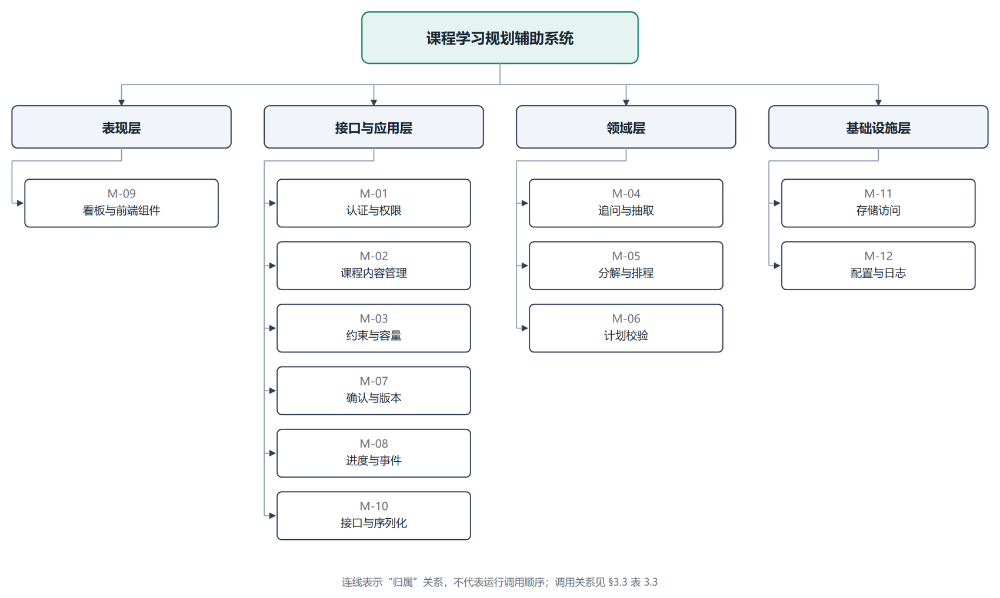

图 2-1 程序调用结构图

表 2.1 程序清单

| 标识符 | 程序名 | 所属层 | 主要职责 | 章节 | 对应需求 |
|---|---|---|---|---|---|
| M-01 | 认证与权限 | 接口与应用层 | 登录、令牌、角色与归属校验 | 第 3 章 | F-01 |
| M-02 | 课程内容管理 | 接口与应用层 | 课程、知识点、先修、资源维护与成环检查 | 第 4 章 | F-02～F-05 |
| M-03 | 约束与容量 | 接口与应用层 | 约束校验、时段展开、容量计算 | 第 5 章 | F-06 |
| M-04 | 追问与抽取 | 领域层 | 自然语言转字段、追问、解释文本 | 第 6 章 | F-07 |
| M-05 | 分解与排程 | 领域层 | 闭包、拆分、排序、装箱、拆片 | 第 7 章 | F-08 |
| M-06 | 计划校验 | 领域层 | 五项检查、问题码、建议 | 第 8 章 | F-09 |
| M-07 | 确认与版本 | 接口与应用层 | 确认事务、版本写入、差异计算 | 第 9 章 | F-10、F-12 |
| M-08 | 进度与事件 | 接口与应用层 | 打卡、更正、完成率、逾期标记 | 第 10 章 | F-10 |
| M-09 | 看板与前端组件 | 表现层 | 页面、任务卡片、状态展示 | 第 11 章 | F-13 |
| M-10 | 接口与序列化 | 接口与应用层 | 路由、请求校验、错误码映射 | 第 12 章 | 全部 |
| M-11 | 存储访问 | 基础设施层 | 数据访问、事务、迁移、备份 | 第 13 章 | 全部 |
| M-12 | 配置与日志 | 基础设施层 | 配置加载、日志、模型适配器 | 第 14 章 | 全部 |

> 各程序的小节结构统一为：x.1 程序描述、x.2 功能（含 IPO 图）、x.3 性能、x.4 输入项、x.5 输出项、x.6 算法、x.7 流程逻辑（含流程图）、x.8 接口、x.9 存储分配、x.10 注释设计、x.11 限制条件、x.12 测试计划、x.13 尚未解决的问题。

表 2.2 全局配置常量（本文定稿，实现为可配置项）

| 常量名 | 取值 | 单位 | 说明与出处 |
|---|---|---|---|
| `STUDY_RATIO` | 0.70 | — | 学习时长占比，练习取剩余 30%（BR-08） |
| `BUFFER_RATIO` | 0.10 | — | 缓冲占原始容量比例，向上取整到分钟（BR-08） |
| `MAX_SLICE_SECONDS` | 7200 | 秒 | 单片上限 2 小时（D05 表 3.4） |
| `MAX_SLICES_PER_TASK` | 100 | 片 | 单任务最多片数；超出则该任务判为不可排（原 Q-01，本文定稿） |
| `CAP_TIGHT_THRESHOLD` | 0.80 | — | T/C 超过此值给 `CAP_TIGHT` 警告（D02 §3.8.2） |
| `DELAY_THRESHOLD_HOURS` | 48 | 小时 | 逾期超过此时长触发调整草案（BR-11） |
| `MODEL_TIMEOUT_SECONDS` | 10 | 秒 | 模型单轮预算，超时转表单（IF-02） |
| `MIN_TASK_MINUTES` | 1 | 分钟 | 任务最短时长，低于则合并到相邻任务 |
| `MAX_DEADLINE_DAYS` | 180 | 天 | 截止日期最远天数（D02 §3.1.7） |
| `LOCK_FAIL_LIMIT` | 5 | 次 | 连续失败多少次后锁定（BR-01） |
| `LOCK_MINUTES` | 5 | 分钟 | 锁定时长（BR-01） |
| `TOKEN_TTL_HOURS` | 24 | 小时 | 会话令牌有效期（BR-01） |

**图示约定**（全篇适用）：

表 2.3 图示约定

| 图型 | 用在哪 | 不用在哪 |
|---|---|---|
| IPO 图 | 每个程序一张（x.2） | — |
| 流程图 | 每个程序一张（x.7），单列 + 右侧阻断出口 | 不用判定表图、判定树、N-S 盒图、PAD 图、Jackson 图、PDL |

**流程图符号**：椭圆＝起止，平行四边形＝输入输出，矩形＝处理，菱形＝判断。判断的失败分支画在右侧：**需要重新填写的回到输入节点形成回路**（如登录失败、约束非法），**需要终止的进入侧链处理框再汇入结束**（如整批拒绝、版本冲突回滚）。

**判定类内容不画图，写成表格。** 本系统各程序的判定都是"有序 + 短路"（前一项失败即停），不是条件正交组合；判定表擅长的是"2^N 种组合全覆盖"，而这里绝大多数组合因顺序约束根本不可达。图型要服务于"读得懂"，不是服务于"图种齐全"。

## 3 M-01 认证与权限设计说明

### 3.1 程序描述

M-01 回答两个问题：**你是谁**（认证）、**你能碰什么**（授权）。它位于接口与应用层，是所有私有接口的第一道闸门。

程序特点：

- **登录是唯一写操作**：失败计数、锁定时间、最近登录时间需要落库；其余接口只做校验，不写库；
- **令牌无状态**：不在服务端保存会话表，每次请求用签名验令牌，避免"重启后所有人掉线"；
- **归属校验前置**：任何涉及学生私有数据的请求，先过归属判定，再进业务逻辑，避免"先查后判"泄露存在性。

### 3.2 功能

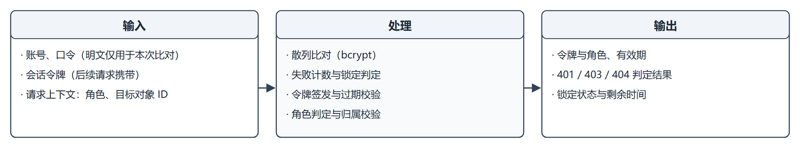

图 3-1 M-01 认证与权限的 IPO 图

表 3.1 M-01 的功能项

| 功能 | 说明 |
|---|---|
| 登录认证 | 校验账号存在、是否锁定、口令散列是否匹配 |
| 令牌签发 | 签发含角色与过期时间的令牌，返回给学生 |
| 令牌校验 | 每个请求验证签名与过期时间，解析出 `sub` 与 `role` |
| 角色判定 | 学生接口拒绝管理员越权访问，反之亦然 |
| 归属校验 | 操作对象必须属于当前登录学生；不属于时按"不存在"处理 |

**不归本程序管**：注册、找回密码、多设备会话管理、令牌吊销（见 §3.11）。

### 3.3 性能

表 3.2 M-01 的性能指标

| 操作 | 规模 | 目标耗时 | 说明 |
|---|---|---|---|
| 登录（含散列比对） | 单次 | ≤ 300 ms | bcrypt 工作因子 10，比对约 80–120 ms，其余为查询与写库 |
| 令牌校验 | 单次请求 | ≤ 2 ms | HMAC-SHA256 验签 + JSON 解析，纯内存 |
| 归属校验 | 单次请求 | ≤ 5 ms | 一次主键查询，命中索引 |
| 失败计数更新 | 单次失败 | ≤ 10 ms | 单行 UPDATE |

### 3.4 输入项

表 3.3 M-01 的输入项

| 名称 | 类型 | 有效范围 | 来源 | 必填 |
|---|---|---|---|---|
| `username` | string | 3–32 字符 | 登录表单 | 登录时必填 |
| `password` | string | ≥ 8 字符，含字母与数字 | 登录表单 | 登录时必填 |
| `token` | string | 签发格式，长度 ≤ 1024 | 请求头 `Authorization` | 私有接口必填 |
| `object_id` | int | 目标对象主键 | 路径参数 | 归属校验时必填 |
| `required_role` | enum | `student` / `admin` | 路由声明 | 是 |

### 3.5 输出项

表 3.4 M-01 的输出项

| 名称 | 类型 | 内容 | 说明 |
|---|---|---|---|
| `token` | string | 签名令牌 | 仅在登录成功时返回 |
| `role` | enum | `student` / `admin` | 前端据此渲染菜单 |
| `expires_at` | string | UTC ISO 8601 | 令牌过期时刻 |
| `error_code` | enum | `E4001`（未认证）/ `E4003`（无权限）/ `E1002`（不存在） | 见 §3.6.4 |
| `lock_remaining_seconds` | int | ≥ 0 | 锁定期间返回剩余秒数 |

### 3.6 算法

#### 3.6.1 口令散列校验

口令只存散列，不存明文。比对用库函数的常数时间比较，避免通过响应时间推断前缀：

```python
def verify_password(plain: str, hashed: str) -> bool:
    # bcrypt 自带盐与代价因子；不要用 == 比较散列字符串
    return bcrypt.checkpw(plain.encode("utf-8"), hashed.encode("utf-8"))
```

#### 3.6.2 失败计数与锁定

设连续失败次数 $f$，锁定边界 $L$：

$$
L = \begin{cases} now + 300\ \text{s} & f \ge 5 \\ \text{不变} & f < 5 \end{cases}
$$

登录成功时 $f \leftarrow 0$、$L \leftarrow \text{NULL}$。**锁定期内即使口令正确也拒绝**，否则锁定形同虚设。

```python
def on_login_failed(user, now):
    user.failed_attempts += 1
    if user.failed_attempts >= config.LOCK_FAIL_LIMIT:
        user.locked_until = now + timedelta(minutes=config.LOCK_MINUTES)
    save(user)

def is_locked(user, now) -> bool:
    return user.locked_until is not None and user.locked_until > now
```

#### 3.6.3 令牌签发与校验

令牌采用 `payload.signature` 两段式：`payload` 是 Base64URL 的 JSON（含 `sub`、`role`、`exp`），`signature` 是对 payload 的 HMAC-SHA256。

$$
\text{exp} = now + \text{TOKEN\_TTL\_HOURS} \times 3600
$$

```python
def issue_token(user, now) -> tuple[str, datetime]:
    exp = now + timedelta(hours=config.TOKEN_TTL_HOURS)
    payload = {"sub": user.id, "role": user.role, "exp": int(exp.timestamp())}
    body = b64u(json.dumps(payload, sort_keys=True))
    return body + "." + b64u(hmac_sha256(key, body)), exp

def parse_token(token, now) -> Claims:
    body, sig = token.rsplit(".", 1)
    if not hmac.compare_digest(sig, b64u(hmac_sha256(key, body))):
        raise Unauthorized("E4001")
    claims = json.loads(b64u_decode(body))
    if claims["exp"] <= int(now.timestamp()):
        raise Unauthorized("E4001")
    return claims
```

#### 3.6.4 403 与 404 的区分规则

**这是本程序最容易被挑错的地方**：越权时返回 403 会泄露"这个对象存在"。

表 3.5 403 与 404 的区分规则

| 情形 | 返回 | 理由 |
|---|---|---|
| 未携带令牌 / 令牌无效 / 已过期 | 401 `E4001` | 身份未确立 |
| 角色不符（学生访问管理接口） | 403 `E4003` | 接口是公开的，不存在泄露问题 |
| 对象不存在 | 404 `E1002` | — |
| 对象存在但不属于当前学生 | **404 `E1002`** | 与"不存在"同响应，不泄露存在性 |
| 对象存在、属于本人但状态不允许 | 400 `E1003` | 此时无需隐藏 |

```python
def require_owner(obj, claims):
    if obj is None or obj.owner_id != claims.sub:
        raise NotFound("E1002")     # 故意不区分“不存在”与“不是你的”
```

### 3.7 流程逻辑

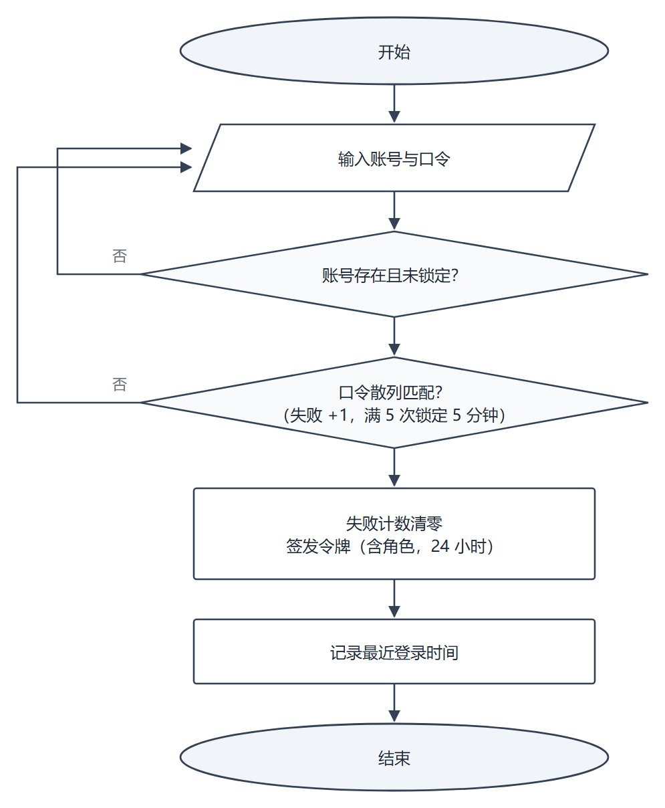

图 3-2 M-01 登录判定流程

流程要点：

1. **账号不存在与口令错误返回同一响应**（401，同一文案），防止账号枚举；
2. **锁定判定在口令比对之前**，锁定期内不消耗比对开销，也不因"口令恰好正确"而放行；
3. 失败计数只在"账号存在且口令错"时累加，账号不存在不计数（否则可被用来探测）；
4. 成功后一次性完成三件事：清零计数、签发令牌、记录最近登录时间，在同一事务内。

### 3.8 接口

表 3.6 M-01 的调用关系

| 方向 | 对象 | 方式 | 说明 |
|---|---|---|---|
| 上层调用方 | M-10 接口与序列化 | 函数调用（依赖注入） | 每个私有路由先调用 `authenticate` |
| 被调用 | M-11 存储访问 | 仓储 | 读取用户、写入失败计数 |
| 数据依赖 | `app_user` 表 | 只读 + 单行写 | 见 D05 §4.1.2 |

```python
def authenticate(token: str | None, now: datetime) -> Claims: ...
def require_role(claims: Claims, role: str) -> None: ...
def require_owner(obj, claims: Claims) -> None: ...
def login(username: str, password: str, now: datetime) -> tuple[str, datetime, str]: ...
```

### 3.9 存储分配

表 3.7 M-01 的存储占用

| 对象 | 规模 | 说明 |
|---|---|---|
| 令牌解析结果 | 每请求约 0.3 KB | 请求结束即释放，不缓存 |
| 用户记录 | 50 条 × 约 0.5 KB | 由 M-11 缓存，本程序不额外持有 |
| 会话状态 | **无** | 无状态令牌，服务端不存会话表 |

### 3.10 注释设计

表 3.8 M-01 的注释要求

| 位置 | 要求 | 示例 |
|---|---|---|
| 模块首部 | 说明"为什么无状态" | `"""无状态认证：令牌自带角色与过期时间，不依赖会话表。"""` |
| 归属判定 | 说明 404 的用意 | `# 故意返回 404 而非 403：不泄露对象是否存在` |
| 锁定逻辑 | 说明顺序不可调换 | `# 锁定判定必须在口令比对之前，否则锁定期内可试错` |

### 3.11 限制条件

1. **令牌不可吊销**：本期不实现黑名单，学生改密码后旧令牌仍有效至过期（最长 24 小时）；
2. **无刷新令牌**：过期需重新登录；
3. 锁定按账号而非按 IP，不防分布式撞库（单机应用，风险可接受）；
4. 依赖服务器时钟；时钟回拨会导致令牌提前失效；
5. 口令强度只做长度与字符类型校验，不拦截常见弱口令；
6. 单进程运行，令牌密钥从环境变量读取，不落库。

### 3.12 测试计划

表 3.9 M-01 单体测试用例

| 用例号 | 覆盖点 | 输入 | 预期结果 |
|---|---|---|---|
| T-01-01 | 正常登录 | 正确账号口令 | 返回令牌、角色 `student`、24 小时有效期 |
| T-01-02 | 账号不存在 | 不存在的账号 | 401，文案与口令错误完全一致 |
| T-01-03 | 口令错误 | 正确账号 + 错口令 | 401，失败计数 +1 |
| T-01-04 | 连续失败 5 次 | 5 次错误口令 | 第 5 次后 `locked_until` 已置，返回剩余秒数 |
| T-01-05 | 锁定期内正确口令 | 锁定期 + 正确口令 | 401（**不放行**） |
| T-01-06 | 锁定到期 | 锁定时间已过 | 正常登录，计数清零 |
| T-01-07 | 令牌过期 | `exp` 早于当前时间 | 401 `E4001` |
| T-01-08 | 令牌签名被篡改 | 改动 payload 一位 | 401 `E4001` |
| T-01-09 | 学生访问管理接口 | 学生令牌 + 管理路由 | 403 `E4003` |
| T-01-10 | 访问他人计划 | 学生 A 的令牌 + 学生 B 的计划 ID | 404 `E1002`（与不存在同响应） |
| T-01-11 | 访问本人已归档计划 | 本人令牌 + 归档计划 | 400 `E1003`（状态不允许，非隐藏） |

### 3.13 尚未解决的问题

表 3.10 M-01 尚未解决的问题

| 编号 | 问题 | 当前处理 | 计划 |
|---|---|---|---|
| Q-05 | 令牌吊销 | 不实现，靠短有效期兜底 | 若需要"立即下线"，加一张 `token_denylist` 表并校验 |
| Q-06 | 锁定粒度 | 按账号 | 若演示环境被多机访问，改为账号 + IP 双维 |

## 4 M-02 课程内容管理设计说明

### 4.1 程序描述

M-02 维护"规划的依据"：课程、知识点、先修关系、资源。它不产生计划，但决定了计划的质量——知识点时长填错，排出来的任务时长就全错；先修关系有环，拓扑排序就会失败。

程序特点：

- **写操作为主**：CRUD 与批量导入；
- **强约束**：先修关系必须在"原图 + 本批"的完整图上做环检测，不能只查单条；
- **保护历史**：被版本引用的知识点只能停用，不能删除。

### 4.2 功能

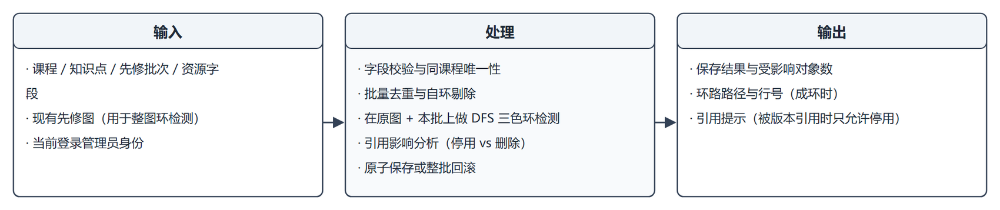

图 4-1 M-02 课程内容管理的 IPO 图

表 4.1 M-02 的功能项

| 功能 | 说明 |
|---|---|
| 课程维护 | 名称、学期、总学时、启用状态 |
| 知识点维护 | 名称、章节、难度、参考时长、目标、常见错误、排序号 |
| 先修维护 | 支持单条与批量提交；成环时整批拒绝 |
| 资源维护 | 链接或摘要；与知识点多对多关联 |
| 引用影响分析 | 停用 / 删除前给出受影响版本数 |

**不归本程序管**：内容快照的生成（M-05）、草案生成（M-05）、权限（M-01）。

### 4.3 性能

表 4.2 M-02 的性能指标

| 操作 | 规模 | 目标耗时 | 说明 |
|---|---|---|---|
| 单条知识点保存 | 单条 | ≤ 50 ms | 含唯一性校验 |
| 批量先修提交 | 40 条 | ≤ 300 ms | 含整图环检测 |
| 引用影响查询 | 30 知识点 | ≤ 100 ms | 按 `version_task` 计数 |
| 资源关联更新 | 60 份 | ≤ 200 ms | 先删后插，单事务 |

### 4.4 输入项

表 4.3 M-02 的输入项

| 名称 | 类型 | 有效范围 | 来源 |
|---|---|---|---|
| `course` | object | 名称 1–100 字，总学时 > 0 | 管理端表单 |
| `concept` | object | 时长 5–600 分钟、难度 1–5、同课程名唯一 | 管理端表单 |
| `prereq_batch` | list | 每条为 `(from_concept_id, to_concept_id)`，最多 40 条 | 批量导入 |
| `resource` | object | 标题 1–200 字；url 或 summary 至少一项 | 管理端表单 |
| `status` | enum | `enabled` / `disabled` | 状态切换 |

### 4.5 输出项

表 4.4 M-02 的输出项

| 名称 | 类型 | 内容 | 说明 |
|---|---|---|---|
| `saved` | object | 保存后的实体 | 含服务端生成的 ID |
| `cycle_path` | list[int] | 环路节点序列 | 成环时返回，如 `[A, B, C, A]` |
| `blocked_rows` | list[int] | 被拒绝的行号 | 便于前端定位 |
| `impact` | object | 受影响版本数、受影响计划数 | 停用前提示 |

### 4.6 算法

#### 4.6.1 先修成环检测（DFS 三色标记）

对"原图 + 本批"构成的完整图做深度优先遍历，用三色标记识别回边：

- **白**：未访问；**灰**：在递归栈上；**黑**：已完成；
- 访问到灰色节点即有环，环路由递归栈中从该节点起的一段构成。

$$
\text{cycle} = \{v_k, v_{k+1}, \dots, v_n, v_k\} \quad \text{当 } \exists (v_n, v_k) \text{ 且 } v_k \text{ 为灰}
$$

```python
def detect_cycle(edges, nodes) -> list[int] | None:
    adj = defaultdict(list)
    for u, v in edges:
        adj[u].append(v)
    color = {n: 0 for n in nodes}      # 0 白 / 1 灰 / 2 黑
    stack, path = [], []

    def dfs(u):
        color[u] = 1
        path.append(u)
        for v in adj[u]:
            if color.get(v, 0) == 1:            # 回边：找到环
                return path[path.index(v):] + [v]
            if color.get(v, 0) == 0:
                got = dfs(v)
                if got:
                    return got
        path.pop()
        color[u] = 2
        return None

    for n in sorted(nodes):
        if color[n] == 0:
            got = dfs(n)
            if got:
                return got
    return None
```

**为什么必须整图检测**：单条校验只能发现自环。A→B、B→C 各自合法，但加上 C→A 就成环——这正是批量提交的风险点。

#### 4.6.2 批量提交的原子性

整批要么全成功，要么全回滚。判定顺序固定：

1. 两端存在且同课程（否则 `E1001`）；
2. 剔除自环（`from == to`）与重复有序对；
3. 在"原图 ∪ 本批"上做环检测（否则 `E2001`）；
4. 单事务写入。

```python
def submit_prereqs(batch, course, repo) -> Result:
    for i, (u, v) in enumerate(batch):
        if u == v:
            return Reject("E1001", f"第 {i} 行自环")
        if not (repo.same_course(u, course) and repo.same_course(v, course)):
            return Reject("E1001", f"第 {i} 行跨课程")
    cleaned = sorted({(u, v) for u, v in batch})
    graph = repo.load_prereq_edges(course) | set(cleaned)
    cycle = detect_cycle(graph, repo.load_concept_ids(course))
    if cycle:
        return Reject("E2001", cycle=cycle)
    with repo.transaction():
        repo.insert_prereqs(cleaned)          # 任何异常整体回滚
    return Ok(len(cleaned))
```

#### 4.6.3 引用影响分析（停用 vs 删除）

$$
\text{引用数} = \#\{\,vt \in version\_task \mid vt.concept\_id = c\,\}
$$

- 引用数 = 0：允许删除；
- 引用数 > 0：只允许停用（`status = disabled`），历史版本仍可打开，新草案不再包含该知识点。

```python
def can_delete(concept_id, repo) -> tuple[bool, int]:
    refs = repo.count_version_task_refs(concept_id)
    return refs == 0, refs
```

#### 4.6.4 多对多关联写入

资源与知识点是 M:N。更新关联时采用"先删后插"，避免逐条比对：

```python
def replace_links(concept_id, resource_ids, repo):
    with repo.transaction():
        repo.delete_links_of_concept(concept_id)
        repo.insert_links([(concept_id, rid) for rid in set(resource_ids)])
```

### 4.7 流程逻辑

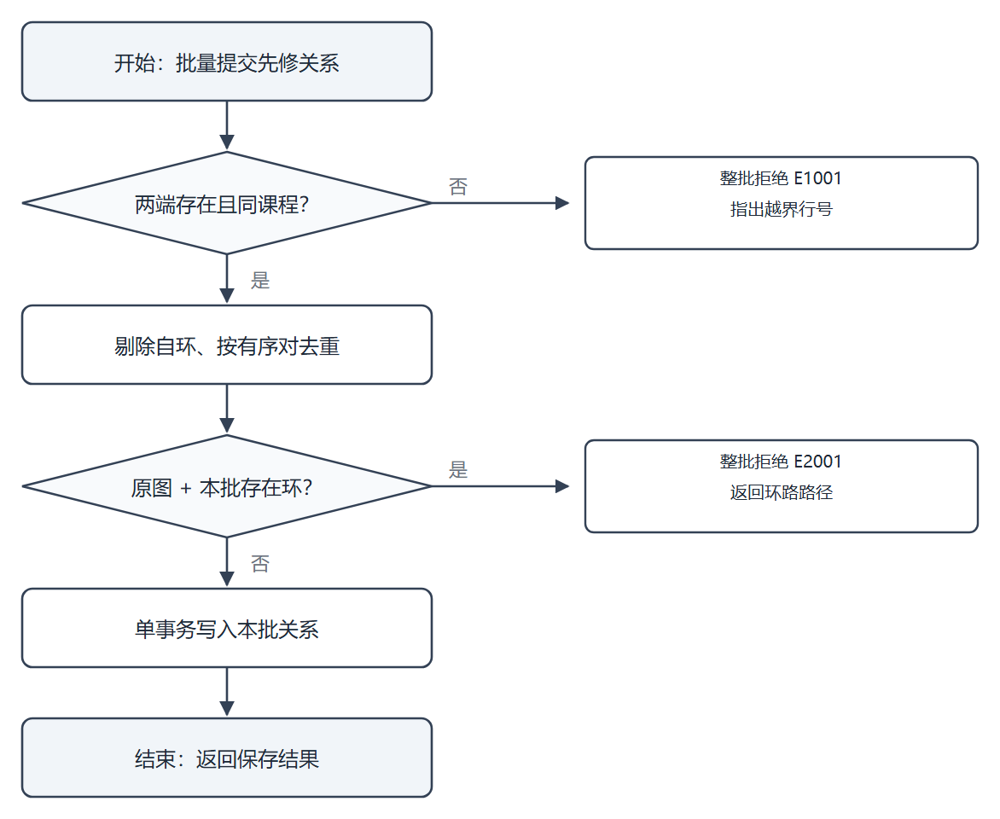

图 4-2 M-02 先修批量提交流程

流程要点：

1. **越界检查在最前**：跨课程/自环属于"参数错"，不进环检测；
2. **去重在环检测之前**：重复边不构成环，先清理能减少无效遍历；
3. **环检测失败整批拒绝**，不做"部分成功"——半套先修关系比没有更危险；
4. 保存成功后使课程内容修订号 `content_revision` 递增，供草案判断"内容是否已变"。

### 4.8 接口

表 4.5 M-02 的调用关系

| 方向 | 对象 | 方式 | 说明 |
|---|---|---|---|
| 上层调用方 | M-10 接口与序列化 | 函数调用 | 管理端路由 |
| 被调用 | M-11 存储访问 | 仓储 + 事务 | 见 D05 §4.1 |
| 被读取 | M-03 / M-05 | 只读快照 | 通过 `ContentSnapshot` 传递，不直接查库 |

```python
def save_concept(concept: ConceptInput, actor: Claims) -> Concept: ...
def submit_prereqs(batch: list[tuple[int, int]], course_id: int, actor: Claims) -> Result: ...
def disable_concept(concept_id: int, actor: Claims) -> Impact: ...
def replace_links(concept_id: int, resource_ids: list[int], actor: Claims) -> int: ...
```

### 4.9 存储分配

表 4.6 M-02 的存储占用

| 对象 | 规模 | 说明 |
|---|---|---|
| 课程内容全量 | 30 知识点 + 40 边 + 60 资源 ≈ 60 KB | 环检测时整图读入内存 |
| 邻接表 | 40 条边 × 约 40 B | 每次提交重建，不复用 |
| 递归栈深度 | ≤ 30 | 图规模小，无栈溢出风险 |

### 4.10 注释设计

表 4.7 M-02 的注释要求

| 位置 | 要求 | 示例 |
|---|---|---|
| 环检测 | 说明三色含义 | `# 0 白=未访问 1 灰=在栈上 2 黑=已完成` |
| 批量提交 | 说明为何整批拒绝 | `# 半套先修关系比没有更危险，故整批回滚` |
| 删除保护 | 说明引用语义 | `# 被版本引用的知识点只能停用，否则历史版本打不开` |

### 4.11 限制条件

1. 单课程：所有知识点必须属于同一 `course_id`；
2. 批量提交上限 40 条，超过需分批（与验收规模一致）；
3. 环检测在应用层完成，数据库无法约束图性质；
4. 停用不影响历史版本，但会让新草案少一个知识点；
5. 不支持知识点合并、拆分等结构变更（需人工处理并重建内容）。

### 4.12 测试计划

表 4.8 M-02 单体测试用例

| 用例号 | 覆盖点 | 输入 | 预期结果 |
|---|---|---|---|
| T-02-01 | 正常新增知识点 | 合法字段 | 保存成功，返回 ID |
| T-02-02 | 同课程重名 | 重复名称 | 拒绝，`E1001` 定位到字段 |
| T-02-03 | 时长越界 | `reference_minutes=601` | 拒绝（CHECK + 应用双保险） |
| T-02-04 | 自环先修 | `(A, A)` | 拒绝，指出第几行 |
| T-02-05 | 跨课程先修 | B 属于另一门课 | 拒绝 `E1001` |
| T-02-06 | 重复边 | 提交两次 `(A, B)` | 去重后只存一条 |
| T-02-07 | 批量成环 | 已有 A→B、B→C，提交 C→A | 拒绝 `E2001`，返回环 `[A,B,C,A]` |
| T-02-08 | 部分合法部分非法 | 3 条中 1 条跨课程 | **整批拒绝**，库中无新增 |
| T-02-09 | 被引用知识点删除 | 该知识点已进入某个 version_task | 拒绝删除，提示改为停用 |
| T-02-10 | 停用后新草案 | 知识点停用 | 新草案不含该知识点，历史版本仍可打开 |
| T-02-11 | 资源关联替换 | 由 3 个关联改为 2 个 | 删旧插新，共 2 条 |
| T-02-12 | 内容修订号 | 任意写操作 | `content_revision` 递增 1 |

### 4.13 尚未解决的问题

表 4.9 M-02 尚未解决的问题

| 编号 | 问题 | 当前处理 | 计划 |
|---|---|---|---|
| Q-07 | 批量导入的冲突策略 | 整批拒绝 | 若导入数据量大，改为"预览差异 + 选择性应用" |
| Q-08 | 知识点停用后的资源孤立 | 不处理 | 看板提示"资源暂无关联知识点" |

## 5 M-03 约束与容量设计说明

### 5.1 程序描述

M-03 把学生填的"目标 + 截止 + 有空时间"变成**可计算的约束对象**与**容量数字**。它是 M-05 的输入准备程序：不排程，只回答"能排多少分钟"。

程序特点：

- **纯计算 + 一次写库**：计算部分无副作用，保存约束时写一次；
- **与 M-05 的分工**：本程序只展开时段、算 C/B/C′；M-05 才装箱；
- **必须给出理由**：容量为零时不能只说"失败"，要说明是哪条约束导致的。

### 5.2 功能

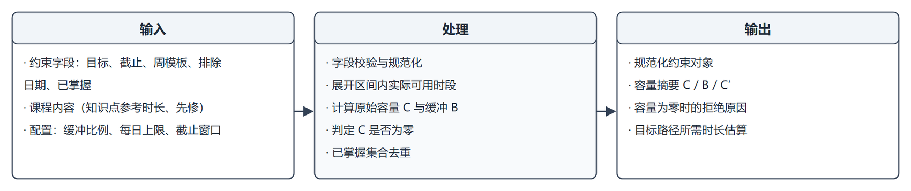

图 5-1 M-03 约束与容量的 IPO 图

表 5.1 M-03 的功能项

| 功能 | 说明 |
|---|---|
| 字段校验与规范化 | 目标去重、截止校验、周模板合法性、排除日期去重 |
| 时段展开 | 把周模板在 `[base_time, deadline)` 内展开为有序区间 |
| 容量计算 | 原始容量 C、缓冲 B、可排容量 C′ |
| 容量为零判定 | 全部被排除或时段为空时拒绝，并列出原因 |
| 已掌握剔除 | 目标与附加目标中剔除已掌握项 |

### 5.3 性能

表 5.2 M-03 的性能指标

| 操作 | 规模 | 目标耗时 |
|---|---|---|
| 字段校验 | 6 个字段 | ≤ 5 ms |
| 时段展开 | 180 天 × 每日 3 段 | ≤ 20 ms |
| 容量计算 | 540 个时段 | ≤ 5 ms |
| 整体（含保存） | 同上 | ≤ 300 ms |

### 5.4 输入项

表 5.3 M-03 的输入项

| 名称 | 类型 | 有效范围 | 说明 |
|---|---|---|---|
| `target_concept_id` | int | 本课程启用知识点 | 主目标 |
| `extra_concept_ids` | list[int] | 0–10 个，去重 | 附加目标 |
| `deadline` | date | 次日至 180 天内 | 截止日 |
| `availability` | 7 × list[(time, time)] | 每日 0–3 段，合计 ≤ 8 小时 | 周模板 |
| `excluded_dates` | list[date] | 0–30 个 | 排除日期 |
| `mastered_concept_ids` | list[int] | 本课程知识点 | 学生自评 |

### 5.5 输出项

表 5.4 M-03 的输出项

| 名称 | 类型 | 内容 | 说明 |
|---|---|---|---|
| `constraint` | object | 规范化后的约束 | 去重、排序后的字段 |
| `C` | int | 原始容量（分钟） | 展开后各段之和 |
| `B` | int | 缓冲（分钟） | `ceil(C × 0.10)` |
| `C_prime` | int | 可排容量 | `C − B` |
| `path_minutes` | int | 目标路径所需时长 | 闭包内知识点参考时长之和 |
| `reject_reason` | enum | `ALL_EXCLUDED` / `EMPTY_AVAILABILITY` | 容量为零时给出 |

### 5.6 算法

#### 5.6.1 时段展开（与 M-05 的 A1 的关系）

M-05 的 §7.6.1 已给出展开算法。本程序复用同一函数，但**只做展开与求和、不做装箱**，差异有两点：

1. 本程序按"整段"统计容量，不消费时段；
2. 本程序额外返回 `path_minutes`，用于界面"提交前估算"。

```python
def expand(constraint, config, base_time) -> list[Interval]:
    # 与 M-05 §7.6.1 完全相同的实现，由 M-05 与本程序共用同一工具函数
    ...
```

#### 5.6.2 容量计算

$$
C = \sum_{k=1}^{m} \left\lfloor \frac{|seg_k|}{60} \right\rfloor \quad (\text{分钟})
$$

$$
B = \left\lceil \text{BUFFER\_RATIO} \times C \right\rceil,\qquad C' = C - B
$$

```python
def compute_capacity(intervals, config) -> tuple[int, int, int]:
    C = sum(int((i.end - i.start).total_seconds() // 60) for i in intervals)
    B = math.ceil(config.BUFFER_RATIO * C)
    return C, B, C - B
```

#### 5.6.3 容量为零的判定与原因

三种情况都判为"不可排"，但原因不同：

表 5.5 容量为零的三种原因

| 条件 | 原因码 | 提示文案要点 |
|---|---|---|
| 周模板全空 | `EMPTY_AVAILABILITY` | "没有填写可用时间" |
| 区间内所有日期都被排除 | `ALL_EXCLUDED` | "排除日期覆盖了整个规划区间" |
| 区间内所有时段都早于基准时刻 | `ALL_EXCLUDED` | "可用的时间都已经过去" |

```python
def ensure_positive(C, intervals, constraint) -> None:
    if C > 0:
        return
    reason = "EMPTY_AVAILABILITY" if not constraint.availability_any() else "ALL_EXCLUDED"
    raise Reject("E1003", reason=reason)
```

#### 5.6.4 目标去重与已掌握剔除

$$
G' = (G \setminus \text{mastered}) \quad \text{且去重后} \ |G'| \ge 1
$$

若主目标已被自评为"已掌握"，允许继续，但附加目标必须至少有一个未掌握项；若全部已掌握，返回 `NOTHING_TO_PLAN`（与 M-05 的空草案一致）。

### 5.7 流程逻辑

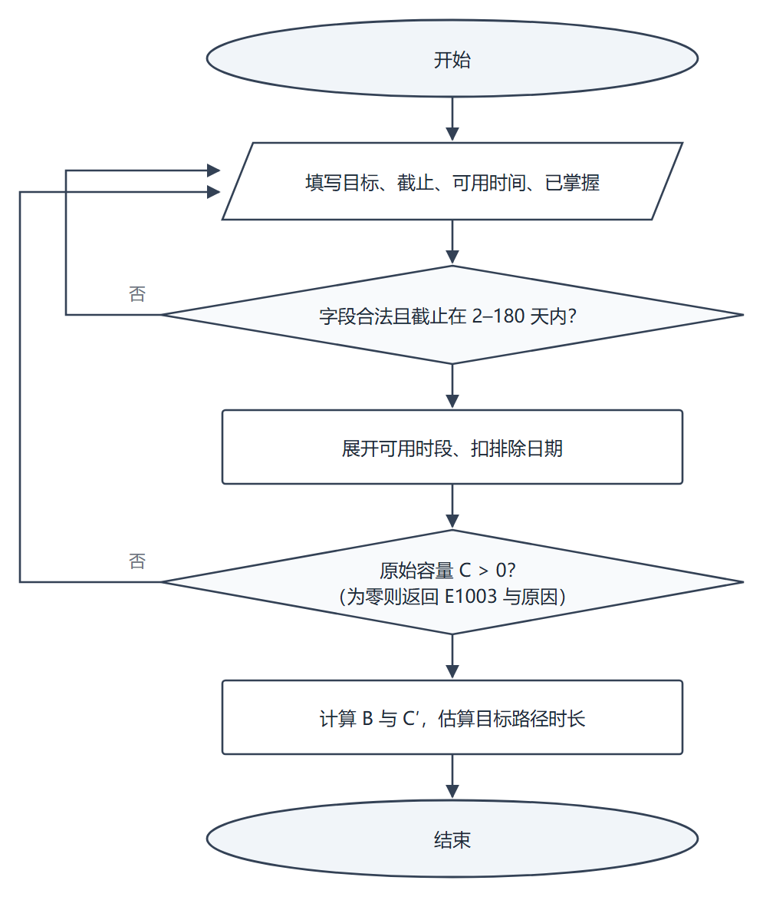

图 5-2 M-03 约束提交流程

流程要点：

1. **字段合法性与截止窗口最先判**，避免为非法输入做无用的时段展开；
2. **容量为零是阻断分支**，此时不保存约束，直接回显原因；
3. 保存成功后返回容量摘要，界面据此显示"排得下/紧张/排不下"；
4. 本程序不判断"排得下"——那是 M-05 与 M-06 的事，本程序只给数字。

### 5.8 接口

表 5.6 M-03 的调用关系

| 方向 | 对象 | 方式 | 说明 |
|---|---|---|---|
| 上层调用方 | M-10 接口与序列化 | 函数调用 | 约束提交接口 |
| 被调用 | M-02 课程内容管理 | 只读快照 | 取知识点与参考时长 |
| 被调用 | M-11 存储访问 | 仓储 | 保存约束 |
| 下游 | M-05 分解与排程 | 返回值 | 提供时段与 C/B/C′ |

```python
def normalize(constraint_input, content, now) -> Constraint: ...
def compute(constraint, content, config, base_time) -> CapacitySummary: ...
def save(constraint, actor) -> Constraint: ...
```

### 5.9 存储分配

表 5.7 M-03 的存储占用

| 对象 | 规模 | 说明 |
|---|---|---|
| 时段列表 | ≤ 540 段 × 约 80 B ≈ 43 KB | 随请求释放 |
| 约束对象 | 约 2 KB（含三个 JSON 字段） | 落库为 `plan_constraint` 一行 |
| 目标集合 | ≤ 11 个 ID | — |

### 5.10 注释设计

表 5.8 M-03 的注释要求

| 位置 | 要求 | 示例 |
|---|---|---|
| 容量公式 | 指明与本文公式号对应 | `# 见 §5.6.2 式 (5-1)：C = Σ 段长` |
| 缓冲 | 说明为何向上取整 | `# 向上取整：宁可少排一分钟，也不要超出真实可用时间` |
| 零容量 | 说明三种原因的区分 | `# 三种零容量原因不同，提示文案必须分开` |

### 5.11 限制条件

1. 只支持单课程约束，不支持跨课程合并；
2. 每日可用时段合计 ≤ 8 小时（超出视为误填）；
3. 排除日期最多 30 个；
4. 截止窗口 2–180 天，不接受当天截止；
5. 时区固定为 Asia/Shanghai，界面显示与存储分离（存储 UTC 秒）。

### 5.12 测试计划

表 5.9 M-03 单体测试用例

| 用例号 | 覆盖点 | 输入 | 预期结果 |
|---|---|---|---|
| T-03-01 | 正常容量 | 30 天、每周 3 天 × 120 分钟 | C、B、C′ 与手算一致 |
| T-03-02 | 截止边界-昨天 | 截止 = 昨天 | 拒绝 `E1001` |
| T-03-03 | 截止边界-180 天 | 截止 = 今天 + 180 | 接受 |
| T-03-04 | 截止边界-181 天 | 截止 = 今天 + 181 | 拒绝 |
| T-03-05 | 每日超 8 小时 | 某日 4 段 × 150 分钟 | 拒绝 `E1001` |
| T-03-06 | 排除日期含截止日 | 排除集合包含截止日 | 该日时段被扣除，仍可排 |
| T-03-07 | 全部排除 | 所有日期被排除 | `E1003` + `ALL_EXCLUDED` |
| T-03-08 | 周模板全空 | 七天都没有时段 | `E1003` + `EMPTY_AVAILABILITY` |
| T-03-09 | 目标去重 | 附加目标含重复项与主目标 | 去重后数量正确 |
| T-03-10 | 全部已掌握 | 目标与附加目标都在已掌握集合 | 返回 `NOTHING_TO_PLAN` |
| T-03-11 | 缓冲取整 | C = 1321 分钟 | B = 133（向上取整） |
| T-03-12 | 时段裁剪 | 基准时刻在某个时段中间 | 该段只计剩余分钟 |

### 5.13 尚未解决的问题

表 5.10 M-03 尚未解决的问题

| 编号 | 问题 | 当前处理 | 计划 |
|---|---|---|---|
| Q-09 | 跨时区学生 | 固定上海时区 | 若有多时区，需把 `availability` 改为带时区的区间 |
| Q-10 | 排除日期的粒度 | 整天排除 | 若需"半天",改用区间排除 |

## 6 M-04 追问与抽取设计说明

### 6.1 程序描述

M-04 是**唯一调用大模型**的程序，位置在领域层，但它的产出必须经过校验才能进入计划。它做三件事：把自然语言转成结构化字段、发现缺失字段并追问、把程序结论转成学生能懂的话。

程序特点：

- **规则优先**：日期、时长、星期这类有明确写法的信息，用本地规则解析，不调模型；
- **模型只读**：模型输出只是候选，字段合法性、知识点存在性、日期合理性全部由程序复核；
- **必然降级**：模型不可用或超时，转表单，已填字段保留，主流程不受影响；
- **可复现**：模型参与的部分不进入计划快照的哈希计算（见 §9.6.5）。

### 6.2 功能

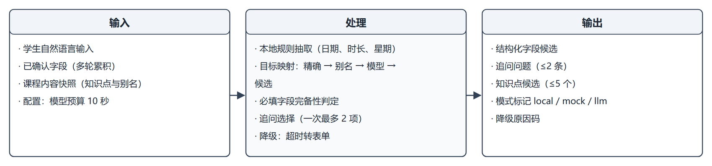

图 6-1 M-04 追问与抽取的 IPO 图

表 6.1 M-04 的功能项

| 功能 | 说明 |
|---|---|
| 本地规则抽取 | 相对日期、时长、星期几、数字范围 |
| 目标映射 | 把"循环那块"映射到具体知识点，四层降级 |
| 缺失字段判定 | 六项必填字段的完备性判断 |
| 追问选择 | 一次最多问 2 项，按"不填无法排程"排序 |
| 回显确认 | 把抽取结果整理成一句人话请学生确认 |
| 降级 | 10 秒预算内无结果 → 表单，标记 `mode=local` |

### 6.3 性能

表 6.2 M-04 的性能指标

| 操作 | 规模 | 目标耗时 | 说明 |
|---|---|---|---|
| 本地规则抽取 | 单句 ≤ 100 字 | ≤ 5 ms | 纯正则与词典匹配 |
| 目标映射（前两层） | 30 知识点 | ≤ 2 ms | 精确匹配 + 别名表 |
| 模型调用 | 单轮 | ≤ 10 s | 超时即降级，计入同一预算 |
| 整体交互 | 一次追问 | ≤ 10 s | 与 D02 §3.2.2 的模型辅助预算一致 |

### 6.4 输入项

表 6.3 M-04 的输入项

| 名称 | 类型 | 有效范围 | 来源 |
|---|---|---|---|
| `utterance` | string | 1–500 字 | 学生输入框 |
| `filled` | map | 已确认字段，可空 | 多轮累积 |
| `content` | ContentSnapshot | 30 知识点 + 别名 | M-02 只读快照 |
| `config` | EngineConfig | 模型预算、候选上限 | M-12 |

### 6.5 输出项

表 6.4 M-04 的输出项

| 名称 | 类型 | 内容 | 说明 |
|---|---|---|---|
| `fields` | map | 抽取到的字段 | 只含识别成功的项 |
| `questions` | list[string] | 追问问题 | **最多 2 条** |
| `candidates` | list[Concept] | 知识点候选 | 最多 5 个，含 ID 与名称 |
| `mode` | enum | `local` / `mock` / `llm` | 界面显示"离线可用" |
| `degraded_reason` | enum | `TIMEOUT` / `UNAVAILABLE` / `INVALID_OUTPUT` | 可空 |

### 6.6 算法

#### 6.6.1 目标映射的四层降级

设学生说出的目标文本为 $u$，课程知识点集合为 $C$：

$$
\hat{c} = \begin{cases}
\text{exact}(u) & \text{命中名称} \\
\text{alias}(u) & \text{命别名表} \\
\text{llm}(u, C) & \text{模型在候选内选择} \\
\varnothing & \text{以上均失败，返回候选列表}
\end{cases}
$$

```python
def map_target(u, content, llm) -> Mapping:
    if (c := content.exact(u)):
        return Mapping.hit(c, "exact")
    if (c := content.alias(u)):          # 循环/for/while → 循环结构
        return Mapping.hit(c, "alias")
    choice = llm.pick(u, content.brief())  # 只允许从候选里挑，不允许自由生成
    if choice in content.ids():
        return Mapping.hit(content[choice], "llm")
    return Mapping.candidates(content.search(u)[:5])
```

**关键约束**：提示词要求模型"从给定候选里选一个 ID"，并在返回后校验 `choice in content.ids()`。模型编造的 ID 一律丢弃——这一条对应测试用例 T-06-06。

#### 6.6.2 相对日期归一化（纯本地规则）

以 `base_time` 的本地日期 $d_0$ 为锚：

表 6.5 相对日期的归一化规则

| 说法 | 归一化 |
|---|---|
| 今天 / 明天 / 后天 | $d_0$、$d_0+1$、$d_0+2$ |
| 本周五 | 本周内的周五，若已过则顺延到下周 |
| 下周三 | **下一周**的周三（不是"最近的周三"） |
| 两周内 / 半个月 | $d_0 + 14$ |
| N 天后 / N 周后 | $d_0 + N$、$d_0 + 7N$ |

```python
def parse_relative(text, base_date) -> date | None:
    if "下周三" in text:
        return next_weekday(base_date, 2)      # 下周的周三
    if "本周" in text:
        return this_weekday(base_date, weekday_of(text))   # 已过则 +7
    if m := re.search(r"(\d+)\s*天", text):
        return base_date + timedelta(days=int(m.group(1)))
    ...
```

**边界**：`本周五` 若今天已是周六，必须顺延到下周，否则会得到过去的日期，被 M-03 直接拒掉。

#### 6.6.3 缺失字段判定与追问选择

必填六项：主目标、截止日期、可用时间（周模板）、每日上限、排除日期（可空）、已掌握集合（可空）。前四项缺一不可。

追问优先级（缺多项时取前 2）：

表 6.6 缺失字段的追问优先级

| 优先级 | 字段 | 理由 |
|---|---|---|
| 1 | 主目标 | 没有目标无法闭包 |
| 2 | 截止日期 | 没有截止无法算容量 |
| 3 | 可用时间 | 同上 |
| 4 | 每日上限 | 缺省可用 8 小时 |

```python
def pick_questions(missing, limit=2) -> list[str]:
    return [Q[f] for f in FIELD_PRIORITY if f in missing][:limit]
```

#### 6.6.4 模型调用与降级

```python
def call_model_safely(prompt, budget_s, provider) -> tuple[Out, str]:
    try:
        out = provider.complete(prompt, timeout=budget_s)
        return validate(out), "llm"
    except TimeoutError:
        return None, "TIMEOUT"
    except ProviderError:
        return None, "UNAVAILABLE"
```

降级后 `mode` 置为 `local`，界面提示"当前为离线模式，请用表单填写"，**已识别字段不清空**。

### 6.7 流程逻辑

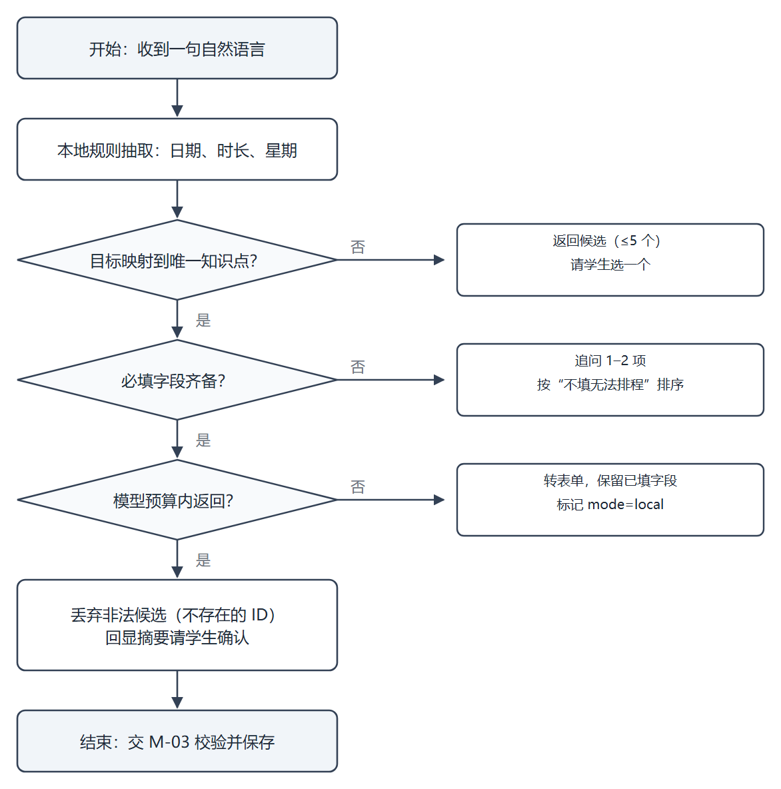

图 6-2 M-04 抽取与追问流程

流程要点：

1. 本地规则先跑，模型只在"规则搞不定"时才被调用，降低延迟与成本；
2. 映射失败不报错，而是**给候选让选**——这是对话式交互的关键；
3. 缺字段时只问 2 项，避免一次问太多把人问跑；
4. 模型异常走右侧降级出口，不阻断主流程。

### 6.8 接口

表 6.7 M-04 的调用关系

| 方向 | 对象 | 方式 | 说明 |
|---|---|---|---|
| 上层调用方 | M-10 接口与序列化 | 函数调用 | 对话接口 |
| 被调用 | M-02 | 只读快照 | 知识点与别名 |
| 被调用 | M-12 | 适配器 | 模型 Provider（可能为 Mock） |
| 下游 | M-03 | 返回值 | 字段齐备后交其校验 |

```python
def extract(utterance: str, filled: dict, content, config) -> Extraction: ...
def build_questions(missing: set[str]) -> list[str]: ...
def explain(issue_codes: list[str]) -> str: ...   # 纯模板，不调模型
```

### 6.9 存储分配

表 6.8 M-04 的存储占用

| 对象 | 规模 | 说明 |
|---|---|---|
| 提示词与上下文 | 约 2 KB（知识点全量注入） | 每轮构建，不缓存 |
| 抽取结果 | < 1 KB | 随请求释放 |
| 别名表 | 30 条 × 20 B | 随内容快照加载 |

### 6.10 注释设计

表 6.9 M-04 的注释要求

| 位置 | 要求 | 示例 |
|---|---|---|
| 映射降级 | 说明四层顺序不可调换 | `# 精确 → 别名 → 模型 → 候选：越往后越贵、越不确定` |
| 候选校验 | 说明为什么必须复核 | `# 模型可能编造 ID，必须校验存在性` |
| 降级 | 说明"不清空已填" | `# 降级只换输入方式，不丢用户已输入的内容` |

### 6.11 限制条件

1. 一次只处理一句输入，不做多轮上下文压缩；
2. 模型只允许在候选内挑选，不允许自由生成知识点；
3. 追问上限 2 项；
4. 单轮预算 10 秒，超时即降级；
5. 不支持语音输入；
6. 相对日期只支持中文常见说法，方言与模糊表达（"月底前吧"）归入模型处理。

### 6.12 测试计划

表 6.10 M-04 单体测试用例

| 用例号 | 覆盖点 | 输入 | 预期结果 |
|---|---|---|---|
| T-06-01 | 精确匹配 | "循环结构" | 直接命中，`mode=local` |
| T-06-02 | 别名匹配 | "for 循环" | 命中循环结构，`source=alias` |
| T-06-03 | 映射失败给候选 | "那个循环的东西" | 返回 ≤5 个候选，不报错 |
| T-06-04 | 相对日期-下周三 | "下周三之前" | 得到**下一周**的周三 |
| T-06-05 | 相对日期-本周已过 | 周六说"本周五" | 顺延到下周，日期在未来 |
| T-06-06 | 模型编造 ID | 模型返回不存在的 `concept_id` | 丢弃该结果，转为候选 |
| T-06-07 | 追问不超 2 项 | 缺 4 个必填字段 | 只问 2 项，且是优先级最高的两项 |
| T-06-08 | 超时降级 | Provider 抛 `TimeoutError` | `mode=local`、`degraded_reason=TIMEOUT`，已填字段保留 |
| T-06-09 | 非法 JSON 输出 | 模型返回非 JSON | 视为无效输出，转候选 |
| T-06-10 | 已掌握剔除后的空目标 | 目标全在已掌握集合 | 返回空草案标记，交 M-03 处理 |

### 6.13 尚未解决的问题

表 6.11 M-04 尚未解决的问题

| 编号 | 问题 | 当前处理 | 计划 |
|---|---|---|---|
| Q-11 | 多轮上下文 | 不保留历史 | 若体验不足，加最近 3 轮摘要 |
| Q-12 | 模糊日期（"月底"） | 归模型处理 | 模型不可用时，提示改用具体日期 |

## 7 M-05 分解与排程设计说明

### 7.1 程序描述

M-05 是系统的核心计算程序：把"学生的约束 + 课程内容快照"转换成"任务与时间片"，并给出容量指标。它决定了计划是否可行，也是校验程序 M-06 的直接输入。

程序特点：

- **纯函数**：不读写数据库、不调用模型、不读系统时钟；基准时刻由入参 `base_time` 传入。相同入参必须得到逐字节相同的结果，这是"历史可复现"的前提。
- **无状态、可重入**：不持有跨调用状态，可被并发调用（当前实现为单进程串行，但接口不依赖调用顺序）。
- **非常驻**：按需调用，单次执行结束后即可回收。
- **确定性**：拓扑排序与装箱都定义了稳定的次序规则（见 §7.6），避免因字典/集合遍历顺序不同而产生不同结果。

### 7.2 功能


图 7-1 M-05 分解与排程的 IPO 图

功能要点：

1. **先修闭包**：从目标知识点反向收集全部前置，形成必须完成的节点集合；
2. **剔除已掌握**：学生自评已掌握的知识点不生成任务，但其先修关系仍参与闭包；
3. **拆学习与练习**：按参考时长 7:3 拆分，练习用于巩固；
4. **稳定排序**：按先修关系与章节顺序排序，保证同一份输入每次排出的顺序一致；
5. **装箱**：把任务时长填入展开后的可用时段，逐段预留缓冲；
6. **拆片**：单个任务的连续时长超过单片上限时切分，片数受限；
7. **汇总指标**：输出 T、C、B、C′、缺口 D 与利用率 U。

不在本程序职责内的：合法性检查（归 M-06）、持久化（归 M-07/M-11）、解释文本（归 M-04）。

### 7.3 性能

表 7.1 M-05 的性能指标

| 操作 | 规模 | 目标耗时 | 说明 |
|---|---|---|---|
| 时段展开 | 180 天 × 每日 3 段 | ≤ 20 ms | 与排除日期求差 |
| 先修闭包 | 30 知识点、40 条边 | ≤ 10 ms | 邻接表 + 迭代 DFS |
| 任务拆分 | 30 知识点 → 60 任务 | ≤ 5 ms | 线性 |
| 拓扑排序 | 60 节点 | ≤ 10 ms | Kahn，堆排序保证稳定 |
| 装箱与拆片 | 60 任务、约 400 片 | ≤ 150 ms | 单次线性扫描时段 |
| 整体（含指标） | 上述规模 | **≤ 1 s** | 对齐 D02 表 3.17 |

精度要求：所有时长以**整分钟**为单位，拆分产生的浮点误差用"学习取整、练习取差"吸收，保证 `学习 + 练习 = 参考时长` 恒成立。

### 7.4 输入项

表 7.2 M-05 的输入项

| 名称 | 类型 | 有效范围 | 来源 | 必填 |
|---|---|---|---|---|
| `constraint` | `Constraint` | 主目标 1 个、附加目标 0～10 个、截止为未来日期 | M-03 校验后传入 | 是 |
| `content_snapshot` | `ContentSnapshot` | 30 知识点、40 条先修、60 份资源 | M-02 只读快照 | 是 |
| `mastered_ids` | `set[ConceptId]` | 本课程知识点子集 | 约束对象 | 否（空集） |
| `config` | `EngineConfig` | 见 §2 表 2.2 | M-12 配置 | 是 |
| `base_time` | `datetime`（UTC） | 不得早于当前时间 24 小时以上（演示可放宽） | 调用方传入 | 是 |

### 7.5 输出项

表 7.3 M-05 的输出项

| 名称 | 类型 | 内容 | 说明 |
|---|---|---|---|
| `tasks` | `list[Task]` | 稳定身份、知识点、类型、预计分钟、顺序号 | 顺序号即拓扑序，跨版本稳定 |
| `slices` | `list[Slice]` | 任务 ID、片号、起止 epoch（整分钟） | 全部落在可用时段内 |
| `unscheduled` | `list[Unscheduled]` | 任务 ID 与原因码 | 原因：容量不足 / 片数超限 |
| `metrics` | `Metrics` | T、C、B、C′、D、U | 供 M-06 与看板使用 |
| `draft` | `Draft` | 上述内容的聚合 + 输入摘要 `input_hash` | 不落库，由 M-07 持久化 |

### 7.6 算法

#### 3.6.1 时段展开（A1）

把周模板在 `[base_time, deadline)` 区间展开为有序、互不重叠的时段列表。

设规划区间起始日 $d_0 = \lfloor base\_time \rfloor$（本地日期），截止边界 $D = deadline + 1$ 日 00:00。对每日 $d \in [d_0, D)$，若 $d \notin excluded$，取其星期对应的模板段 $(s_i, e_i)$，裁剪后加入结果：

$$
\text{seg}(d, i) = \left[\max(s_i, base\_time),\ \min(e_i, D)\right),\quad \text{仅当 } \max < \min
$$

原始容量：

$$
C = \sum_{k} \left| \text{seg}_k \right| \quad (\text{分钟，向下取整})
$$

缓冲与可排容量：

$$
B = \left\lceil \text{BUFFER\_RATIO} \times C \right\rceil,\qquad C' = C - B
$$

```python
def expand_availability(constraint, config, base_time) -> list[Interval]:
    d0 = local_date(base_time)
    D = local_date(constraint.deadline) + timedelta(days=1)
    out = []
    for d in dates(d0, D):
        if d in constraint.excluded_dates:
            continue
        for s, e in constraint.availability[d.weekday()]:
            lo, hi = max(s, base_time), min(e, datetime.combine(D, time.min))
            if lo < hi:
                out.append(Interval(lo, hi))
    return sorted(out, key=lambda x: x.start)
```

#### 3.6.2 先修闭包（A2）

从目标集合 $G$ 出发，沿先修边反向遍历，得到必须完成的结点集 $R$：

$$
R = G \cup \{ u \mid \exists v \in R,\ (u, v) \in E_{\text{prereq}} \}
$$

实现用显式栈的迭代 DFS（避免递归深度问题）。遍历中若再次遇到"正在访问"的节点，说明输入图成环——这在 M-02 提交时已拦截，此处作为**不变式断言**处理：直接抛 `PREREQ_CYCLE`，不静默纠正。

```python
def prereq_closure(goals, edges, mastered) -> list[ConceptId]:
    reverse = defaultdict(list)
    for u, v in edges:            # u 先修 v
        reverse[v].append(u)
    seen, order, stack = set(), [], list(goals)
    while stack:
        node = stack.pop()
        if node in seen:
            continue
        seen.add(node)
        order.append(node)
        stack.extend(sorted(reverse[node], key=lambda c: c.sort_key))
    return order      # 已按"先修在前"排序的近似序，正式次序由 A4 决定
```

#### 3.6.3 时长拆分（A3）

对知识点 $c$ 的参考时长 $T_c$：

$$
L_c = \left\lfloor \text{STUDY\_RATIO} \times T_c \right\rfloor,\qquad P_c = T_c - L_c
$$

练习取差值而非再次取整，保证 $L_c + P_c = T_c$ 恒成立。若 $c \in mastered$ 或 $c$ 已停用，则两者都不生成；若 $P_c < \text{MIN\_TASK\_MINUTES}$，把 $P_c$ 并入 $L_c$，只生成学习任务。

```python
def split_tasks(concepts, mastered, config) -> list[Task]:
    tasks = []
    for c in concepts:
        if c.id in mastered or not c.enabled:
            continue
        total = c.reference_minutes
        study = int(total * config.study_ratio)
        practice = total - study
        if practice < config.min_task_minutes:
            study, practice = total, 0
        tasks.append(Task(c.id, "study", study))
        if practice:
            tasks.append(Task(c.id, "practice", practice))
    return tasks
```

#### 3.6.4 稳定拓扑排序（A4）

在结点集 $R$ 上按先修边做 Kahn 排序；同一入度的候选按三元组 $(\text{chapter}, \text{sort\_order}, \text{concept\_id})$ 升序取最小，保证**确定性**。同一知识点内，学习任务排在练习任务之前。

$$
\text{key}(c) = (\text{chapter}(c),\ \text{sort\_order}(c),\ \text{concept\_id}(c))
$$

```python
def topo_order(nodes, edges) -> list[ConceptId]:
    indeg = {n: 0 for n in nodes}
    adj = defaultdict(list)
    for u, v in edges:
        if u in indeg and v in indeg:
            adj[u].append(v)
            indeg[v] += 1
    heap = [(c.key, c.id) for c in nodes if indeg[c.id] == 0]
    heapq.heapify(heap)
    order = []
    while heap:
        _, cid = heapq.heappop(heap)
        order.append(cid)
        for nxt in adj[cid]:
            indeg[nxt] -= 1
            if indeg[nxt] == 0:
                heapq.heappush(heap, (key_of(nxt), nxt))
    assert len(order) == len(nodes), "先修图成环"
    return order
```

#### 3.6.5 装箱（A5）

按 A4 的次序逐任务填充时段，允许一个任务跨多个时段（切分为片）。

总量与缺口：

$$
T = \sum_{c} (L_c + P_c),\qquad D = \max(0,\ T - C'),\qquad U = \frac{T}{C}
$$

```python
def pack(tasks, intervals, config) -> tuple[list[Slice], list[Unscheduled]]:
    pool = [list(i) for i in intervals]      # 可消费的剩余时段
    cur = 0                                  # 当前时段索引
    slices, unscheduled = [], []
    for t in tasks:
        need = t.minutes
        pieces = []
        while need > 0:
            if cur >= len(pool):
                unscheduled.append(Unscheduled(t.id, "CAPACITY"))
                pieces = []
                break
            lo, hi = pool[cur]
            avail = int((hi - lo).total_seconds() // 60)
            if avail <= 0:
                cur += 1
                continue
            take = min(need, avail, config.max_slice_seconds // 60)
            start = lo
            pieces.append((start, start + timedelta(minutes=take)))
            pool[cur][0] = start + timedelta(minutes=take)
            need -= take
        if pieces:
            if len(pieces) > config.max_slices_per_task:
                unscheduled.append(Unscheduled(t.id, "TOO_MANY_SLICES"))
            else:
                slices.extend(make_slices(t.id, pieces))
    return slices, unscheduled
```

**装箱判定**（与 A6 共同决定"排入 / 未排入"）：

表 7.4 装箱判定的结果与原因码

| 条件 | 结果 | 原因码 |
|---|---|---|
| 剩余时段总分钟 ≥ 任务分钟 且 片数 ≤ 100 | 排入 | — |
| 时段用尽仍不足 | 未排入 | `CAPACITY` |
| 需要的片数 > 100 | 未排入 | `TOO_MANY_SLICES` |
| 单段剩余 < `MIN_TASK_MINUTES` | 跳过该段 | — |

#### 3.6.6 拆片（A6）

单片时长上限取自配置（7200 秒 = 120 分钟）。切分规则：在同一时段内尽量取满 `min(剩余需求, 段剩余, 单片上限)`，跨段继续。片号在同一任务内从 1 递增，`slice_no` 稳定，便于差异比较。

本程序**不做二次缓冲**：缓冲已在 $C'$ 中按整段预留，若再在片内扣减会造成双重预留，与实际可用时间不符。

#### 3.6.7 复杂度

时段数 $m \le 540$，任务数 $n \le 60$，片数 $s \le 400$。

- A1：$O(m)$；
- A2：$O(V + E)$，$V \le 30,\ E \le 40$；
- A4：$O((V + E)\log V)$；
- A5：$O(s)$（每个任务顺序消费时段指针，不回退）。

整体为线性量级，实测目标见 §7.3。

### 7.7 流程逻辑

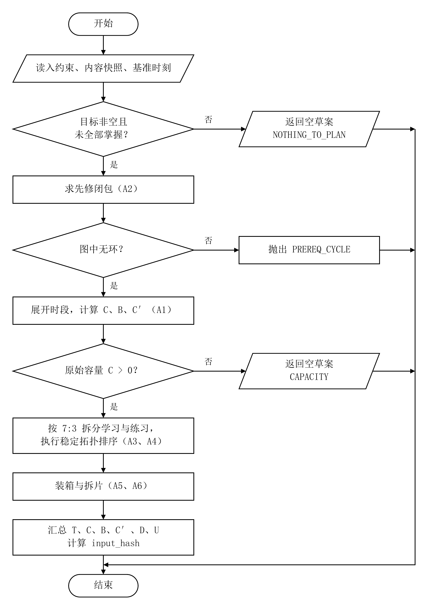

图 7-2 M-05 主流程图

流程要点：

1. 先判空：目标集为空或全部已掌握 → 直接返回空草案并给 `NOTHING_TO_PLAN`；
2. 先修闭包失败（成环）→ 抛出 `PREREQ_CYCLE`，不进入装箱；
3. 容量为 0（$C = 0$）→ 不排程，返回 `CAPACITY`，由上层提示改约束；
4. 装箱结束后若 `unscheduled` 非空 → 仍返回草案（可查看），但 `metrics.deficit > 0`；
5. 组装指标 → 生成 `input_hash` → 返回。

表 7.5 主流程判定表

| 条件 | 规则 1 | 规则 2 | 规则 3 | 规则 4 |
|---|---|---|---|---|
| 目标集非空 | N | Y | Y | Y |
| 先修图无环 | — | N | Y | Y |
| 原始容量 C > 0 | — | — | N | Y |
| 结果 | 空草案 `NOTHING_TO_PLAN` | 异常 `PREREQ_CYCLE` | 空草案 `CAPACITY` | 正常草案 |

### 7.8 接口

表 7.6 M-05 的调用关系

| 方向 | 对象 | 方式 | 说明 |
|---|---|---|---|
| 上层调用方 | M-10 接口与序列化 | 函数调用 | 生成草案入口 |
| 同层调用方 | M-07 确认与版本 | 函数调用 | 调整时重排 |
| 被调用 | M-02 课程内容管理 | 只读快照 | 通过 `ContentSnapshot` 传入，不直接查库 |
| 被调用 | M-03 约束与容量 | 只读 | 使用其展开的时段与 C/B/C′ |
| 下游 | M-06 计划校验 | 返回值 | 草案作为校验输入 |

函数签名：

```python
def generate_plan(
    constraint: Constraint,
    content: ContentSnapshot,
    config: EngineConfig,
    base_time: datetime,
) -> Draft:
    """生成计划草案。纯函数：相同入参必须得到相同 output_hash。"""
```

涉及的持久化结构（仅引用，本程序不写库）：`plan_task`、`version_task`、`task_slice`（见 D05 §4.1）。

### 7.9 存储分配

表 7.7 M-05 的存储占用

| 对象 | 规模上限 | 单条估算 | 合计 |
|---|---|---|---|
| 任务对象 | 60 | ~200 B | ~12 KB |
| 时间片 | 400 | ~120 B | ~48 KB |
| 时段列表 | 540 | ~80 B | ~43 KB |
| 快照引用 | 30 知识点 | 复用入参 | 不额外分配 |

峰值内存 < 1 MB，无需特殊分配策略；不持有跨调用缓存，避免与"纯函数"约束冲突。

### 7.10 注释设计

表 7.8 M-05 的注释要求

| 位置 | 内容要求 | 示例 |
|---|---|---|
| 模块首部 | 职责、约束（纯函数）、入参含义、可能抛出的异常 | `"""生成计划草案。纯函数：不读写外部状态。\n Raises: PREREQ_CYCLE, CAPACITY。"""` |
| 分支点 | 说明为什么这样判（而不是重复代码） | `# 缓冲已在 C′ 中整段预留，片内不再二次扣减，避免双重预留` |
| 变量 | 单位与量纲必须写在名字或注释里 | `need_minutes`, `slice_no` |
| 公式 | 与本文公式号对应 | `# 见 §7.6.5 式 (3-3)：D = max(0, T - C′)` |

### 7.11 限制条件

1. 单进程串行调用，不做并发控制；若将来并发，需保证 `content` 快照不可变。
2. 入参对象视为只读，本程序不得原地修改（必要时先深拷贝时段列表）。
3. 不读取系统时钟，所有时间来自 `base_time`，否则结果不可复现。
4. 不支持跨课程排程：`content` 只含一门课程。
5. 片数超过 100 的任务直接判不可排，不做"跨多日无限切分"的兜底。
6. 浮点只用于比例计算，落库前一律转为整分钟。

### 7.12 测试计划

环境：`pytest` + 内存 SQLite；M-02/M-03 用固定夹具（30 知识点、40 条先修），不 mock 算法本身；模型适配器替换为假实现（本程序不调用）。

表 7.9 M-05 单体测试用例

| 用例号 | 覆盖点 | 输入 | 预期结果 |
|---|---|---|---|
| T-05-01 | 正常流 | 1 目标（90 分钟）、7 天 × 2 小时/天 | 生成 2 任务（63/27），全部排入，`D=0` |
| T-05-02 | 7:3 取整 | 参考时长 85 分钟 | 学习 59、练习 26；两者之和 = 85 |
| T-05-03 | 极小练习 | 参考时长 10 分钟（7:0.3→练习 3） | 若配置 `MIN_TASK_MINUTES=5`，只生成学习任务 10 分钟 |
| T-05-04 | 已掌握剔除 | 目标已掌握 | 返回空草案 + `NOTHING_TO_PLAN` |
| T-05-05 | 先修闭包 | 目标 C，先修 B，B 先修 A | 生成 A、B、C 三组任务，A 的任务在前 |
| T-05-06 | 成环断言 | 构造 A→B→A | 抛 `PREREQ_CYCLE`，不返回草案 |
| T-05-07 | 容量为零 | 全部时段被排除日期覆盖 | 返回空草案 + `CAPACITY` |
| T-05-08 | 容量紧张 | T/C = 0.85 | `D=0`，`U≈0.85`，由 M-06 给 `CAP_TIGHT` |
| T-05-09 | 容量不足 | T 超过 C′ | `unscheduled` 含 `CAPACITY`，`D>0` |
| T-05-10 | 拆片 | 单任务 300 分钟、每日段 120 分钟 | 生成 3 片，每片 ≤ 120 分钟，片号 1..3 |
| T-05-11 | 片数超限 | 构造需 120 片的任务 | `unscheduled` 含 `TOO_MANY_SLICES` |
| T-05-12 | 确定性 | 同一输入连续调用两次 | 两次输出的 `output_hash` 完全相同 |

桩模块：`ContentSnapshot` 用 JSON 夹具加载；`Constraint` 直接构造；无需数据库桩（本程序不访问库）。

### 7.13 尚未解决的问题

表 7.10 M-05 尚未解决的问题

| 编号 | 问题 | 当前处理 | 计划 |
|---|---|---|---|
| Q-01 | 拆片上限取多少 | 本章定稿为 100 片，超出判不可排 | 若实测发现正常场景超限，调 `MAX_SLICES_PER_TASK` 并重跑 T-05-11 |
| Q-04 | 跨天拆片是否允许"同日多片" | 允许，只要落在不同时段 | 若看板拥挤，改为每日最多 2 片（仅影响 A5 的取片顺序） |

## 8 M-06 计划校验设计说明

### 8.1 程序描述

M-06 判断一份草案"能不能用"。它是纯函数：只读草案、约束与内容，返回校验报告，不改任何数据。它是"确认"的前置闸门——**有 ERROR 就不能确认**。

程序特点：

- **顺序固定**：五项检查按 时段 → 容量 → 重叠 → 先修 → 截止 执行，前一 ERROR 即停；
- **可解释**：每个问题都带问题码、级别、受影响任务与建议；
- **确定性**：同一草案多次校验结果必须完全一致，便于复现与测试。

### 8.2 功能

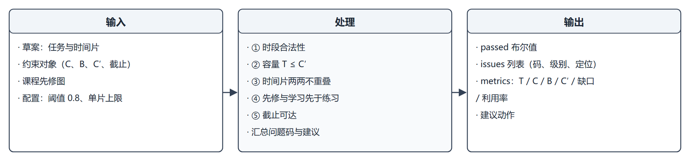

图 8-1 M-06 计划校验的 IPO 图

表 8.1 M-06 的检查项与问题码

| 检查 | 问题码 | 级别 |
|---|---|---|
| 时段合法性 | `SLOT_INVALID` | ERROR |
| 容量 T ≤ C′ | `CAP_EXCEEDED` | ERROR |
| 时间片重叠 | `TIME_OVERLAP` | ERROR |
| 先修与学习先于练习 | `PREREQ_VIOLATED` | ERROR |
| 截止可达 | `DEADLINE_UNREACHABLE` | ERROR |
| 容量紧张（T/C > 0.8） | `CAP_TIGHT` | WARN |
| 知识点无先修且无后继 | `ISOLATED_CONCEPT` | INFO |

### 8.3 性能

表 8.2 M-06 的性能指标

| 操作 | 规模 | 目标耗时 | 说明 |
|---|---|---|---|
| 时段合法性 | 400 片 | ≤ 30 ms | 逐片与可用区间比对 |
| 重叠检测 | 400 片 | ≤ 80 ms | 按任务分组的区间排序 |
| 先修校验 | 60 任务 | ≤ 20 ms | 按拓扑序取首末片 |
| 整体 | 上述规模 | ≤ 200 ms | 对齐 D02 表 3.3 |

### 8.4 输入项

表 8.3 M-06 的输入项

| 名称 | 类型 | 说明 |
|---|---|---|
| `draft` | Draft | 任务与时间片，可能含未排入项 |
| `constraint` | Constraint | C、B、C′、截止 |
| `content` | ContentSnapshot | 先修图与知识点状态 |
| `config` | EngineConfig | 阈值 0.8、单片上限 |
| `base_time` | datetime | 判断"过去时间"用 |

### 8.5 输出项

表 8.4 M-06 的输出项

| 名称 | 类型 | 内容 |
|---|---|---|
| `passed` | bool | 无 ERROR 即为真 |
| `issues` | list[Issue] | 码、级别、任务 ID、区间、建议 |
| `metrics` | Metrics | T、C、B、C′、缺口 D、利用率 U |

### 8.6 算法

#### 8.6.1 五项检查与短路

$$
\text{report} = \begin{cases}
\text{ERROR}(k) & \text{第 } k \text{ 项失败，} k \text{ 最小} \\
\text{passed} & \text{五项全部通过}
\end{cases}
$$

```python
def validate(draft, constraint, content, config, base_time) -> Report:
    issues = []
    for check in (check_slots, check_capacity, check_overlap,
                  check_prereq, check_deadline):
        found = check(draft, constraint, content, config, base_time)
        if any(i.level == "ERROR" for i in found):
            return Report(passed=False, issues=found, metrics=metrics_of(draft, constraint))
        issues.extend(found)
    issues.extend(check_tight(draft, constraint, config))
    return Report(passed=True, issues=issues, metrics=metrics_of(draft, constraint))
```

**为什么顺序不能变**：先判时段，再判容量——如果一个任务排在"过去的时间"，报"容量不足"会误导学生。

#### 8.6.2 重叠判定（左闭右开区间代数）

两个时间片 $a = [a_s, a_e)$、$b = [b_s, b_e)$ 相交当且仅当：

$$
a_s < b_e \ \land \ b_s < a_e
$$

相交区间为 $[\max(a_s,b_s),\ \min(a_e,b_e))$。

```python
def overlaps(a, b):
    return a.start < b.end and b.start < a.end      # 端点相接不算重叠

def intersect(a, b):
    return (max(a.start, b.start), min(a.end, b.end))
```

**边界**：`19:00–20:00` 与 `20:00–21:00` 端点相接，**不算重叠**。这是最容易写错的地方（用 `<=` 就会误报），对应测试 T-08-02。

#### 8.6.3 先修与学习先于练习

对先修边 $u \to v$，要求 $u$ 的最后一片结束时间不晚于 $v$ 的第一片开始时间：

$$
\max_{s \in slices(u)} s_e \ \le \ \min_{s \in slices(v)} s_s
$$

同一知识点内，学习任务全部结束后练习才开始。未排入的任务不参与比较（它们没有时间片）。

#### 8.6.4 问题码聚合与建议

表 8.5 问题码与建议动作

| 问题码 | 建议动作 |
|---|---|
| `CAP_EXCEEDED` | 延后截止、减少附加目标、增加每周时段 |
| `TIME_OVERLAP` | 重新生成草案（通常由手工改时长导致） |
| `PREREQ_VIOLATED` | 检查先修图或重新生成 |
| `DEADLINE_UNREACHABLE` | 延后截止或减少目标 |
| `CAP_TIGHT` | 提示余量紧张，不阻止确认 |

### 8.7 流程逻辑

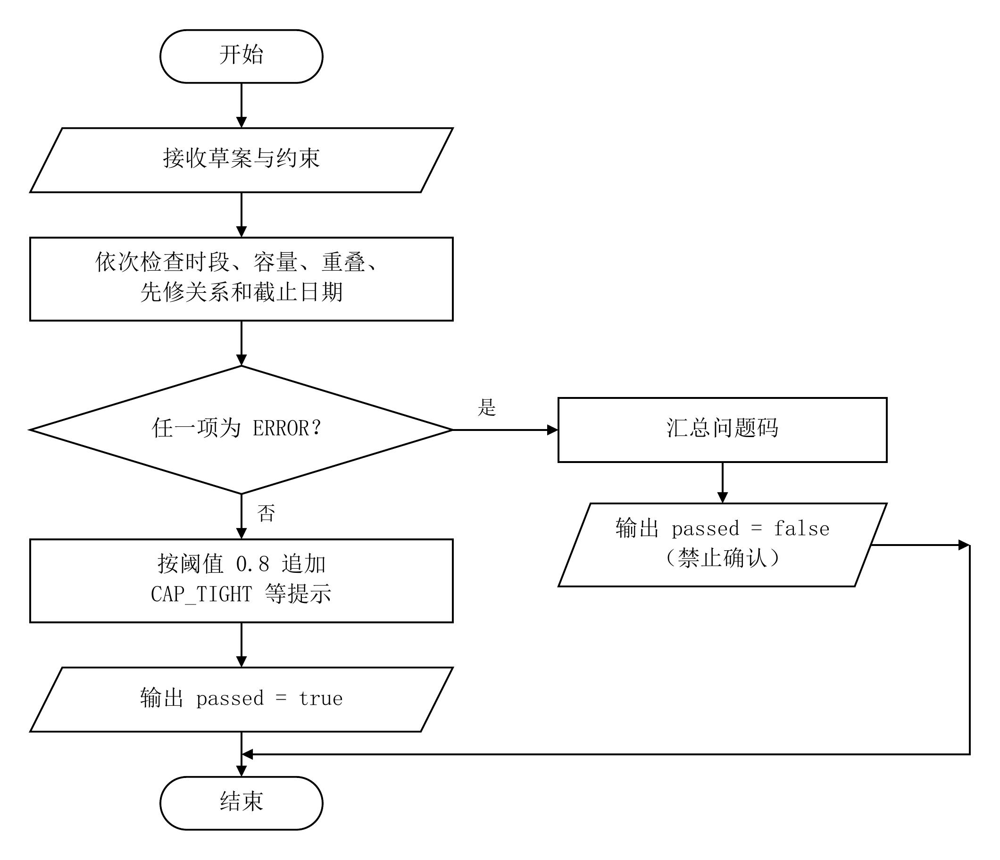

图 8-2 M-06 五项校验流程

流程要点：

1. **任一 ERROR 立即返回**，右侧出口即"阻断"，不再执行后续检查；
2. 全部通过后追加 WARN/INFO（`CAP_TIGHT`、`ISOLATED_CONCEPT`），**不阻断确认**；
3. `metrics` 无论如何都计算，界面才能显示缺口与利用率。

### 8.8 接口

表 8.6 M-06 的调用关系

| 方向 | 对象 | 方式 | 说明 |
|---|---|---|---|
| 上层调用方 | M-05、M-07、M-10 | 函数调用 | 生成后校验、确认前复核 |
| 被调用 | M-02 | 只读快照 | 先修图 |
| 数据依赖 | 无 | — | **不写库**，纯函数 |

```python
def validate(draft, constraint, content, config, base_time) -> Report: ...
def metrics_of(draft, constraint) -> Metrics: ...
```

### 8.9 存储分配

表 8.7 M-06 的存储占用

| 对象 | 规模 | 说明 |
|---|---|---|
| 片列表副本 | 400 × 约 120 B ≈ 48 KB | 排序时需要副本，不改入参 |
| 问题列表 | ≤ 20 条 | 通常 0–3 条 |
| 无跨调用缓存 | — | 纯函数，不持有状态 |

### 8.10 注释设计

表 8.8 M-06 的注释要求

| 位置 | 要求 | 示例 |
|---|---|---|
| 重叠判定 | 明确左闭右开 | `# 区间左闭右开，端点相接不算重叠` |
| 顺序 | 说明顺序的业务含义 | `# 先判时段：排在过去的任务不应报“容量不足”` |
| 短路 | 说明为何提前返回 | `# ERROR 即停：后续检查对不可排的草案没有意义` |

### 8.11 限制条件

1. 只校验单课程、单计划的草案；
2. 假定输入来自 M-05，不处理"任务缺知识点的孤儿数据"（由 M-05 保证）；
3. 不校验学生身份与归属（归 M-01）；
4. 不修改草案，也不产生"修正后的草案"；
5. 阈值 0.8 为全局配置，不按学科调整。

### 8.12 测试计划

表 8.9 M-06 单体测试用例

| 用例号 | 覆盖点 | 输入 | 预期结果 |
|---|---|---|---|
| T-08-01 | 全部通过 | 合法草案 | `passed=true`，issues 为空或仅 WARN |
| T-08-02 | 端点相接 | 19:00–20:00 与 20:00–21:00 | **不报** `TIME_OVERLAP` |
| T-08-03 | 真重叠 | 19:00–20:30 与 20:00–21:00 | 报 `TIME_OVERLAP` + 相交区间 |
| T-08-04 | 时段越界 | 片落在排除日期内 | `SLOT_INVALID` |
| T-08-05 | 超容量 | T > C′ | `CAP_EXCEEDED`，附缺口 D |
| T-08-06 | 先修倒置 | 练习排在先修知识点之前 | `PREREQ_VIOLATED` |
| T-08-07 | 学习晚于练习 | 同知识点练习片早于学习片 | `PREREQ_VIOLATED` |
| T-08-08 | 截止不可达 | 最晚片晚于截止边界 | `DEADLINE_UNREACHABLE` |
| T-08-09 | 阈值边界 | T/C = 0.80 | **不报** `CAP_TIGHT`（严格大于才报） |
| T-08-10 | 阈值超限 | T/C = 0.81 | 报 `CAP_TIGHT`，`passed` 仍为真 |
| T-08-11 | 空任务集 | 无任务 | `passed=true`，`DEADLINE` 检查跳过 |
| T-08-12 | ERROR 阻断 | 同时存在时段错与容量不足 | 只报 `SLOT_INVALID`（短路） |

### 8.13 尚未解决的问题

表 8.10 M-06 尚未解决的问题

| 编号 | 问题 | 当前处理 | 计划 |
|---|---|---|---|
| Q-13 | 单任务超单片上限但总时长够 | 由 M-05 拆片处理，本程序只校验片 | 若出现不可拆场景，补 `UNSPLITTABLE` 码 |
| Q-14 | 多课程扩展 | 不支持 | 需增加"跨课程先修"校验 |

## 9 M-07 确认与版本设计说明

### 9.1 程序描述

M-07 是**唯一写版本的入口**。它把"学生点了确认"变成"v2 生效、v1 转历史"，并且必须同时满足：只成功一次、冲突不覆盖、历史不被改。

程序特点：

- **事务型**：整个确认在一个事务内完成，任一步失败整体回滚；
- **幂等**：同一个 `confirm_key` 重复提交返回同一版本，不产生第二版；
- **乐观并发**：四项基线复核，任何一项变了就返回 `E2004`。

### 9.2 功能

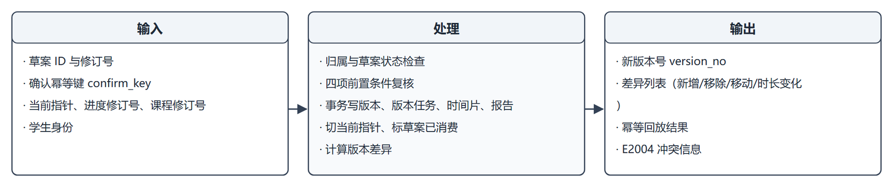

图 9-1 M-07 确认与版本的 IPO 图

表 9.1 M-07 的功能项

| 功能 | 说明 |
|---|---|
| 确认草案 | 复核基线 → 写版本与子项 → 切指针 → 标草案已消费 |
| 幂等回放 | 同一 `confirm_key` 返回原结果 |
| 版本写入 | 版本、版本任务、时间片、校验报告一次写入 |
| 差异计算 | 新旧版本按稳定任务 ID 对比四类变化 |
| 快照哈希 | 规范化输入后计算摘要，用于判断"输入是否真变了" |

### 9.3 性能

表 9.2 M-07 的性能指标

| 操作 | 规模 | 目标耗时 |
|---|---|---|
| 确认事务 | 60 任务 + 400 片 | ≤ 300 ms |
| 差异计算 | 两版各 60 任务 | ≤ 100 ms |
| 快照哈希 | 约 40 KB JSON | ≤ 20 ms |

### 9.4 输入项

表 9.3 M-07 的输入项

| 名称 | 类型 | 说明 |
|---|---|---|
| `draft_id` | int | 待确认草案 |
| `revision` | int | 客户端看到的草案修订号 |
| `confirm_key` | string | 幂等键，客户端生成 |
| `actor` | Claims | 当前学生 |

### 9.5 输出项

表 9.4 M-07 的输出项

| 名称 | 类型 | 内容 |
|---|---|---|
| `version_no` | int | 新版本号（首版为 1） |
| `replayed` | bool | 是否为幂等回放 |
| `diff` | Diff | 新增/移除/移动/时长变化 |
| `error` | enum | `E2004`（基线已变）/ `E1003`（状态不允许） |

### 9.6 算法

#### 9.6.1 确认事务的固定顺序

```text
① BEGIN IMMEDIATE（取得写锁，阻止并发写）
② 若 confirm_key 已消费 → 返回原 result_version，结束
③ 复核四项基线：draft.revision、plan.current_version、
   plan.progress_revision、course.content_revision
④ 写 plan_version、version_task、task_slice、plan_validation
⑤ 切 study_plan.current_version，更新状态
⑥ 标草案 consumed，写 result_version_id
⑦ COMMIT
```

```python
def confirm(draft_id, revision, confirm_key, actor) -> ConfirmResult:
    with uow.transaction(immediate=True) as tx:
        d = tx.drafts.get(draft_id)
        if d.confirm_key == confirm_key and d.result_version_id:
            return ConfirmResult(d.result_version_id, replayed=True)
        assert_baseline(d, revision, tx)          # 不满足抛 E2004
        v = tx.versions.insert(d, actor)
        tx.version_tasks.insert_all(v, d.tasks)
        tx.slices.insert_all(v, d.slices)
        tx.validations.insert(v, d.report)
        tx.plans.switch_current(d.plan_id, v.version_no)
        tx.drafts.mark_consumed(d.draft_id, v.version_id, confirm_key)
        return ConfirmResult(v.version_no, replayed=False)
```

#### 9.6.2 幂等与并发

表 9.5 幂等与并发的处理

| 场景 | 处理 |
|---|---|
| 同一 `confirm_key` 再次提交 | 返回原版本，`replayed=true` |
| 两个窗口同时确认 | 先到者成功；后到者拿到写锁时基线已变 → `E2004` |
| 确认途中学生打卡 | `progress_revision` 递增 → 后确认方失败 |

$$
\text{基线一致} \iff r_{draft} = r'_{draft} \ \land \ c_v = c'_v \ \land \ p = p' \ \land \ k = k'
$$

#### 9.6.3 差异计算

按**稳定任务 ID** 匹配，四类变化：

表 9.6 版本差异的四类变化

| 类型 | 判定 |
|---|---|
| 新增 | 新版本有、旧版本无 |
| 移除 | 旧版本有、新版本无 |
| 移动 | 两版都有，但首片开始日期不同 |
| 时长变化 | 两版都有，`estimated_minutes` 不同 |

```python
def diff(old: Version, new: Version) -> Diff:
    o = {t.task_id: t for t in old.tasks}
    n = {t.task_id: t for t in new.tasks}
    return Diff(
        added=[n[k] for k in n.keys() - o.keys()],
        removed=[o[k] for k in o.keys() - n.keys()],
        moved=[n[k] for k in n.keys() & o.keys() if first_day(n[k]) != first_day(o[k])],
        resized=[n[k] for k in n.keys() & o.keys() if n[k].minutes != o[k].minutes],
    )
```

**为什么按稳定任务 ID**：按"知识点 + 类型"也能匹配，但一旦某个知识点被拆成两条任务就无法对应；稳定 ID 是唯一不会误判的锚点。

#### 9.6.4 快照规范化哈希

$$
h = \text{SHA256}\big(\text{canonical}(snapshot)\big)
$$

规范化规则：键按字典序、数组按约定字段稳定排序、UTF-8 编码、去掉 `elapsed_ms` 与 `request_id`。

```python
def canonical_hash(obj) -> str:
    return hashlib.sha256(
        json.dumps(obj, sort_keys=True, ensure_ascii=False, separators=(",", ":")).encode("utf-8")
    ).hexdigest()
```

排除耗时与请求 ID，是为了让"输入相同"能判为同一个哈希——否则每次调用都会得到新哈希，比较失去意义。

### 9.7 流程逻辑

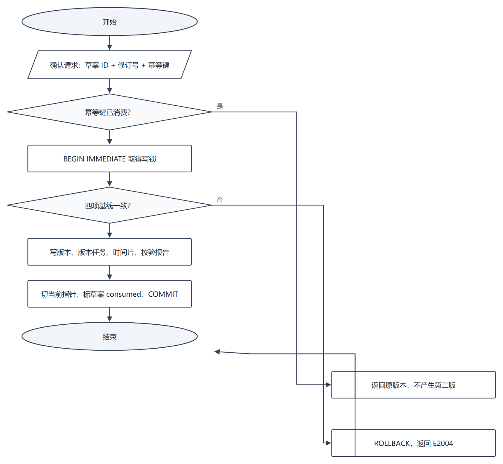

图 9-2 M-07 确认事务流程

流程要点：

1. 幂等检查在取写锁之后、复核之前，避免重复请求走完整事务；
2. 基线复核失败立即回滚并返回 `E2004`，**不做"尽力而为"的合并**；
3. 指针切换是事务内最后一步，保证"子项写完才生效"；
4. 提交成功后旧版本自动转为只读历史（由触发器保证）。

### 9.8 接口

表 9.7 M-07 的调用关系

| 方向 | 对象 | 方式 | 说明 |
|---|---|---|---|
| 上层调用方 | M-10 | 函数调用 | 确认接口 |
| 被调用 | M-06 | 函数调用 | 确认前复核校验结论 |
| 被调用 | M-11 | 事务与仓储 | 写版本与子项 |
| 数据依赖 | `plan_version` 等 5 张表 | 写 | 见 D05 §4.1 |

```python
def confirm(draft_id: int, revision: int, confirm_key: str, actor: Claims) -> ConfirmResult: ...
def diff_versions(plan_id: int, a: int, b: int) -> Diff: ...
```

### 9.9 存储分配

表 9.8 M-07 的存储占用

| 对象 | 规模 | 说明 |
|---|---|---|
| 快照 JSON | 约 40 KB / 版 | 含课程内容与全部任务 |
| 版本及其子项 | 400 片 ≈ 60 KB | 一次事务写入 |
| 写锁持有时间 | ≤ 300 ms | 模型调用不得在事务内 |

### 9.10 注释设计

表 9.9 M-07 的注释要求

| 位置 | 要求 | 示例 |
|---|---|---|
| 幂等分支 | 说明返回原结果 | `# 同一 confirm_key 重复提交，返回原版本，不新建` |
| 基线复核 | 说明四项含义 | `# 四项基线任一变化都说明用户看到的是过期草案` |
| 指针切换 | 说明为何最后做 | `# 指针最后切：子项写完才对外可见` |

### 9.11 限制条件

1. 单写者：靠 `BEGIN IMMEDIATE` 串行化，不支持多进程并发写；
2. 不合并冲突：冲突即报错，由学生重新生成；
3. 不支持回滚到历史版本（只读对比）；
4. 快照一旦写入不可修改（触发器保证）；
5. 模型调用不得出现在确认事务内。

### 9.12 测试计划

表 9.10 M-07 单体测试用例

| 用例号 | 覆盖点 | 输入 | 预期结果 |
|---|---|---|---|
| T-09-01 | 首次确认 | 合法草案 | 返回 `v1`，计划状态转"执行中" |
| T-09-02 | 重复确认 | 同一 `confirm_key` 两次 | 第二次 `replayed=true`，版本数不增 |
| T-09-03 | 不同键重复确认 | 草案已 consumed，用新键 | 拒绝 `E1003` |
| T-09-04 | 修订号过期 | `revision` 小于当前 | `E2004`，事务回滚 |
| T-09-05 | 进度已变 | 确认期间打卡使 `progress_revision` 递增 | `E2004` |
| T-09-06 | 课程内容已变 | `content_revision` 不一致 | `E2004` |
| T-09-07 | 差异-新增 | 新目标多一个知识点 | `diff.added` 含该任务 |
| T-09-08 | 差异-移除 | 新目标少一个知识点 | `diff.removed` 含该任务 |
| T-09-09 | 差异-移动 | 同一任务首片日期改变 | `diff.moved` 含该任务 |
| T-09-10 | 差异-时长 | 覆盖值改变 | `diff.resized` 含该任务 |
| T-09-11 | 已完成任务不被移动 | 调整时含已完成任务 | 该任务仍在原日期，`frozen=1` |
| T-09-12 | 哈希稳定性 | 同一输入两次 | 两个 `input_hash` 完全相同 |

### 9.13 尚未解决的问题

表 9.11 M-07 尚未解决的问题

| 编号 | 问题 | 当前处理 | 计划 |
|---|---|---|---|
| Q-15 | 版本回滚 | 不支持，只读对比 | 若需要，新增"以 v1 为基线重新生成"而非回滚 |
| Q-16 | 并发度 | 单写者串行 | 多用户时改用 WAL + 重试，或换 PostgreSQL |

## 10 M-08 进度与事件设计说明

### 10.1 程序描述

M-08 记录"实际发生了什么"：打卡、更正、备注。它是执行事实的唯一入口，与规划数据严格分离——**打卡不建版本，不回写快照**。

程序特点：

- **只追加**：事件一旦写入不可修改、不可删除，更正用"新事件指向旧事件"表达；
- **幂等**：客户端生成 `request_key`，重复提交返回原结果；
- **派生而非存储**：完成率、逾期标记都是算出来的，不落库，避免与规则不一致。

### 10.2 功能

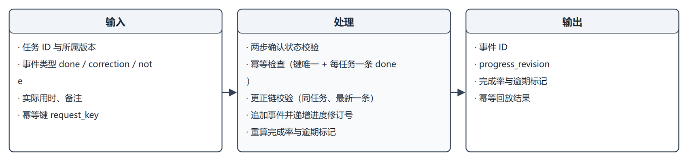

图 10-1 M-08 进度与事件的 IPO 图

表 10.1 M-08 的功能项

| 功能 | 说明 |
|---|---|
| 两步确认打卡 | 先置"完成"再提交，未提交不写事件 |
| 幂等写入 | `request_key` 唯一，重复返回原事件 |
| 更正 | 追加 `correction` 事件，指向同任务的最新完成事件 |
| 有效用时 | 取最新 done/correction 的 `actual_minutes`；空值用预计值并标注"估算" |
| 完成率与逾期 | 按 `in_scope=1` 统计；逾期为派生标记 |

### 10.3 性能

表 10.2 M-08 的性能指标

| 操作 | 规模 | 目标耗时 |
|---|---|---|
| 单次打卡 | 单条事件 | ≤ 200 ms |
| 完成率重算 | 3000 任务内某计划 | ≤ 50 ms |
| 逾期判定 | 单计划 | ≤ 30 ms |

### 10.4 输入项

表 10.3 M-08 的输入项

| 名称 | 类型 | 有效范围 | 说明 |
|---|---|---|---|
| `task_id` | int | 属于当前版本 | 打卡对象 |
| `event_type` | enum | `done` / `correction` / `note` | 事件类型 |
| `actual_minutes` | int \| null | ≥ 0 | 实际用时 |
| `note` | string | ≤ 500 字 | 备注 |
| `request_key` | string | 客户端生成，全局唯一 | 幂等键 |
| `corrects_event_id` | int \| null | 仅 `correction` 必填 | 指向的前一事件 |

### 10.5 输出项

表 10.4 M-08 的输出项

| 名称 | 类型 | 内容 |
|---|---|---|
| `event_id` | int | 新事件 ID |
| `replayed` | bool | 是否幂等回放 |
| `completion_rate` | float | 0.0–1.0，保留一位小数 |
| `overdue` | bool | 逾期派生的标记 |

### 10.6 算法

#### 10.6.1 两步确认

界面状态机：`未完成 → 待提交 → 已完成`。**只有"提交"这一步才调用本程序**，第一步只在界面置状态，不写库。这样误触不会产生事件。

#### 10.6.2 幂等与唯一性

$$
\text{写事件} \iff request\_key \notin \{e.request\_key\} \ \land \ (type \ne done \ \lor \ \nexists\, done(task))
$$

```python
def submit(event, repo) -> Result:
    if (old := repo.find_by_request_key(event.request_key)):
        return Result(old, replayed=True)
    if event.type == "done" and repo.has_done(event.task_id):
        raise Conflict("E1003", "该任务已完成，如需改用时请用更正")
    return Result(repo.append(event), replayed=False)
```

数据库侧另有两条索引兜底：`ux_done_once`（`UNIQUE(task_id) WHERE event_type='done'`）与 `request_key` 的唯一约束。

#### 10.6.3 更正链校验

更正事件必须满足三个条件，缺一即拒：

1. `corrects_event_id` 指向的事件属于**同一任务**；
2. 该事件类型是 `done` 或 `correction`（`note` 不能被更正）；
3. 该事件是该任务**最新**的一条完成类事件。

$$
\text{valid}(e_c) \iff e_c.corrects \in \text{events}(e_c.task) \ \land \ e_c.corrects \ne \text{note} \ \land \ e_c.corrects = \max\{\text{id of done/correction}\}
$$

```python
def check_correction(e, repo):
    prev = repo.get_event(e.corrects_event_id)
    if prev is None or prev.task_id != e.task_id:
        raise Reject("E1001", "更正必须指向同一任务的事件")
    if prev.event_type == "note":
        raise Reject("E1001", "备注事件不能被更正")
    if prev.event_id != repo.latest_completion_event(e.task_id):
        raise Reject("E1003", "只能更正最新一次完成记录")
```

#### 10.6.4 有效用时与完成率

单任务有效用时：

$$
m(t) = \begin{cases}
m_{event} & \text{存在最新的 done/correction 且 } actual\_minutes \ne \text{NULL} \\
m_{plan} & \text{否则用预计值，界面标注“估算”}
\end{cases}
$$

完成率（分母只含在范围内的必做任务）：

$$
R = \frac{\#\{t \mid t.in\_scope=1 \land done(t)\}}{\#\{t \mid t.in\_scope=1\}}
$$

```python
def completion_rate(tasks, events) -> float:
    scoped = [t for t in tasks if t.in_scope == 1]
    if not scoped:
        return 0.0
    return round(sum(1 for t in scoped if has_done(t, events)) / len(scoped), 3)
```

#### 10.6.5 逾期（派生标记）

$$
\text{overdue}(t) = \neg done(t) \ \land \ \big(\text{now} > \text{end}(t) \ \lor \ \text{now} > deadline\big)
$$

**逾期不改完成状态**，只在界面上加标记；这是与"计划状态机"的边界——计划是否"已完成"只看必做任务是否全部完成。

```python
def is_overdue(task, now, deadline) -> bool:
    return not task.done and (now > task.last_slice_end or now > deadline)
```

### 10.7 流程逻辑

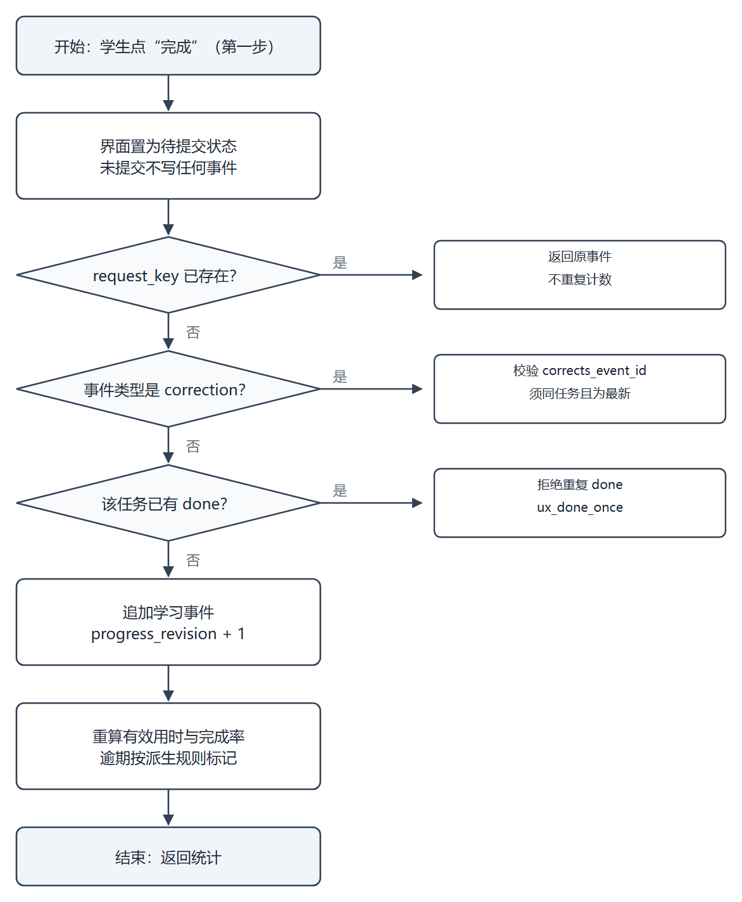

图 10-2 M-08 打卡与更正流程

流程要点：

1. **幂等检查在最前**，重复请求不进入后续校验；
2. 更正与打卡走同一入口，靠 `event_type` 分流；
3. 同一任务第二次 `done` 被拒，提示改用更正——这比"允许覆盖"更安全；
4. 写入成功才递增 `progress_revision`，供确认事务比对。

### 10.8 接口

表 10.5 M-08 的调用关系

| 方向 | 对象 | 方式 | 说明 |
|---|---|---|---|
| 上层调用方 | M-10 | 函数调用 | 打卡接口 |
| 被调用 | M-11 | 仓储 + 事务 | 追加事件、更新修订号 |
| 被读取 | M-09 | 查询 | 看板取事件算状态 |

```python
def submit(event: EventInput, actor: Claims) -> Result: ...
def completion_rate(plan_id: int) -> float: ...
def is_overdue(task, now, deadline) -> bool: ...
```

### 10.9 存储分配

表 10.6 M-08 的存储占用

| 对象 | 规模 | 说明 |
|---|---|---|
| 事件行 | 约 200 B/条 | 与任务量同阶 |
| 完成率计算 | 单计划 ≤ 3000 任务 | 一次性内存聚合，不缓存 |
| 索引 | `ix_event_plan`、`ux_done_once` | 查询与唯一性 |

### 10.10 注释设计

表 10.7 M-08 的注释要求

| 位置 | 要求 | 示例 |
|---|---|---|
| 幂等 | 说明"返回原结果" | `# 同一 request_key 返回原事件，不重复计数` |
| 更正 | 说明为何只允许最新一条 | `# 只允许更正最新完成记录，避免事件链分叉` |
| 逾期 | 说明不改状态 | `# 逾期是派生标记，不改变计划的完成状态` |

### 10.11 限制条件

1. 本期不撤销完成（只可更正用时与备注）；
2. 事件不可删除，误操作靠新增更正事件修正；
3. 单进程写，并发更正由写锁串行化；
4. 完成率只统计 `in_scope=1` 的任务；
5. 逾期以服务端时钟为准。

### 10.12 测试计划

表 10.8 M-08 单体测试用例

| 用例号 | 覆盖点 | 输入 | 预期结果 |
|---|---|---|---|
| T-10-01 | 正常打卡 | 首次 `done` | 写一条事件，`progress_revision` +1 |
| T-10-02 | 重复打卡 | 同 `request_key` 两次 | 第二次 `replayed=true`，事件数不变 |
| T-10-03 | 换键重复打卡 | 新键、同任务再 done | 拒绝 `E1003` |
| T-10-04 | 更正用时 | `correction` 指向最新 done | 有效用时更新为新值 |
| T-10-05 | 更正跨任务 | `corrects_event_id` 属于别的任务 | 拒绝 `E1001` |
| T-10-06 | 更正非最新 | 指向更早的那条 done | 拒绝 `E1003` |
| T-10-07 | 备注事件 | `note` + 带 `corrects_event_id` | 拒绝 `E1001` |
| T-10-08 | 备注不影响用时 | 追加 `note` | 有效用时不变 |
| T-10-09 | 用时为空 | `actual_minutes=null` | 用预计值并标注“估算” |
| T-10-10 | 完成率分母 | 存在 `in_scope=0` 的已完成任务 | 不计入分母 |
| T-10-11 | 完成率边界 | 全部完成 / 全部未完成 | 1.0 / 0.0 |
| T-10-12 | 逾期 | 未完成且已过片结束时间 | `overdue=true`，状态仍为执行中 |

### 10.13 尚未解决的问题

表 10.9 M-08 尚未解决的问题

| 编号 | 问题 | 当前处理 | 计划 |
|---|---|---|---|
| Q-17 | 撤销完成 | 不支持 | 若需要，加 `undone` 事件类型并重算派生值 |
| Q-18 | 多设备并发更正 | 写锁串行 | 多用户时改为版本号比对 |

## 11 M-09 看板与前端组件设计说明

### 11.1 程序描述

M-09 是唯一的展示层程序：把"版本任务 + 时间片 + 事件"渲染成学生看得懂的日视图与周视图。它不写库、不做业务判断，只负责**取数、分组、标注、呈现**。

程序特点：

- **只读**：所有写操作在其他程序；
- **查询走索引**：读 `version_task` 与 `task_slice`，不扫快照 JSON；
- **双通道状态**：文字 + 底色，不使用颜色作为唯一区分。

### 11.2 功能

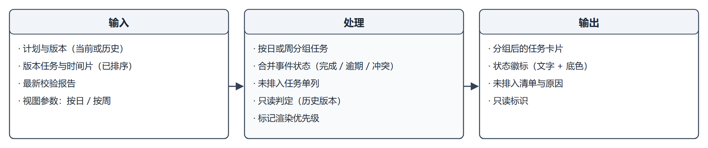

图 11-1 M-09 看板与前端组件的 IPO 图

表 11.1 M-09 的功能项

| 功能 | 说明 |
|---|---|
| 日视图 | 今日任务卡片、用时、状态 |
| 周视图 | 按周分组，标注冲突与逾期 |
| 未排入清单 | 单列展示，附原因码 |
| 历史版本 | 只读，无打卡入口，差异高亮 |
| 校验结果栏 | 展示问题码与建议 |

### 11.3 性能

表 11.2 M-09 的性能指标

| 操作 | 规模 | 目标耗时 |
|---|---|---|
| 首屏渲染 | 单日 ≤ 10 条 | ≤ 2 s（含静态资源） |
| 周视图切换 | 300 任务 | ≤ 300 ms |
| 未排入清单 | ≤ 100 条 | ≤ 100 ms |

### 11.4 输入项

表 11.3 M-09 的输入项

| 名称 | 类型 | 说明 |
|---|---|---|
| `plan_id` / `version_no` | int | 当前或历史版本 |
| `view` | enum | `day` / `week` |
| `tasks` / `slices` | list | 由 M-11 查询返回，已按时间排序 |
| `report` | Report | 最新校验报告 |

### 11.5 输出项

表 11.4 M-09 的输出项

| 名称 | 类型 | 内容 |
|---|---|---|
| `groups` | list | 按日分组的任务卡片 |
| `badges` | map | 每个任务的状态徽标（文字 + 底色） |
| `unscheduled` | list | 未排入任务与原因 |
| `readonly` | bool | 历史版本为真 |

### 11.6 算法

#### 11.6.1 分组规则

$$
\text{bucket}(t) = \lfloor \text{local\_date}(t.start) \rfloor \quad (\text{日视图})
$$

周视图按 `ISO 周` 分组，组内按时间片开始时间升序。

```python
def group_by_day(tasks, slices) -> dict[date, list[Card]]:
    by_task = defaultdict(list)
    for s in slices:
        by_task[s.task_id].append(s)
    out = defaultdict(list)
    for t in tasks:
        day = min(s.start for s in by_task[t.id]).date() if by_task[t.id] else None
        out[day].append(to_card(t, by_task[t.id]))
    return dict(sorted(out.items(), key=lambda kv: (kv[0] is None, kv[0])))
```

#### 11.6.2 状态展示的双通道规则

表 11.5 状态展示的双通道规则

| 状态 | 文字 | 底色 | 附加图标 |
|---|---|---|---|
| 未开始 | “未开始” | 中性 | — |
| 已完成 | “已完成” | 浅绿 | ✓ |
| 逾期 | “已逾期 N 天” | 浅橙 | ! |
| 冲突 | “冲突：问题码” | 浅红 | ⚠ |
| 未排入 | “未排入：原因” | 斜纹 | — |

**只用底色不行**：黑白打印会全部变成灰块；所以每个状态必须有文字。

#### 11.6.3 标记优先级

同一卡片可能同时"逾期 + 冲突"，只显示一个主标记，按优先级：

$$
\text{冲突} > \text{逾期} > \text{已完成} > \text{未开始}
$$

理由：冲突会导致计划不可确认，比逾期更严重。

#### 11.6.4 历史版本只读

```python
def render(version, viewer_claims):
    readonly = version.version_no != version.plan.current_version
    return View(cards=..., readonly=readonly, show_checkin=not readonly)
```

历史版本隐藏打卡入口，并显示与上一版的差异高亮（调用 M-07 的差异结果）。

### 11.7 流程逻辑

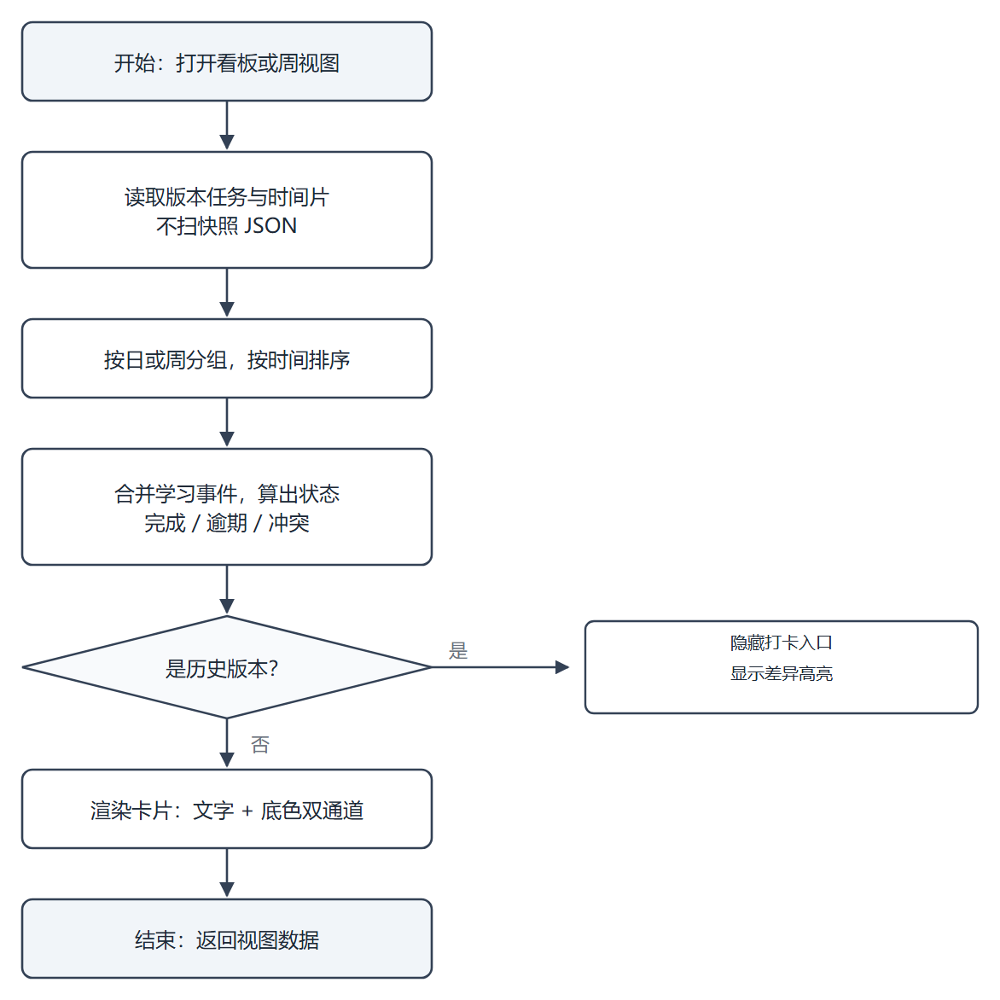

图 11-2 M-09 看板渲染流程

流程要点：

1. **先判是否已有生效版本**：未确认的计划没有版本任务可读，直接提示“计划尚未确认”并引导去确认，不进渲染；
2. 读 `version_task` 与 `task_slice`，不扫快照 JSON——快照只用于历史版本对比；
3. 分组后合并学习事件，状态**以事件为准**，不以计划安排为准：计划说今天学，实际已完成就显示已完成；
4. 渲染时判只读：历史版本隐藏打卡入口、显示差异高亮，避免出现“点不了的按钮”；
5. 未排入任务单独成区，不混进时间轴（否则会以为是某天的任务）。

### 11.8 接口

表 11.6 M-09 的调用关系

| 方向 | 对象 | 方式 | 说明 |
|---|---|---|---|
| 上层调用方 | M-10 | 查询接口 | 看板数据 |
| 被调用 | M-11 | 只读查询 | 版本任务、时间片、事件 |
| 被调用 | M-07 | 函数调用 | 历史版本的差异 |
| 被调用 | M-08 | 函数调用 | 完成率与逾期 |

```python
def build_view(plan_id: int, version_no: int, view: str, claims) -> View: ...
def to_card(task, slices, events) -> Card: ...
```

### 11.9 存储分配

表 11.7 M-09 的存储占用

| 对象 | 规模 | 说明 |
|---|---|---|
| 视图数据 | 单周 ≤ 300 卡片 × 约 200 B ≈ 60 KB | 前端不缓存历史版本 |
| 未排入清单 | ≤ 100 条 | 单列渲染 |
| 无服务端缓存 | — | 每次查询现算，避免与事件不同步 |

### 11.10 注释设计

表 11.8 M-09 的注释要求

| 位置 | 要求 | 示例 |
|---|---|---|
| 双通道 | 说明为什么不用纯颜色 | `# 只用底色不行：黑白打印会全变灰块` |
| 优先级 | 说明冲突优先的理由 | `# 冲突会导致不可确认，优先于逾期` |
| 只读 | 说明历史版本行为 | `# 历史版本隐藏打卡入口，避免误操作` |

### 11.11 限制条件

1. 只支持日/周两种粒度，不做月视图；
2. 单个计划任务数按 3000 估算，超出需分页；
3. 不做拖拽调整（调整走 M-07 的调整草案）；
4. 桌面浏览器优先，不做移动端适配；
5. 不缓存视图数据。

### 11.12 测试计划

表 11.9 M-09 单体测试用例

| 用例号 | 覆盖点 | 输入 | 预期结果 |
|---|---|---|---|
| T-11-01 | 空计划 | 无任务 | 显示空状态，不报错 |
| T-11-02 | 仅未排入 | 全部任务未排入 | 时间轴为空，未排入区列出全部 |
| T-11-03 | 完成率 0 | 全部未完成 | 0.0，无异常 |
| T-11-04 | 完成率 100 | 全部完成 | 100.0 |
| T-11-05 | 历史版本 | `version_no < current` | `readonly=true`，无打卡按钮 |
| T-11-06 | 冲突卡片 | 任务带 `TIME_OVERLAP` | 显示文字“冲突：TIME_OVERLAP” |
| T-11-07 | 逾期卡片 | 逾期 3 天 | 显示“已逾期 3 天” |
| T-11-08 | 标记优先级 | 同时逾期与冲突 | 只显示冲突 |
| T-11-09 | 跨日任务 | 一任务两片跨两天 | 两天各出现一张卡片 |
| T-11-10 | 时区 | UTC 存储、本地展示 | 显示为本地时间 |

### 11.13 尚未解决的问题

表 11.10 M-09 尚未解决的问题

| 编号 | 问题 | 当前处理 | 计划 |
|---|---|---|---|
| Q-19 | 月视图 | 不做 | 若需要，复用周视图分组逻辑 |
| Q-20 | 拖拽调整 | 不做 | 需新增"移动任务"草案与校验 |

## 12 M-10 接口与序列化设计说明

### 12.1 程序描述

M-10 是系统唯一的 HTTP 入口，负责把请求翻译成领域调用、把结果翻译成响应。它**不写业务逻辑**，只做鉴权、校验、路由、包装、错误映射。

程序特点：

- **薄**：每个路由 5–15 行，业务全在领域程序；
- **统一响应**：所有接口同一信封，前端只写一套错误处理；
- **错误不泄露**：内部异常一律映射为固定错误码，不透出堆栈与 SQL。

### 12.2 功能

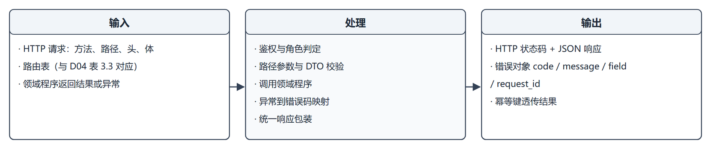

图 12-1 M-10 接口与序列化的 IPO 图

表 12.1 M-10 的功能项

| 功能 | 说明 |
|---|---|
| 鉴权与角色 | 调用 M-01，失败直接 401/403 |
| 路由映射 | 路径 → 领域函数 |
| DTO 校验 | 类型、必填、范围，错误定位到 `field` |
| 调用与事务 | 注入事务边界，一次请求一个事务 |
| 错误映射 | 领域异常 → HTTP 状态码 + 错误码 |
| 统一包装 | `code` / `message` / `field` / `detail` / `request_id` |

### 12.3 性能

表 12.2 M-10 的性能指标

| 操作 | 目标耗时 |
|---|---|
| 路由解析 + 鉴权 | ≤ 5 ms |
| DTO 校验 | ≤ 5 ms |
| 序列化 | ≤ 3 ms |

### 12.4 输入项

表 12.3 M-10 的输入项

| 名称 | 类型 | 说明 |
|---|---|---|
| `method` / `path` | string | 路由键 |
| `headers` | map | `Authorization`、`Idempotency-Key` |
| `body` | JSON | 请求体，由 DTO 校验 |
| `query` | map | 查询参数 |

### 12.5 输出项

表 12.4 M-10 的输出项

| 名称 | 类型 | 内容 |
|---|---|---|
| `status` | int | HTTP 状态码 |
| `body` | JSON | `{"code","message","data","field","detail","request_id"}` |

### 12.6 算法

#### 12.6.1 路由到领域程序的映射

表 12.5 路由到领域程序的映射

| 方法与路径 | 调用的程序 |
|---|---|
| `POST /api/constraints` | M-03 |
| `POST /api/plans/drafts` | M-05 |
| `POST /api/plans/{id}/confirm` | M-07 |
| `POST /api/plans/{id}/events` | M-08 |
| `GET /api/plans/{id}/versions` | M-07 |
| `GET /api/plans/{id}/tasks` | M-09 |

**与 D04 表 3.3 的关系**：那张表是"模块间调用"，本表是"HTTP 到模块"，两者逐条对应。

#### 12.6.2 错误码映射

表 12.6 错误码与 HTTP 状态码映射

| 异常 | HTTP | 错误码 | 说明 |
|---|---|---|---|
| 参数校验失败 | 400 | `E1001` | 附 `field` |
| 未认证/令牌过期 | 401 | `E4001` | — |
| 角色不符 | 403 | `E4003` | — |
| 对象不存在或不属于本人 | 404 | `E1002` | **不区分两者** |
| 状态不允许 | 400 | `E1003` | — |
| 基线已变（版本冲突） | 409 | `E2004` | 前端提示重新生成 |
| 数据库忙/写失败 | 503 | `E1005` | 提示稍后重试 |
| 模型不可用 | 200 | — | `mode=mock`，不阻断 |

最后一行是特例：**模型失败不返回错误**，而是降级成功，`detail` 里带 `degraded_reason`。

```python
def map_error(exc) -> tuple[int, dict]:
    table = {
        ValidationError: (400, "E1001"), NotFound: (404, "E1002"),
        StateError: (400, "E1003"), VersionConflict: (409, "E2004"),
        Busy: (503, "E1005"), Unauthorized: (401, "E4001"), Forbidden: (403, "E4003"),
    }
    for cls, (status, code) in table.items():
        if isinstance(exc, cls):
            return status, envelope(code, exc.message, getattr(exc, "field", None))
    return 500, envelope("E9000", "内部错误", request_id=ctx.request_id)
```

#### 12.6.3 统一响应包装

```json
{"code": "OK", "message": "", "data": {...}, "field": null,
 "detail": null, "request_id": "9f3c..."}
```

`request_id` 由入口生成并写入日志，便于根据前端报错定位。

#### 12.6.4 幂等键透传

客户端在 `Idempotency-Key` 头里带键，M-10 原样传给 M-07/M-08：

```python
confirm_key = request.headers.get("Idempotency-Key") or new_uuid()
```

缺省时生成新键——这意味着**同一次点击重复发送若没带键，会被当作两次操作**，所以前端必须带。

### 12.7 流程逻辑

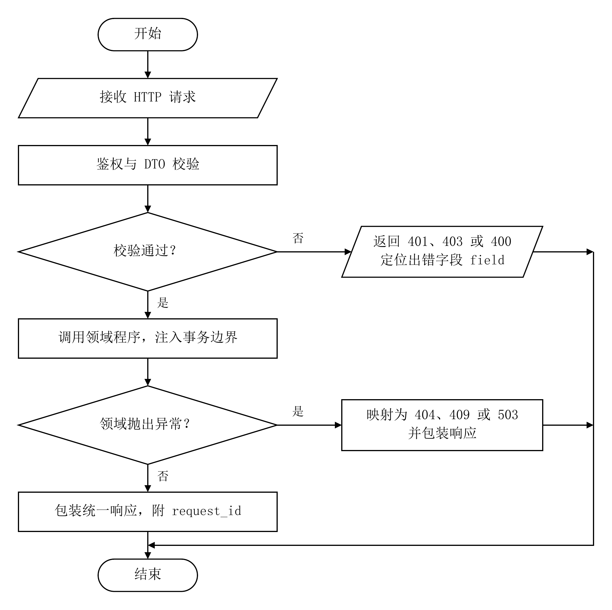

图 12-2 M-10 请求处理管道

流程要点：

1. 鉴权在最前，未认证请求不进入业务；
2. 校验失败返回 400 且带 `field`，前端可直接高亮；
3. 领域异常统一映射，**不把 SQL 或堆栈返回给前端**；
4. 任何响应都带 `request_id`。

### 12.8 接口

表 12.7 M-10 的调用关系

| 方向 | 对象 | 说明 |
|---|---|---|
| 上层 | 前端 / 测试脚本 | HTTP |
| 被调用 | M-01 | 鉴权 |
| 被调用 | M-03 / M-05 / M-07 / M-08 / M-09 | 业务 |
| 被调用 | M-11 | 事务边界 |

```python
def handle(request) -> Response: ...
def envelope(code, message, data=None, field=None, detail=None) -> dict: ...
```

### 12.9 存储分配

表 12.8 M-10 的存储占用

| 对象 | 规模 | 说明 |
|---|---|---|
| 请求上下文 | < 10 KB | 每请求一份 |
| 响应体 | 列表接口 ≤ 200 KB | 超 100 条强制分页 |

### 12.10 注释设计

表 12.9 M-10 的注释要求

| 位置 | 要求 | 示例 |
|---|---|---|
| 错误映射 | 说明为何合并 404 | `# 越权与不存在返回同一码，不泄露存在性` |
| 幂等 | 说明缺省行为 | `# 未带 Idempotency-Key 时生成新键，前端应始终携带` |
| 模型降级 | 说明不报错 | `# 模型失败按降级处理，返回 200 + degraded_reason` |

### 12.11 限制条件

1. 单进程、同步处理，不引入异步队列；
2. 不支持批量接口（一次一个业务动作）；
3. 分页上限 100 条；
4. 不实现限流与熔断（单机应用）；
5. 只支持 JSON 请求体，不支持表单编码。

### 12.12 测试计划

表 12.10 M-10 单体测试用例

| 用例号 | 覆盖点 | 输入 | 预期结果 |
|---|---|---|---|
| T-12-01 | 字段错误定位 | 缺必填字段 | 400，`field` 指向该字段 |
| T-12-02 | 未认证 | 无令牌 | 401 `E4001` |
| T-12-03 | 角色不符 | 学生调管理接口 | 403 `E4003` |
| T-12-04 | 不存在 | 不存在的计划 ID | 404 `E1002` |
| T-12-05 | 越权不泄露 | 他人计划 ID | 404，与不存在响应完全一致 |
| T-12-06 | 版本冲突 | 过期修订号确认 | 409 `E2004` |
| T-12-07 | 数据库忙 | 模拟写锁超时 | 503 `E1005` |
| T-12-08 | 模型失败 | Provider 抛异常 | 200，`mode=mock`，带 `degraded_reason` |
| T-12-09 | 幂等透传 | 带 `Idempotency-Key` 重复提交 | 第二次返回 `replayed=true` |
| T-12-10 | 缺幂等键 | 不带键重复提交 | 视为两次操作（记录行为，提示前端必须带） |
| T-12-11 | 响应信封 | 任意成功请求 | 含 `code/message/data/request_id` |
| T-12-12 | 内部错误 | 模拟未捕获异常 | 500 `E9000`，不含堆栈与 SQL |

### 12.13 尚未解决的问题

表 12.11 M-10 尚未解决的问题

| 编号 | 问题 | 当前处理 | 计划 |
|---|---|---|---|
| Q-21 | 分页 | 上限 100 条 | 若看板数据多，改游标分页 |
| Q-22 | 并发限流 | 不实现 | 单机演示无需求，部署到服务器时加 |

## 13 M-11 存储访问设计说明

### 13.1 程序描述

M-11 是系统唯一直接接触 SQLite 的程序。所有领域程序通过仓储接口读写，禁止在业务代码里出现 SQL。它同时负责事务边界、迁移与备份。

程序特点：

- **唯一的数据出入口**：换库只改这一层；
- **事务边界在用例层**：一个业务动作一个事务，不跨请求持有连接；
- **对触发器友好**：触发器的报错在这里统一映射为业务错误码。

### 13.2 功能

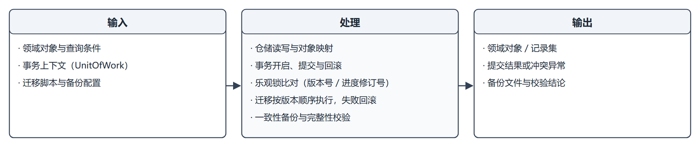

图 13-1 M-11 存储访问的 IPO 图

表 13.1 M-11 的功能项

| 功能 | 说明 |
|---|---|
| 仓储读写 | 16 张表的对象映射与查询 |
| 事务管理 | `UnitOfWork` 开启、提交、回滚 |
| 乐观锁 | 版本号 / 进度修订号比对 |
| 迁移 | 按 `schema_version` 顺序执行，失败回滚 |
| 备份 | 一致性备份 + 完整性校验，保留 7 份 |

### 13.3 性能

表 13.2 M-11 的性能指标

| 操作 | 规模 | 目标耗时 |
|---|---|---|
| 单条按主键读 | 单行 | ≤ 2 ms |
| 计划聚合查询 | ≤ 400 片 | ≤ 30 ms |
| 事务提交 | 单事务 ≤ 500 行 | ≤ 50 ms |
| 一致性备份 | 数据库 < 100 MB | ≤ 2 s |

### 13.4 输入项

表 13.3 M-11 的输入项

| 名称 | 类型 | 说明 |
|---|---|---|
| 查询条件 | 键值 / 范围 | 由仓储方法决定 |
| 领域对象 | dataclass | 写入时的行映射来源 |
| 事务声明 | 上下文 | 由调用方 `with uow.transaction()` 声明 |
| 迁移脚本 | `scripts/schema.sql` 或迁移文件 | 建库与升级 |

### 13.5 输出项

表 13.4 M-11 的输出项

| 名称 | 类型 | 内容 |
|---|---|---|
| 记录集 | list[Row] | 已映射为领域对象 |
| 提交结果 | Result | 影响行数或冲突异常 |
| 备份结果 | BackupResult | 文件路径、大小、校验结论 |

### 13.6 算法

#### 13.6.1 UnitOfWork 与事务边界

```python
class UnitOfWork:
    def __enter__(self):
        self.conn = connect()                 # 每事务一条连接
        self.conn.execute("BEGIN IMMEDIATE")  # 立刻拿写锁，避免升级死锁
        return self

    def __exit__(self, exc_type, *_):
        if exc_type is None:
            self.conn.commit()
        else:
            self.conn.rollback()
        self.conn.close()                      # 连接必须随事务释放
```

**规则**：连接不得跨层传递；领域程序只接收仓储接口，不接收连接对象。

#### 13.6.2 乐观锁

更新前比对"读到的修订号"与"库里的修订号"：

$$
\text{允许更新} \iff rev_{read} = rev_{db}
$$

```python
def update_with_guard(row, expected_rev: int):
    cur = db.execute(
        "UPDATE study_plan SET status=?, updated_at=? , progress_revision=progress_revision+1 "
        "WHERE plan_id=? AND progress_revision=?",
        (row.status, row.updated_at, row.plan_id, expected_rev))
    if cur.rowcount == 0:
        raise VersionConflict("E2004")
```

用 `WHERE` 带条件实现，比"先查再比再改"少一次往返，且天然原子。

#### 13.6.3 仓储映射与触发器错误

16 张表与领域对象的对应见 D05 §4.1。需要特别处理两类数据库错误：

表 13.5 数据库错误到业务错误码的映射

| 触发场景 | SQLite 报错 | 映射为 |
|---|---|---|
| 复合外键失败（跨课程/跨计划） | `FOREIGN KEY constraint failed` | `E1001`（参数错） |
| 不可变触发器（改版本/删事件） | `ABORT: 计划版本不可修改` | `E1003`（状态不允许） |
| 唯一约束（重复 done、重复确认） | `UNIQUE constraint failed` | `E1003` 或幂等返回 |
| 忙等超时 | `database is locked` | `E1005` |

```python
def translate_sqlite_error(e: sqlite3.Error) -> AppError:
    msg = str(e)
    if "FOREIGN KEY" in msg: return ValidationError("E1001", msg)
    if "不可修改" in msg or "不可删除" in msg: return StateError("E1003", msg)
    if "UNIQUE" in msg: return StateError("E1003", msg)
    if "locked" in msg or "busy" in msg: return Busy("E1005")
    return InternalError(msg)
```

#### 13.6.4 迁移执行

```python
def migrate(target_version: str):
    backup()                                  # 迁移前强制备份
    cur = schema_version()
    for script in sorted(pending(cur, target_version)):
        try:
            with uow.transaction():
                run(script)
                set_schema_version(script.version)
        except Exception:
            restore_latest_backup()           # 失败即回到迁移前
            raise
```

**禁止**用"重复执行 `CREATE TABLE IF NOT EXISTS`"冒充迁移——那不会修改已有表的列。

#### 13.6.5 一致性备份

WAL 模式下不可只复制主库文件，必须用官方备份接口：

```python
def backup() -> BackupResult:
    tmp = temp_path()
    src = sqlite3.connect(DB)
    dst = sqlite3.connect(tmp)
    src.backup(dst)                            # 一致性快照
    check(dst, "PRAGMA integrity_check")
    check(dst, "PRAGMA foreign_key_check")
    final = rename_with_timestamp(tmp)
    prune(keep=7)                              # 只保留最近 7 份成功备份
    return BackupResult(final, size(final))
```

### 13.7 流程逻辑

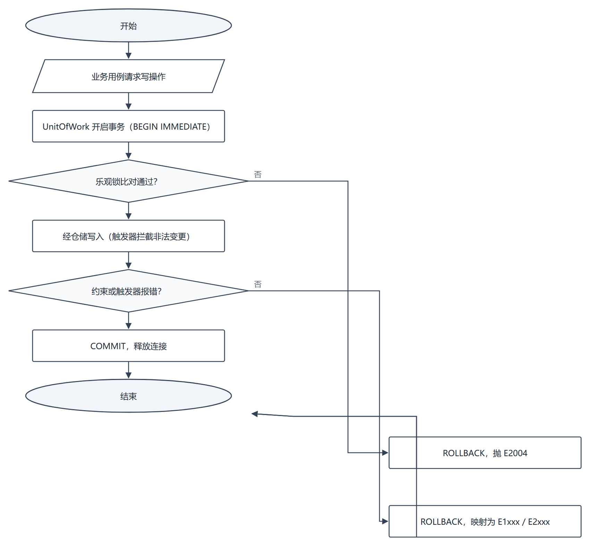

图 13-2 M-11 事务与备份流程

流程要点：

1. 事务开启即取写锁，避免"读后升级写锁"的竞争；
2. 触发器与约束报错统一转成业务错误码，不把 SQL 文本透给前端；
3. 任何异常整体回滚，不留半提交状态。

### 13.8 接口

表 13.6 M-11 的调用关系

| 方向 | 对象 | 说明 |
|---|---|---|
| 上层调用方 | 全部领域程序 | 经仓储接口 |
| 被调用 | SQLite 文件 | 参数化 SQL |
| 对外 | 备份脚本 / 健康检查 | 一致性备份与状态查询 |

```python
def transaction(immediate=True) -> ContextManager["UnitOfWork"]: ...
def backup() -> BackupResult: ...
def health() -> HealthStatus: ...
```

### 13.9 存储分配

表 13.7 M-11 的存储占用

| 对象 | 规模 | 说明 |
|---|---|---|
| 连接 | 1 条 / 事务 | 事务结束即关闭 |
| 页缓存 | 默认约 2 MB | 数据量小，基本常驻 |
| 备份占用 | 7 份 × 单库大小 | 预留 1 GB 可用空间 |

### 13.10 注释设计

表 13.8 M-11 的注释要求

| 位置 | 要求 | 示例 |
|---|---|---|
| 事务 | 说明为何用 IMMEDIATE | `# 立刻取写锁：避免先读后升级写锁时的死锁` |
| 错误映射 | 说明映射依据 | `# 触发器 ABORT 的语言是业务约定，据此映射 E1003` |
| 备份 | 说明不可直接复制 | `# WAL 模式不能只复制主库，必须用 backup API` |

### 13.11 限制条件

1. 单进程单写者，写操作串行；
2. 不支持分布式事务；
3. 迁移期间需停服，不做在线迁移；
4. 备份不加密，靠文件权限保护；
5. SQLite 版本需 ≥ 3.35（部分索引与 JSON 函数）。

### 13.12 测试计划

表 13.9 M-11 单体测试用例

| 用例号 | 覆盖点 | 输入 | 预期结果 |
|---|---|---|---|
| T-13-01 | 事务回滚 | 事务内抛异常 | 库中无残留行 |
| T-13-02 | 乐观锁冲突 | `expected_rev` 与库中不符 | 抛 `E2004`，不更新 |
| T-13-03 | 复合外键 | 跨课程插入先修 | 抛 `E1001` |
| T-13-04 | 触发器拦截 | 尝试 UPDATE 版本 | 抛 `E1003`，映射后不含 SQL 文本 |
| T-13-05 | 唯一约束 | 重复 `done` | 抛 `E1003` |
| T-13-06 | 忙锁映射 | 另一连接持写锁 | 等待 3 s 后抛 `E1005` |
| T-13-07 | 备份校验 | 备份后跑 `integrity_check` | `ok` |
| T-13-08 | 备份保留 | 连续备份 9 次 | 目录中只剩 7 份 |
| T-13-09 | 迁移幂等 | 重复执行同一迁移 | 无副作用，版本号不变 |
| T-13-10 | 迁移失败回滚 | 中途语法错误 | 恢复到迁移前状态 |
| T-13-11 | 外键完整性 | 随机删行后 `foreign_key_check` | 能报出孤儿行 |

### 13.13 尚未解决的问题

表 13.10 M-11 尚未解决的问题

| 编号 | 问题 | 当前处理 | 计划 |
|---|---|---|---|
| Q-23 | 大表分页 | 不分页 | 数据量到万级时改游标分页 |
| Q-24 | 备份加密 | 不加密 | 若含真实数据，加 GPG 或 SQLCipher |

## 14 M-12 配置与日志设计说明

### 14.1 程序描述

M-12 负责"进程启动时的装配"与"运行期的可观测性"：配置加载与校验、日志格式化与脱敏、健康检查、模型适配器的选择与降级。

程序特点：

- **启动即校验**：配置越界直接拒绝启动，不带着错配置跑；
- **脱敏优先**：日志功能先写"绝不能落盘"的字段清单，再写格式；
- **可降级**：模型不可用不影响主流程，标记模式即可。

### 14.2 功能

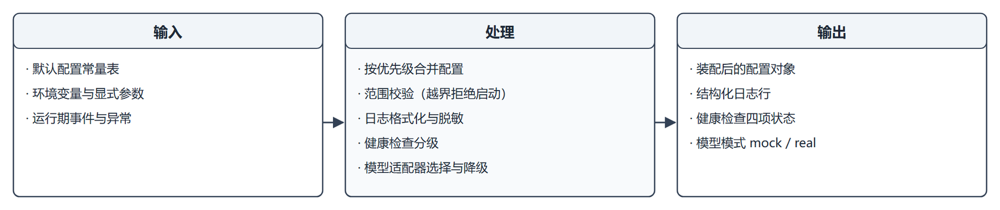

图 14-1 M-12 配置与日志的 IPO 图

表 14.1 M-12 的功能项

| 功能 | 说明 |
|---|---|
| 配置加载 | 默认值 < 环境变量 < 显式参数 |
| 取值校验 | 范围检查，越界拒绝启动并指出键名 |
| 日志 | 结构化输出 + 脱敏 |
| 健康检查 | 主服务 / 数据库 / 模型模式 / 备份状态 |
| 适配器切换 | `mock` / `real` / `auto`，失败降级 |

### 14.3 性能

表 14.2 M-12 的性能指标

| 操作 | 目标耗时 |
|---|---|
| 配置加载与校验 | ≤ 20 ms（启动时一次） |
| 单条日志写入 | ≤ 1 ms |
| 健康检查 | ≤ 100 ms（含一次数据库查询） |

### 14.4 输入项

表 14.3 M-12 的输入项

| 名称 | 类型 | 说明 |
|---|---|---|
| 默认配置 | 常量表 | 见 §2 表 2.2 |
| 环境变量 | `DSH_*` 前缀 | 部署时覆盖 |
| 显式参数 | 启动参数 | 测试与演示用 |
| 运行期事件 | 请求、异常、耗时 | 日志来源 |

### 14.5 输出项

表 14.4 M-12 的输出项

| 名称 | 类型 | 内容 |
|---|---|---|
| `config` | EngineConfig | 装配后的配置对象 |
| 日志行 | JSON | `ts`、`level`、`event`、`request_id`、`duration_ms` |
| `health` | enum × 4 | 四项状态与总判定 |
| `provider` | Adapter | 模型适配器实例 |

### 14.6 算法

#### 14.6.1 配置优先级

$$
\text{cfg}(k) = \text{arg}(k) \ \text{若存在}，\ \text{否则}\ \text{env}(k)\ \text{若存在}，\ \text{否则}\ \text{default}(k)
$$

```python
def load(overrides: dict) -> EngineConfig:
    raw = {}
    for k, default in DEFAULTS.items():
        raw[k] = overrides.get(k, os.getenv("DSH_" + k.upper(), default))
    return validate(raw)
```

#### 14.6.2 取值校验

每个键有类型与范围，越界即中止启动：

表 14.5 配置键的取值范围

| 键 | 范围 | 越界后果 |
|---|---|---|
| `BUFFER_RATIO` | 0–0.5 | 拒绝启动 |
| `STUDY_RATIO` | 0.1–0.9 | 拒绝启动 |
| `MAX_SLICES_PER_TASK` | 1–500 | 拒绝启动 |
| `TOKEN_TTL_HOURS` | 1–72 | 拒绝启动 |
| `MODEL_TIMEOUT_SECONDS` | 1–60 | 拒绝启动 |

```python
def validate(raw) -> EngineConfig:
    for key, spec in SPECS.items():
        v = coerce(key, raw[key])
        if not spec.min <= v <= spec.max:
            raise ConfigError(f"{key}={v} 越界（允许 {spec.min}–{spec.max}）")
    return EngineConfig(**raw)
```

报错信息必须含**键名与允许范围**，否则部署时无从排查。

#### 14.6.3 日志脱敏

黑名单字段一律替换为 `***`：

表 14.6 日志脱敏字段

| 字段 | 原因 |
|---|---|
| `password`、`password_hash` | 口令 |
| `token`、`Authorization` | 会话凭证 |
| `utterance` 全文 | 学生自由输入可能含隐私 |
| `deadline`、`availability` 明细 | 精确日程属私人信息 |

```python
REDACT = {"password", "password_hash", "token", "authorization", "utterance"}

def sanitize(record: dict) -> dict:
    return {k: ("***" if k.lower() in REDACT else v) for k, v in record.items()}
```

#### 14.6.4 健康检查分级

表 14.7 健康检查分级

| 项 | 判据 | 失败含义 |
|---|---|---|
| 主服务 | 进程存活 | 服务不可用 |
| 数据库 | `SELECT 1` 成功且可写 | 只读或锁定 |
| 模型模式 | `mock` / `real` / `auto` 当前值 | 仅提示，不影响可用性 |
| 备份 | 最近一次成功时间 ≤ 24 h | 提示需要补做 |

```python
def health() -> dict:
    return {
        "service": "ok",
        "database": probe_db(),          # ok / readonly / locked
        "provider": config.provider_mode,
        "backup": backup_age_hours(),    # 超 24 小时给 warn
    }
```

#### 14.6.5 模型适配器切换

```python
def build_provider(mode: str, cfg) -> Adapter:
    if mode == "mock":
        return MockProvider()
    if mode == "real":
        return RealProvider(cfg.key, timeout=cfg.MODEL_TIMEOUT_SECONDS)
    # auto：探测一次，失败即降级
    try:
        p = RealProvider(cfg.key, timeout=cfg.MODEL_TIMEOUT_SECONDS)
        p.probe()
        return p
    except Exception:
        log.warn("provider_fallback", reason="probe_failed")
        return MockProvider()
```

### 14.7 流程逻辑

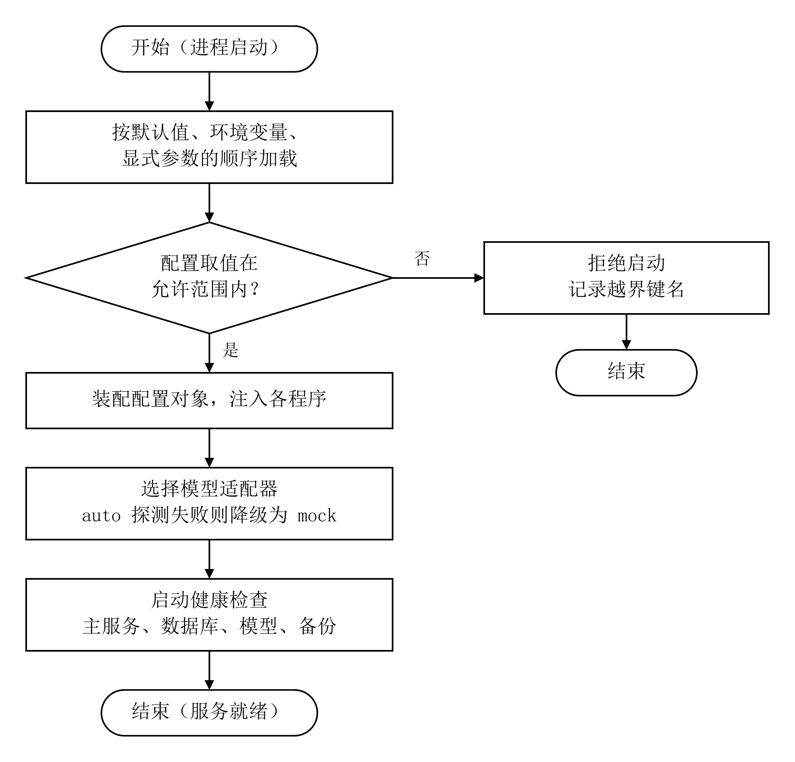

图 14-2 M-12 配置装配与降级流程

流程要点：

1. 配置校验在装配之前，**错配置不进入运行期**；
2. `auto` 模式先探测再决定，探测失败只降级不退出；
3. 健康检查四项独立，区分"不可用"与"可降级"。

### 14.8 接口

表 14.8 M-12 的调用关系

| 方向 | 对象 | 说明 |
|---|---|---|
| 上层调用方 | 全部程序 | 读取配置 |
| 上层调用方 | M-04 | 取模型适配器 |
| 对外 | 运维 | 健康检查接口、日志文件 |

```python
def load(overrides: dict) -> EngineConfig: ...
def build_provider(mode: str, cfg) -> Adapter: ...
def health() -> dict: ...
def sanitize(record: dict) -> dict: ...
```

### 14.9 存储分配

表 14.9 M-12 的存储占用

| 对象 | 规模 | 说明 |
|---|---|---|
| 配置对象 | < 2 KB | 进程内单例 |
| 日志 | 按日切分，约 1–5 MB/日 | 保留 14 天 |
| 适配器 | 1 个实例 | 不随请求创建 |

### 14.10 注释设计

表 14.10 M-12 的注释要求

| 位置 | 要求 | 示例 |
|---|---|---|
| 脱敏 | 说明"为什么这些字段" | `# utterance 全文不落盘：可能含学生隐私` |
| 校验 | 说明报错要含键名 | `# 报错必须含键名与范围，否则部署时无从排查` |
| 降级 | 说明不退出 | `# 探测失败只降级，不阻断启动` |

### 14.11 限制条件

1. 配置只支持"启动时读取"，不支持热更新；
2. 日志同步写，不引入异步队列；
3. 健康检查不检测外部网站连通性；
4. 不支持多套配置文件切换（演示/生产靠环境变量区分）；
5. 模型密钥只从环境变量读取，不写入配置文件。

### 14.12 测试计划

表 14.11 M-12 单体测试用例

| 用例号 | 覆盖点 | 输入 | 预期结果 |
|---|---|---|---|
| T-14-01 | 默认值生效 | 无任何覆盖 | 使用 §2 表 2.2 的默认值 |
| T-14-02 | 环境变量覆盖 | `DSH_STUDY_RATIO=0.8` | 生效，其余仍为默认 |
| T-14-03 | 显式参数优先 | 参数与环境变量都设 | 参数生效 |
| T-14-04 | 越界拒绝启动 | `BUFFER_RATIO=0.9` | 拒绝启动，报错含键名与范围 |
| T-14-05 | 类型错误 | `MAX_SLICES_PER_TASK=abc` | 拒绝启动 |
| T-14-06 | 日志脱敏 | 记录含 `password` | 输出为 `***` |
| T-14-07 | 对话不落盘 | 记录含 `utterance` | 替换为 `***` |
| T-14-08 | mock 断网可用 | `mode=mock`、断网 | 主流程正常 |
| T-14-09 | auto 降级 | 真实 Provider 探测失败 | 切 mock，记录 `provider_fallback` |
| T-14-10 | 健康检查四项 | 正常环境 | 四项均有值，总判定为 ok |
| T-14-11 | 备份超期 | 最近备份 30 小时前 | 备份项给 warn |

### 14.13 尚未解决的问题

表 14.12 M-12 尚未解决的问题

| 编号 | 问题 | 当前处理 | 计划 |
|---|---|---|---|
| Q-25 | 日志轮转 | 按日切分 + 保留 14 天 | 量大时改异步与压缩 |
| Q-26 | 配置热更新 | 不支持 | 需重启，演示场景可接受 |

## 附录 A 函数清单

表 A.1 关键函数与所属章节

| 文件 | 函数 / 类 | 职责 | 所属章 | 估算行数 |
|---|---|---|---|---|
| `auth/service.py` | `login` | 认证并签发令牌 | 3 | 40 |
| `auth/service.py` | `authenticate` | 解析并校验令牌 | 3 | 25 |
| `auth/service.py` | `require_owner` | 归属校验（404 不泄露） | 3 | 15 |
| `content/service.py` | `save_concept` | 知识点保存与唯一性校验 | 4 | 35 |
| `content/service.py` | `submit_prereqs` | 批量先修提交与整批回滚 | 4 | 55 |
| `content/cycle.py` | `detect_cycle` | DFS 三色环检测 | 4 | 45 |
| `content/service.py` | `disable_concept` | 引用影响分析 | 4 | 30 |
| `constraint/service.py` | `normalize` | 约束字段规范化 | 5 | 50 |
| `constraint/capacity.py` | `expand` | 可用时段展开 | 5, 7 | 40 |
| `constraint/capacity.py` | `compute_capacity` | C / B / C′ 计算 | 5 | 15 |
| `agent/extract.py` | `map_target` | 目标映射四层降级 | 6 | 45 |
| `agent/extract.py` | `parse_relative` | 相对日期归一化 | 6 | 60 |
| `agent/client.py` | `call_model_safely` | 预算内调用与降级 | 6 | 30 |
| `planner/closure.py` | `prereq_closure` | 先修闭包 | 7 | 30 |
| `planner/split.py` | `split_tasks` | 7:3 拆分 | 7 | 25 |
| `planner/topo.py` | `topo_order` | 稳定拓扑排序 | 7 | 40 |
| `planner/pack.py` | `pack` | 装箱与拆片 | 7 | 70 |
| `planner/engine.py` | `generate_plan` | 编排上述步骤 | 7 | 35 |
| `validation/checks.py` | `validate` | 五项顺序校验 | 8 | 60 |
| `validation/overlap.py` | `overlaps` / `intersect` | 左闭右开区间判定 | 8 | 15 |
| `version/service.py` | `confirm` | 确认事务 | 9 | 80 |
| `version/diff.py` | `diff` | 版本差异四类 | 9 | 45 |
| `version/snapshot.py` | `canonical_hash` | 快照规范化哈希 | 9 | 15 |
| `progress/service.py` | `submit` | 打卡与更正 | 10 | 55 |
| `progress/stats.py` | `completion_rate` | 完成率与逾期 | 10 | 30 |
| `board/service.py` | `build_view` | 看板数据组装 | 11 | 50 |
| `api/routes.py` | `handle` | 请求管道 | 12 | 40 |
| `api/errors.py` | `map_error` | 异常到错误码 | 12 | 30 |
| `storage/uow.py` | `UnitOfWork` | 事务边界 | 13 | 40 |
| `storage/repo.py` | 各仓储方法 | 表到对象映射 | 13 | 200 |
| `storage/backup.py` | `backup` | 一致性备份 | 13 | 45 |
| `infra/config.py` | `load` / `validate` | 配置装配与校验 | 14 | 50 |
| `infra/logging.py` | `sanitize` | 日志脱敏 | 14 | 25 |
| `infra/health.py` | `health` | 健康检查分级 | 14 | 30 |

> 估算合计数千行，与 D01 的规模假设（源码 < 5000 行）一致；实际行数以编码为准。

## 附录 B 图表清单

表 B.1 图清单

| 图号 | 图题 | 所在章节 |
|---|---|---|
| 图 2-1 | 程序调用结构图 | 2 |
| 图 3-1 | M-01 认证与权限的 IPO 图 | 3.2 |
| 图 3-2 | M-01 登录判定流程 | 3.7 |
| 图 4-1 | M-02 课程内容管理的 IPO 图 | 4.2 |
| 图 4-2 | M-02 先修批量提交流程 | 4.7 |
| 图 5-1 | M-03 约束与容量的 IPO 图 | 5.2 |
| 图 5-2 | M-03 约束提交流程 | 5.7 |
| 图 6-1 | M-04 追问与抽取的 IPO 图 | 6.2 |
| 图 6-2 | M-04 抽取与追问流程 | 6.7 |
| 图 7-1 | M-05 分解与排程的 IPO 图 | 7.2 |
| 图 7-2 | M-05 主流程图 | 7.7 |
| 图 8-1 | M-06 计划校验的 IPO 图 | 8.2 |
| 图 8-2 | M-06 五项校验流程 | 8.7 |
| 图 9-1 | M-07 确认与版本的 IPO 图 | 9.2 |
| 图 9-2 | M-07 确认事务流程 | 9.7 |
| 图 10-1 | M-08 进度与事件的 IPO 图 | 10.2 |
| 图 10-2 | M-08 打卡与更正流程 | 10.7 |
| 图 11-1 | M-09 看板与前端组件的 IPO 图 | 11.2 |
| 图 11-2 | M-09 看板渲染流程 | 11.7 |
| 图 12-1 | M-10 接口与序列化的 IPO 图 | 12.2 |
| 图 12-2 | M-10 请求处理管道 | 12.7 |
| 图 13-1 | M-11 存储访问的 IPO 图 | 13.2 |
| 图 13-2 | M-11 事务与备份流程 | 13.7 |
| 图 14-1 | M-12 配置与日志的 IPO 图 | 14.2 |
| 图 14-2 | M-12 配置装配与降级流程 | 14.7 |

表 B.2 表清单（按章汇总）

| 章 | 表号范围 | 数量 |
|---|---|---|
| 1 | 表 1.1～1.3 | 3 |
| 2 | 表 2.1～2.3 | 3 |
| 3 | 表 3.1～3.10 | 10 |
| 4 | 表 4.1～4.9 | 9 |
| 5 | 表 5.1～5.10 | 10 |
| 6 | 表 6.1～6.11 | 11 |
| 7 | 表 7.1～7.10 | 10 |
| 8 | 表 8.1～8.10 | 10 |
| 9 | 表 9.1～9.11 | 11 |
| 10 | 表 10.1～10.9 | 9 |
| 11 | 表 11.1～11.10 | 10 |
| 12 | 表 12.1～12.11 | 11 |
| 13 | 表 13.1～13.10 | 10 |
| 14 | 表 14.1～14.12 | 12 |
| 附录 | 表 A.1、B.1、B.2、C.1 | 4 |

## 附录 C 与上游文档的对应关系

表 C.1 需求—模块—数据三向对应

| D02 需求 | D04 模块 | D05 数据表 | 本文章节 |
|---|---|---|---|
| F-01 登录与角色 | M-01 | `app_user` | 第 3 章 |
| F-02～F-05 内容维护 | M-02 | `course`、`concept`、`prerequisite`、`resource`、`concept_resource` | 第 4 章 |
| F-06 约束与容量 | M-03 | `plan_constraint` | 第 5 章 |
| F-07 追问与补全 | M-04 | — | 第 6 章 |
| F-08 分解与排程 | M-05 | `plan_task`、`version_task`、`task_slice` | 第 7 章 |
| F-09 计划校验 | M-06 | `plan_validation` | 第 8 章 |
| F-10 确认与进度 | M-07、M-08 | `plan_version`、`learning_event` | 第 9、10 章 |
| F-11 计划调整 | M-05、M-07 | `plan_draft`、`plan_version` | 第 7、9 章 |
| F-12 版本与差异 | M-07 | `plan_version` | 第 9 章 |
| F-13 看板 | M-09 | 只读汇总 | 第 11 章 |
| 全局 | M-10、M-11、M-12 | `schema_meta` | 第 12～14 章 |

## 变更记录

| 日期 | 版本 | 主要变更 | 状态 |
|---|---|---|---|
| 2026-11-03 | v0.1 | 建立结构：§1 引言、§2 程序系统结构、M-05 完整样章（含公式、伪码、12 条用例） | 内部稿 |
| 2026-11-04 | v1.0 | 补齐第 3～14 章（12 个程序 × 13 小节）、24 张程序图与结构图；新增附录 A 函数清单、B 图表清单、C 三向对应；全文校对（章号、图表号、常量、术语、伪码） | 待评审 |
