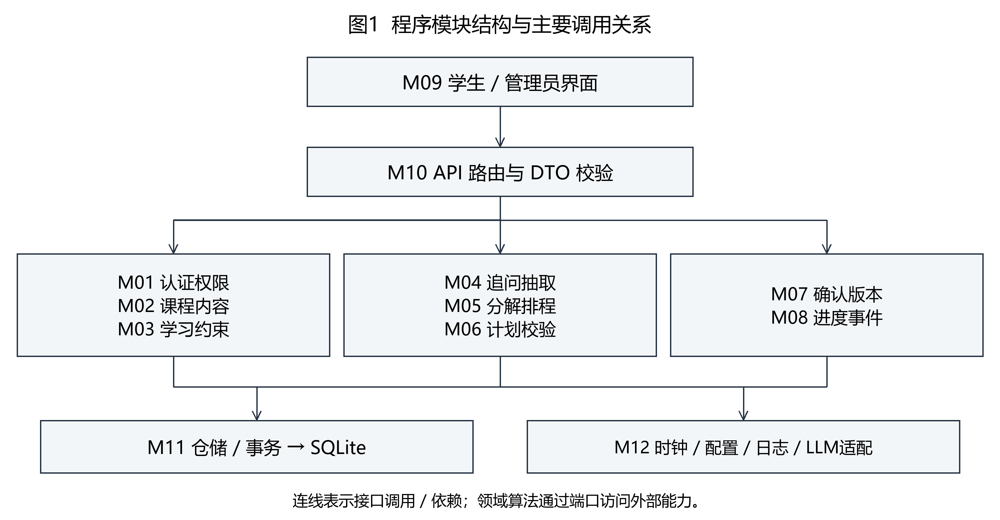
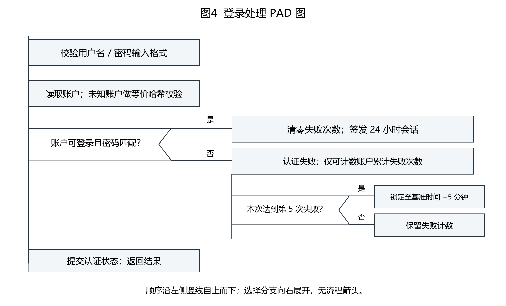
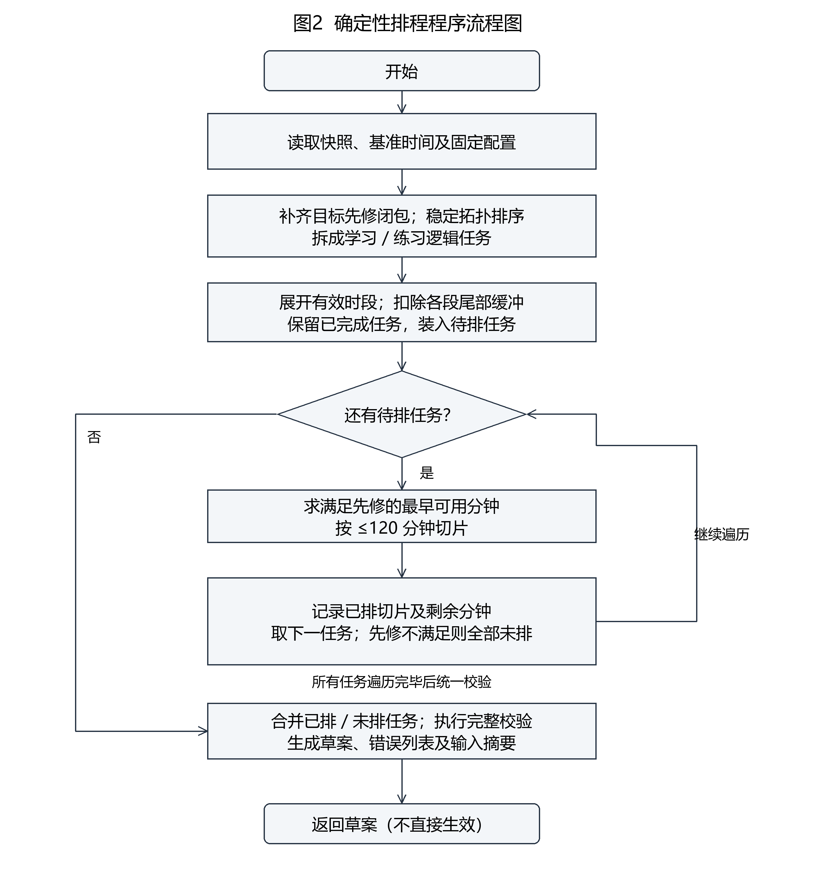
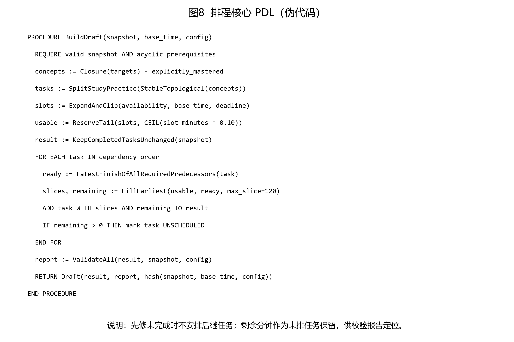
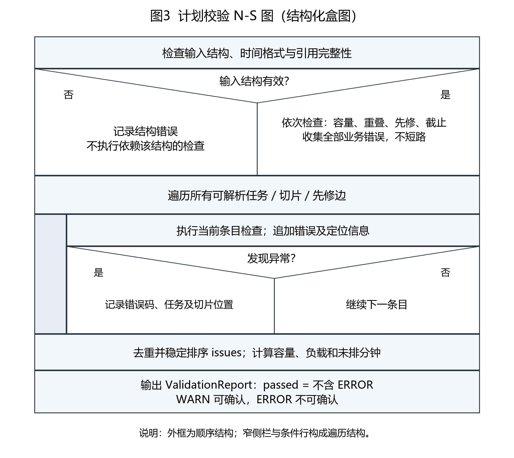
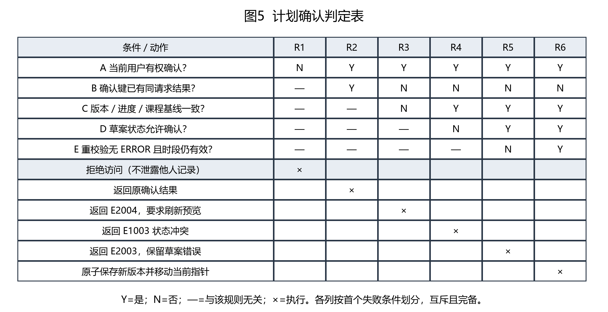
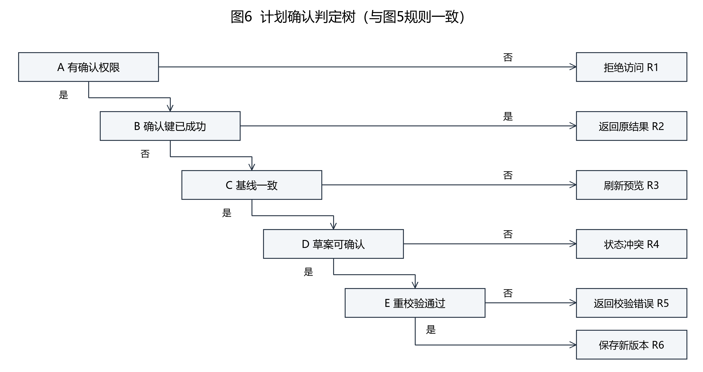
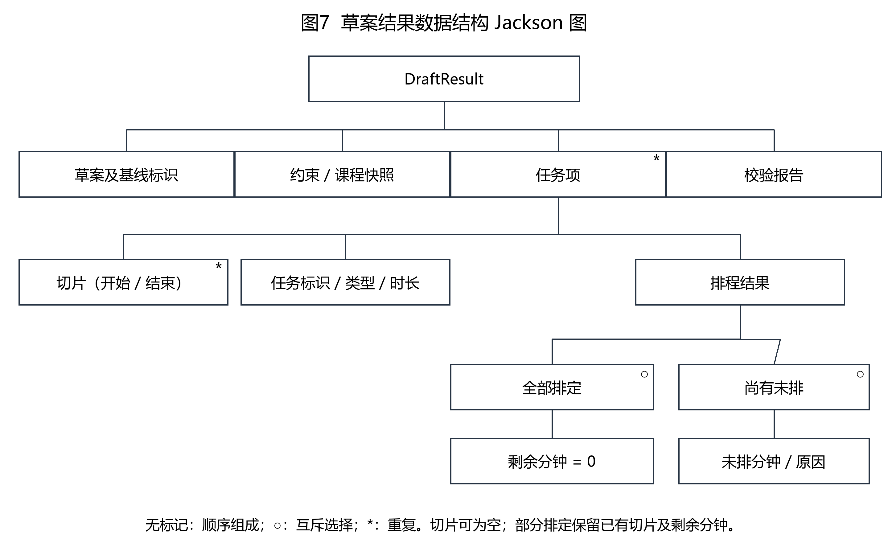

# 课程学习规划辅助系统（学径 StudyPath）详细设计说明书
版本：D06 v1.0｜日期：2026-11-02｜状态：设计评审稿

## 1 引言
### 1.1 编写目的
本文把需求和概要设计细化为可编码、可测试的程序设计，说明各模块的输入输出、算法、处理逻辑、接口、存储和测试方法。预期读者为指导教师、开发组成员及测试人员。本文描述拟实现方案，不代表程序已经开发或通过性能验收。
### 1.2 背景
系统名称为课程学习规划辅助系统，简称“学径 StudyPath”。开发者为软件工程2班第6组，组长王昱涵，成员李鸿佑、李俊达、项奕乔，指导教师张德珍。面向学生及课程管理员，运行在浏览器、FastAPI 后端与本地 SQLite 环境中。本期限定一门 Python 课程，不扩展为多课程推荐平台。
学生填写目标、截止日期、可用时段及已掌握知识，系统补充追问、分解任务并生成可检查的计划；学生确认后执行和记录进度，变化时重新预览并确认调整。管理员维护课程、知识点、先修关系与资源。管理员角色不自动获得学生私人计划的访问权。
### 1.3 定义
逻辑任务：由知识点和学习/练习类型确定的稳定工作单元，task_id 跨版本不变。切片：逻辑任务在某版本中的具体时间区间。草案：尚未生效的候选计划。版本：一次确认后不可变的快照。基线：生成草案时的当前版本号、进度修订号与课程修订号。ERROR 阻止确认；WARN 允许确认但需展示。PDL 为程序设计语言式伪代码，N-S 为结构化盒图，PAD 为问题分析图，DTO 为接口数据对象。
### 1.4 参考资料
（1）《6-王昱涵-课程学习规划辅助系统-软件需求说明书v2.3.docx》，用户提供的需求基线。
（2）《D04_概要设计说明书_v1.0_20261102》《D05_数据库设计说明书_v1.0_20261102》，本项目已整理的设计评审稿；同时参考队员提供的 v0.1 原稿。
（3）教师《5.详细设计说明书格式.docx》：本文第1、2章及各程序的13个小节按此组织。
（4）教师《参考_软件开发过程中用到的各种图.pdf》第19—27页：程序流程图、N-S、PAD、判定表、判定树、PDL、Jackson 图。
本文根据图的用途选择表示法。图5、图6表达同一确认规则，便于审查一致性；不将概要架构图、数据库 E-R 图当作详细算法图重复展开。

## 2 程序系统的结构
### 2.1 模块划分及调用

图1 程序模块结构与主要调用关系
程序采用 React 18 + TypeScript、Python 3.11、FastAPI + Uvicorn、SQLite。单机演示使用 Mock 智能体，真实模型作为可切换适配器。后端按请求调用模块，不在模块中保存可变全局用户状态；领域算法接受明确参数，不读取隐藏的当前时间。
|模块|职责|主要下游|
|---|---|---|
|M01 认证与权限|认证、会话、对象归属校验|M11、M12|
|M02 课程内容|知识点、资源、先修 DAG|M11|
|M03 约束管理|约束解析、范围与时段检查|M02、M11、M12|
|M04 追问与抽取|补齐缺失字段、生成解释|M03、M12|
|M05 分解与排程|先修闭包、时长、切片安排|M02、M03|
|M06 计划校验|容量、重叠、先修、截止检查|纯函数|
|M07 确认与版本|确认事务、快照、版本比较|M05、M06、M11|
|M08 进度与事件|完成、备注、更正、延期触发|M07、M11、M12|
|M09 看板与前端|表单、预览、打卡、差异展示|M10|
|M10 接口与序列化|路由、DTO、错误映射|M01—M08|
|M11 存储访问|仓储、事务、约束和迁移|SQLite|
|M12 基础设施|模型、时钟、配置、日志与备份|外部服务 / 文件|
### 2.2 公共数据约定
所有 ID 为服务端生成的不透明字符串；版本号、修订号为非负整数。业务日期按 Asia/Shanghai 解析，数据库切片以 UTC 整秒保存且必须是整分钟；审计时间使用 UTC。区间统一为左闭右开 [start,end)，相邻任务结束等于下一任务开始不算重叠。截止日期的有效上界为该日期次日零点（不含）。
输入和输出均采用 UTF-8 JSON、HTTPS/本机 HTTP 请求、请求级返回，不通过页面刷新直接写库。服务端验证全部字段，客户端校验仅用于提示。个人约束、计划、事件仅所属学生可读写；公开课程内容按角色授权。
|数据对象|核心字段与范围|来源及使用|
|---|---|---|
|ConstraintInput|目标知识点ID列表；已掌握ID列表；deadline；weekly_slots；excluded_dates；duration_overrides|学生输入；每次生成或调整提交|
|Slot|weekday=1..7；start/end 为 HH:mm，start<end；每天0..3段且不交叉，总计≤480分钟|M03 归一化，展开为日期区间|
|DraftResult|draft_id、revision、base_version、base_progress_revision、course_revision、tasks、report|M05 / M06 输出，经 M07 保存；见图7|
|Task|task_id、concept_id、type、estimated_minutes、in_scope、frozen、slices、remaining_minutes|逻辑身份与版本属性分离|
|ValidationIssue|code、severity、task_id、slice_no、field、message|机器定位与界面中文提示同时保留|
|ValidationReport|passed、issues[]、raw_minutes、buffer_minutes、usable_minutes、required_minutes、unscheduled_minutes|passed 等价于不存在 ERROR|
|ConfirmInput|draft_id、revision、confirm_key、change_reason、change_note|客户端生成请求键，重试沿用原键|
|EventInput|task_id、version_id、request_key、type、actual_minutes、note、corrects_event_id|完成两步确认后提交；更正必须指向原事件|
姓名、学号等无关身份数据不提交给大模型。模型调用不传精确可用时间表，模型返回的资源 ID 必须在本课程资源白名单中。
### 2.3 不变量与处理顺序
本期按整分钟计算，避免浮点误差。先检查结构，再计算业务。所有先修关系为 AND；知识点自身不可先修自身，跨课程先修非法，先修图必须无环。任务分解和排程只依赖课程快照、输入快照、基准时间与固定引擎配置，相同输入必须得到相同结果。
已完成任务的原排程、预计时长和身份冻结，不被调整删除。新目标不再需要的已完成任务作为历史项保留，in_scope=false，不计入当前目标的完成比例。只在当前范围内的全部逻辑任务完成时设置 completed；延期不自动完成计划。
### 2.4 统一接口与错误
成功响应为 {data, request_id}；失败响应为 {error:{code,message,details}, request_id}。details 不包含堆栈、密码、令牌或他人的计划信息。幂等重放成功返回原结果；相同请求键对应不同有效负载时返回冲突，不重复操作。
|编码|语义|HTTP 映射|
|---|---|---|
|E1001 / E1002|字段非法 / 不存在或不可见|400 / 404|
|E1003 / E1005|状态冲突 / 数据库繁忙|409 / 503|
|E2001 / E2002|课程结构错误 / 目标及已掌握集合错误|400 / 400|
|E2003 / E2004|计划校验不通过 / 预览基线过期|409 / 409|
|E3001|模型降级，返回可继续填写的草案提示|可恢复场景为成功响应内 warning|
|E4001 / E4003|未认证 / 无角色权限|401 / 403|
对私人对象按所有者过滤后返回404，避免用“无权限”暴露对象存在性。角色级管理入口禁止访问时返回403。

## 3 M01 认证与权限设计说明

### 3.1 程序描述
校验登录身份、会话及对象归属，防止越权。 本模块为请求驱动组件，可重复调用；每次调用拥有独立上下文。共享数据库的写操作经M11串行事务协调，不依赖模块内可变全局变量。

### 3.2 功能
认证；失败计数；锁定；角色和所有者检查。

### 3.3 性能
单用户预热环境下普通页面≤2秒；外部模型时间单独统计。 指标为待验证的设计目标，测量方法见附录C。

### 3.4 输入项
username：3—32字符；password：至少8位并含字母和数字；会话令牌由请求头携带。 数据来源为已认证用户请求或上游明确传入的结构体，经UTF-8 JSON接口或进程内参数按需输入；不得使用其他用户会话中的隐式数据。

### 3.5 输出项
登录结果、到期时间和角色；失败统一提示，不泄露账户是否存在。 接口返回面向当前调用者；私人字段受所有者规则保护。持久化副作用仅限本模块接口约定。

### 3.6 算法
以安全密码哈希验证密码；累计5次失败锁定5分钟，锁定期间不继续累加；成功后清零。会话有效24小时，过期要求重新登录。未知账户执行等价哈希校验，尽量减少计时差异。

### 3.7 流程逻辑
按格式校验、账户读取、状态检查、哈希校验、状态保存顺序处理，见图4。锁定和禁用优先于签发会话。


登录处理_PAD图（图号见图内标题）

### 3.8 接口
POST /api/auth/login；其他路由调用 require_role 与 require_owner。 上游以显式参数调用，下游错误统一按2.4映射；数据库结构以D05为准。

### 3.9 存储分配
app_user；会话签名密钥由环境配置提供，禁止明文密码和硬编码密钥。 本设计不手工分配固定内存地址；请求临时集合按输入规模动态分配，响应完成后释放。

### 3.10 注释设计
模块首部说明职责、输入输出和不变量；函数注明前置条件、返回值及副作用。对本模块的关键边界“认证接口不设计注册入口”写明原因，避免只重复语句。复杂分支注明规则编号和对应测试编号。

### 3.11 限制条件
认证接口不设计注册入口；每次私人对象访问都做归属检查。

### 3.12 测试计划
未知用户、错误密码1—5次、锁定期间、锁定到期、成功清零、令牌过期、管理员读私人计划被拒绝。 开发者先完成单元检查，测试负责人在联调时执行并记录输入、实际输出和证据；需要的外部能力通过Mock或注入时钟替代。

### 3.13 尚未解决的问题
密码哈希算法参数及令牌撤销策略在编码前锁定；评审稿采用带盐的成熟密码哈希库与签名会话。

## 4 M02 课程内容管理设计说明

### 4.1 程序描述
为排程提供一致的课程知识快照。 本模块为请求驱动组件，可重复调用；每次调用拥有独立上下文。共享数据库的写操作经M11串行事务协调，不依赖模块内可变全局变量。

### 4.2 功能
管理课程、知识点、先修边和课程资源；读写时修订内容版本。

### 4.3 性能
单用户预热环境下普通页面≤2秒；外部模型时间单独统计。 指标为待验证的设计目标，测量方法见附录C。

### 4.4 输入项
管理员提交知识点、先修起终点ID、资源信息；difficulty=1..5，reference_minutes=5..600，默认30。 数据来源为已认证用户请求或上游明确传入的结构体，经UTF-8 JSON接口或进程内参数按需输入；不得使用其他用户会话中的隐式数据。

### 4.5 输出项
课程快照及 content_revision；失败给出字段或闭环定位。 接口返回面向当前调用者；私人字段受所有者规则保护。持久化副作用仅限本模块接口约定。

### 4.6 算法
新增先修边 A→B 时检查 A≠B、同课程、无重复，再从 B 搜索是否可达 A；可达则成环并拒绝。批量替换采用全图 Kahn 拓扑检查，队列以 sort_order、concept_id 稳定排序。

### 4.7 流程逻辑
先验证完整候选图，再在同一事务写入并递增课程修订号。存在计划引用的知识点采用停用，历史版本继续使用原快照。

### 4.8 接口
GET /api/course；管理员知识点与资源维护路由；PUT /api/admin/course/prerequisites。 上游以显式参数调用，下游错误统一按2.4映射；数据库结构以D05为准。

### 4.9 存储分配
course、concept、prerequisite、resource、concept_resource；保留版本中的课程快照。 本设计不手工分配固定内存地址；请求临时集合按输入规模动态分配，响应完成后释放。

### 4.10 注释设计
模块首部说明职责、输入输出和不变量；函数注明前置条件、返回值及副作用。对本模块的关键边界“资源URL限制 http/https”写明原因，避免只重复语句。复杂分支注明规则编号和对应测试编号。

### 4.11 限制条件
资源URL限制 http/https；先修边两端及关联资源必须同课程。

### 4.12 测试计划
自环、二节点环、长环、跨课关联、重复边、资源停用、课程修订导致旧草案失效。 开发者先完成单元检查，测试负责人在联调时执行并记录输入、实际输出和证据；需要的外部能力通过Mock或注入时钟替代。

### 4.13 尚未解决的问题
首批 Python 课程知识点与合法资源清单由团队和教师审定，不能由模型凭空建立课程知识。

## 5 M03 约束管理设计说明

### 5.1 程序描述
把学生表单转换成唯一、可校验的约束快照。 本模块为请求驱动组件，可重复调用；每次调用拥有独立上下文。共享数据库的写操作经M11串行事务协调，不依赖模块内可变全局变量。

### 5.2 功能
解析目标、已掌握、截止日、周时段、排除日及预计时长覆盖。

### 5.3 性能
单用户预热环境下普通页面≤2秒；外部模型时间单独统计。 指标为待验证的设计目标，测量方法见附录C。

### 5.4 输入项
目标和已掌握引用有效知识点；截止日为明天至180天内；排除日0—30个且可包含截止日；覆盖时长1—1440分钟。 数据来源为已认证用户请求或上游明确传入的结构体，经UTF-8 JSON接口或进程内参数按需输入；不得使用其他用户会话中的隐式数据。

### 5.5 输出项
归一化 ConstraintSnapshot；字段错误与剩余可填写字段。 接口返回面向当前调用者；私人字段受所有者规则保护。持久化副作用仅限本模块接口约定。

### 5.6 算法
对日期、去重排序、周时段合并规则进行确定化处理；交叉时段不自动合并掩盖错误，直接提示。展开时取与 [base_time,deadline_end) 的交集，起点不足整分钟则向上取整，不把基准时间前的分钟纳入。

### 5.7 流程逻辑
先做格式与引用校验，再展开实际日期、剔除排除日、计算实际容量；容量为0返回明确错误而非空白计划。

### 5.8 接口
POST /api/plans/drafts 的 constraints；内部 normalize_constraints(input, course_snapshot, base_time)。 上游以显式参数调用，下游错误统一按2.4映射；数据库结构以D05为准。

### 5.9 存储分配
plan_constraint 为当前投影；plan_draft.payload_json 与 plan_version.snapshot_json 保存相应不可变输入。 本设计不手工分配固定内存地址；请求临时集合按输入规模动态分配，响应完成后释放。

### 5.10 注释设计
模块首部说明职责、输入输出和不变量；函数注明前置条件、返回值及副作用。对本模块的关键边界“不跨日时段”写明原因，避免只重复语句。复杂分支注明规则编号和对应测试编号。

### 5.11 限制条件
不跨日时段；每周日编号1—7；空目标及目标全部已掌握需要学生确认目标，不自动生成无意义计划。

### 5.12 测试计划
截止日边界、跨午夜时段、每天4段、交叉时段、排除截止日、30/31排除日、全部容量为0、分钟向上取整。 开发者先完成单元检查，测试负责人在联调时执行并记录输入、实际输出和证据；需要的外部能力通过Mock或注入时钟替代。

### 5.13 尚未解决的问题
系统部署时区固定为上海；夏令时及跨时区排程不纳入本期。

## 6 M04 追问与信息抽取设计说明

### 6.1 程序描述
辅助补齐需求、检索课程资源及解释排程结果。 本模块为请求驱动组件，可重复调用；每次调用拥有独立上下文。共享数据库的写操作经M11串行事务协调，不依赖模块内可变全局变量。

### 6.2 功能
识别缺失项；每轮最多追问2项；保留已填写内容；可切换Mock。

### 6.3 性能
单用户预热环境下普通页面≤2秒；外部模型时间单独统计。 指标为待验证的设计目标，测量方法见附录C。

### 6.4 输入项
已脱敏的课程目标语义、缺失字段名、合法资源摘要；精确日程由本地程序解析。 数据来源为已认证用户请求或上游明确传入的结构体，经UTF-8 JSON接口或进程内参数按需输入；不得使用其他用户会话中的隐式数据。

### 6.5 输出项
建议字段、追问文本、合法资源ID及解释；不能直接成为正式计划。 接口返回面向当前调用者；私人字段受所有者规则保护。持久化副作用仅限本模块接口约定。

### 6.6 算法
先本地判定必填项；缺失时一次选择优先级最高的最多2项。超过5轮提供表单补齐入口。真实模型总调用预算10秒，最多1次重试且必须留在总预算内；超时、非法结构或资源ID非法均回退模板/Mock。

### 6.7 流程逻辑
模型结果经结构解析与白名单验证，再由 M03 重新校验；计划安排始终交给 M05、M06。不能通过模型文本绕过程序规则。

### 6.8 接口
POST /api/dialogue/constraints；Provider.extract 和 Provider.explain，支持mock与真实适配器。 上游以显式参数调用，下游错误统一按2.4映射；数据库结构以D05为准。

### 6.9 存储分配
plan_draft 中保存结构化字段与必要解释；日志仅记录请求ID、耗时与错误类别。 本设计不手工分配固定内存地址；请求临时集合按输入规模动态分配，响应完成后释放。

### 6.10 注释设计
模块首部说明职责、输入输出和不变量；函数注明前置条件、返回值及副作用。对本模块的关键边界“模型不可自行修改数据库，不发送身份及精确日程”写明原因，避免只重复语句。复杂分支注明规则编号和对应测试编号。

### 6.11 限制条件
模型不可自行修改数据库，不发送身份及精确日程；资源检索以课程已维护资源为主。

### 6.12 测试计划
无网络、10秒预算到期、非法JSON、未知资源ID、连续缺字段、Mock结果可复现、降级后已填值不丢失。 开发者先完成单元检查，测试负责人在联调时执行并记录输入、实际输出和证据；需要的外部能力通过Mock或注入时钟替代。

### 6.13 尚未解决的问题
真实模型供应商、密钥和费用额度由部署配置确定；未配置时默认Mock，不阻塞验收主流程。

## 7 M05 任务分解与排程设计说明

### 7.1 程序描述
把知识目标转换为符合先修和容量约束的任务草案。 本模块为请求驱动组件，可重复调用；每次调用拥有独立上下文。共享数据库的写操作经M11串行事务协调，不依赖模块内可变全局变量。

### 7.2 功能
补齐先修、分解学习练习、应用时长覆盖、预留缓冲、生成切片和未排任务。

### 7.3 性能
50个逻辑任务、100个切片时，生成P95≤1秒；时间和分钟计算必须精确，不截断未排工作。 指标为待验证的设计目标，测量方法见附录C。

### 7.4 输入项
归一化约束、课程快照、完成任务快照、base_time、engine_version 与配置。 数据来源为已认证用户请求或上游明确传入的结构体，经UTF-8 JSON接口或进程内参数按需输入；不得使用其他用户会话中的隐式数据。

### 7.5 输出项
DraftResult，包含全部所需逻辑任务、已排切片、未排分钟及初步原因，不直接激活。 接口返回面向当前调用者；私人字段受所有者规则保护。持久化副作用仅限本模块接口约定。

### 7.6 算法
采用稳定拓扑顺序与最早可用时段贪心安排；详细算法、公式、流程及PDL见7.6—7.7。该策略保证可解释和确定性，不宣称全局最优。

1. 以目标集合为根，沿入边求先修闭包，包含目标自身，再减去明确已掌握集合；已掌握节点视为已满足，不生成重复任务。使用 visited 防止重复遍历，并在此前确认课程图无环。多前驱必须全部满足。
2. 对剩余知识点稳定拓扑排序，优先键为 (sort_order, concept_id)。每点先学习后练习；原始总时长 m 拆为学习 ceil(0.7m)、练习 m-ceil(0.7m)，不是给两种任务各分配一次总时长。已覆盖的逻辑任务采用学生明确提交的预计分钟数，不自动再按比例拆该覆盖值。
3. 展开基准时间至截止日的日期时段，排除指定日期，并与有效范围求交。每个有效时段原始分钟 C_i，尾部缓冲 B_i=ceil(0.10C_i)，可用分钟 U_i=C_i-B_i；缓冲不参与排程。完成任务保留原记录；其落在未来有效时段内的冻结切片先占用对应容量，不能再排新任务。
4. 学习任务依赖所有先修知识点的练习完成，练习依赖本点学习完成。已掌握知识点不再要求排程。对已完成前驱以完成事实满足约束；对未完成前驱要求其已排切片全部结束。若前驱仍有未排分钟，将该任务全部标记未排，防止出现先修链断裂的假可执行计划。
5. 从就绪时刻起按开始时间扫描可用空闲区间，每次取 min(任务剩余分钟,区间剩余分钟,120)，产生切片并扣减。允许尾片1—14分钟。可跨多个时段分割，但不得越过时段、缓冲、其他切片或截止边界。部分任务可保留已排切片和剩余分钟；有剩余时其后继不能排定。
6. 所有逻辑任务都进入返回值，未排部分携带容量或先修原因。调用独立校验器得到报告。可调整预计时长、目标或可用时间后重新生成，系统不私自消耗缓冲或降低目标。
数值例：某有效时段09:00—10:01共61分钟，缓冲ceil(6.1)=7分钟，可用09:00—09:54共54分钟。某知识点30分钟拆为学习21、练习9分钟，合计30；若可用容量只有20分钟，保留剩余工作并禁止正式确认。

### 7.7 流程逻辑
依赖未排定则后继不安排，记为 PREREQ_UNSCHEDULED；容量不足保留剩余工作，不向截止日之后虚构时间。


排程程序流程图（图号见图内标题）


排程核心_PDL（图号见图内标题）

### 7.8 接口
build_draft(snapshot, base_time, config) → DraftResult；由生成与调整服务调用。 上游以显式参数调用，下游错误统一按2.4映射；数据库结构以D05为准。

### 7.9 存储分配
算法工作集在内存；生成后保存 plan_draft，确认时才写正式版本任务与切片。 本设计不手工分配固定内存地址；请求临时集合按输入规模动态分配，响应完成后释放。

### 7.10 注释设计
模块首部说明职责、输入输出和不变量；函数注明前置条件、返回值及副作用。对本模块的关键边界“保持已完成任务原切片”写明原因，避免只重复语句。复杂分支注明规则编号和对应测试编号。

### 7.11 限制条件
保持已完成任务原切片；未完成切片最早开始时间不得早于基准时间。单切片≤120分钟，允许不足15分钟尾片。

### 7.12 测试计划
先修链与多前驱、30分钟7:3分解、120/121分钟切片、容量不足、完成任务冻结、固定输入重复生成一致。 开发者先完成单元检查，测试负责人在联调时执行并记录输入、实际输出和证据；需要的外部能力通过Mock或注入时钟替代。

### 7.13 尚未解决的问题
性能指标需编码后实测；资源质量与学生预计时长的准确性不由排程算法保证。

## 8 M06 计划校验设计说明

### 8.1 程序描述
独立于生成器复核草案，避免自证正确。 本模块为请求驱动组件，可重复调用；每次调用拥有独立上下文。共享数据库的写操作经M11串行事务协调，不依赖模块内可变全局变量。

### 8.2 功能
检查时段有效、总容量、任务重叠、先修及截止；输出可定位报告。

### 8.3 性能
50任务、100切片时校验P95≤200毫秒；全部检查以整数分钟和明确边界执行。 指标为待验证的设计目标，测量方法见附录C。

### 8.4 输入项
完整任务列表、切片、约束和课程快照、完成记录及固定基准时间。 数据来源为已认证用户请求或上游明确传入的结构体，经UTF-8 JSON接口或进程内参数按需输入；不得使用其他用户会话中的隐式数据。

### 8.5 输出项
ValidationReport；ERROR阻止确认；仅WARN允许继续。 接口返回面向当前调用者；私人字段受所有者规则保护。持久化副作用仅限本模块接口约定。

### 8.6 算法
结构错误仅阻止依赖该结构的检查，其余可独立检查继续。合法输入按时段、容量、重叠、先修、截止顺序执行，不在第一个业务错误处停止。见图3及8.6。

检查明细：SLOT_INVALID 检查切片属于有效可用区间、无缓冲占用且分钟合法；CAPACITY_EXCEEDED 检查待执行总需求 T 是否超过扣除缓冲及未来冻结占用后的 C′，并报告未排分钟；TASK_OVERLAP 对同一学生的切片按开始、结束、任务ID排序，检查相交；PREREQ_UNSATISFIED 对每条依赖检查后继开始≥前驱全部切片结束，已掌握或已完成前驱按满足处理；DEADLINE_EXCEEDED 检查所有新排任务结束≤截止日期次日00:00。
同时复核逻辑任务的切片分钟总和＋未排分钟=预计分钟；正式确认必须未排分钟为0。排序后的区间扫描维护此前最大结束值，不能仅比较上一个区间以致漏掉嵌套重叠。负载T/C′>0.8但无ERROR时可给高负载WARN；缺少推荐资源可给资源WARN。C′=0单独处理，不进行除零。

### 8.7 流程逻辑
校验器不修改排程，不自动压缩时长，也不吞掉冲突。问题按检查顺序、task_id、slice_no 排序。


校验算法_NS图（图号见图内标题）

### 8.8 接口
validate_plan(candidate, context) → ValidationReport；供生成预览及确认重校验共同调用。 上游以显式参数调用，下游错误统一按2.4映射；数据库结构以D05为准。

### 8.9 存储分配
失败报告保留在草案JSON；plan_validation仅保存正式版本的通过报告。 本设计不手工分配固定内存地址；请求临时集合按输入规模动态分配，响应完成后释放。

### 8.10 注释设计
模块首部说明职责、输入输出和不变量；函数注明前置条件、返回值及副作用。对本模块的关键边界“从实际切片重算分钟并比对预计时长”写明原因，避免只重复语句。复杂分支注明规则编号和对应测试编号。

### 8.11 限制条件
从实际切片重算分钟并比对预计时长；防止前端伪造 passed=true。

### 8.12 测试计划
相邻切片不重叠、交叉1分钟、先修相等边界、超截止1分钟、缓冲占用、切片合计不等、同时多错误。 开发者先完成单元检查，测试负责人在联调时执行并记录输入、实际输出和证据；需要的外部能力通过Mock或注入时钟替代。

### 8.13 尚未解决的问题
本期不评价学习效果，只判断可检查的计划约束。

## 9 M07 计划确认与版本设计说明

### 9.1 程序描述
将预览原子地变为正式版本，并提供调整与差异。 本模块为请求驱动组件，可重复调用；每次调用拥有独立上下文。共享数据库的写操作经M11串行事务协调，不依赖模块内可变全局变量。

### 9.2 功能
首次确认、调整确认、不可变快照、幂等重放、版本查询和比较。

### 9.3 性能
确认保存P95≤300毫秒；3个版本范围的版本比较P95≤500毫秒，外部模型调用不计入保存事务且不得在其中执行。 指标为待验证的设计目标，测量方法见附录C。

### 9.4 输入项
ConfirmInput 与当前学生会话；调整原因 initial/delay/goal_change/availability_change/duration_change/manual。首次以外原因及说明必填。 数据来源为已认证用户请求或上游明确传入的结构体，经UTF-8 JSON接口或进程内参数按需输入；不得使用其他用户会话中的隐式数据。

### 9.5 输出项
新的版本号和当前指针；或原幂等结果、状态冲突、过期预览、校验失败。 接口返回面向当前调用者；私人字段受所有者规则保护。持久化副作用仅限本模块接口约定。

### 9.6 算法
见9.6确认事务。差异以逻辑task_id匹配，新增/移除按范围变化，moved表示切片变化，resized表示预计时长变化；两者同时变化则同时标记。

确认步骤：①在当前用户权限范围内解析草案和确认键；同键且规范化输入一致则返回原结果。②读取候选、基线并在事务外重校验，检查生成后经过的时间是否使未完成任务已落入过去；若不可行返回刷新预览。③BEGIN IMMEDIATE，重新检查确认键、draft.revision、base_version、base_progress_revision、course_revision和草案状态；任何变化返回E2004或相应状态错误并回滚。④解析稳定任务身份，依次写plan_version、version_task、task_slice及通过的plan_validation，保存约束投影和完整快照。⑤最后移动current_version、更新计划状态、把草案标为consumed并存confirm_key与result_version_id，COMMIT。写锁内不再调用模型。
快照必须包含目标、已掌握、时段、排除日、时长覆盖、课程知识点/先修/资源、基准时间、配置、引擎版本、校验输入和结果。输入摘要按规范化JSON的UTF-8 SHA-256计算，集合先排序，浮点数不参与分钟表达。历史重放采用记录的引擎版本和配置；无法提供旧引擎时只能比对存档，不声称可完整重算。
调整：读取当前版本及完成事实→应用变化→冻结已完成任务→重新分解未完成范围→展示差异和原因→学生确认→新版本。新目标不再需要的完成任务保留历史，未完成且不再需要的任务从当前范围移除。已有计划完成后若新目标产生待执行任务，确认的新版本恢复为active。

### 9.7 流程逻辑
图5和图6定义确认入口；事务内复核全部基线，旧版只读。旧基线确认不得用新版本偷偷替换。


计划确认_判定表（图号见图内标题）


计划确认_判定树（图号见图内标题）

### 9.8 接口
POST /api/drafts/{id}/confirm；POST /api/plans/{id}/adjustments；GET /api/plans/{id}/versions；GET /api/plans/{id}/diff?from=&to=。 上游以显式参数调用，下游错误统一按2.4映射；数据库结构以D05为准。

### 9.9 存储分配
study_plan、plan_draft、plan_version、version_task、task_slice、plan_validation、plan_constraint；详见D05。 本设计不手工分配固定内存地址；请求临时集合按输入规模动态分配，响应完成后释放。

### 9.10 注释设计
模块首部说明职责、输入输出和不变量；函数注明前置条件、返回值及副作用。对本模块的关键边界“模型调用、复杂排程和网络操作不放在写事务内”写明原因，避免只重复语句。复杂分支注明规则编号和对应测试编号。

### 9.11 限制条件
模型调用、复杂排程和网络操作不放在写事务内；确认失败全部回滚，草案仍可供修改。

### 9.12 测试计划
同键重试一次写入、同键不同输入冲突、版本和进度竞争、课程变更、事务中断回滚、冻结任务不移动、差异双标记。 开发者先完成单元检查，测试负责人在联调时执行并记录输入、实际输出和证据；需要的外部能力通过Mock或注入时钟替代。

### 9.13 尚未解决的问题
运行时恢复旧版本采用重新生成并确认新版本，不覆盖历史；本期不提供直接篡改或删除历史入口。

## 10 M08 进度与事件设计说明

### 10.1 程序描述
记录学习结果并保持调整依据可追溯。 本模块为请求驱动组件，可重复调用；每次调用拥有独立上下文。共享数据库的写操作经M11串行事务协调，不依赖模块内可变全局变量。

### 10.2 功能
两步完成、实际时长、备注、更正事件、完成状态与延期提醒。

### 10.3 性能
进度记录P95≤200毫秒，幂等请求不得产生重复done事件。 指标为待验证的设计目标，测量方法见附录C。

### 10.4 输入项
EventInput；actual_minutes为非负整数或空；note≤500字；当前用户与当前任务版本。 数据来源为已认证用户请求或上游明确传入的结构体，经UTF-8 JSON接口或进程内参数按需输入；不得使用其他用户会话中的隐式数据。

### 10.5 输出项
事件ID、progress_revision、更新后的完成比例及计划状态；重复请求返回原事件。 接口返回面向当前调用者；私人字段受所有者规则保护。持久化副作用仅限本模块接口约定。

### 10.6 算法
完成按钮先打开确认框，再提交。一个逻辑任务最多一个done事件；后续修正实际分钟或备注采用 correction 事件，不修改原done，不撤销完成。每次有效新增事件递增进度修订号。

### 10.7 流程逻辑
事务中检查所有权、当前版本和任务范围；重复done不得二次推进。当前范围全部逻辑任务完成时计划为completed。查看/刷新时发现未完成任务延期≥48小时，提出调整建议，学生确认后才生成新版本。

### 10.8 接口
POST /api/plans/{id}/events；GET /api/plans/{id}/tasks。更正指向该任务原事件链，由最新有效值形成显示投影。 上游以显式参数调用，下游错误统一按2.4映射；数据库结构以D05为准。

### 10.9 存储分配
learning_event 仅追加；study_plan.progress_revision及status为可变投影。 本设计不手工分配固定内存地址；请求临时集合按输入规模动态分配，响应完成后释放。

### 10.10 注释设计
模块首部说明职责、输入输出和不变量；函数注明前置条件、返回值及副作用。对本模块的关键边界“旧版任务只读”写明原因，避免只重复语句。复杂分支注明规则编号和对应测试编号。

### 10.11 限制条件
旧版任务只读；历史已完成任务不计新目标分母；不以实际学习分钟直接替代预计分钟。

### 10.12 测试计划
点击后取消、不重复提交、完成请求重试、两请求同时done、更正链、旧版本提交、完成比例与历史项、48小时边界。 开发者先完成单元检查，测试负责人在联调时执行并记录输入、实际输出和证据；需要的外部能力通过Mock或注入时钟替代。

### 10.13 尚未解决的问题
无需后台定时器才能演示延期建议；若以后增加通知，另行确定用户授权和提醒频率。

## 11 M09 看板与前端交互设计说明

### 11.1 程序描述
让用户理解输入、预览、校验、确认和执行状态。 本模块为请求驱动组件，可重复调用；每次调用拥有独立上下文。共享数据库的写操作经M11串行事务协调，不依赖模块内可变全局变量。

### 11.2 功能
约束向导、计划预览、问题定位、两步打卡、版本差异、管理端表单。

### 11.3 性能
单用户预热环境下普通页面≤2秒；外部模型时间单独统计。 指标为待验证的设计目标，测量方法见附录C。

### 11.4 输入项
M10提供的JSON；前端草稿字段、当前选中的版本号与请求状态。 数据来源为已认证用户请求或上游明确传入的结构体，经UTF-8 JSON接口或进程内参数按需输入；不得使用其他用户会话中的隐式数据。

### 11.5 输出项
确认弹窗、列表/日历、剩余容量、错误标记和历史只读页面；日期显示上海时间。 接口返回面向当前调用者；私人字段受所有者规则保护。持久化副作用仅限本模块接口约定。

### 11.6 算法
页面状态采用idle/loading/ready/invalid/submitting/success/conflict；请求中禁用重复点击并保留请求键。409过期时展示刷新预览入口，不自动确认新结果。

### 11.7 流程逻辑
生成后先显示ERROR/WARN；有ERROR时禁止确认；每次确认和完成均使用独立提交过程。切换旧版本后关闭编辑和打卡入口。

### 11.8 接口
通过M10统一客户端封装访问；不在浏览器保存模型密钥或拼接SQL。 上游以显式参数调用，下游错误统一按2.4映射；数据库结构以D05为准。

### 11.9 存储分配
可持久化尚未提交的非敏感表单；令牌存储策略与M01统一，退出后清理。 本设计不手工分配固定内存地址；请求临时集合按输入规模动态分配，响应完成后释放。

### 11.10 注释设计
模块首部说明职责、输入输出和不变量；函数注明前置条件、返回值及副作用。对本模块的关键边界“可用时间、错误信息不得仅靠颜色表达”写明原因，避免只重复语句。复杂分支注明规则编号和对应测试编号。

### 11.11 限制条件
可用时间、错误信息不得仅靠颜色表达；按钮提供中文说明与键盘焦点。

### 11.12 测试计划
加载失败保留表单、409刷新、时区显示、只读版本、提交中重复点击、确认取消、窄屏长任务列表。 开发者先完成单元检查，测试负责人在联调时执行并记录输入、实际输出和证据；需要的外部能力通过Mock或注入时钟替代。

### 11.13 尚未解决的问题
日历增强视图按需求优先级安排；P0主流程以列表预览和清晰校验信息完整可用为准。

## 12 M10 接口与序列化设计说明

### 12.1 程序描述
统一网络契约，使业务模块不依赖页面格式。 本模块为请求驱动组件，可重复调用；每次调用拥有独立上下文。共享数据库的写操作经M11串行事务协调，不依赖模块内可变全局变量。

### 12.2 功能
请求校验、依赖注入、权限拦截、错误映射及请求ID。

### 12.3 性能
单用户预热环境下普通页面≤2秒；外部模型时间单独统计。 指标为待验证的设计目标，测量方法见附录C。

### 12.4 输入项
Content-Type application/json；DTO按2.2与附录A；所有路径ID均验证格式并做权限过滤。 数据来源为已认证用户请求或上游明确传入的结构体，经UTF-8 JSON接口或进程内参数按需输入；不得使用其他用户会话中的隐式数据。

### 12.5 输出项
HTTP状态码、统一响应包和可定位错误；时间字段使用带偏移的ISO8601或UTC秒，禁止混用。 接口返回面向当前调用者；私人字段受所有者规则保护。持久化副作用仅限本模块接口约定。

### 12.6 算法
按格式→认证→归属→业务→序列化顺序执行；路由不直接写库；异常映射见2.4。限制大请求大小并对列表条数做可配置约束，超限明确报错。

### 12.7 流程逻辑
请求ID从入口生成并贯穿日志，捕获意外异常回滚事务，向客户端返回通用错误而不暴露堆栈。


草案数据结构_Jackson图（图号见图内标题）

### 12.8 接口
FastAPI路由；DTO使用Pydantic约束字段，OpenAPI由实现自动生成并与本设计对照。 上游以显式参数调用，下游错误统一按2.4映射；数据库结构以D05为准。

### 12.9 存储分配
无业务长期状态；仅保留请求对象和响应DTO。 本设计不手工分配固定内存地址；请求临时集合按输入规模动态分配，响应完成后释放。

### 12.10 注释设计
模块首部说明职责、输入输出和不变量；函数注明前置条件、返回值及副作用。对本模块的关键边界“不信任客户端传入student_id、passed、version_no”写明原因，避免只重复语句。复杂分支注明规则编号和对应测试编号。

### 12.11 限制条件
不信任客户端传入student_id、passed、version_no；这些由服务端推导。

### 12.12 测试计划
缺字段、错误日期、未知枚举、负数时长、越权ID、重复键、异常映射、中文UTF-8输出。 开发者先完成单元检查，测试负责人在联调时执行并记录输入、实际输出和证据；需要的外部能力通过Mock或注入时钟替代。

### 12.13 尚未解决的问题
接口路径为拟定契约，联调前形成冻结版；变更同步更新前端与接口文档。

## 13 M11 存储访问与事务设计说明

### 13.1 程序描述
落实数据完整性及版本、事件不可变原则。 本模块为请求驱动组件，可重复调用；每次调用拥有独立上下文。共享数据库的写操作经M11串行事务协调，不依赖模块内可变全局变量。

### 13.2 功能
仓储查询、UnitOfWork、外键校验、迁移和事务边界。

### 13.3 性能
单用户预热环境下普通页面≤2秒；外部模型时间单独统计。 指标为待验证的设计目标，测量方法见附录C。

### 13.4 输入项
经过业务校验的实体与命令；当前事务上下文。 数据来源为已认证用户请求或上游明确传入的结构体，经UTF-8 JSON接口或进程内参数按需输入；不得使用其他用户会话中的隐式数据。

### 13.5 输出项
持久化ID、版本记录、查询投影；繁忙及约束错误转换为业务错误。 接口返回面向当前调用者；私人字段受所有者规则保护。持久化副作用仅限本模块接口约定。

### 13.6 算法
每连接启用foreign_keys=ON、busy_timeout=3000；采用WAL与synchronous=FULL。写事务BEGIN IMMEDIATE；不在数据库繁忙时无限重试；唯一约束作为并发兜底。

### 13.7 流程逻辑
版本头→任务身份→版本任务→切片→通过报告→当前约束→指针与状态→消费草案；中途失败回滚。事件写入与进度修订在同一事务。

### 13.8 接口
Repository.get/save、UnitOfWork.begin/commit/rollback；业务通过接口调用，不拼接用户SQL。 上游以显式参数调用，下游错误统一按2.4映射；数据库结构以D05为准。

### 13.9 存储分配
沿用D05的16张物理表和索引、触发器。内存缓存只用于本请求；数据库连接随请求释放。 本设计不手工分配固定内存地址；请求临时集合按输入规模动态分配，响应完成后释放。

### 13.10 注释设计
模块首部说明职责、输入输出和不变量；函数注明前置条件、返回值及副作用。对本模块的关键边界“不可变表禁止UPDATE/DELETE”写明原因，避免只重复语句。复杂分支注明规则编号和对应测试编号。

### 13.11 限制条件
不可变表禁止UPDATE/DELETE；当前指针移动后封存子记录，防止后补切片改变旧版本。

### 13.12 测试计划
外键、唯一约束、不可变触发器、当前版本指针、数据库锁竞争、回滚无半版本、快照重放读取。 开发者先完成单元检查，测试负责人在联调时执行并记录输入、实际输出和证据；需要的外部能力通过Mock或注入时钟替代。

### 13.13 尚未解决的问题
模式变更需带迁移版本和备份；D02逻辑实体到D05物理16表为设计细化，不增加产品功能。

## 14 M12 基础设施与运行支持设计说明

### 14.1 程序描述
隔离模型、时钟、日志和备份等环境差异。 本模块为请求驱动组件，可重复调用；每次调用拥有独立上下文。共享数据库的写操作经M11串行事务协调，不依赖模块内可变全局变量。

### 14.2 功能
Mock/真实模型切换；注入时钟；集中配置；日志；一致性备份与恢复。

### 14.3 性能
单用户预热环境下普通页面≤2秒；外部模型时间单独统计。 指标为待验证的设计目标，测量方法见附录C。

### 14.4 输入项
环境配置、显式基准时间、脱敏模型请求、备份任务触发。 数据来源为已认证用户请求或上游明确传入的结构体，经UTF-8 JSON接口或进程内参数按需输入；不得使用其他用户会话中的隐式数据。

### 14.5 输出项
模型结构化输出或降级原因；UTC审计时钟；可恢复数据库副本及运行日志。 接口返回面向当前调用者；私人字段受所有者规则保护。持久化副作用仅限本模块接口约定。

### 14.6 算法
模型总预算10秒含最多1次重试；备份使用SQLite在线备份API，一天一次并保留最近7份，日志保留30天。恢复前停止写入，验证副本完整性，再替换并做主流程检查。

### 14.7 流程逻辑
服务启动检查配置与数据库版本；模型异常不影响Mock主流程；记录错误类别、request_id、耗时，日志不打印密码和令牌。

### 14.8 接口
Clock.now、LLMProvider、Config、Logger、BackupService；备份可由本地计划任务启动。 上游以显式参数调用，下游错误统一按2.4映射；数据库结构以D05为准。

### 14.9 存储分配
studyplan.db、backup目录、日志目录；不把WAL模式下仅复制主库文件当作有效备份。 本设计不手工分配固定内存地址；请求临时集合按输入规模动态分配，响应完成后释放。

### 14.10 注释设计
模块首部说明职责、输入输出和不变量；函数注明前置条件、返回值及副作用。对本模块的关键边界“密钥只在服务器环境中”写明原因，避免只重复语句。复杂分支注明规则编号和对应测试编号。

### 14.11 限制条件
密钥只在服务器环境中；备份目录限制访问；主机未运行期间不能保证每天产生新备份。

### 14.12 测试计划
无密钥Mock启动、模型超时降级、时间注入重复测试、备份时并发写入、完整性校验失败、恢复演练。 开发者先完成单元检查，测试负责人在联调时执行并记录输入、实际输出和证据；需要的外部能力通过Mock或注入时钟替代。

### 14.13 尚未解决的问题
运行条件满足时RPO≤24小时，恢复目标≤30分钟；需在目标电脑进行演练确认。

## 附录A 关键接口示例
示例字段为本设计的拟定契约，联调时需与实际OpenAPI保持一致。时间示例均为上海时区，ID仅为示意，不表示真实数据库已有记录。
### A.1 创建草案
POST /api/plans/drafts，服务端从会话确定student_id，忽略或拒绝客户端伪造的所有者字段。
```json
{
  "course_id": "python-01",
  "constraints": {
    "target_concept_ids": ["c-loop"],
    "mastered_concept_ids": ["c-basic"],
    "deadline": "2026-11-15",
    "weekly_slots": [{"weekday": 1, "start": "19:00", "end": "20:00"}],
    "excluded_dates": [],
    "duration_overrides": []
  }
}
```
成功data至少包括draft_id、revision、三个基线字段、tasks和report。生成成功不等于可确认；report.passed=false时仍返回可编辑草案和明确问题。
### A.2 确认调整
POST /api/drafts/draft-01/confirm。
```json
{
  "revision": 2,
  "confirm_key": "client-generated-unique-key",
  "change_reason": "availability_change",
  "change_note": "周一晚间可用时间减少，重新安排未完成任务"
}
```
响应data包含plan_id、version_no、status。confirm_key按用户、草案和规范化命令校验，重试使用原键。版本竞争返回E2004，重新预览后创建新确认命令，不将原确认悄悄转移到新草案。
### A.3 完成与更正
POST /api/plans/plan-01/events，type=done、task_id、version_id、request_key为必需，actual_minutes和note可选。界面先展示确认框，用户确认后才发请求。更正使用type=correction并提供corrects_event_id，记录新事件并计算投影；不更新历史事件行。

## 附录B 图示清单与插入位置
|图号|类型及内容|正文位置|
|---|---|---|
|图1|程序模块结构图|2.1|
|图2|排程程序流程图|7.7（M05）|
|图3|计划校验N-S盒图|8.7（M06）|
|图4|登录处理PAD图|3.7（M01）|
|图5|计划确认判定表|9.7（M07）|
|图6|计划确认判定树|9.7（M07）|
|图7|草案结果Jackson结构图|12.7（M10）|
|图8|排程核心PDL伪代码|7.7（M05）|
流程图使用起止、处理、判断及带方向的控制流；N-S图使用嵌套盒、选择区域和循环区域；PAD按顺序竖线与向右选择分支展开；判定表各列规则互斥完备；判定树与表逐条对应；Jackson同层无标记表示顺序组成、圆标记表示选择、星号表示重复。PDL用于解释算法，不作为可直接执行代码。

## 附录C 联调、验收与待评审事项
### C.1 需求追踪
|需求范围|主要模块|验收观察点|
|---|---|---|
|F01 登录、F02—F05课程内容|M01、M02|鉴权、同课程、无环与资源合法|
|F06约束、F07追问|M03、M04|字段边界、≤2项追问、超时降级|
|F08任务与排程、F09校验|M05、M06|确定性、7:3、缓冲、切片与四项核心检查|
|F10确认与进度|M07、M08|事务原子、二次确认、事件幂等|
|F11调整、F12版本|M07、M08|冻结完成任务、过期拒绝、差异与原因|
|F13看板/日历|M09、M10|新旧版本区分、错误定位与状态展示|
### C.2 测试顺序与职责
第一阶段由各模块开发者验证边界与纯算法，固定课程夹具、输入快照和时钟。第二阶段由接口联调负责人测试生成—校验—确认—打卡—调整—版本差异主链及回滚。第三阶段由测试负责人执行并发、Mock降级、备份恢复和性能测量，组长审查报告。成员具体分工在组内登记，不在本文虚构个人承担情况。
重点夹具：A→B→C链；A和B共同先修C；显式掌握B；含循环候选图；容量恰好/差1分钟；连续任务120/121分钟；一个部分排定任务及其后继；已完成历史任务退出新目标；两个请求同时确认同一草案；打卡后继续确认旧预览。
### C.3 性能测量
在目标演示电脑记录CPU、内存、系统、数据库规模和软件版本。单用户、已预热、50逻辑任务与100切片；先预热3次，再测20次，耗时升序排列取第19个值为P95。分别测生成、独立校验、保存、打卡及3版本比较，不把Mock响应当成真实模型耗时。结果与3.3等设计目标逐项对照；当前文档仅完成设计说明，尚无上述运行验收结果。
### C.4 本稿需评审后锁定的内容
确认接口字段与路由、密码哈希和会话存储策略、首批课程知识/资源清单、真实模型配置及目标电脑性能。教师模板规定的13项均已给出；未定项已在各模块13小节中明确，不以“已实现”替代评审结论。设计评审通过后统一修订D02、D04、D05、D06版本号，防止字段和规则不同步。
