# 用户手册

表 1.1 文档信息

| 项 | 内容 |
|---|---|
| 文档编号 | D11 |
| 版本 | v0.1（初稿，待评审） |
| 编写日期 | 2026-11-11 |
| 项目 | 《软件工程综合实训》第 6 组 · 学径 StudyPath（课程学习规划辅助系统） |
| 编写 | 项奕乔 |
| 审核 | 王昱涵 |
| 依据模板 | `docs/00_课程要求与模板/7.用户手册格式.docx` |

> **阅读对象**：使用本系统的学生与课程管理员。
> **不包含**：部署、备份、故障排查——见《操作手册》（D12）。

---

## 1 引言

### 1.1 编写目的

本手册说明学径 StudyPath 能做什么、怎么用、界面上的信息什么意思、出错时怎么办，供学生与课程管理员在日常使用中查阅。

预期读者：本课程的选课学生（主要读者）、课程管理员、指导教师。

### 1.2 背景

表 1.2 背景

| 项 | 说明 |
|---|---|
| 软件名称 | 学径 StudyPath（课程学习规划辅助系统） |
| 任务提出者 | 《软件工程综合实训》课程组 |
| 开发者 | 第 6 组：王昱涵（组长）、李鸿佑、李俊达、项奕乔 |
| 首批用户 | 软件工程 2 班选课学生；课程管理员 1 名 |
| 运行位置 | 校园网内一台服务器（或教师机），学生通过浏览器访问，无需安装客户端 |

### 1.3 定义

表 1.3 定义

| 术语 | 含义 |
|---|---|
| 知识点 | 本课程的最小学习单元，带参考学习时长与所属章节 |
| 先修关系 | "A 先于 B"：学 B 之前应先学 A |
| 目标 | 你这次想重点掌握的知识点；系统会自动把它所有先修一起排进来 |
| 已掌握 | 你自评已经会了的知识点；勾选后不再排任务，也不计入所需时长 |
| 计划草案 | 系统按你的约束排出的一版任务安排，**未生效**，可反复生成 |
| 版本 | 你确认后的计划快照，只读；调整会产生新版本 |
| 片 | 一个任务太长（超过 2 小时）时会被切成几段，每段叫一片 |
| 容量 C / 缓冲 B / 可排 C′ | 截止前所有可用时间之和是 C；预留 10% 作缓冲 B；真正能排的是 C′ = C − B |
| 打卡 | 标记某个任务已完成，并记录实际用时 |

### 1.4 参考资料

表 1.4 参考资料

| 编号 | 名称 |
|---|---|
| D02 | 软件需求说明书 v2.4（功能编号 F-01 — F-13） |
| D06 | 详细设计说明书 v1.1（容量与拆分公式、错误码） |
| D09 | 测试计划 v0.1（T1–T4 测试项） |
| D12 | 操作手册 v0.1（部署与运维） |

---

## 2 用途

### 2.1 功能

本系统面向**一门课程**，帮助你回答三个问题：现在该学什么、还剩多少时间、落后了怎么办。

表 2.1 功能

| 序号 | 功能 | 你能做什么 | 边界与限制 |
|---|---|---|---|
| F-01 | 登录 | 用课程账号登录，系统按角色进入 | 连续输错 5 次锁定 5 分钟 |
| F-02 — F-05 | 课程内容维护 | 管理员维护课程信息、知识点、先修关系、学习资料 | 仅管理员可见此入口；学生尝试写入返回"无权限" |
| F-06 | 填写约束 | 设定目标、截止日期、每周可用时间、排除日期、已掌握 | 截止日期不得早于今天；目标必须在课程知识点内 |
| F-07 | 一句话描述 | 用日常语言说清需求，系统自动填字段并追问缺失项 | 一次最多追问 2 项；模型不可用时退回规则解析，结果仍可用 |
| F-08 | 生成草案 | 由系统拆任务、排时间，给出可确认的草案 | 时间不够时不会硬塞，而是列出"未排入"任务并说明原因 |
| F-09 | 校验与解释 | 看到草案的问题项与处理建议 | 有 ERROR 时"确认生效"按钮不可用 |
| F-10 | 确认与打卡 | 确认草案成为 v1，之后逐条打卡、更正、写备注 | 同一任务只能打卡一次；改用时请用"更正" |
| F-11 | 调整计划 | 进度落后或目标变化时重排，先看差异再确认 | 已完成的事实不会被改动；旧版本转只读 |
| F-12 | 版本与记录 | 查看版本历史、任意两版差异、全部操作记录 | 历史版本只读，不能补打卡 |
| F-13 | 看板 | 今天 / 本周 / 全部三种视图看安排 | 见 §4.4 的查询能力 |

管理员维护课程内容的界面如下（学生账号看不到该入口）：

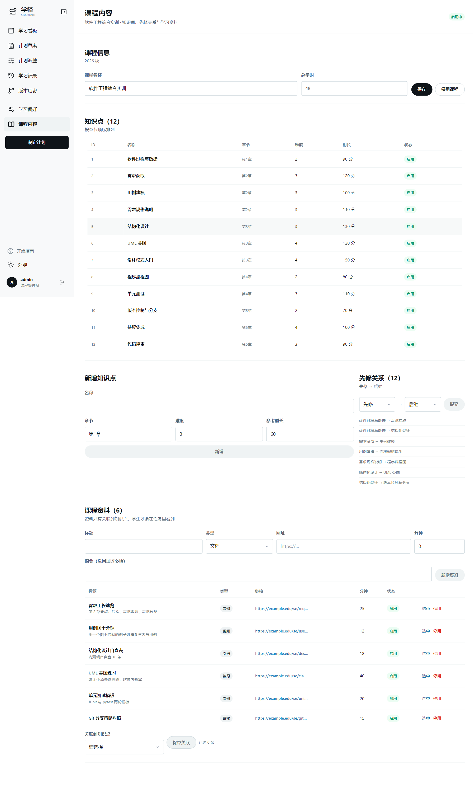

### 2.2 性能

#### 2.2.1 精度

表 2.2 精度

| 项 | 规则 | 例子 |
|---|---|---|
| 时间粒度 | 分钟；界面显示 `HH:MM` | `19:00–20:24` |
| 学习/练习拆分 | 学习时长 = ⌊0.70 × 任务总时长⌋（向下取整） | 总 90 分钟 → 学习 63 + 练习 27（不是 62/28） |
| 单片上限 | 单片不超过 120 分钟；切完必须合计不变 | 覆盖为 135 分钟 → 2 片（120 + 15），合计 135 |
| 缓冲 | B = ⌈0.10 × C⌉（向上取整） | C = 2340 分钟 → B = 234，C′ = 2106 |
| 完成率 | 已完成任务数 ÷ 总任务数，保留 3 位小数，界面显示百分比 | 1/22 → `5%` |

#### 2.2.2 时间特性

以下为 2026-11-09 实测（本机 i5 / 16 GB，模型 `deepseek-flash`）：

表 2.3 时间特性

| 操作 | 实测 | 上限 |
|---|---|---|
| 打开看板（首屏，22 个任务） | < 1 s | 3 s |
| 一句话解析（走真实模型） | 均值 0.95 s，P95 1.20 s | 10 s（超时自动降级） |
| 一句话解析（规则命中） | < 0.02 s | — |
| 生成草案（22 任务 / 30 片） | < 1 s | 5 s |
| 打卡后看板刷新 | < 0.5 s | 2 s |

#### 2.2.3 灵活性

表 2.4 灵活性

| 变化 | 系统的适应方式 |
|---|---|
| 某天没时间 | 在「学习偏好」里把该日从可用时间中取消，或用排除日期 |
| 目标变了 | 「计划调整」选"目标变了"，改完重排，确认后生成新版本 |
| 进度落后 | 看板出现"已逾期 N 小时"提示，一键去调整；顺延后旧版本仍可对比 |
| 估时不准 | 「计划草案」里直接改某个任务的分钟数再重排（不影响课程原始参考时长） |
| 模型不可用 | 自动退回规则解析，界面标注"规则解析"，已填字段不丢 |

### 2.3 安全保密

表 2.5 安全保密

| 项 | 说明 |
|---|---|
| 口令存储 | 只存加盐哈希，任何人（含管理员）看不到明文 |
| 登录保护 | 连续 5 次输错锁定 5 分钟，界面显示剩余秒数 |
| 会话 | 登录令牌 24 小时过期；过期后自动回到登录页 |
| 数据隔离 | 学生只能读写自己的计划；访问他人计划返回"不存在"（不泄露是否存在） |
| 角色隔离 | 课程内容维护仅管理员可用；学生调用写接口返回"无权限" |
| 日志 | 记录请求号、路径、耗时、错误码；不记录口令与令牌 |
| 密钥 | 大模型密钥只存服务器本地配置文件，不写入代码仓库 |

---

## 3 运行环境

### 3.1 硬设备

学生端不需要专门硬件，只要一台能上网的电脑或平板：

表 3.1 硬设备

| 项 | 最低要求 | 建议 |
|---|---|---|
| 处理器 | 双核 1.6 GHz | 四核 |
| 内存 | 4 GB | 8 GB |
| 显示器 | 1280 × 720 | 1440 × 900 以上（周课表能一屏放下） |
| 网络 | 能访问服务器 5173 端口 | 同网段 |

服务器端要求（由课程管理员维护，详见 D12）：4 GB 内存、10 GB 可用磁盘、可出网访问模型服务。

### 3.2 支持软件

表 3.2 支持软件

| 类别 | 要求 |
|---|---|
| 浏览器 | Chrome / Edge 100 以上，Firefox 100 以上，Safari 16 以上；不支持 IE |
| 操作系统 | Windows 10+、macOS 12+、主流 Linux 桌面 |
| 屏幕阅读 | 支持键盘操作；弹层按 Esc 关闭；表单控件带可读标签 |
| 主题 | 浅色 / 深色 / 跟随系统三档，选择会被记住 |

### 3.3 数据结构

你不必了解数据库，只需知道系统保存了三类数据：

表 3.3 数据结构

| 类别 | 内容 | 谁能看 |
|---|---|---|
| 课程数据 | 知识点、先修关系、学习资料、参考时长 | 所有人可读，仅管理员可改 |
| 你的计划 | 约束、草案、已确认版本、任务与片 | 只有你自己 |
| 你的记录 | 打卡、更正、备注（只追加，不删除、不改写） | 只有你自己 |

> 记录一旦提交就不能删除：写错了用"更正"，系统会保留"更正了哪一条"的指向。这是为了保证进度统计可追溯。

---

## 4 使用过程

软件功能与参与者的关系如下：

```
        ┌──────────────┐        填写目标/时间        ┌──────────────┐
        │   学生       │ ─────────────────────────▶ │              │
        │ alice        │ ◀───────────────────────── │   学径       │
        └──────────────┘   课表 / 草案 / 校验报告    │  StudyPath   │
               │ 打卡 / 更正 / 调整                  │              │
               └───────────────────────────────────▶ │              │
        ┌──────────────┐   维护知识点/先修/资料      │              │
        │ 课程管理员   │ ─────────────────────────▶ │              │
        │ admin        │ ◀───────────────────────── │              │
        └──────────────┘   环路提示 / 引用影响        └──────────────┘
```

### 4.1 安装与初始化

学生端**无需安装**。管理员完成部署后，把访问地址发给学生即可。

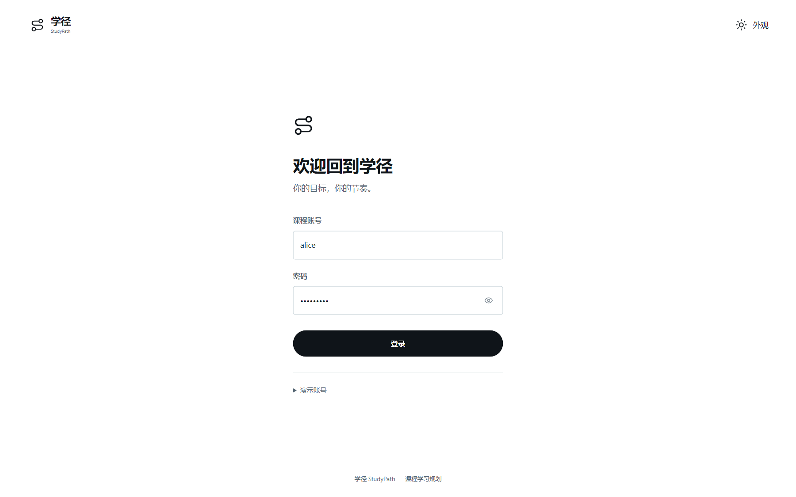

首次使用按以下顺序操作（约 5 分钟）：

表 4.1 安装与初始化

| 步骤 | 操作 | 界面反馈 |
|---|---|---|
| 1 | 打开 `http://<服务器地址>:5173` | 出现登录页，左侧为品牌说明，右侧为账号口令 |
| 2 | 输入账号与口令，点「登录」 | 进入「学习看板」；首次登录会弹出三步引导 |
| 3 | 引导里点「稍后设置」或走完三步 | 引导只出现一次，之后可在左下角「开始指南」重新打开 |
| 4 | 点左侧「学习偏好」 | 进入约束页，按 §4.2 填写 |
| 5 | 保存约束后到「计划草案」点「生成草案」 | 看到任务清单与校验结果 |
| 6 | 校验通过后点「确认生效」 | 生成 v1，看板出现彩色时间块 |

首次登录会弹出三步引导（外观 → 视图偏好 → 开始使用），可随时点「稍后设置」跳过；引导每个账号只出现一次，之后可在左下角「开始指南」重新打开。

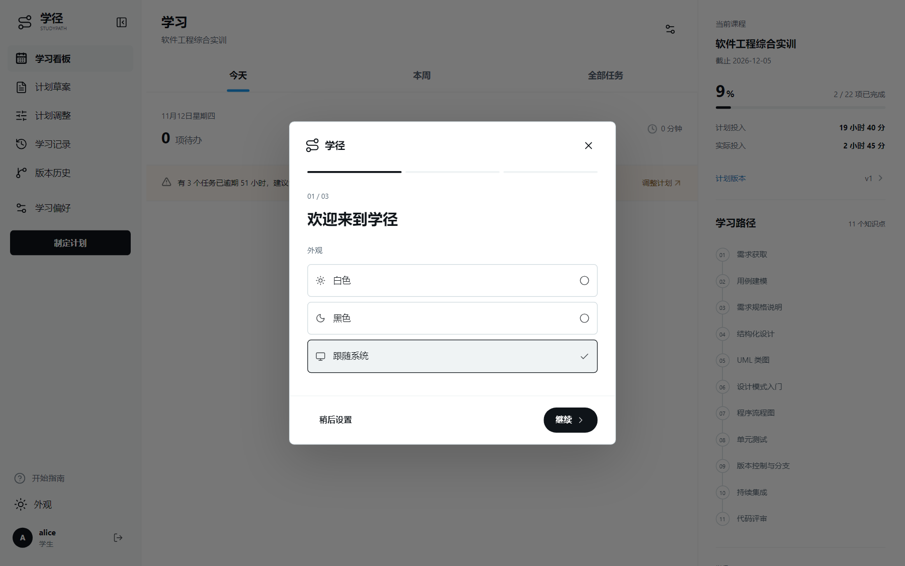

### 4.2 输入

#### 4.2.1 输入数据的现实背景

表 4.2 输入数据的现实背景

| 项 | 说明 |
|---|---|
| 何时产生 | 学期初制定计划时（一次性）；学期中时间或目标变化时（偶尔） |
| 频率 | 建计划 1 次；调整通常 1–3 次/学期；打卡每天 1–4 次 |
| 来源 | 学生本人；管理员维护课程内容 |
| 录入方式 | 键盘输入 + 鼠标点选（可用时间用格子点选，不用手打时间段） |
| 限制 | 只有登录本人能录入自己的约束；课程内容只有管理员能录入 |
| 质量保证 | 每个字段都有校验：越界立即提示，且不清空已填内容 |
| 数据归属 | 约束与计划属于学生个人；课程内容属于课程，所有学生共享 |

#### 4.2.2 输入格式

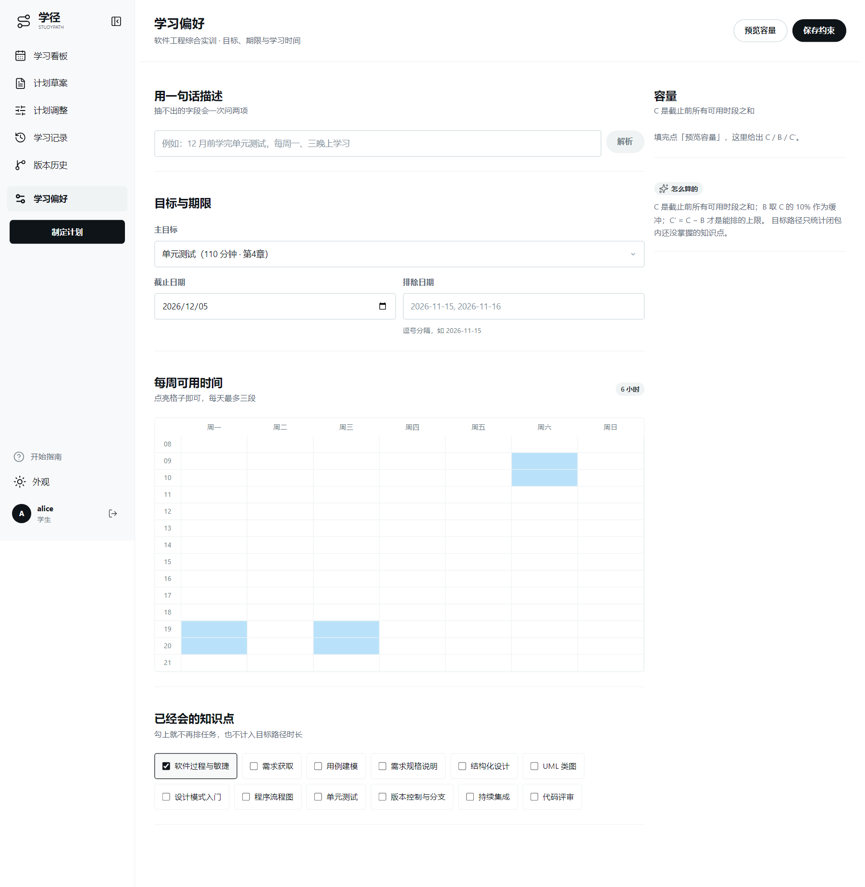

「学习偏好」页字段规则：

表 4.3 输入格式

| 字段 | 控件 | 必填 | 规则 | 出错提示 |
|---|---|---|---|---|
| 一句话描述 | 文本框 | 否 | 自然语言，建议包含"学什么 + 多久" | 解析失败时提示"还差：…"，可继续补充 |
| 主目标 | 下拉选择 | 是 | 必须是本课程已启用的知识点 | 未选时不可保存 |
| 截止日期 | 日期选择 | 是 | 不得早于今天；不超过 180 天 | 「截止日期不能早于今天」 |
| 每周可用时间 | 7×14 格子 | 是 | 点选即选中；每天最多 3 段、合计不超过 8 小时 | 「每天最多三段」 |
| 排除日期 | 文本框 | 否 | 逗号分隔，格式 `2026-11-15`；不能覆盖整个区间 | 「排除日期把区间盖满了」 |
| 已掌握 | 复选框 | 否 | 只能是本课程知识点（可含先修） | 「已掌握集合包含非本课程的知识点」 |

「计划草案」页的时长编辑：

表 4.4 草案页的时长编辑规则

| 字段 | 规则 |
|---|---|
| 任务时长 | 1–1440 分钟；改完点「按新时长重排」才生效 |
| 覆盖含义 | 只改本次规划值，不改课程里的原始参考时长 |

#### 4.2.3 输入举例

**例 1（正常）**：先点选「周一 19:00–21:00」「周三 19:00–21:00」「周六 09:00–11:30」，主目标选「单元测试」，截止填 `2026-12-20`，排除日期填 `2026-11-15`，已掌握勾「软件过程与敏捷」。
系统反馈：C = 2340 分钟，B = 234，C′ = 2106，目标路径 1180 分钟，判定"时间够用"。

**例 2（时间不够）**：只选「周六 09:00–10:00」，截止 `2026-11-20`，目标选「单元测试」。
系统反馈：C = 60，C′ = 54，目标路径 1180，判定"排不下"，并在草案里把无法安排的任务列进「未排入」并说明原因。

**例 3（一句话）**：在「一句话描述」里输入 `我想把那块讲数据流的东西学会，两周内`，点「解析」。
系统反馈：右上角出现「模型解析」标识，自动填好目标（结构化设计）与截止日期（两周后），并追问"每周哪些时间段方便学习？"。

### 4.3 输出

#### 4.3.1 输出数据的现实背景

表 4.5 输出数据的现实背景

| 输出 | 给谁看 | 用来干什么 | 频率 |
|---|---|---|---|
| 本周课表 | 学生 | 知道每天几点学什么 | 每天打开 |
| 今日清单 | 学生 | 今天要做几件事、多久 | 每天 1–3 次 |
| 计划草案与校验报告 | 学生 | 确认前判断这份计划是否可行 | 建计划/调整时 |
| 版本差异 | 学生 | 知道这次调整改了什么 | 每次调整后 |
| 进度环与统计 | 学生 | 判断是否落后 | 每天 |
| 知识点与先修表 | 管理员 | 维护课程结构 | 学期初 |

#### 4.3.2 输出格式

看板的三种视图与深色外观如下：

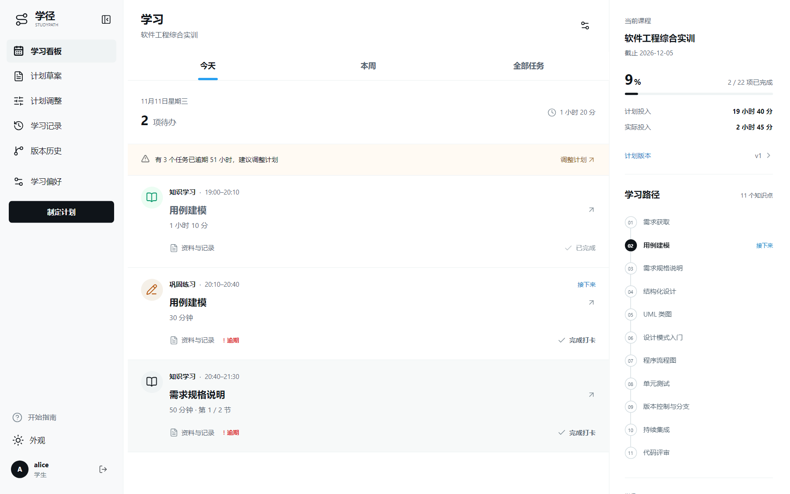
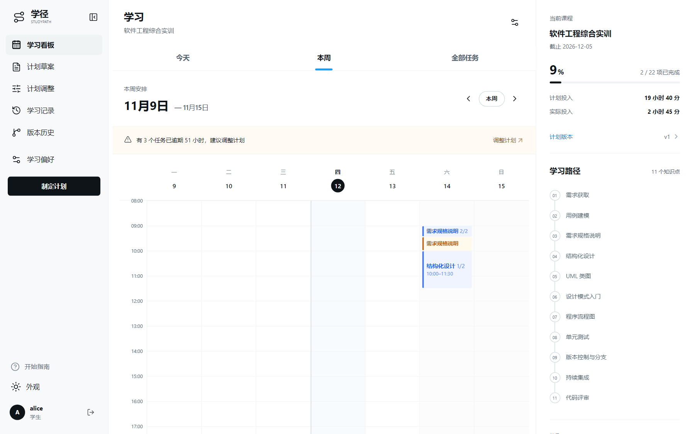
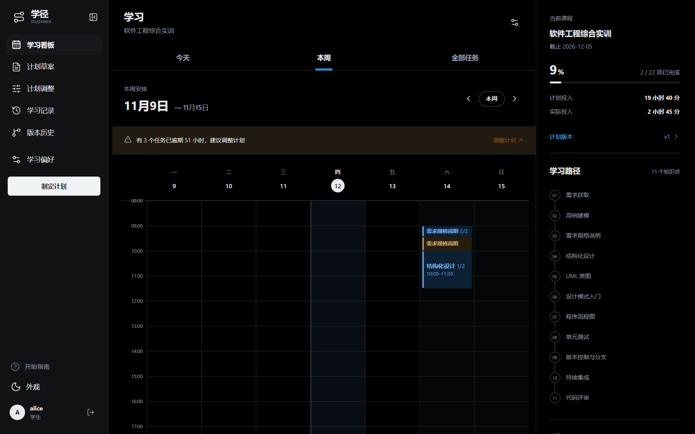

表 4.6 输出格式

| 输出 | 结构 |
|---|---|
| 课表时间块 | 颜色区分类型（学习蓝 / 练习琥珀 / 完成绿 / 逾期红）；左侧色条 + 标题 + 起止时间；多片任务标 `2/2` |
| 草案清单 | 表头为「知识点 / 类型 / 时长 / 片数 / 首片」，每行可编辑时长 |
| 校验报告 | 每行 `错误码 + 说明 + 建议`，ERROR 用红色、WARN 用橙色 |
| 版本差异 | 四类计数：新增 / 移除 / 移动 / 时长变化 |
| 进度 | `2 / 22 项已完成` + 百分比环 + 计划投入 / 实际投入 |

#### 4.3.3 输出举例

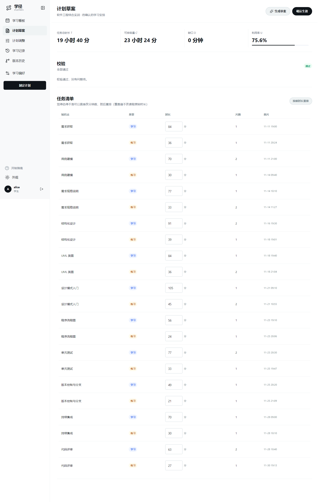

确认 v1 后，看板右栏显示：

```
当前课程    软件工程综合实训
            截止 2026-12-05
5 %         1 / 22 项已完成
计划投入    19 小时 40 分
实际投入    1 小时 35 分
```

课表里，"用例建模（学习）19:00–20:10"是蓝色块，"用例建模（练习）20:10–20:40"是琥珀色块；已打卡的块变绿并带勾；过了结束时间还没打卡的块变红并标「逾期」。

### 4.4 数据查询

系统提供五条查询路径，都在界面上直接可用，无需记命令：

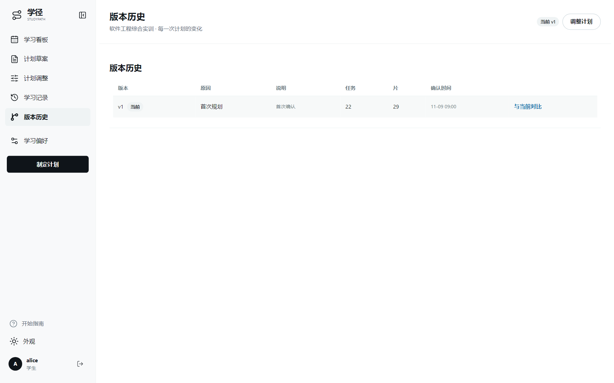
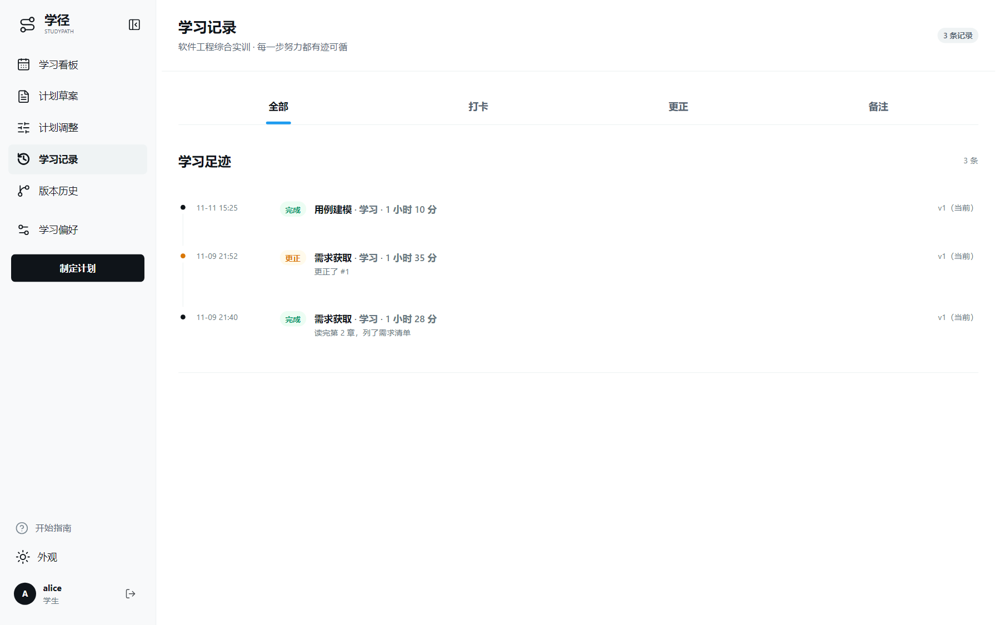

表 4.7 数据查询

| 查询需求 | 入口 | 说明 |
|---|---|---|
| 今天要做什么 | 看板 →「今天」 | 只列今天的任务，附剩余项数与预计时长 |
| 这周怎么安排 | 看板 →「本周」 | 周课表；可「上一周 / 本周 / 下一周」翻页 |
| 全周期有哪些任务 | 看板 →「全部任务」 | 按日期分组列出全部任务 |
| 以前改过什么 | 「版本历史」→「与当前对比」 | 选任一版本对比当前，看四类差异 |
| 我哪天打了卡 | 「学习记录」 | 全部事件倒序；可按打卡 / 更正 / 备注筛选 |

### 4.5 出错处理和恢复

#### 4.5.1 常见提示与处理

表 4.8 常见提示与处理

| 提示（错误码） | 含义 | 你该怎么做 |
|---|---|---|
| E1001 参数不合法 | 某个字段格式不对 | 看提示里的"字段"名，改完再提交 |
| E1002 不存在 | 记录不存在，或不是你的 | 确认是否登录了正确账号 |
| E1003 状态不允许 | 例如未确认就打卡、重复打卡 | 按提示先确认计划；改用时用「更正」 |
| E2001 先修成环 | 课程结构里有环 | 联系管理员删掉一条先修关系 |
| E2004 版本冲突 | 你的草案已过期（别处改过） | 重新「生成草案」再确认 |
| E4001 未认证 | 登录已过期（24 小时） | 重新登录 |
| E4003 无权限 | 学生调用了管理员功能 | 需要改课程内容时联系管理员 |
| E9000 内部错误 | 服务端异常 | 稍后重试；持续出现请把"请求号"报给管理员 |

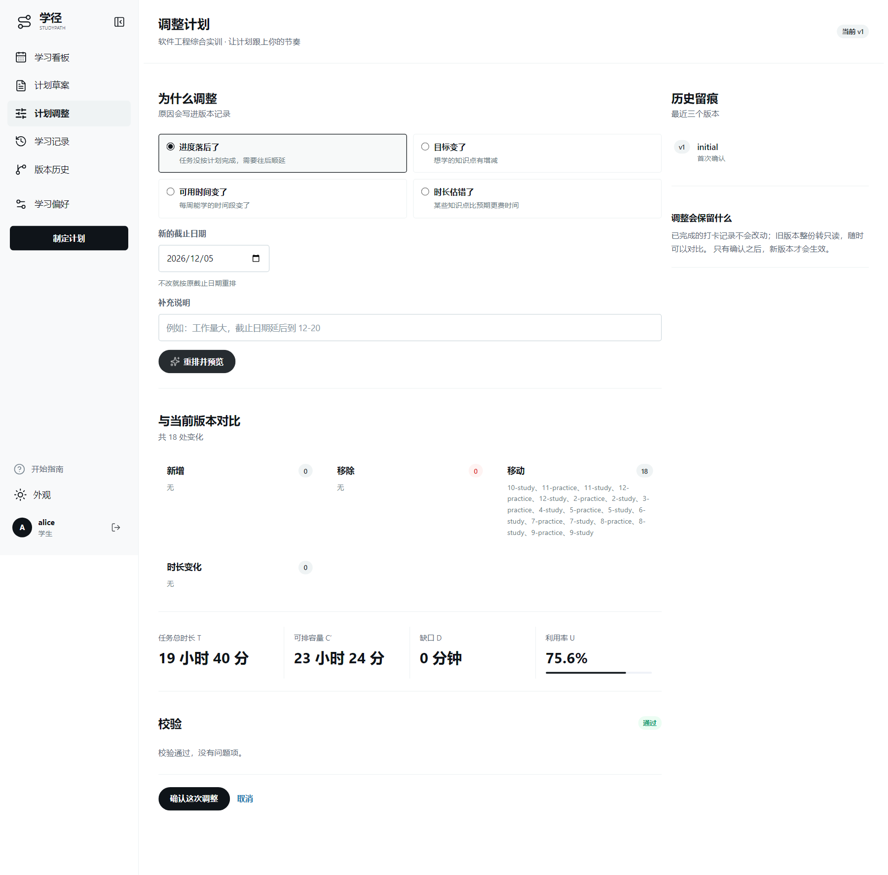

#### 4.5.2 恢复步骤

表 4.9 恢复步骤

| 情况 | 恢复方式 |
|---|---|
| 填了一半刷新页面 | 已保存的约束会重新加载；未保存的内容需要重填 |
| 误点「确认生效」 | 版本不可撤销。可立即「计划调整」重排并确认新版本，旧版本留作对比 |
| 打卡打错了时间 | 用「更正用时」，系统保留更正链 |
| 模型解析失败 | 界面会提示"已降级为规则解析"，功能仍可用；也可稍后重试 |
| 页面白屏或报错 | 刷新一次；仍不行请记录浏览器版本与"请求号"报给管理员 |

### 4.6 浏览器操作

表 4.10 浏览器操作

| 操作 | 说明 |
|---|---|
| 键盘 | Tab 依次聚焦；弹层打开后焦点在弹层内，按 Esc 关闭并回到原来的位置 |
| 跳过导航 | 页面最上方第一个 Tab 停点是「跳到主要内容」 |
| 深色模式 | 左下角「外观」选择浅色 / 深色 / 跟随系统，选择会被记住 |
| 窗口宽度 | 1280 以上周课表可完整显示；小屏时周课表可左右滑动，底部出现五个导航按钮 |
| 打印/截图 | 用浏览器自带打印即可；课表为浅底深字，黑白打印仍可分辨（状态另有文字标注） |
| 移动端 | 窄屏时底部出现五项导航；周课表可左右滑动（见 图 4-12） |


---

## 附录 A 插图清单

表 A.1 插图清单

| 图号 | 标题 | 文件 |
|---|---|---|
| 图 4-1 | 登录页 | `images/d11-4-01-login.png` |
| 图 4-2 | 首次登录的三步引导 | `images/d11-4-02-onboarding.png` |
| 图 4-3 | 学习看板（今天） | `images/d11-4-03-board-today.png` |
| 图 4-4 | 学习看板（本周） | `images/d11-4-04-board-week.png` |
| 图 4-5 | 学习看板（深色外观） | `images/d11-4-05-board-dark.png` |
| 图 4-6 | 学习偏好页 | `images/d11-4-06-constraint.png` |
| 图 4-7 | 计划草案 | `images/d11-4-07-draft.png` |
| 图 4-8 | 计划调整 | `images/d11-4-08-adjust.png` |
| 图 4-9 | 版本历史 | `images/d11-4-09-versions.png` |
| 图 4-10 | 学习记录 | `images/d11-4-10-timeline.png` |
| 图 4-11 | 课程内容（仅管理员） | `images/d11-4-11-admin.png` |
| 图 4-12 | 移动端（390 px） | `images/d11-4-12-mobile.png` |

截图口径：2026-11-11 20:30 的演示库（22 个任务、2 个已完成）；桌面端 1440×900，移动端 390×844；除图 4-6、4-7、4-8、4-11 为整页长图外，其余为视口截图。
